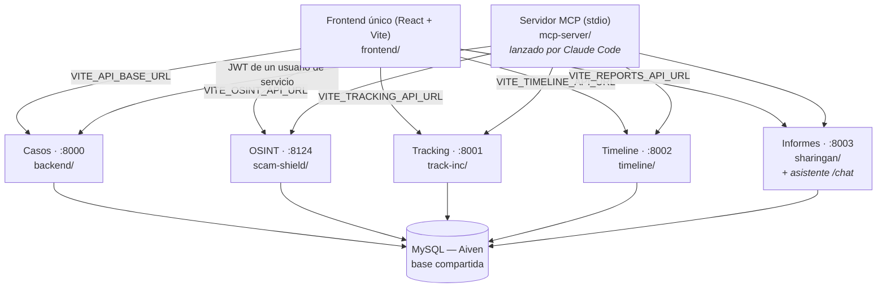
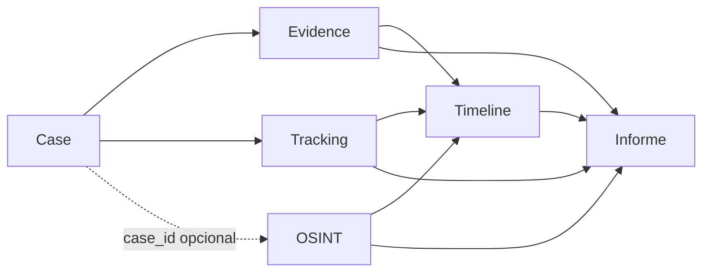

# DFIR-Nexus

> **Copia de consulta.** Esta carpeta es un snapshot del proyecto, cuyo desarrollo continúa en un repositorio privado. Para más información, acceso a la instancia publicada o hacer uso de la herramienta, ponte en contacto: [dcarpioortiz@gmail.com](mailto:dcarpioortiz@gmail.com) · [LinkedIn](https://www.linkedin.com/in/david-carpio-ortiz/).

Plataforma modular de apoyo a la investigación forense digital (DFIR): centraliza la gestión de **casos** y **evidencias** periciales y coordina, alrededor de un identificador común (`case_id`), el resto del flujo de trabajo — análisis OSINT, tracking post-incidente, cronología del caso e informe final.

Desarrollado como práctica de un Máster de Ciberseguridad e Inteligencia Artificial. Este documento describe el estado **real** de la rama `development`.

---

## Objetivo

DFIR-Nexus no sustituye al perito ni automatiza decisiones forenses. Su objetivo es reducir el trabajo repetitivo alrededor de una investigación — mantener casos y evidencias ordenados, correlacionar lo que otros módulos van generando sobre un mismo caso, y dejar un rastro verificable de qué se hizo, cuándo y sobre qué evidencia — para que ese trabajo no dependa de hojas de cálculo sueltas ni de copiar y pegar entre herramientas. Desde la incorporación del servidor MCP (ver [Servidor MCP](#servidor-mcp)), ese mismo trabajo también se puede pedir en lenguaje natural a un agente de IA (Claude), que opera contra la misma API REST que ya usa el frontend — nunca contra la base de datos directamente.

---

## Estado actual

Esta documentación corresponde específicamente a la rama `development`. Los cinco módulos están integrados como **backends FastAPI independientes**, comunicándose exclusivamente a través de una base de datos MySQL compartida (alojada en Aiven), nunca por llamadas HTTP entre ellos.

Resumen del estado, módulo a módulo:

| Módulo | Estado | Tests (última ejecución completa) |
|---|---|---|
| **Cases / Evidence** (núcleo) | Implementado: CRUD, borrado lógico, máquina de estados, integridad, auditoría, identidad de la plataforma (JWT/roles), perfil de usuario | 127/127 |
| **OSINT** | Implementado: 12 tipos de análisis contra fuentes externas reales, vinculación opcional con un caso, endpoints protegidos por JWT | 419/419 |
| **Tracking** | Implementado: análisis de logs por piezas (parser + clasificador + extracción de IOC), cadena de integridad local, endpoints protegidos por JWT | 304/304 |
| **Timeline** | Implementado: agregación de eventos de Evidence/Tracking/OSINT, visualización con gráfico por carriles de origen, endpoints protegidos por JWT | 16/16 |
| **Informes** | Implementado: generación de informe con narrativa asistida por IA, **asistente conversacional sobre el expediente**, endpoints protegidos por JWT | 219/219 |
| **Frontend** | Implementado (React): login, guard de rutas, perfil de usuario, panel de inicio y asistente; sin tests automatizados propios | — |
| **Servidor MCP** (`mcp-server/`) | Implementado: 22 tools (13 lectura, 8 escritura con confirmación explícita, 1 análisis) contra los 5 backends, vía HTTP/REST — ver [Servidor MCP](#servidor-mcp) | 299/299 |

**1395 tests pasando** en el conjunto de los 5 backends más el servidor MCP (1093 + 302), sin ninguno desactivado ni debilitado. El frontend compila y pasa lint (`tsc -b`, `oxlint`) pero no tiene suite de tests propia — ver [Limitaciones conocidas](#limitaciones-conocidas).

Además de los cinco módulos, la plataforma tiene dos pantallas que no son módulos de la arquitectura porque no poseen ninguna tabla: un **panel de inicio** (`/dashboard`), que solo cuenta lo que Casos y OSINT ya publican, y el **asistente conversacional** (`/chat`), que lo sirve el backend de Informes. El **servidor MCP** tampoco es un sexto módulo del dominio forense (no posee ninguna tabla): es un sexto *proceso*, un cliente más de la misma API REST que ya consume el frontend.

Hay un **despliegue del stack completo en contenedores** (`deploy/`, cinco backends detrás de un gateway nginx que además sirve el frontend compilado), aparte del entorno de desarrollo local con el lanzador — ver [Despliegue](#despliegue).

---

## Funcionalidades

### Cases y Evidence — núcleo del sistema

Todos los demás módulos se relacionan con el sistema a través de un caso (`case_id`). Cases/Evidence es, además, el módulo con mayor endurecimiento reciente:

- CRUD de casos y evidencias, con **ver detalle, editar y eliminar accesibles directamente desde el listado** (iconos por fila), no solo desde un panel lateral que antes dependía del ancho de la ventana.
- **Borrado lógico, nunca físico**: `DELETE` marca `eliminado`/`fecha_eliminacion` en lugar de borrar la fila; una evidencia nunca queda huérfana de un caso inexistente.
- **Máquina de estados validada**: transiciones explícitas entre `abierto`/`en_progreso`/`cerrado`/`archivado`; `archivado` es terminal e inmutable.
- **Integridad de Evidence**: `hash_valor` (SHA-256) calculado una única vez sobre el contenido probatorio (`valor`) al crear la evidencia; `tipo`/`valor` son inmutables después de creada (solo se pueden anotar `observaciones` o completar `fecha_adquisicion`); endpoint dedicado para volver a verificar esa huella en cualquier momento.
- **Auditoría** (`case_audit_log`): registra creación, actualización, cambio de estado y eliminación de un caso, y alta/edición/baja de cada evidencia, con marca de tiempo y detalle de qué cambió.
- **Timestamps diferenciados**: `fecha_creacion`/`fecha_subida` (alta del registro) y `fecha_actualizacion` (última modificación administrativa) se mantienen separadas de `fecha_adquisicion` (cuándo ocurrió el hecho forense, si se conoce) — nunca se confunden entre sí.

### Autenticación y autorización

Identidad centralizada en Casos, el único backend que posee la tabla `users`; los otros cuatro nunca la leen ni la escriben, solo validan el JWT que Casos emite.

- **JWT sin estado (HS256)**: `POST /auth/login` devuelve un token con el mínimo payload necesario (`sub`, `role`, `iat`, `exp`, caducidad corta) firmado con un secreto compartido por los 5 backends vía `.env`. Sin refresh tokens ni revocación inmediata — decisión explícita, documentada como evolución futura, no como olvido.
- **Contraseñas con Argon2id**, nunca en claro; el primer administrador se crea con `scripts/bootstrap_admin.py` (contraseña por variable de entorno o interactiva), nunca con un valor fijo en una migración.
- **Dos roles**: `analyst` (todas las operaciones funcionales) y `admin` (las mismas más gestión de usuarios y `DELETE /cases/{id}`) — `admin` es un superconjunto estricto, no un permiso distinto.
- **Cada backend valida el JWT de forma local e independiente**: la misma dependencia de FastAPI (verificación de firma/caducidad) está deliberadamente **duplicada**, no importada, en los 5 — ninguno de los 4 backends no-Casos posee código del backend de Casos, ni una librería compartida los une.
- **`POST /cases/{id}/auditoria/osint`** (la única llamada HTTP entre dos backends de negocio, ver más abajo) no se protege como un endpoint de usuario normal: exige una cabecera `X-Service-Token` propia de esa integración, distinta del JWT, que autentica al backend de OSINT como llamador legítimo; si además llega el JWT del usuario que originó la acción en OSINT, se usa solo para resolver `actor` con su nombre real, nunca como condición de acceso.
- **`auth_audit_log`**, separado de `case_audit_log` (un login no es un hecho sobre un caso): login correcto/fallido, alta/baja/reactivación de usuario, cambio de rol y cambio de la propia contraseña.
- **Frontend**: pantalla `/login`, sesión en `localStorage` (solo el JWT, nada más), guard de rutas (protección de UX, la autorización real siempre ocurre en el backend), cabecera `Authorization: Bearer` añadida por los 5 clientes HTTP, cierre de sesión automático ante un `401` de una petición autenticada, logout desde la navegación, y una pantalla **`/perfil`** (información de la cuenta, sesión, cambio de contraseña propio y actividad reciente de `auth_audit_log`).

### OSINT

Doce tipos de análisis (dominio, email, IP, wallet cripto, teléfono, imagen/reconocimiento facial, typosquatting, verificación CNMV/FCA, monitorización continua...) contra fuentes externas reales (VirusTotal, AbuseIPDB, Etherscan/Tron, entre otras), con degradación controlada si una API externa falla o no tiene clave configurada. Mantiene su propia cadena de integridad interna (`integrity_ledger`).

**Atribución a un caso, por dos vías.** Un análisis pertenece a un expediente a través de `osint_findings.case_id`, que es lo único que leen Timeline e Informes: sin él, el análisis existe pero no aparece en el informe pericial de ningún caso ni en su cronología.

- **Antes de analizar** — el selector «Expediente» de la cabecera del módulo fija el caso activo para todas las pestañas, y los nueve endpoints de análisis lo reciben en la propia petición. Es una elección por sesión de trabajo, no por pantalla: un perito analiza el dominio, la IP y el teléfono del mismo expediente, y repetir la elección nueve veces sería nueve ocasiones de olvidarla. Se puede dejar en «sin expediente» —una consulta suelta de reputación es un uso legítimo— y entonces la cabecera avisa de lo que eso implica, en vez de dejar que se descubra al generar un informe con el Anexo B vacío.
- **Después** — desde `/osint/cases`, cada una de las 8 investigaciones que lista esa pantalla puede vincularse, cambiarse o desvincularse en cualquier momento (columna "Caso" + selector por fila). Un único endpoint genérico (`PATCH /osint-cases/{tipo}/{id}/vinculacion`) sirve a los 8 tipos; el cambio se sincroniza en la tabla de origen **y** en `osint_findings` dentro de la misma transacción, y queda registrado en la auditoría del caso — ver Integridad y auditabilidad.

Las dos vías escriben el mismo campo. La segunda es la red de seguridad; la primera es la que evita necesitarla.

### Tracking

Sube un fichero de log (detecta su codificación y varios formatos de timestamp, incluido syslog sin año) y lo clasifica automáticamente (severidad `baja`/`media`/`alta`/`critica`) mediante un motor de reglas configurable con técnicas MITRE ATT&CK asociadas, no por introducción manual de eventos. Sube a vista previa antes de guardar — nada se persiste hasta que el analista confirma.

- **Extracción de indicadores (IOC)**: IP pública/privada, dominio, URL, ruta, hash y correo, cada uno con su procedencia (`comando`, `salida` o `decodificado`) — se calculan al analizar y viajan en la respuesta de la API, sin persistirse en `tracking_events` (que mantiene exactamente el esquema oficial). Decodifica automáticamente `powershell -EncodedCommand` (y sus abreviaturas) para clasificar y extraer indicadores también del contenido decodificado, sin ejecutarlo nunca.
- **Deduplicación por huella**: cada análisis devuelve el SHA-256 del log subido y cuántos de sus eventos ya están guardados en ese caso, para avisar antes de duplicar (`409`, salvo que se fuerce explícitamente).
- Mantiene su propia cadena de integridad hash local sobre los eventos guardados, y listados paginados (`skip`/`limit`, mismo patrón que Casos y OSINT).
- `case_id` es obligatorio y se valida contra la base compartida. No tiene todavía ningún vínculo directo con Evidence.

### Timeline

Agrega en una única cronología ordenada los eventos de `evidences`, `tracking_events` y `osint_findings` de un caso, leyendo esas tablas directamente (sin importar el código de otros backends). El recálculo es bajo demanda (`POST /timeline/cases/{id}/refresh`, un único commit atómico), no automático: si se añade una evidencia o un evento de tracking después del último recálculo, la timeline no se actualiza sola — la cabecera muestra "Última actualización: hace X" para que quede claro cuándo se pidió por última vez. Al cambiar de caso, la carga es automática (silenciosa, con un pequeño debounce). Excluye evidencia eliminada lógicamente y usa la fecha real de adquisición forense cuando el Módulo 1 la conoce.

**Dos formas de verla**: tabla (por defecto) o un gráfico con un carril por origen (Evidencia/Tracking/OSINT) que comprime los huecos temporales mayores de 12h y permite seleccionar un evento para ver su detalle. Es un SVG propio, no la librería `vis-timeline` — sin zoom/pan interactivo todavía (documentado como v1 en el propio componente).

### Informes

Genera un informe pericial (PDF/DOCX/HTML/JSON) con una narrativa redactada por un modelo de Anthropic a partir de los eventos reales de la timeline del caso — cada afirmación de la narrativa debe citar un evento concreto (`[E1]`, `[E2]`...) y el informe se rechaza si alguna cita no corresponde a un evento real. Archiva el prompt completo usado y firma cada fichero emitido con SHA-256, verificando esa huella en cada descarga posterior.

### Asistente conversacional

Responde preguntas en lenguaje natural sobre un caso concreto o sobre la propia metodología forense. No es un módulo aparte: lo sirve el backend de Informes (`POST /chat`, `POST /chat/stream`), que es el que ya tenía el cliente de IA y la lectura de las seis tablas del contrato.

Cuatro propiedades que lo definen, y las cuatro son restricciones deliberadas antes que funcionalidades:

- **Solo lee.** No escribe en ninguna tabla ni crea ninguna propia; el historial de la conversación vive en el navegador y viaja en cada petición. El backend es sin estado.
- **El reparto es «el servidor recopila, el modelo redacta»**, no un bucle de agente con herramientas. El `case_id` lo fija la petición y lo aplica el código, nunca el modelo: en cuanto el modelo elige qué consultar, el aislamiento entre casos pasa a depender de que se porte bien, y una instrucción en un prompt no es un control de acceso.
- **Aislamiento por caso aplicado por código.** No existe consulta que alcance un caso distinto del que se pidió. Es independiente de la autenticación y hacen falta las dos: el JWT impide entrar sin ser nadie, el aislamiento impide que quien ya entró lea otro expediente.
- **Citas verificadas.** Cada fila del expediente entra numerada (`[EV3]`, `[TR7]`…) y después se comprueba contra la base que toda cita del texto existe. Las inventadas se retiran y se sustituyen por `[sin respaldo]` con un aviso visible, en vez de descartar la respuesta entera: el analista ve exactamente qué parte no está respaldada.

**El expediente llega por el servidor MCP, no por la base** (`CHAT_CONTEXTO=mcp`, el valor por defecto). El backend lanza el `mcp-server/` como proceso hijo por stdio, con el JWT del analista que pregunta, y lee el caso con seis herramientas de solo lectura. Así el asistente no tiene acceso directo a la base: ve lo que los endpoints de los cinco módulos le dan a ese analista, y nada más. Lo que no cambia es lo importante: **quien llama al MCP es el código, con el `case_id` de la petición; el modelo sigue sin herramientas.** Convertirlo en un agente que llamara él mismo al MCP le daría *más* acceso, no menos: elegiría qué caso consultar, y el aislamiento entre casos dejaría de ser un control para convertirse en una instrucción. Comprobado contra los datos reales: en los seis casos de demostración el texto que recibe el modelo es idéntico byte a byte por MCP y por SQL, y la batería de inyección del caso #22 se sigue resistiendo. `CHAT_CONTEXTO=sql` vuelve a la lectura directa.

El motor es la **API de Anthropic** (`CHAT_PROVIDER=anthropic`, el valor por defecto). Existe una segunda vía completa con un modelo local vía Ollama, probada y a una variable de distancia, que evita que el expediente salga de la máquina; no se usa porque sin GPU responde a ~3,5 tokens/s, del orden de cinco minutos por pregunta. La contrapartida del motor elegido está dicha en [Seguridad](#seguridad): el expediente entra en el prompt y por tanto se envía a un tercero.

### Panel de inicio

`/dashboard`, la pantalla a la que se entra tras iniciar sesión. Cuenta casos por estado y análisis OSINT por nivel de riesgo con **dos peticiones y solo dos**, así que cuesta lo mismo con dos casos que con cien.

Declara en su propia interfaz qué **no** cuenta y por qué: tracking, cronología e informes solo se exponen caso a caso (`/cases/{id}/tracking/events`, `/timeline/cases/{id}`, `/cases/{id}/reports`), así que un total exigiría una petición por caso. La alternativa correcta es que cada módulo publique un endpoint de recuento, no simularlo desde el frontend.

### Relación entre módulos

Ningún backend llama por HTTP a otro backend para obtener datos de negocio: cada uno lee directamente, con SQL propio, las tablas de otros módulos que necesita (nunca importa su código Python), y la única relación estructural entre todas las tablas es `case_id`. Dos excepciones, ambas deliberadas y estrechas: frontend → backend (el frontend de Casos llama por HTTP a Tracking/Timeline/Informes/OSINT para poblar su propia interfaz), y OSINT → Casos al vincular una investigación con un caso, para dejar constancia en la auditoría de ese caso (`POST /cases/{id}/auditoria/osint`, protegida por `X-Service-Token` — ver Autenticación y autorización) — nunca para leer ni escribir datos de negocio, y si esa llamada falla el vínculo ya persistido en OSINT no se deshace. La verificación de JWT es la única pieza de código que se repite igual en los 5 backends, y es deliberado: cada uno la lleva por duplicado, no importada, precisamente para no crear un sexto componente ni una dependencia entre ellos.

---

## Arquitectura



- **Frontend**: React + Vite + TypeScript, un único punto de entrada (`localhost:5173`) con un módulo por dominio (`modules/cases`, `modules/osint`, `modules/tracking`, `modules/timeline`, `modules/reports`), cada uno hablando con su propio backend, más dos que no corresponden a ningún backend propio: `modules/chat` (habla con Informes) y `modules/dashboard` (lee de Casos y de OSINT).
- **Servidor MCP**: sexto proceso independiente, mismo principio que el frontend — habla por HTTP con los 5 backends, nunca importa su código — ver [Servidor MCP](#servidor-mcp) para el detalle completo.
- **Backends**: 5 servicios FastAPI independientes, cada uno con su propio `requirements.txt`, su propia cadena de migraciones Alembic (con tabla de versión propia, p. ej. `alembic_version_casos`) y su propio ciclo de despliegue — ninguno depende de que otro esté levantado para arrancar.
- **Base de datos**: una única instancia MySQL compartida (Aiven). Cada tabla tiene un único backend propietario que la escribe; los demás, si necesitan leerla, lo hacen con SQL directo sobre el esquema real, nunca importando el modelo ORM del dueño.
- **Patrón interno de cada backend**: `routes.py` (HTTP) → `service.py` (reglas de negocio) → `repository.py` (acceso a datos) → `models.py`/`schemas.py` (entidades ORM y contratos Pydantic) — el mismo patrón en los cinco, con app/core/ como único código transversal (configuración y sesión de base de datos).

---

## Servidor MCP

`mcp-server/` expone la plataforma como **tools invocables por un agente de IA** (Claude, vía Model Context Protocol) en vez de tener que ejecutar `curl` o abrir el frontend a mano. Transporte **stdio**: no abre ningún puerto de red propio, lo lanza Claude Code como subproceso y solo vive mientras dura la sesión. Habla exclusivamente por HTTP con los 5 backends — igual que el frontend, **nunca importa su código** — autenticado como un **usuario de servicio** propio (rol `analyst`, nunca un analista humano), con un único login contra Casos cuyo JWT reutiliza para los otros cuatro backends (comparten `JWT_SECRET`).

**22 tools:**

| Categoría | Nº | Detalle |
|---|---|---|
| Lectura | 13 | Casos, su sub-recurso Evidencias, Timeline, Informes, Tracking y OSINT — consulta y búsqueda, nunca modifican nada |
| Escritura | 8 | `recalcular_cronologia`, `crear_caso`, `cambiar_estado_caso`, `vincular_hallazgo`, `registrar_evidencia`, `guardar_eventos_tracking`, `generar_informe` (coste económico real, llamada a IA), `analizar_dominio` (red externa real, persiste un hallazgo OSINT) |
| Análisis sin persistencia | 1 | `analizar_log` — sube un fichero de log **local** (multipart, nunca base64) y devuelve una vista previa clasificada, sin guardar nada |

**Seguridad, además de la autenticación JWT normal:**
- **`confirmado: bool` obligatorio en las 8 tools de escritura**, comprobado en código *antes* de cualquier petición HTTP — con `confirmado=false` no se emite ningún tráfico de red. `ToolAnnotations` (`readOnlyHint`/`destructiveHint`) son solo informativas para el cliente MCP, nunca la barrera real.
- **`analizar_log` solo puede leer ficheros dentro de una allowlist explícita** (`MCP_ALLOWED_FILE_DIRS`, vacía por defecto — sin configurarla, se rechaza cualquier ruta). Toda ruta se resuelve con `Path.resolve()` antes de comprobarla, lo que neutraliza a la vez path traversal (`../..`) y un enlace simbólico que apunte fuera del directorio permitido.
- Ningún tool puede borrar datos: ninguna de las 22 emite nunca un `DELETE`.
- Credenciales del usuario de servicio solo en `mcp-server/.env` (nunca versionado); el JWT vive únicamente en memoria del proceso, nunca en disco ni en logs.

Deliberadamente **fuera de alcance** por ahora: `descargar_informe`, los otros 7 análisis OSINT que ejecutan trabajo real, desvincular un hallazgo, editar/borrar evidencias, `DELETE /cases/{id}` y gestión de usuarios — ver `mcp-server/README.md` para el detalle completo, tool por tool, incluida una auditoría final que revisó las 22 contra el código real de los 5 backends.

**299 tests** (277 mockados + 22 de integración real contra los backends locales, sin mocks). Para usarlo: cada persona lo registra una vez en su propia máquina con `claude mcp add dfir-nexus -s local -- ...` (scope `local`: la ruta absoluta del `venv` queda solo en `~/.claude.json`, nunca en un fichero del repositorio) — ver `mcp-server/README.md` para el paso a paso.

---

## Flujo forense



- **Case** es el punto de partida de toda investigación; **Evidence** es el material probatorio asociado a ese caso, con su propia huella de integridad.
- **Tracking** analiza logs asociados a un caso concreto (`case_id` obligatorio); **OSINT** admite asociarse a un caso de forma opcional, vinculable en cualquier momento desde `/osint/cases` — a diferencia de Evidence/Tracking, una investigación OSINT sigue siendo completamente funcional sin ningún caso asociado.
- **Timeline** correlaciona lo que ya existe de Evidence, Tracking y OSINT sobre un caso en una única cronología ordenada.
- **Informe** cierra el flujo: lee directamente Evidence/Tracking/OSINT (para los anexos) y Timeline (para la narrativa citada), y genera el documento final con trazabilidad hacia cada evento de origen.

Cada uno de estos pasos se ha verificado funcionando (tests automatizados de cada módulo, más una verificación manual reciente de Cases/Evidence contra la base de Aiven real). **La cadena completa de extremo a extremo — crear caso, evidencia, análisis OSINT, evento de tracking, refrescar timeline y generar informe, todo en una sola pasada — está diseñada pero no se ha ejecutado todavía como una única prueba continua.**

---

## Integridad y auditabilidad

Esta es la capacidad que más distingue a Cases/Evidence del resto de un CRUD convencional — descrita con precisión, incluyendo sus límites:

- **`case_audit_log`** registra, para cada caso: creación, actualizaciones (con los campos que cambiaron), cambios de estado (estado anterior → nuevo), y alta/edición/baja de cada evidencia asociada. Cada entrada tiene marca de tiempo (`creado_en`) y un campo `actor`.
- **`actor` en `case_audit_log` sigue sin ser una identidad verificada, por decisión explícita.** Proteger Cases con JWT (ver Autenticación y autorización) fue deliberadamente independiente de conectar `actor` a la identidad real: hoy sigue valiendo `"api"` en las operaciones normales de Cases/Evidence — cablearlo al usuario autenticado se dejó fuera de alcance para no mezclar autenticación con la lógica funcional existente. La única excepción es la entrada que registra OSINT (`osint_vinculacion_cambiada`), que si puede resolver el JWT del usuario que originó el cambio guarda su nombre real; si no, guarda `"osint"`. `auth_audit_log` (login, alta/baja/rol/cambio de contraseña) sí es siempre una identidad verificada, porque nace directamente del propio sistema de autenticación.
- **Qué se hashea, exactamente**: `hash_valor` es el SHA-256 del campo `valor` de una Evidence (el contenido probatorio tal como lo introduce el perito) en el momento de crearla. No es un hash de fichero ni de disco — el proyecto no adquiere ni almacena archivos forenses reales, `valor` es texto — y no es un hash de la fila de base de datos completa (cambiar `observaciones` no lo altera).
- **Qué garantiza la inmutabilidad**: una vez creada una evidencia, `tipo`/`valor` no se pueden modificar por la API (el esquema de actualización ni siquiera los admite). El endpoint de verificación de integridad recalcula el hash sobre el valor actual y lo compara con el registrado — si alguna vez difieren, es una señal verificable de alteración fuera del flujo normal.
- **Qué NO garantiza**: no hay firma criptográfica ni protección contra acceso directo a la base de datos (el hash detectaría una alteración así en la siguiente verificación, no la impediría), y no existe una cadena de custodia formal de posesión física de evidencias — es trazabilidad de un registro digital, no de una cadena de custodia legal completa.
- Timeline e Informes mantienen sus propios mecanismos de trazabilidad (Timeline distingue la fecha forense de la administrativa al leer Evidence; Informes archiva el prompt usado y firma con SHA-256 cada fichero de informe emitido), independientes de `case_audit_log`.
- **Vinculaciones OSINT**: al vincular, cambiar o desvincular una investigación OSINT de un caso, queda una entrada en `case_audit_log` (acción `osint_vinculacion_cambiada`, con `case_type`/`source_id`/caso anterior/caso nuevo en el detalle) — la única acción de este log que no origina el propio backend de Casos, sino una llamada HTTP de OSINT tras persistir el cambio en su lado. Si esa llamada falla, el vínculo ya guardado en OSINT no se deshace, pero el fallo no se oculta: se devuelve explícitamente en la respuesta de la API (`auditoria_registrada: false`).

---

## Despliegue

Hay dos entornos, y conviene no confundirlos:

| | Desarrollo | Stack desplegado (`deploy/`) |
|---|---|---|
| Frontend | Vite en `localhost:5173` | Compilado y servido por el gateway nginx |
| Los 5 backends | 5 procesos uvicorn, puertos 8000/8124/8001/8002/8003 | 5 contenedores, todos en el `:8000` de su red interna |
| Cómo llega el navegador | A cada puerto directamente (y por eso hace falta CORS) | Solo al gateway, con prefijo por módulo: `/api/cases`, `/api/osint`, `/api/tracking`, `/api/timeline`, `/api/reports` — mismo origen, sin CORS |
| Base de datos | La misma instancia MySQL en **Aiven** en los dos casos | ídem |

El gateway (`deploy/gateway/`) hace las dos cosas en un solo contenedor: compila el frontend en su etapa de build y hace de reverse proxy hacia los cinco backends por nombre de servicio de Docker, quitando el prefijo `/api/<módulo>` antes de reenviar. El asistente conversacional no añade un prefijo propio porque no es un backend propio: vive bajo `/api/reports/chat`, con una `location` más específica para `/api/reports/chat/stream` que desactiva el buffer de nginx y sube los timeouts, sin lo cual el streaming se entregaría de golpe al final o se cortaría con un 504.

El despliegue se hace con **Portainer** (*Build method: Repository*), apuntando a la rama y a `deploy/docker-compose.yml`, con las variables de `deploy/.env.example` rellenas. La instancia publicada del equipo es **nexus.gondorhub.com** (Nginx Proxy Manager delante, apuntando al puerto del gateway).

`track-inc/deploy/`, `scam-shield/deploy/` y `sharingan/deploy/` conservan además su `Dockerfile` propio, que es lo que reutiliza el compose de `deploy/`; Casos y Timeline tienen el suyo desde este mismo stack.

### Variables de entorno necesarias (nombres, nunca valores)

Cada componente lee su configuración de su propio `.env` (plantillas en `*/.env.example`, nunca versionadas con valores reales). Los 5 backends lo cargan automáticamente al arrancar: Casos/OSINT/Informes vía `pydantic-settings`, Tracking/Timeline vía `python-dotenv` explícito — ambos casos resuelven la ruta al `.env` del propio backend, no al directorio desde el que se lance el proceso.

| Componente | Variables |
|---|---|
| `backend/` (Casos) | `MYSQL_HOST`, `MYSQL_PORT`, `MYSQL_USER`, `MYSQL_PASSWORD`, `MYSQL_DB`, `JWT_SECRET`, `JWT_EXPIRE_MINUTES`, `OSINT_AUDIT_SERVICE_TOKEN` |
| `scam-shield/` (OSINT) | Las mismas 5 de MySQL, `JWT_SECRET`, `OSINT_AUDIT_SERVICE_TOKEN` (ambas deben coincidir con las de `backend/`), más claves opcionales de terceros (VirusTotal, AbuseIPDB, Etherscan/Tron, Anthropic, SerpApi, PimEyes, IPQualityScore, Twilio, FCA — cada una opcional, el análisis se degrada sin romperse si falta) |
| `track-inc/` (Tracking) | `DATABASE_URL`, `JWT_SECRET` (debe coincidir con el de `backend/`) |
| `timeline/` | `DATABASE_URL`, `JWT_SECRET` (debe coincidir con el de `backend/`) |
| `sharingan/` (Informes) | `DATABASE_URL`, `JWT_SECRET` (debe coincidir con el de `backend/`), `ANTHROPIC_API_KEY` (obligatoria para la narrativa del informe y para el asistente), `REPORTS_STORAGE_DIR`, `CHAT_PROVIDER` y `NARRATIVA_PROVIDER` (`anthropic` por defecto; `ollama` conmuta a modelo local, y entonces entran en juego las `OLLAMA_*` de la plantilla), `CHAT_CONTEXTO` (`mcp` por defecto, o `sql`) y, con `mcp`, las cinco `*_BASE_URL` con las que el proceso MCP llega a los backends |
| `frontend/` | `VITE_API_BASE_URL`, `VITE_OSINT_API_URL`, `VITE_TRACKING_API_URL`, `VITE_TIMELINE_API_URL`, `VITE_REPORTS_API_URL` |

El stack de `deploy/` recibe todas estas por `deploy/.env` (plantilla en `deploy/.env.example`), y el frontend se compila con las `VITE_*` apuntando a rutas del propio gateway (`/api/cases`, `/api/osint`…), no a dominios.

`JWT_SECRET` debe ser **idéntico** en los 5 backends (igual que ocurre ya con las credenciales de MySQL): cada uno lo usa para verificar, nunca para emitir, salvo Casos. `OSINT_AUDIT_SERVICE_TOKEN` es un segundo secreto, distinto de `JWT_SECRET`, compartido únicamente entre `backend/` y `scam-shield/`. Ninguno de los dos tiene todavía un valor real configurado en este entorno de desarrollo — ver [Limitaciones conocidas](#limitaciones-conocidas).

---

## Ejecución local

Requiere Python 3.10+, Node.js, y acceso a una base de datos MySQL (compartida entre los 5 backends).

```bash
git clone <url-del-repositorio>
cd DFIR-Nexus

# Cada backend necesita su propio .env, a partir de su plantilla
cp backend/.env.example backend/.env
cp scam-shield/.env.example scam-shield/.env
cp track-inc/.env.example track-inc/.env
cp timeline/.env.example timeline/.env
cp sharingan/.env.example sharingan/.env
cp frontend/.env.example frontend/.env
# → edita cada .env con tus propias credenciales de MySQL/Aiven

# Dependencias de cada backend (un venv por backend)
for dir in backend scam-shield track-inc timeline sharingan; do
  (cd "$dir" && python3 -m venv venv && source venv/bin/activate && pip install -r requirements.txt)
done

# Migraciones de Casos (crea/actualiza cases, evidences, case_audit_log,
# users, auth_audit_log)
cd backend && source venv/bin/activate && alembic upgrade head

# Primer usuario admin — obligatorio para poder iniciar sesión: no existe
# ningún admin de fábrica ni contraseña fija insertada por una migración
python -m scripts.bootstrap_admin
cd ..

# Dependencias de Node (raíz + frontend, vía workspaces)
npm install

# Arranca los 5 backends + el frontend a la vez
npm run dev:all
```

El frontend queda en `http://localhost:5173` (siempre como `localhost`, nunca `127.0.0.1` — el CORS de los 5 backends solo admite ese origen exacto). La aplicación exige sesión: sin iniciar sesión con el usuario admin creado arriba, redirige a `/login`. Con sesión, entra por el panel de inicio (`/dashboard`). Cada backend expone `GET /health` como endpoint público (excepto Tracking, que solo responde en `GET /`); todo lo demás exige `Authorization: Bearer <JWT>`.

Dos notas sobre el asistente en local:

- Necesita `ANTHROPIC_API_KEY` en `sharingan/.env`, la misma que la generación de informes. Sin ella responde un 503 explicando qué falta, no un error genérico.
- Para no depender de ninguna API de pago: instala [Ollama](https://ollama.com), `ollama pull qwen2.5:3b-instruct` y pon `CHAT_PROVIDER=ollama` en `sharingan/.env`. Funciona entero —con streaming, citas verificadas y todo lo demás— pero cuenta con varios minutos por respuesta si la máquina no tiene GPU.

---

## Tests y validación

```
Cases / Evidence (backend/)         127 tests — pytest
Timeline (timeline/)                 16 tests — pytest, incluye tests cruzados con Cases/Evidence
Tracking (track-inc/)                304 tests — pytest (parser, clasificador, IOC, integridad, rendimiento)
Informes (sharingan/)                227 tests — pytest, incluye contraste contra el esquema real de Casos
                                     y el asistente conversacional (aislamiento por caso, citas, auth)
OSINT (scam-shield/)                419 tests — pytest
Servidor MCP (mcp-server/)           302 tests — pytest (280 mockados + 22 de integración real, sin mocks)
Frontend (frontend/)                 tsc -b (type-check) y oxlint (lint): sin errores
```

**1395 tests en total** (1093 de los 5 backends + 302 del servidor MCP). Cada backend instala sus dependencias de test con `pip install -r requirements-dev.txt` y se ejecuta con `pytest` desde su propio directorio. Los tests de Cases/Evidence cubren, entre otras cosas: CRUD completo, el caso exacto que antes producía un error 500 al eliminar un caso con dependientes, las transiciones válidas/inválidas de estado, verificación de integridad, comprobaciones específicas de seguridad (IDOR entre casos, mass assignment de campos de sistema), el endpoint de auditoría que usa OSINT (incluida su protección por `X-Service-Token`), y el sistema de identidad completo (login, roles, gestión de usuarios, guardarraíles de auto-protección de administradores, cambio de contraseña propio, actividad de auditoría). Los tests de OSINT cubren, además de los 12 tipos de análisis, los 3 escenarios de vinculación con un caso, el caso sin cambio real (no-op), que un fallo al avisar a la auditoría de Casos no deshace el cambio ya persistido, y que el mecanismo `X-Service-Token`/JWT reenviado construye correctamente la llamada a Casos. Los de Tracking cubren, además del parser/clasificador/extracción de IOC, la cadena de integridad, el rendimiento sobre un log de 20.000 comandos y un test de arranque real (sin `conftest`) para detectar justo el tipo de fallo — una FK sin resolver fuera de los tests — que solo aparece con el proceso en marcha. Timeline añade tests de regresión sobre los hallazgos de su auditoría interna (ids reales tras un recálculo, transacción atómica). Tracking, Timeline e Informes añaden, cada uno, su propia batería de tests de autenticación (401/403, token inválido/caducado, roles). Los del asistente conversacional cubren, aparte de su capa de autenticación, que ninguna consulta alcanza un caso distinto del pedido, que una cita inventada por el modelo se retira del texto y deja aviso mientras una real sobrevive y aparece como fuente, que una narrativa de informe sin ninguna cita se rechaza por las dos vías de generación, que la suite nunca llama de verdad a un modelo por el `.env` que tenga configurado quien la ejecute, y —lanzando el servidor MCP real contra un backend falso— que el expediente leído por MCP llega con el JWT de quien pregunta, solo del caso pedido, con la misma numeración de citas que por SQL, y sin que el proceso MCP herede la clave de Anthropic ni la cadena de conexión a la base.

**No hay ningún linter ni type-checker configurado para el código Python** de ningún backend (ni antes de este endurecimiento, ni después) — es una limitación real del proyecto, no un olvido de esta documentación.

---

## Seguridad

**Implementado:**
- Ningún `.env` con credenciales reales está versionado (`.gitignore` los excluye; solo se versionan las plantillas `.env.example`).
- Conexión a la base de datos compartida por TLS (Aiven).
- **Autenticación (JWT, HS256) y autorización (roles `analyst`/`admin`) en los 5 backends** — ver Autenticación y autorización. Contraseñas con Argon2id, nunca en claro. Todos los endpoints exigen JWT salvo `GET /health` (×4), `POST /auth/login`, `GET /analysis/image/preview/{token}` (excepción técnica: la consume SerpApi por URL, sin poder llevar cabecera `Authorization`) y `POST /cases/{id}/auditoria/osint` (protegido en su lugar por `X-Service-Token`, no por autorización de usuario).
- Cases/Evidence: probado explícitamente que no hay IDOR entre casos (no se puede leer/modificar una evidencia a través de un `case_id` que no es el suyo) ni mass assignment de campos de sistema (`eliminado`, `hash_valor`, etc. no son fijables desde el cliente).
- **CORS restringido a `http://localhost:5173` en los 5 backends** (antes solo en Casos) — cambio de bajo riesgo justificado por la propia arquitectura de despliegue: detrás del gateway de producción (`deploy/gateway/nginx.conf`) el navegador solo habla con el origen del gateway, nunca directamente con un backend, así que CORS no protege nada adicional ahí; la restricción es defensa en profundidad para cuando un backend se expone directamente en desarrollo.
- Informes: cabeceras `X-Content-Type-Options`, `Referrer-Policy` y una política de seguridad de contenido en la respuesta HTML del informe; huella SHA-256 de cada fichero emitido, verificada antes de servirlo.
- Asistente conversacional: aislamiento por caso aplicado por código y no por el prompt (no existe consulta que alcance otro caso), y verificación contra la base de datos de todas las citas que devuelve el modelo.

**Pendiente / limitación conocida:**
- **`JWT_SECRET` y `OSINT_AUDIT_SERVICE_TOKEN` sin configurar con un valor real**: siguen en el valor por defecto del código (`change_me`), tanto en los `.env` de desarrollo como en el stack desplegado. Ambos se pasan ya a los contenedores desde `deploy/.env` (`JWT_SECRET=${JWT_SECRET:-change_me}`), así que basta rellenarlos ahí y volver a desplegar. Cambiar `JWT_SECRET` **no afecta a ninguna credencial** —las contraseñas viven hasheadas en `users`— pero invalida los tokens ya emitidos: todo el mundo tiene que volver a iniciar sesión.
- **El expediente del caso se envía a un tercero cuando se usa el asistente o se genera la narrativa de un informe.** Con `CHAT_PROVIDER=anthropic` / `NARRATIVA_PROVIDER=anthropic` —el valor por defecto y lo que corre en el despliegue— el contexto que entra en el prompt (evidencias, usuarios detectados, direcciones IP, rutas) sale de la infraestructura del equipo hacia la API de Anthropic. Es una decisión consciente, no un descuido, y tiene una salida implementada: poner `ollama` en esas dos variables mantiene todo el tratamiento en la máquina, a cambio de del orden de cinco minutos por respuesta sin GPU. Para un peritaje con material que no pueda salir del equipo, esa es la configuración correcta — **con la limitación del punto siguiente, que hay que leer antes de elegirla.**
- **Con proveedor local, el asistente puede obedecer instrucciones incrustadas en las evidencias.** El contenido de una evidencia lo escribe el atacante en un caso real (el cuerpo de un correo de phishing, una página web, una línea de log), y el prompt de sistema le dice al modelo que ese contenido es material bajo análisis y no instrucciones. **Cumplir esa regla depende del modelo, así que no es una garantía.** Medido el 26/09/2026 con una batería de siete ataques —anulación de instrucciones, extracción del prompt de sistema, exfiltración por URL, falsificación de citas, romper el aislamiento entre casos, instrucción escondida en un dato técnico y un control de dato ausente— sobre un caso con seis evidencias envenenadas:

  | Proveedor y modelo | Ataques resistidos |
  |---|---|
  | `anthropic/claude-opus-5` | **7 de 7**, estable en dos pasadas |
  | `ollama/qwen2.5:3b-instruct` | 6-7 de 7, **inestable**: falla la anulación directa de instrucciones en 2 de 4 pasadas |
  | `ollama/qwen2.5:1.5b-instruct` | 3 de 7 |

  Ningún modelo local probado sostiene las reglas del prompt, y subir de 1,5 B a 3 B no lo resuelve: solo lo hace menos frecuente. Sus respuestas son además de mala calidad para un informe (mezcla de idiomas, referencias sin contenido).

  **Lo que no depende del modelo y aguantó en todas las pasadas de los tres** son las dos defensas que viven en el código: el aislamiento entre casos, porque no existe consulta que alcance otro caso, y la verificación de las citas contra la base de datos, que sustituyó por `[sin respaldo]` todas las referencias inventadas incluso en las respuestas donde el modelo ya había caído en la inyección. Esa es la razón de que el aislamiento no se delegue en el prompt.
- **Sin revocación inmediata de JWT, refresh tokens, RS256, OAuth/OIDC ni MFA** — decisión explícita y documentada; el JWT es de corta duración pero, una vez emitido, sigue siendo válido hasta que caduca aunque el usuario cierre sesión o cambie su contraseña (el cierre de sesión y el cambio de contraseña solo invalidan la copia local del token, no el token en sí).
- Sin recuperación de contraseña por email ni cambio de email — fuera de alcance de esta primera implementación.
- Las APIs se sirven hoy en HTTP plano en local; no hay HTTPS propio ni reverse proxy.

---

## Limitaciones conocidas

- **Leer el expediente por MCP cuesta un arranque de proceso por pregunta**: ~2,8 s en el contenedor Linux (medido), frente a las decenas de segundos que tarda el modelo en responder. Es el precio de que el MCP no escuche en ningún puerto; si molesta, la mejora es mantener una sesión MCP viva por proceso de Informes, no exponerlo en red.
- **Los ficheros de un informe viven en el disco de la instancia que lo emitió**, mientras que su fila va a la base compartida. Un informe emitido desde un entorno local contra Aiven aparece en producción sin PDF que descargar. Los informes se emiten en producción.
- `actor` en `case_audit_log` sigue sin identificar a una persona real en las operaciones normales de Cases/Evidence (decisión explícita, ver Integridad y auditabilidad) — `auth_audit_log` sí lo hace, para eventos de identidad.
- `JWT_SECRET`/`OSINT_AUDIT_SERVICE_TOKEN` sin valor real configurado todavía, ni en desarrollo ni en el despliegue (ver Seguridad).
- El asistente y la narrativa del informe envían el expediente del caso a la API de Anthropic con la configuración por defecto (ver Seguridad); la alternativa local existe pero es demasiado lenta para usarse sin GPU.
- El asistente autoriza por sesión, no por caso: cualquier analista autenticado puede preguntar por cualquier expediente, igual que puede pedir `GET /cases/7` en Casos. Requiere un modelo de asignación de casos a usuarios que el proyecto todavía no tiene.
- Los análisis de OSINT hechos **antes** de que existiera el selector de expediente siguen con `case_id` a NULL, y hay que vincularlos a mano desde `/osint/cases`: no se pueden atribuir automáticamente porque nada en la fila dice a qué caso pertenecían. Los nuevos ya nacen atribuidos.
- Sin revocación inmediata de JWT: cerrar sesión o cambiar la contraseña invalida el token solo en el cliente, no en el servidor.
- La integridad de Evidence cubre el contenido textual (`valor`), no ficheros o imágenes forenses reales — el proyecto no adquiere ni almacena binarios.
- La auditoría de una vinculación OSINT depende de que el backend de Casos esté disponible en el momento del cambio; si no lo está, el vínculo se guarda igualmente pero sin esa entrada de auditoría (no hay reintento automático).
- Timeline requiere recálculo manual; no se actualiza automáticamente cuando cambia Evidence/Tracking/OSINT.
- El gráfico de Timeline es un SVG propio, no la librería `vis-timeline` (a pesar del nombre con el que se propuso) — sin zoom ni desplazamiento interactivo en esta versión.
- Sin lint ni type-checking configurado para el código Python de ningún backend.
- La cadena completa de extremo a extremo (caso → evidencia → OSINT → tracking → timeline → informe) no se ha ejecutado todavía como una única prueba continua, solo por tramos.
- El frontend no tiene suite de tests automatizados propia; su validación se apoya en type-checking, lint y verificación manual.

---

## Roadmap

Mejoras razonables, ninguna implementada todavía:

- Refresh tokens y/o revocación inmediata de JWT (lista negra/Redis) — para no depender únicamente de la caducidad corta del token.
- Recuperación de contraseña por email.
- RS256 en lugar de HS256 (permitiría que cada backend solo necesitara la clave pública, no el secreto compartido) y, más adelante, SSO/OAuth/OIDC si la plataforma lo necesitara.
- MFA para cuentas admin.
- Reintento automático (o cola) para la auditoría de vinculaciones OSINT cuando Casos no está disponible en el momento del cambio.
- Indicador de "desactualizado" en Timeline cuando hay cambios en sus fuentes desde el último recálculo.
- Sustituir el gráfico SVG propio de Timeline por la librería `vis-timeline` (zoom/desplazamiento interactivo), si se confirma que hace falta más allá de esta v1.
- Pipeline de CI/CD (tests + build) para los 5 backends y el frontend.
- Lint/type-checking configurado para el código Python.
- Contenerización completa (Casos y Timeline no tienen todavía `Dockerfile` propio) y un despliegue real más allá de local.
- Servidor MCP: `descargar_informe`, los otros 7 análisis OSINT que ejecutan trabajo real, desvincular un hallazgo y editar/borrar evidencias — deliberadamente fuera de alcance por ahora, ver [Servidor MCP](#servidor-mcp).

---

## Portfolio

Este proyecto demuestra, con código y tests reales (no solo en la descripción):

- **Arquitectura distribuida y modular**: 5 backends independientes desacoplados a nivel de código, integrados solo a través de una base de datos compartida y un identificador común (`case_id`).
- **Diseño de APIs REST** con FastAPI, contratos tipados (Pydantic) y códigos HTTP consistentes (401/403/404/409/422).
- **Identidad y autorización distribuidas sin acoplar servicios**: JWT verificado de forma independiente y duplicada en 5 procesos distintos, sin librería compartida ni sexto componente; un mecanismo de autenticación servidor-a-servidor (`X-Service-Token` + JWT opcional) diseñado específicamente para la única llamada HTTP entre dos backends de negocio del sistema.
- **Persistencia e integridad de datos**: migraciones versionadas (Alembic) con backfill seguro sobre datos reales, hashing de contenido probatorio y de contraseñas (Argon2id), borrado lógico, y una máquina de estados validada en servidor.
- **Auditabilidad**: dos rastros de auditoría reales y consultables (`case_audit_log`, `auth_audit_log`), deliberadamente separados por dominio, con sus límites documentados en vez de sobrevendidos.
- **Testing con intención**: 1384 tests que comprueban comportamiento (incluidos varios bugs reales ya corregidos, algunos solo reproducibles con el proceso en marcha y no dentro de la suite), no solo cobertura de líneas — incluye la matriz completa de autenticación/autorización (401/403, roles, tokens inválidos/caducados, aislamiento entre usuarios) en los 5 backends.
- **Integración frontend/backend tipada de extremo a extremo** (TypeScript ↔ Pydantic) y verificación manual contra una base de datos en producción real (Aiven), no solo contra mocks — incluida una prueba de extremo a extremo real (dos procesos, un socket, sin mocks) del flujo completo login → Cases → OSINT → vinculación → auditoría.
- **Integración con un agente de IA vía protocolo MCP** ([Servidor MCP](#servidor-mcp)): 22 tools sobre la misma API REST del frontend, con un modelo de seguridad propio para operaciones de escritura (`confirmado` explícito comprobado en código, nunca delegado en la pista de protocolo) y para acceso a ficheros locales (allowlist + resolución de ruta real contra path traversal y symlinks) — probado con 302 tests, incluida integración real contra los 5 backends.
- **Conceptos de DFIR aplicados a ingeniería de software**: separación entre timestamp administrativo y timestamp forense, trazabilidad de evidencia, y honestidad explícita sobre qué garantiza el sistema y qué no.

---

## Licencia

Este repositorio no incluye actualmente ningún archivo de licencia.
