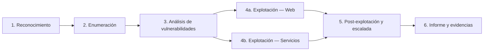

# Metodologías

Ciclo de una auditoría organizado por fases. Cada fase enlaza a los apuntes del máster que la desarrollan. Para decidir qué aplicar ante un caso concreto, usa el [Selector de metodología](selector.md).

-   **[1 · Reconocimiento](fases/reconocimiento.md)**

    ---

    Reunir información del objetivo sin tocarlo (pasivo) o con contacto mínimo.

    *6 apuntes*

-   **[2 · Enumeración](fases/enumeracion.md)**

    ---

    Descubrir hosts, puertos, servicios, tecnologías, rutas y parámetros.

    *5 apuntes*

-   **[3 · Análisis de vulnerabilidades](fases/analisis.md)**

    ---

    Clasificar y priorizar hallazgos (OWASP, CWE, CVE, CVSS).

    *5 apuntes*

-   **[4a · Explotación — Web](fases/explotacion-web.md)**

    ---

    Abusar de vulnerabilidades de aplicación web para obtener acceso.

    *27 apuntes*

-   **[4b · Explotación — Servicios](fases/explotacion-servicios.md)**

    ---

    Abusar de servicios de red y software vulnerable.

    *6 apuntes*

-   **[5 · Post-explotación y escalada](fases/post-explotacion.md)**

    ---

    Consolidar el acceso y elevar privilegios.

    *2 apuntes*

-   **[6 · Informe y evidencias](fases/informe.md)**

    ---

    Documentar hallazgos, impacto, cadenas de ataque y remediación.

    *4 apuntes*

