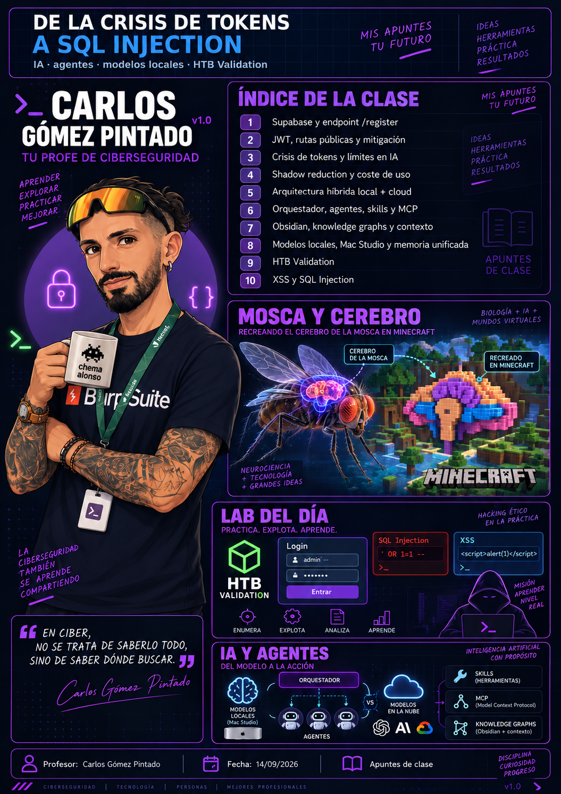

---
tags:
- Inteligencia artificial
date: '2026-09-14'
author: Carlos Gómez Pintado
---

# IA hibrida, agentes y SQL Injection

2026-09-14 · Carlos Gómez Pintado

**IA híbrida, agentes y SQL Injection — HTB Validation**

**Profesor: Carlos Gómez Pintado**Fecha de clase: 14/09/2026  
Duración aproximada: 3 horas

| **FUENTE PRINCIPAL —** Transcripción completa aportada por Chema. Se han corregido únicamente errores evidentes de reconocimiento de voz y se han separado las afirmaciones de clase de la verificación externa. No se inventan salidas, credenciales, versiones ni pasos ausentes. |
| --- |

# 1. Objetivos de la sesión

- Entender el impacto práctico de los límites de uso y del coste de los modelos de IA en flujos profesionales.
- Diseñar una arquitectura híbrida en la que un modelo potente planifique y agentes más baratos o locales ejecuten tareas especializadas.
- Distinguir modelo, aplicación, contexto, memoria, skills, herramientas, MCP y grafo de conocimiento.
- Revisar qué significa realmente ejecutar modelos locales y por qué la memoria disponible condiciona el tamaño de modelo y contexto utilizable.
- Aplicar metodología de auditoría web sobre la máquina retirada Validation de Hack The Box.
- Detectar y validar un Stored XSS y una SQL Injection manipulando parámetros de una petición HTTP POST con Burp Suite.
- Enumerar la base de datos activa y los esquemas accesibles mediante una SQL Injection UNION-based.

# 2. Resumen de la sesión

La clase se dividió en dos bloques muy distintos pero conectados por una idea común: utilizar la herramienta adecuada para cada tarea. En el primer bloque se debatió sobre límites de consumo, costes y seguridad de la IA; a partir de ahí Carlos propuso una arquitectura híbrida con un modelo “arquitecto” que razona y agentes “obreros” que ejecutan. También se repasaron contexto, memoria, grafos de conocimiento, skills, MCP y ejecución local.

En la segunda mitad se trabajó sobre la máquina retirada HTB Validation. Se siguió un flujo de reconocimiento → enumeración web → análisis de parámetros → pruebas controladas. Se validó un Stored XSS en el parámetro de nombre de usuario y una SQL Injection en el parámetro de país, manipulando la petición con Burp Suite. La sesión terminó tras enumerar los esquemas MySQL y confirmar registration como base de datos personalizada; la explotación completa quedó pendiente para la siguiente clase.

# 3. Apertura: discusión sobre Supabase y registro de usuarios

La sesión comenzó resolviendo una duda sobre una aplicación montada con Supabase. La idea principal expuesta fue que permitir altas de usuarios desde una interfaz pública requiere controles explícitos: si la aplicación no necesita autorregistro, debe deshabilitarse; si sí lo necesita, hay que imponer políticas de alta y autorización desde el backend.

| **CORRECCIÓN / AMPLIACIÓN TÉCNICA —** Supabase no se resume en una ruta universal “/register” pública que deba ocultarse. Supabase Auth permite habilitar o deshabilitar nuevos signups y aplicar controles server-side. Un JWT no “arregla” por sí solo una política de registro insegura: hay que definir quién puede crear cuentas, qué roles recibe cada cuenta y qué políticas/RLS o hooks se aplican. |
| --- |

- Deshabilitar nuevos registros cuando el producto no necesita autorregistro.
- Si el alta es pública, verificar correo/teléfono y aplicar rate limiting y controles antiabuso.
- No permitir que el cliente pueda asignarse roles administrativos mediante metadatos controlados por el usuario.
- Aplicar autorización en backend/RLS: autenticación y autorización son problemas diferentes.
- Una contraseña fuerte mejora la resistencia al ataque de credenciales, pero no corrige un endpoint de alta o una elevación de privilegios mal diseñados.

# 4. Actualidad de IA comentada en clase: qué está verificado y qué no

Carlos utilizó noticias y experiencias personales para introducir el problema de sostenibilidad económica, consumo de tokens, seguridad y evolución de los modelos. Conviene separar hecho, experiencia personal y predicción.

| **Afirmación** | **Estado** | **Nota** |
| --- | --- | --- |
| Límites de Claude Max | Verificado parcialmente | Anthropic mantiene planes Max 5x y 20x, reinicio por sesión y límites semanales. La experiencia de “dura mucho menos que antes” es personal y depende de modelo, contexto, herramientas y carga. |
| Demanda colectiva por el plan Max | Verificado | Existe una demanda colectiva que cuestiona cómo se publicitaron los multiplicadores 5x/20x frente a los límites efectivos. |
| Reducción “shadow” en agosto y otro -50% el 15/09 | Pendiente de confirmar | No se encontró confirmación oficial suficiente de esa secuencia exacta. Se conserva como afirmación de clase, no como hecho. |
| Petición pública de ralentizar la IA de frontera | Verificado | Dario Amodei pidió desacelerar el avance de capacidades; Sam Altman y Elon Musk expresaron apoyo a medidas de pacing/seguridad. |
| OpenAI resolvió Navier–Stokes | Verificado con matices | OpenAI publicó una propuesta de resolución producida por un modelo interno coordinando miles de agentes. No fue “Codex” en la fuente oficial y el resultado requiere revisión matemática independiente. |
| Mac Studio M5 Ultra con 512 GB | Verificado con corrección | Apple anunció M5 Ultra y hasta 512 GB de memoria unificada. Disponibilidad general desde 22/09; la configuración de 512 GB, a finales de octubre, no el 21/10 de forma confirmada. |
| Cerebro de mosca en Minecraft | Verificado con matices | Existe un proyecto que integra un conectoma de Drosophila en un mod. No demuestra conciencia: mapea actividad neuronal simulada a entradas/salidas de un agente del juego. |
| “Declive de la IA” | Opinión/predicción | Es una interpretación del profesor sobre costes, límites y ritmo de crecimiento, no un hecho establecido. |

# 5. Idea central: usar la herramienta adecuada

El ejemplo de clase fue “cuchara, pala, excavadora y bomba”: todas pueden hacer un agujero, pero no todas son igual de eficientes ni apropiadas. Trasladado a IA: el objetivo no es usar siempre el modelo más potente, sino enrutar cada tarea al modelo suficientemente capaz y más eficiente.

| **CONCEPTO CLAVE —** Model routing: seleccionar modelo, herramienta o agente en función de la dificultad, coste, latencia, contexto, calidad exigida y riesgo de la tarea. |
| --- |

# 6. Arquitectura híbrida: “arquitecto”, “capataz” y “obreros”

Carlos planteó separar razonamiento de alto nivel y ejecución repetitiva. La metáfora fue un edificio: un arquitecto diseña planos; muchos obreros ejecutan tareas acotadas. El coste elevado se reserva para la planificación, descomposición y revisión; la ejecución masiva se delega a modelos más baratos o locales.

Usuario  
 ↓  
Orquestador / “arquitecto” (modelo potente)  
 ↓ descompone, asigna y define criterios  
Agentes especializados / “obreros”  
 ↓ usan skills + herramientas + conocimiento  
Resultado parcial  
 ↓  
Revisión / QA  
 ↓ feedback  
Skills, documentación y grafo de conocimiento

- Arquitecto: toma requisitos, diseña el plan, divide tareas y decide qué agente/modelo debe ejecutarlas.
- Obrero: resuelve una tarea concreta con instrucciones, herramientas y contexto limitado.
- Capataz: capa intermedia propuesta para revisar trabajos repetitivos y reutilizar conocimiento operativo.
- Revisor: comprueba calidad, seguridad, coherencia y cumplimiento de criterios antes de aceptar el resultado.
- Objetivo económico: reducir llamadas caras al modelo de frontera y usar computación local en lectura, escritura y tareas repetitivas.

| **CORRECCIÓN TÉCNICA —** Actualizar una skill, un documento o un grafo NO equivale a entrenar el modelo ni modificar sus pesos. Es mejora del contexto, la memoria externa o el workflow. Solo existe entrenamiento/postentrenamiento real cuando se actualizan parámetros del modelo mediante un proceso específico. |
| --- |

# 7. Modelo vs aplicación vs agente vs herramienta

| **Elemento** | **Qué es** |
| --- | --- |
| Modelo | Red neuronal entrenada que realiza inferencia. Ej.: una familia/version concreta de Claude, GPT, Qwen, GLM, etc. |
| Aplicación | Interfaz y lógica que usa uno o varios modelos. Ej.: Claude Code, ChatGPT, un IDE con agente. |
| Agente | Sistema que combina modelo + objetivo + bucle de decisión + herramientas + estado/contexto. |
| Herramienta | Función externa invocable: shell, navegador, API, buscador, generador de imagen, etc. |
| Skill | Instrucciones/procedimiento reutilizable que guía cómo ejecutar un tipo de tarea. No es un modelo. |
| Memoria externa | Información persistente fuera de los pesos: ficheros, base de datos, Obsidian, vector DB, knowledge graph. |
| Orquestador | Componente que decide qué agente/modelo/herramienta ejecutar y en qué orden. |

# 8. MCP: qué es realmente

En clase se describió un “MCP server” como un taller con herramientas y conocimiento operativo. La metáfora es útil, pero conviene precisar el estándar.

| **AMPLIACIÓN TÉCNICA —** MCP (Model Context Protocol) es un protocolo para conectar aplicaciones de IA con fuentes de datos y capacidades externas. Un servidor MCP puede exponer tools, resources y prompts. Las “skills” de un agente no forman parte obligatoria del protocolo MCP, aunque una aplicación puede combinarlas con herramientas MCP. |
| --- |

Cliente/host de IA  
 ↕ MCP (JSON-RPC / transporte compatible)  
Servidor MCP  
 ├─ Tools → acciones ejecutables  
 ├─ Resources → datos/contexto  
 └─ Prompts → plantillas/instrucciones expuestas

# 9. Parámetros, contexto y memoria: corrección de conceptos

La transcripción mezcla varias ideas al explicar por qué un modelo local necesita mucha memoria. Para estudiar conviene separarlas con precisión.

| **Concepto** | **Definición correcta** |
| --- | --- |
| Parámetros | Pesos aprendidos durante el entrenamiento. Determinan gran parte de la capacidad del modelo. No son el historial de conversación. |
| Contexto | Tokens disponibles para la inferencia actual: prompt, historial, archivos, resultados de herramientas, etc. |
| Ventana de contexto | Límite máximo de tokens que el modelo/servicio admite en una inferencia o sesión. |
| KV cache | Estructuras de atención almacenadas durante generación; su memoria crece con la longitud del contexto. |
| VRAM / memoria unificada | Memoria donde pueden residir pesos cuantizados, KV cache, activaciones y buffers de cómputo. |
| Memoria persistente | Datos externos reutilizables entre sesiones. No forma parte automáticamente de los pesos ni de la ventana de contexto. |

| **CORRECCIÓN IMPORTANTE —** “5 TB de memoria = 25 billones de parámetros de contexto” no es una equivalencia válida. Memoria, número de parámetros y longitud de contexto son magnitudes distintas. La memoria necesaria depende de cuantización, arquitectura, KV cache, batch, activaciones y runtime. |
| --- |

# 10. Obsidian y grafos como memoria operativa

Carlos volvió a defender una bóveda de Obsidian bien estructurada para proyectos grandes. La ventaja no es que Obsidian “aprenda”, sino que reduce cuánto material necesita releer el agente en cada sesión: primero consulta un índice/grafo, localiza el componente relevante y después abre solo los ficheros necesarios.

Proyecto grande  
 ↓  
Bóveda / grafo de conocimiento  
 ├─ componentes  
 ├─ relaciones  
 ├─ dependencias  
 ├─ decisiones  
 └─ rutas a ficheros reales  
 ↓  
Recuperación selectiva de contexto  
 ↓  
Menos lectura repetida + mejor localización

| **BUENA PRÁCTICA —** Un grafo de conocimiento no aprende por sí mismo. Sirve para representar relaciones y recuperar información; el aprendizaje solo aparece si existe un mecanismo adicional que actualiza pesos o políticas a partir de datos/feedback. |
| --- |

# 11. Hardware local y Mac Studio M5 Ultra

La clase propuso usar varios Mac Studio como infraestructura de inferencia local gracias a la memoria unificada. La idea pedagógica es válida: cuanto mayor es la memoria utilizable por CPU/GPU, más modelos o cuantizaciones pueden cargarse y más contexto puede mantenerse, dentro de los límites del software y del ancho de banda.

| **Dato** | **Estado verificado** |
| --- | --- |
| Producto anunciado | Mac Studio con M5 Max / M5 Ultra |
| Memoria unificada máxima | Hasta 512 GB en configuraciones M5 Ultra |
| Disponibilidad | Desde 22/09/2026; 512 GB a finales de octubre |
| Precio base España M5 Ultra | Desde 6.649 € según Apple; una configuración superior puede costar más |
| Afirmación de clase “~12.000 €” | Estimación del profesor para una configuración concreta; no se trata como precio oficial universal |

# 12. Optimización de tokens: RTK y reducción de ruido

Se mencionó RTK (Rust Token Killer) como herramienta para reducir la cantidad de salida de terminal que termina dentro del contexto de un agente. El mecanismo es razonable: filtrar o comprimir salidas verbosas puede reducir tokens de entrada.

| **VERIFICACIÓN —** Las cifras de “80–90 % de ahorro” no deben memorizarse como garantía. Existen demostraciones que reportan reducciones grandes en casos concretos, pero una prueba independiente de JetBrains no reprodujo ese ahorro global y observó resultados neutros o incluso algo más caros según configuración. El ahorro depende del workflow. |
| --- |

- Limpiar contexto que ya no es necesario.
- Evitar adjuntar ficheros/logs completos si solo hacen falta fragmentos.
- Delegar búsquedas, lectura y transformación mecánica a modelos más baratos.
- Mantener índices del proyecto para no releer todo el repositorio.
- Medir coste y calidad: optimizar tokens no sirve si aumenta errores o retrabajo.

# 13. Noticias técnicas destacadas

## 13.1 OpenAI y Navier–Stokes

La clase afirmó que “Codex resolvió un problema del milenio”. La fuente oficial de OpenAI habla de un modelo interno en entrenamiento y de un sistema con miles de agentes coordinados que produjo una propuesta de resolución para Navier–Stokes. Conviene no atribuirlo a Codex salvo fuente adicional. OpenAI tampoco presenta el proceso como una validación definitiva equivalente al reconocimiento del Clay Mathematics Institute.

## 13.2 Conectoma de mosca en Minecraft

Se comentó un proyecto que lleva un conectoma de Drosophila a Minecraft. Existen implementaciones recientes que simulan decenas de miles de neuronas y conectan actividad del modelo a sentidos y movimientos del mob. Es una demostración de neurocomputación y mapeo sensorimotor; no es evidencia de que se haya “subido” una mente biológica consciente al juego.

# 14. Bloque práctico — HTB Validation

| **ENTORNO AUTORIZADO —** Máquina retirada de Hack The Box utilizada con fines formativos. Los pasos siguientes se documentan únicamente como reproducción del laboratorio de clase. |
| --- |

La práctica se realizó guiando a una alumna paso a paso y obligando a justificar cada decisión. El objetivo era demostrar que una auditoría no debe saltar directamente a una vulnerabilidad “porque sabemos el nombre del tema”; primero se recoge evidencia.

# 15. Fases de auditoría aplicadas

| **Fase** | **Aplicación en Validation** |
| --- | --- |
| Planificación | Confirmar entorno HTB autorizado, VPN y objetivo. Establecer que se trabajará sobre una máquina retirada y que la sesión busca SQLi manual. |
| Recogida de información | Ping/TTL, traceroute, Nmap, revisión web, Wappalyzer/código fuente y enumeración de contenido con Feroxbuster. |
| Análisis de vulnerabilidades | Observar cómo los parámetros se reflejan/persisten, interceptar POST con Burp, probar caracteres especiales y localizar diferencias entre username y country. |
| Pruebas de explotación controladas | Validar Stored XSS con alert(1) y SQLi con comilla simple + UNION SELECT; enumerar database() y information\_schema.schemata. La explotación completa queda pendiente. |

# 16. Recogida de información: conectividad y TTL

Se comenzó comprobando que el host respondía. El ping devolvía TTL 63; se interpretó como un host Linux con un salto previo por la VPN.

ping <IP\_OBJETIVO>  
traceroute <IP\_OBJETIVO>

| **INFERENCIA TÉCNICA —** Un TTL observado de 63 es compatible con un TTL inicial 64 y un salto, pero la identificación de sistema operativo por TTL es una heurística. Firewalls, túneles, rutas y configuraciones pueden alterar el valor. |
| --- |

También se recordó que ping utiliza ICMP y que una ausencia de respuesta no demuestra que el host esté apagado: ICMP puede estar filtrado o deshabilitado.

# 17. Nmap: escaneo y significado de los flags

La sintaxis se explicó oralmente. Para evitar depender de la combinación escrita de flags, la forma canónica equivalente queda así:

nmap -sC -sV -p- --min-rate 1500 -T4 <IP\_OBJETIVO>

| **Opción** | **Objetivo** |
| --- | --- |
| -sC | Ejecuta los scripts NSE “default”. |
| -sV | Detección activa de servicio/versión. |
| -p- | Escanea los 65.535 puertos TCP. |
| --min-rate 1500 | Pide a Nmap mantener al menos ~1500 probes/paquetes por segundo cuando sea posible. |
| -T4 | Plantilla de temporización agresiva, adecuada en laboratorios estables; aumenta ruido. |

| **CORRECCIÓN IMPORTANTE —** El MTU Ethernet típico de 1500 bytes y --min-rate 1500 no son magnitudes equivalentes: MTU es tamaño máximo de payload IP por trama estándar; --min-rate es ritmo de envío. Usar “1500” en ambos no evita por sí mismo fragmentación ni hace el escaneo más sigiloso. |
| --- |

Durante la revisión aparecieron al menos SSH/22, HTTP/80 con Apache y un servicio en 4566. La transcripción no conserva de forma fiable todas las versiones, por lo que no se inventan.

# 18. Enumeración web

- Se abrió el servicio HTTP y se observó un formulario con nombre de usuario y selector de país.
- Antes de probar SQLi se revisaron tecnologías con Wappalyzer y el código fuente de la página.
- Se utilizó Feroxbuster por su enumeración recursiva y posteriormente se amplió la búsqueda a extensiones PHP.
- La enumeración reveló recursos PHP; un fichero config.php con 0 bytes se descartó por no aportar contenido en esa respuesta.
- La URL y el comportamiento permitían confirmar que la aplicación estaba implementada con PHP.

feroxbuster -u http://<IP\_OBJETIVO> -x php

| **NOTA —** El comando anterior refleja la forma general coherente con lo visto; la transcripción no conserva todos los flags exactos ni una wordlist explícita, por lo que no se añaden. |
| --- |

# 19. Analizar el comportamiento antes de explotar

Al introducir nombres normales, la aplicación los mostraba de nuevo y además quedaban asociados a la región elegida. Esto demostró persistencia del dato, pero no permitía concluir todavía que existiera una base de datos: la persistencia podría implementarse con BBDD, fichero u otro almacenamiento.

| **CORRECCIÓN —** “Si hay POST, hay base de datos” no es una regla válida. POST indica una operación enviada al servidor y suele usarse para crear/cambiar estado, pero el backend podría almacenar en memoria, ficheros, colas, APIs externas o no persistir nada. En este laboratorio la SQLi posterior sí demuestra una consulta SQL. |
| --- |

# 20. Stored XSS en username

Como el campo username acepta texto y su contenido termina representado en la respuesta, se probaron caracteres especiales y un payload de JavaScript de verificación. El objetivo inicial no fue robar datos, sino comprobar ejecución.

">

El payload se guardó y volvió a ejecutarse al acceder al mismo listado/región, por lo que el comportamiento observado es compatible con Stored XSS: el valor malicioso persiste en el servidor y se renderiza posteriormente.

| **CORRECCIÓN TÉCNICA —** Que un valor se refleje en HTML no implica que “se haga con JavaScript”. Puede venir de una plantilla server-side, de JavaScript cliente o de otro mecanismo. XSS aparece cuando datos no confiables alcanzan un contexto ejecutable sin codificación/escape contextual adecuados. |
| --- |

| **RIESGO —** La clase habló de robar document.cookie. Eso solo sería posible si la cookie objetivo es accesible desde JavaScript; una cookie marcada HttpOnly no puede leerse con document.cookie. En la transcripción no se confirma si la cookie de sesión tenía HttpOnly, así que no se afirma que fuese robable. |
| --- |

# 21. Burp Suite: observar la petición real

Se activó el proxy, se interceptó el envío del formulario y se mandó la petición a Repeater para poder modificar parámetros de forma independiente. La petición era POST y contenía al menos dos variables relevantes: username y country.

POST /<ruta> HTTP/1.1  
...  
username=test&country=Brazil

La respuesta incluía una cabecera Set-Cookie para el usuario/sesión. Esto conectó el Stored XSS con el riesgo de secuestro de sesión, aunque no se realizó una exfiltración real en clase.

# 22. El fallo clave: country no estaba protegido igual que username

La interfaz presenta country como un desplegable, por lo que un usuario normal no puede escribir libremente en él. Sin embargo, Burp permite modificar la petición HTTP después de que el navegador la construye. Este fue el punto didáctico principal: proteger solo lo que “parece editable” en el front no protege el backend.

| **BUENA PRÁCTICA —** Nunca confíes en controles del front. Validación, autorización, tipado y consultas parametrizadas deben aplicarse en el servidor sobre todos los parámetros, incluidos select, hidden, IDs, headers y campos calculados por el cliente. |
| --- |

# 23. Error-based SQL Injection en country

Se sustituyó el valor de country por una comilla simple. A diferencia de username, la aplicación devolvió un error no gestionado en PHP. La combinación de entrada especial + error del backend + comportamiento posterior permitió confirmar que ese parámetro alcanzaba una consulta SQL vulnerable.

country='

| **MATIZ —** Una comilla simple que provoca un error es un indicador fuerte, pero no demuestra siempre SQLi por sí sola. En este laboratorio, el error de la aplicación y las consultas UNION posteriores sí aportan evidencia suficiente. |
| --- |

El error también reveló detalles internos del servidor, incluida una ruta bajo /var/www/html/ y el fichero PHP afectado. Esto es information disclosure y facilita el análisis.

# 24. UNION-based SQL Injection: base de datos activa

Una vez validada la inyección, se utilizó UNION SELECT para acoplar una consulta de lectura al flujo de la consulta original. El primer objetivo fue conocer la base de datos activa.

' UNION SELECT database() -- -

La aplicación devolvió registration. Por tanto, registration es el nombre de la base de datos activa observada en clase.

# 25. Enumeración de esquemas con information\_schema

Después se consultó el catálogo de MySQL para obtener los nombres de esquemas accesibles.

' UNION SELECT schema\_name FROM information\_schema.schemata -- -

Resultado observado en clase:

- information\_schema
- performance\_schema
- mysql
- registration

| **CORRECCIÓN —** registration es una base de datos/esquema personalizado, no una tabla. Los tres primeros son esquemas del sistema de MySQL. El siguiente paso lógico sería enumerar tablas y columnas de registration, pero la clase terminó antes de completarlo. |
| --- |

# 26. Qué NO se completó en esta sesión

- No se enumeraron de forma completa las tablas de registration.
- No se enumeraron columnas/credenciales ni se extrajo un dataset completo.
- No se documentó acceso por SSH ni escalada de privilegios en esta sesión.
- No se obtuvo una flag final en el material aportado.
- No se realizó robo real de cookies mediante XSS.
- El profesor indicó que la segunda parte de la máquina continuaría al día siguiente con Carlos Castillo.

# 27. Metodología “sota, caballo, rey” que se reforzó

1. Confirmar que el objetivo está vivo y comprender la ruta/red.
2. Enumerar puertos y servicios con versiones cuando proceda.
3. Abrir la aplicación y revisar tecnologías, código fuente y contenido oculto.
4. Probar funcionalidad normal antes de enviar payloads.
5. Identificar parámetros y dónde se reflejan o persisten.
6. Interceptar con Burp para modificar también parámetros que el front no deja editar.
7. Probar vectores de entrada según contexto: XSS, SQLi y otros solo cuando la evidencia lo justifica.
8. Ante SQLi, determinar tipo de inyección y enumerar de forma progresiva: contexto → base de datos → esquemas/tablas → columnas → datos necesarios.
9. Detenerse y revisar evidencia antes de saltar a una fase posterior.

# 28. Comandos y payloads vistos

| **Comando / payload** | **Uso** | **Evidencia / estado** |
| --- | --- | --- |
| ping <IP\_OBJETIVO> | Comprobar respuesta ICMP y observar TTL. | Visto en clase. |
| traceroute <IP\_OBJETIVO> | Visualizar saltos/ruta. | Visto en clase. |
| nmap -sC -sV -p- --min-rate 1500 -T4 <IP\_OBJETIVO> | Enumerar TCP, servicios y scripts por defecto. | Sintaxis canónica equivalente a la explicación oral. |
| feroxbuster -u http://<IP\_OBJETIVO> -x php | Enumeración recursiva web y extensiones PHP. | Forma general; flags exactos incompletos en transcripción. |
| "> | Prueba visible de XSS. | Ejecución y persistencia observadas. |
| ' | Forzar ruptura de la consulta en country. | Error observado; indicador de SQLi. |
| ' UNION SELECT database() -- - | Obtener base de datos activa. | registration. |
| ' UNION SELECT schema\_name FROM information\_schema.schemata -- - | Enumerar esquemas MySQL. | information\_schema, performance\_schema, mysql, registration. |

# 29. Riesgos y buenas prácticas de desarrollo

| **Riesgo / error** | **Buena práctica** |
| --- | --- |
| Validar solo campos de texto | Un select/hidden/ID también se manipula con proxy o cliente propio. Validar en backend. |
| Concatenar SQL | Usar prepared statements / consultas parametrizadas. |
| Escapar de forma genérica | Aplicar encoding contextual según HTML, atributo, JS, URL, SQL, etc. |
| Errores PHP visibles | Registrar internamente y devolver mensajes genéricos al usuario. |
| Cookies accesibles desde JS | Usar HttpOnly cuando la aplicación no necesite acceso JavaScript; añadir Secure/SameSite según caso. |
| Confiar en la UI | El cliente es controlable por el atacante. Toda autorización se decide en servidor. |
| Usar siempre el modelo más caro | Aplicar routing, límites, revisión y métricas coste/calidad. |
| Confundir memoria con entrenamiento | Documentar si el sistema actualiza pesos o solo cambia contexto/skills/memoria externa. |

# 30. Registro de herramientas

| **Herramienta** | **Objetivo** | **Fase** | **Uso visto** | **Nivel** | **Notas** |
| --- | --- | --- | --- | --- | --- |
| Supabase Auth | Autenticación/registro de usuarios | Planificación / Análisis | Configuración de signups comentada | Introducida | No se explotó; fue resolución de duda. |
| Claude / Claude Code | Razonamiento, programación, agentes | Planificación | Orquestación, skills, consumo de tokens | Recurrente | Distinguir modelo, aplicación y agente. |
| Obsidian | Memoria/documentación estructurada | Planificación | Bóvedas y grafos para reducir relectura | Recurrente | No aprende por sí mismo. |
| MCP | Conexión con herramientas/datos | Planificación | Servidor MCP como capa de capacidades | Introducida | Protocolo; tools/resources/prompts. |
| RTK | Filtrar salida de terminal | Planificación | Reducción de ruido/tokens | Mencionada | Ahorro variable; no asumir 80% fijo. |
| Hack The Box | Laboratorio autorizado | Todas | Máquina Validation | Recurrente | Retirada. |
| ping | Conectividad/TTL | Recogida de información | ICMP y TTL 63 | Practicada | TTL = heurística. |
| traceroute | Ruta y saltos | Recogida de información | Salto por VPN | Practicada | Ruta visible. |
| Nmap | Enumeración de puertos/servicios | Recogida de información | -sC -sV -p- --min-rate -T4 | Recurrente | Cuidado con ruido. |
| Wappalyzer | Tecnologías web | Recogida de información | Revisión previa a explotación | Recurrente | Complementar con evidencia manual. |
| Feroxbuster | Contenido web recursivo | Recogida de información | Enumeración + .php | Practicada | Recursividad destacada. |
| Burp Suite | Interceptar/modificar HTTP | Análisis / Explotación controlada | Proxy + Repeater; username/country | Recurrente | Clave para manipular select. |
| MySQL / information\_schema | Metadatos de BBDD | Explotación controlada | database(), schemata | Practicada | registration confirmado como DB. |

# 31. Checklist de repaso

- Puedo explicar por qué un router de modelos puede reducir coste sin sacrificar calidad en tareas sencillas.
- Distingo parámetros, contexto, memoria persistente y entrenamiento.
- Sé explicar por qué una skill no modifica los pesos de un modelo.
- Sé qué expone MCP: tools, resources y prompts.
- Entiendo por qué 512 GB de memoria unificada ayudan a inferencia local, sin confundir memoria con número de parámetros/contexto.
- Sé aplicar las cuatro fases de auditoría a Validation.
- Sé explicar qué indican TTL 63 y un salto de traceroute sin tratarlos como prueba absoluta del SO.
- Sé qué hacen -sC, -sV, -p-, --min-rate y -T4 en Nmap.
- Sé por qué MTU 1500 bytes no equivale a --min-rate 1500.
- Sé por qué un select HTML también debe validarse en backend.
- Distingo Stored XSS de Reflected XSS.
- Sé por qué HttpOnly puede impedir leer una cookie con document.cookie.
- Sé por qué una comilla simple que rompe una consulta es un indicador, no una prueba universal.
- Puedo explicar UNION SELECT database() e information\_schema.schemata.
- Sé que registration es una base de datos y que la enumeración de tablas quedó pendiente.

# 32. Glosario

| **Término** | **Definición** |
| --- | --- |
| Model routing | Selección dinámica del modelo/agente apropiado para cada tarea. |
| Orquestador | Componente que descompone tareas y coordina modelos, agentes y herramientas. |
| Skill | Procedimiento/instrucciones reutilizables para una tarea; no equivale a entrenamiento. |
| MCP | Model Context Protocol; estándar para conectar aplicaciones LLM con tools, resources y prompts. |
| Context window | Cantidad máxima de tokens que un modelo puede considerar en una inferencia. |
| KV cache | Estado de atención reutilizado durante generación y dependiente de longitud de secuencia. |
| Unified memory | Memoria compartida por CPU/GPU en arquitecturas como Apple Silicon. |
| Stored XSS | XSS cuyo payload queda almacenado y se ejecuta en visitas posteriores. |
| Error-based SQLi | SQLi donde errores del gestor/backend aportan evidencia o información. |
| UNION-based SQLi | Técnica que combina el resultado de la consulta original con un SELECT controlado. |
| information\_schema | Catálogo estándar de metadatos en MySQL y otros SGBD compatibles. |
| Prepared statement | Consulta parametrizada que separa estructura SQL y datos. |
| MTU | Maximum Transmission Unit; tamaño máximo de paquete IP transportado sin fragmentación en un enlace concreto. |
| Rate | Ritmo de envío; en Nmap --min-rate solicita un mínimo de probes por segundo. |

# 33. Fuentes y verificación externa

Las fuentes externas se utilizan únicamente para comprobar información cambiante o corregir afirmaciones técnicas. El cuerpo principal sigue la transcripción de clase.

- [Anthropic — What is the Max plan?](https://support.claude.com/en/articles/11049741-what-is-the-max-plan)
- [The Verge — demanda colectiva sobre Claude Max](https://www.theverge.com/ai-artificial-intelligence/990313/anthropic-class-action-lawsuit-pricing-subscription-plans)
- [Reuters — Anthropic CEO urges AI companies to slow model development](https://www.reuters.com/business/anthropic-ceo-urges-ai-companies-slow-model-development-2026-09-12/)
- [Apple — Mac Studio con M5 Max y M5 Ultra](https://www.apple.com/es/newsroom/2026/08/apple-introduces-new-mac-studio-with-m5-max-and-m5-ultra/)
- [OpenAI — On the Navier–Stokes Millennium Prize Problem](https://openai.com/index/navier-stokes-solution/)
- [GitHub — Fly Brain Minecraft](https://github.com/blendi-remade/fly-brain-minecraft)
- [Supabase — Auth general configuration](https://supabase.com/docs/guides/auth/general-configuration)
- [Model Context Protocol — server overview](https://modelcontextprotocol.io/specification/draft/server/index)
- [JetBrains — benchmark de ahorro de tokens con rtk](https://blog.jetbrains.com/ai/2026/07/rtk-claude-code-token-savings/)
- [Anthropic — Model system cards](https://www.anthropic.com/system-cards)

# 34. Pendientes para la siguiente sesión

- Continuar HTB Validation desde la base de datos registration y enumerar progresivamente tablas/columnas solo con evidencia real.
- Confirmar en la siguiente transcripción qué persona realiza la segunda parte y qué comandos exactos se usan.
- No asumir credenciales, flags ni flag final de la máquina.
- Seguir diferenciando observación de clase y verificación externa en noticias de IA.
- Si aparecen nuevas cifras de límites Claude/planes, comprobarlas en documentación oficial antes de incorporarlas como dato.

# 35. Actualización de memoria del proyecto

| **Categoría** | **Información nueva** | **Certeza** | **Acción futura** |
| --- | --- | --- | --- |
| Sesión | 14/09/2026 — Carlos Gómez Pintado. Bloque IA + HTB Validation/SQLi. | Alta | Conectar con continuación del 15/09 si se aporta. |
| IA | Arquitectura híbrida: orquestador/arquitecto + agentes locales/obreros + revisión + skills/conocimiento. | Alta | Reutilizar para el proyecto de tutor/agentes. |
| Conceptos IA | Se reforzaron routing de modelos, contexto, memoria, skills, MCP y grafos. Se corrigió que memoria/contexto/parámetros no son equivalentes. | Alta | Mantener distinciones en futuros apuntes. |
| Noticias | Debate sobre límites Claude, demanda Max, pacing de IA, M5 Ultra 512 GB, Navier–Stokes y conectoma de mosca. | Media-Alta | Revalidar si cambian noticias/estado científico. |
| Laboratorio | HTB Validation: TTL 63, Nmap, web/PHP, Feroxbuster, Stored XSS y SQLi en country. | Alta | Continuar desde registration. |
| SQLi | database() → registration; information\_schema.schemata → information\_schema, performance\_schema, mysql, registration. | Alta | Siguiente: tablas/columnas solo si la clase las muestra. |
| Pendiente | No se resolvió la máquina completa ni se obtuvo flag en esta sesión. | Alta | No inventar continuación. |
| Formato | Regla permanente: todos los apuntes finales llevan portada como primera página, adaptada al tema y usando imagen del profesor cuando esté disponible. | Alta | Aplicar automáticamente en futuras sesiones. |
