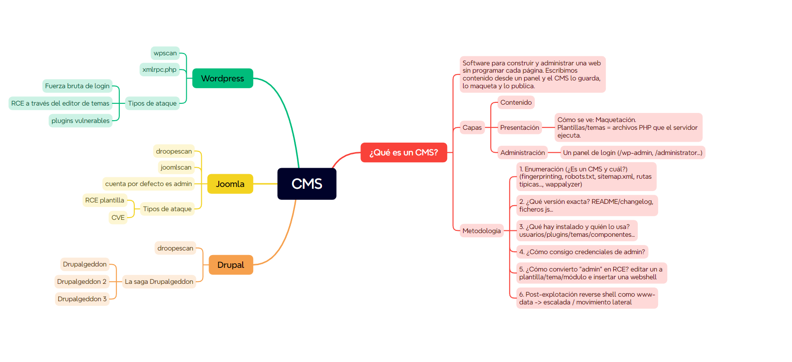

---
tags:
- Máquinas y prácticas
date: '2026-09-29'
author: Yuba González Parrilla
---

# CMS y Curling

2026-09-29 · Yuba González Parrilla

**APUNTES MÁSTER**

CMS WordPress Joomla Drupal y Curling

**Laboratorio Hack The Box · Máquina Curling**

Yuba González Parrilla · 29 de septiembre de 2026

# Mapa de la clase

El recorrido combina tres CMS y aplica la metodología a Curling. Cada caja y relación de esta página es texto o tabla editable.

| **Concepto** | **Contenido** | **Presentación** | **Administración** |
| --- | --- | --- | --- |
| CMS | Artículos y datos | Plantillas y temas | Usuarios, permisos y panel |
| Interés en auditoría | Qué se publica y expone | Código servido y extensiones | Quién puede modificar el sitio |

## Seis preguntas para auditar un CMS

| **1 Reconocer** | **2 Precisar** | **3 Enumerar** |
| --- | --- | --- |
| ¿Es un CMS y cuál? Huellas HTTP, rutas, robots.txt, sitemap.xml y tecnología. | ¿Qué versión exacta? README, cambios y recursos; contrastar posibles CVE. | ¿Qué usuarios, plugins, temas, componentes y directorios hay? |

| **4 Acceso** | **5 Ejecución** | **6 Posacceso** |
| --- | --- | --- |
| ¿Existe acceso legítimo al panel en este laboratorio? Revisar credenciales y controles. | ¿Permiten los permisos editar código servido, como una plantilla? | ¿Qué identidad tiene la shell y qué procesos privilegiados consumen archivos controlables? |

## Tres CMS y la práctica

| **WordPress** | **Joomla** | **Drupal** |
| --- | --- | --- |
| WPScan; plugins, temas y XML-RPC. | JoomlaScan; panel y plantillas. | Droopescan y familia Drupalgeddon; comprobar versión y requisitos. |

Curling: enumeración web → pista en comentario y cadena Base64 → acceso al panel de Joomla → edición de plantilla → shell www-data → volcado hexadecimal y capas bzip2, gzip, tar → usuario floris → tarea privilegiada que lee configuración de curl modificable → escalada observada al final.

El esquema original de Yuba, compartido por Chema, se reproduce completo en la página siguiente. Este mapa es una síntesis editable para el estudio.

## Glosario de la clase

| **Término** | **Significado en esta clase** |
| --- | --- |
| CMS | Aplicación que administra contenido, presentación y permisos de una web. |
| Plugin o componente | Extensión que añade funciones y puede ampliar la superficie de ataque. |
| Plantilla | Archivos que dan forma a la salida; en Joomla pueden incluir PHP. |
| RCE | Ejecución de código o comandos en el sistema remoto. |
| Web shell | Código web que acepta instrucciones y devuelve su resultado. |
| PTY | Pseudoterminal que mejora la interacción de una shell. |
| Cron | Planificador de tareas periódicas en Unix. |
| Frontera de confianza | Límite que se cruza cuando root procesa instrucciones editables por floris. |

# Esquema original de Yuba · CMS

Captura F002 aportada por Chema para estos apuntes. Se conserva íntegra y sin alterar; las etiquetas describen el esquema de clase, no afirman que todos los CMS compartan esas condiciones.

*Figura 1. Esquema de CMS de Yuba. Fuente: F002, imagen compartida en el chat.*

En Curling se trabaja principalmente la rama de Joomla y el sexto paso del método. La imagen permite ampliar cada rótulo en el visor; el mapa editable de la página anterior resume sus relaciones.

# Alcance y resultado de la sesión

Yuba repasa cómo analizar un gestor de contenidos (CMS) y aplica ese método a la máquina Curling de Hack The Box. La idea central es identificar la tecnología y sus componentes antes de pensar en una vía de acceso. En la práctica se obtiene acceso al panel de Joomla, se demuestra ejecución de comandos con los permisos del servicio web, se recupera una contraseña guardada en varias capas de compresión y se estudia una tarea de root dependiente de un archivo modificable por floris. La primera prueba de la escalada no devuelve shell; al final de la grabación Yuba afirma y muestra que el mecanismo funciona. La transcripción no incluye capturas ni salida completa de cada comando, por lo que los resultados observados se describen con ese límite.

Fuente factual: transcripción F001, aportada para esta sesión. Los comandos de ejemplo de estos apuntes explican la técnica vista, pero no sustituyen el registro literal de terminal. Las correcciones técnicas comprobadas se separan al final.

# Qué es un CMS y dónde mirar

Un CMS permite crear y administrar una web desde un panel: se redacta el contenido, la aplicación lo guarda y la capa de presentación lo publica. Yuba lo organiza en contenido, presentación y administración. La división sirve para preguntar qué datos se muestran, qué plantillas o extensiones participan en la respuesta y quién puede cambiar la configuración o el código. Una plantilla de Joomla puede contener PHP ejecutado por el servidor; el acceso al editor, por tanto, tiene consecuencias distintas de cambiar solo un color o una imagen.

En una auditoría web hay que distinguir un CMS de una aplicación desarrollada a medida. La transcripción menciona las aplicaciones web progresivas y las interfaces de una sola página como ejemplos de otras arquitecturas; esas propiedades, por sí solas, no demuestran que una web carezca de CMS. La identificación requiere evidencias observables.

Yuba diferencia dos situaciones: un defecto de software explotable y el abuso de una funcionalidad prevista, como un editor de plantillas habilitado para una cuenta con permisos. La segunda situación depende de la autenticación y de los privilegios concedidos. La valoración del riesgo exige describir condiciones y alcance, no llamar vulnerabilidad a cualquier pantalla de administración.

# Metodología de auditoría de CMS

La secuencia que propone empieza por reconocer la tecnología mediante HTTP, rutas típicas, robots.txt, sitemap.xml, el código de la página y herramientas de identificación. Después busca la versión exacta en recursos como README, changelogs o archivos JavaScript. La coincidencia con un aviso o CVE solo abre una hipótesis: hay que verificar versión afectada, configuración y prerrequisitos.

El siguiente paso es inventariar usuarios, plugins, temas, componentes y directorios. Una instalación puede tener el núcleo actualizado y una extensión desatendida. Con ese mapa, se revisan los controles de acceso del laboratorio y las vías que podrían convertir una cuenta administrativa en ejecución de código. La última pregunta mira la identidad efectiva de la sesión y las relaciones de confianza entre procesos de mayor privilegio y archivos editables por un usuario de menor privilegio.

| **Fase de auditoría** | **Aplicación en esta clase** |
| --- | --- |
| Planificación | Laboratorio HTB Curling y alcance de la máquina asignada. |
| Recogida de información | Puertos, navegación, huellas del CMS, rutas, comentarios, usuarios y componentes. |
| Análisis de vulnerabilidades | Valorar credenciales, permisos del editor, archivos expuestos y configuración de tarea privilegiada. |
| Pruebas de explotación controladas | Validar ejecución en Joomla, shell con www-data y comportamiento de la tarea en Curling. |

# WordPress Joomla y Drupal

## WordPress

La clase destaca el inventario de plugins y temas con WPScan y la revisión de xmlrpc.php. XML-RPC es una interfaz real de WordPress; encontrarla no prueba por sí solo que haya un fallo. Yuba menciona como posibles rutas de laboratorio el acceso al panel, el editor de temas y extensiones vulnerables. Sus porcentajes aproximados sobre dónde se concentran los fallos se anotan como estimación oral, sin base estadística verificada para estos apuntes.

## Joomla

Joomla es el foco de Curling. El profesor señala el panel administrativo, las extensiones y el gestor de plantillas. Se prueban herramientas de enumeración de Joomla y se explica que disponer de una cuenta con permisos para editar archivos de una plantilla permite alterar código servido. Las credenciales de la instalación concreta son una observación del laboratorio; no se debe asumir que otras instalaciones compartan usuario o contraseña.

## Drupal

Drupal se presenta como otro CMS escrito en PHP. Se menciona Droopescan y la familia conocida como Drupalgeddon. La transcripción duda sobre las fechas y agrupa bajo un mismo apodo problemas distintos: antes de relacionar un CVE con un objetivo hay que contrastar su versión y condiciones exactas. Drupal no se explota en esta práctica.

# Curling: del reconocimiento al panel

La práctica comienza con reconocimiento de puertos mediante Nmap, primero de forma acotada y después ampliada, y con la preparación de un nombre local para abrir Curling en el navegador. Se ve el puerto 22 y una web HTTP. Yuba usa Burp Suite y FoxyProxy para construir un mapa de rutas y parámetros; al recorrer enlaces y formularios, ordena las peticiones por parámetros para identificar cuáles faltan por analizar. La salida exacta de Nmap y sus indicadores no están completos en la transcripción, así que no se reconstruyen como comandos literales.

La enumeración de directorios devuelve rutas de Joomla como administrator, templates y componentes. El punto de inflexión llega al inspeccionar el código de la página: un comentario sugiere un archivo de texto accesible. Su contenido parece codificado y se analiza con CyberChef. La cadena Base64 se decodifica sin clave; no equivale a descifrar un secreto. El nombre de autor visible en el sitio ayuda a vincular una identidad con la credencial obtenida en el laboratorio. Se valida acceso al panel con el usuario floris y permisos suficientes para gestionar la plantilla. No se reproducen contraseñas en estos apuntes.

# De editor de plantillas a ejecución como www-data

Dentro del administrador se identifica la plantilla activa Protostar. La cuenta con permisos puede modificar un archivo PHP de esa plantilla. Yuba añade una llamada que recibe un parámetro de la petición y lo entrega a una función de ejecución del sistema; después comprueba la respuesta con un comando de identidad. El resultado demuestra ejecución bajo el usuario del servicio web, www-data. Esto es una observación de la instalación de Curling y de los permisos que tenía la cuenta; no constituye una propiedad universal de Joomla.

La clase prueba también la protección \_JEXEC de los archivos de Joomla. La guarda evita que cierto archivo se ejecute directamente fuera de la aplicación. La ubicación del código añadido respecto de esa comprobación cambia el resultado. Yuba muestra un intento que falla y otro que funciona y explica la necesidad de entender qué ruta carga realmente la plantilla. Más tarde envía la petición con curl usando codificación de parámetros, obtiene una shell inversa en el laboratorio y mejora su interacción con una pseudoterminal de Python. La transcripción confirma la identidad www-data; no aporta un volcado completo del payload.

python3 -c 'import pty; pty.spawn("/bin/bash")' # Mejora interactiva vista en la clase

La pseudoterminal ayuda con entrada y señales, pero no cambia privilegios. Tras conseguir www-data, aún hay que examinar qué archivos puede leer ese usuario y cuáles no.

# El respaldo de contraseña en capas

En el directorio de floris aparece password\_backup, legible para www-data. La salida es un volcado hexadecimal con direcciones y representación ASCII, no una contraseña en claro. Se reconstruyen los bytes con xxd -r en un directorio de trabajo escribible, como /tmp. A partir de ahí, file identifica sucesivamente bzip2, gzip y un archivo tar. Dentro del tar hay un texto con la credencial. La clase recuerda que codificación hexadecimal y compresión son transformaciones reversibles; ninguna cifra el contenido por sí misma.

| **Orden** | **Qué se observa** | **Cómo se trata** |
| --- | --- | --- |
| 1 | Volcado hexadecimal | Reconstruir bytes con xxd -r. |
| 2 | Datos bzip2 | Identificar con file y descomprimir. |
| 3 | Datos gzip | Identificar de nuevo y descomprimir. |
| 4 | Archivo tar | Listar su contenido y leer password.txt. |
| 5 | Texto recuperado | Validar a qué cuenta pertenece en el entorno autorizado. |

La cuenta floris se prueba por SSH tras recuperar la credencial. Yuba enseña que un primer intento de introducirla falla y una copia posterior permite el acceso. El valor concreto de la contraseña no añade aprendizaje al documento y se deja en la evidencia de la práctica.

# Escalada: una tarea privilegiada confía en un archivo editable

Con floris se revisan permisos, tareas y procesos. Se usa una presentación HTML de linPEAS para ordenar hallazgos, pero sus alertas son candidatos, no vulnerabilidades confirmadas. Después se observa con pspy una tarea periódica que ejecuta curl como root y lee un archivo input bajo el directorio de floris. La oportunidad aparece porque floris puede escribir ese archivo. pspy ayuda a ver procesos breves sin ser root, aunque no garantiza capturarlos todos.

Corrección técnica: la opción que hace que curl lea argumentos de un archivo es -K o --config. La opción -k significa --insecure y desactiva la validación TLS. Esta diferencia de mayúscula y minúscula es decisiva; la transcripción oral suena como “guion k” y no conserva una captura inequívoca de la terminal. El mecanismo descrito por Yuba corresponde a -K.

El archivo de configuración controlado puede indicar a curl qué descargar y dónde guardarlo. La demostración intenta que el proceso de root reemplace un archivo de planificación del sistema por uno preparado en el laboratorio. Primero se observa la descarga y el archivo modificado sin recibir la shell esperada; al final Yuba afirma y muestra el acceso como root. El aprendizaje transferible es la ruptura de la frontera de confianza: un proceso privilegiado no debe aceptar instrucciones de un archivo escribible por un usuario menos privilegiado.

Prevención: guardar la configuración de la tarea en una ruta propiedad de root, impedir escritura a cuentas no privilegiadas, restringir destinos de salida y revisar cambios en archivos de cron. En una auditoría autorizada, documentar qué archivo controla el usuario, qué proceso lo lee, con qué identidad se ejecuta y qué efecto se observó antes de concluir que la escalada funciona.

# Comandos y salidas que conviene interpretar

Estos ejemplos reconstruyen el procedimiento explicado en clase. El nombre de cada archivo de salida evita sobrescribir la capa anterior; hay que ejecutar cada paso solo después de comprobar file. No son una transcripción literal de terminal.

| **Comando o forma** | **Objetivo y opción clave** | **Qué indica la salida** |
| --- | --- | --- |
| file <archivo> | Identificar el formato antes de procesarlo. | Si cambia de bzip2 a gzip o tar, hay otra capa. |
| xxd -r <volcado> > <binario> | -r invierte el volcado hexadecimal. | Se recuperan bytes; no implica descifrado. |
| bzip2 -dc <entrada> > <salida> | -d descomprime; -c envía a stdout. | Se obtiene la siguiente capa sin borrar la entrada. |
| gzip -dc <entrada> > <salida> | Misma idea para gzip. | Un file posterior determina el paso siguiente. |
| tar -tf <archivo.tar> | -t lista y -f nombra el archivo. | Permite ver password.txt sin extraerlo. |
| tar -xOf <archivo.tar> password.txt | -x extrae; -O escribe el miembro en stdout. | Lee el texto sin cambiar de directorio. |
| python3 -c 'import pty; pty.spawn("/bin/bash")' | Abre una pseudoterminal desde la shell. | Mejora la interacción; mantiene el mismo usuario. |
| curl -K <config> | -K lee opciones de un archivo. | Si root lee un archivo modificable, hay riesgo de escalada. |

Precaución de la práctica: no redirigir la salida sobre el mismo archivo de entrada. La shell trunca el destino antes de que la herramienta lea los datos y puede destruir la capa que se quería abrir.

# Herramientas y evidencias

| **Herramienta** | **Objetivo** | **Fase** | **Nivel en clase** |
| --- | --- | --- | --- |
| Nmap | Reconocer puertos y servicios | Recogida de información | Usada en auditoría |
| Burp Suite y FoxyProxy | Mapear rutas, formularios y parámetros | Recogida de información | Usada en auditoría |
| Wappalyzer | Sugerir la tecnología web | Recogida de información | Introducida |
| WPScan | Inventariar WordPress y extensiones | Recogida de información | Introducida |
| JoomlaScan | Apoyar enumeración de Joomla | Recogida de información | Practicada |
| Droopescan | Enumerar CMS compatibles | Recogida de información | Introducida |
| CyberChef | Reconocer y decodificar Base64 | Análisis de vulnerabilidades | Practicada |
| file, xxd, bzip2, gzip, tar | Identificar y abrir capas de un respaldo | Análisis de vulnerabilidades | Practicada |
| linPEAS y pspy | Examinar posibles vías de escalada | Análisis de vulnerabilidades | Practicada |
| curl | Enviar peticiones y leer configuración de la tarea | Pruebas de explotación controladas | Usada en auditoría |

# Ideas importantes de la transcripción

| **Tema** | **Idea importante** | **Referencia** |
| --- | --- | --- |
| CMS | Separar contenido, presentación y administración para entender la superficie web. | F001 · 22:02–25:52 |
| Método | Identificar el CMS, versión y componentes antes de evaluar una vía de acceso. | F001 · 27:14–33:29 |
| WordPress | Revisar extensiones, temas y XML-RPC; la exposición requiere contexto. | F001 · 39:45–43:15 |
| Joomla y Drupal | Comparar herramientas de enumeración y requisitos de cada instalación. | F001 · 43:26–49:05 |
| Curling | Mapear la web con Burp y observar rutas y parámetros. | F001 · 55:34–01:12:23 |
| Pista | Un comentario del código conduce a texto codificado y a una cuenta del CMS. | F001 · 01:12:34–01:17:05 |
| Plantilla | El editor de Protostar permite probar ejecución bajo www-data; \_JEXEC afecta la ruta directa. | F001 · 01:26:19–01:57:35 |
| Shell | Se recibe una conexión inversa y se mejora la interacción con una PTY. | F001 · 02:15:47–02:19:58 |
| Respaldo | El volcado hexadecimal abre capas bzip2, gzip y tar hasta un texto de contraseña. | F001 · 02:20:20–02:36:43 |
| Escalada | Un proceso de root consume un archivo de curl modificable por floris. | F001 · 02:49:24–03:00:00 |
| Resultado | La primera prueba no devuelve shell; al final se declara y muestra root. | F001 · 03:13:44–03:15:46 |

# Verificaciones técnicas y límites

Ampliación técnica verificada el 29/09/2026. Estas fuentes comprueban mecanismos; lo ocurrido en Curling procede de la transcripción F001:

- curl: -K/--config lee opciones desde archivo; -k/--insecure desactiva la verificación TLS. https://curl.se/docs/manpage.html
- crontab: el archivo de sistema añade un campo de usuario tras los cinco campos de tiempo. https://man7.org/linux/man-pages/man5/crontab.5.html
- Joomla: el gestor permite editar archivos de plantilla en la versión documentada. https://docs.joomla.org/J3.x:Editing\_a\_template\_with\_Template\_Manager/en
- WordPress: XML-RPC es una API publicada. https://developer.wordpress.org/apis/xml-rpc/
- pspy: observa procesos con procfs e inotify sin root; puede perder procesos breves. https://github.com/dominicbreuker/pspy

Pendientes de confirmar: versión exacta de Joomla de la máquina, salida íntegra de las herramientas, archivo final de cron y comandos exactos del intento exitoso. La transcripción tiene oralidad y errores de reconocimiento; se han normalizado nombres claros, pero no se han inventado resultados.

# Actualización de memoria del proyecto

| **Categoría** | **Información nueva de esta sesión** | **Certeza** | **Acción futura** |
| --- | --- | --- | --- |
| Teoría | Yuba estructura el análisis de CMS en capas y seis preguntas. | Alta | Mantener esta explicación asociada a la sesión. |
| Laboratorio | Curling enlaza Joomla, shell www-data, respaldo en capas y tarea privilegiada. | Alta | Conservar trazabilidad al practicar la máquina. |
| Corrección | Distinguir curl -K de curl -k en la edición final. | Alta | Revisar captura o comando literal si se aporta. |
| Pendiente | La salida exacta de la escalada final no está transcrita completa. | Media | Añadir captura únicamente si Chema la entrega. |
