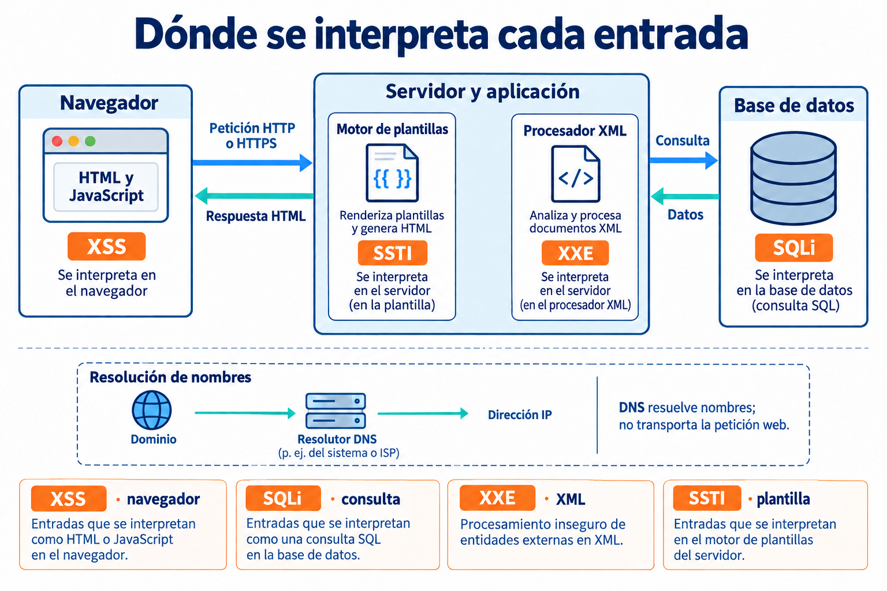
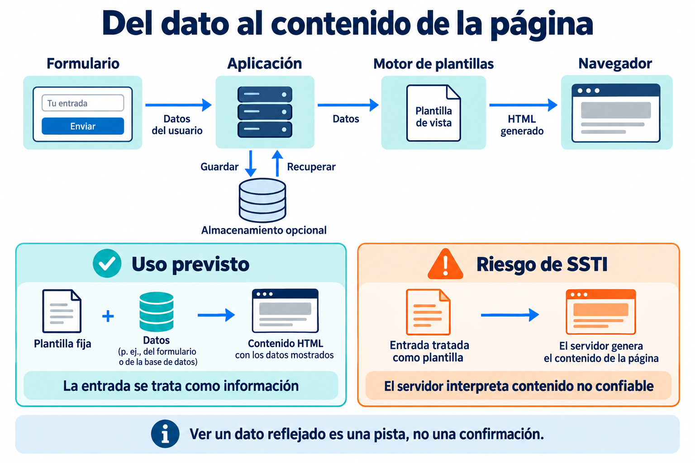
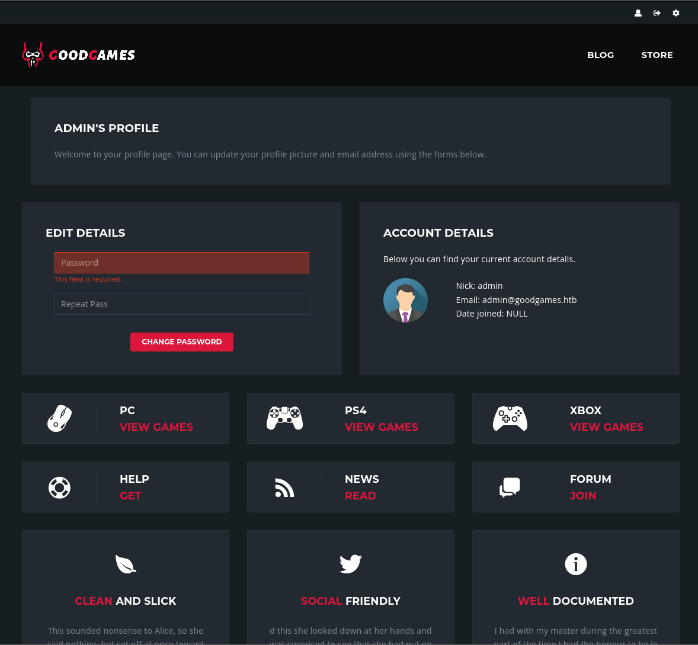
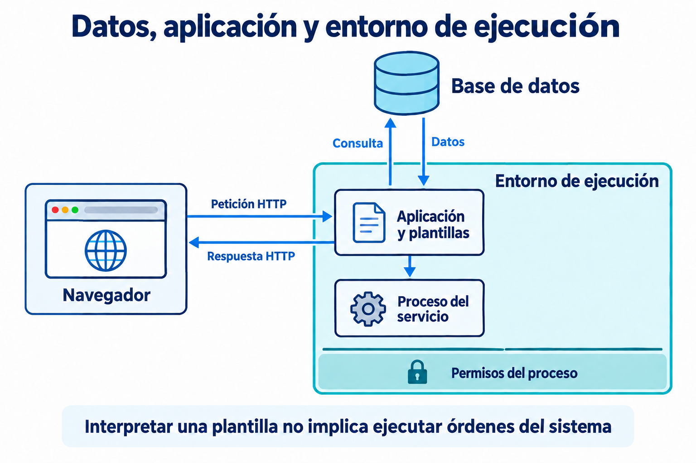

---
tags:
- Máquinas y prácticas
date: '2026-09-23'
author: Carlos Gómez Pintado
---

# SSTI y evidencias web - GoodGames

2026-09-23 · Carlos Gómez Pintado

# Mapa de la clase

Una entrada cambia de significado según el componente que la interpreta. La evidencia permite identificar ese componente y acotar lo que realmente se ha demostrado.

| **Concepto** | **Relaciones que debes recordar** |
| --- | --- |
| Arquitectura web | Nombre → resolución → dirección IP Navegador ⇄ aplicación ⇄ datos La aplicación genera una respuesta para el cliente. |
| Puntos de interpretación | XSS → navegador SQLi → consulta de base de datos XXE → procesador XML SSTI → motor de plantillas del servidor |
| Plantillas | Plantilla de confianza + datos → contenido Entrada interpretada como plantilla → riesgo de SSTI Reflejo, persistencia y evaluación son propiedades distintas. |
| Tecnologías | Lenguaje ≠ framework ≠ motor de plantillas Python / Flask / Jinja ayudan a situar la explicación. Identificar una tecnología no prueba una vulnerabilidad. |
| Evidencias | Comportamiento normal → cambio observado → hipótesis Respuesta HTTP, sesión, perfil y dato mostrado se contrastan. Un resultado negativo solo informa sobre el contexto probado. |
| Identidad y acceso | Autenticación → identidad; autorización → permisos Una sesión no implica conocer la contraseña. La reutilización de secretos conecta aplicaciones distintas. |
| Alcance y defensa | Evaluación de plantilla ≠ control total del sistema Aplicación → proceso → contenedor → anfitrión Separar código y datos, reducir permisos y proteger credenciales. |

**OBSERVAR → INTERPRETAR → CONTRASTAR → DELIMITAR**

Final de esta sesión: Carlos sitúa la ejecución relatada en un contenedor. El acceso al sistema anfitrión queda pendiente.

# Lo que enseña esta clase

Carlos Gómez Pintado dedica la sesión a entender la inyección de plantillas en el servidor, conocida como SSTI, y a relacionarla con otras vulnerabilidades web. GoodGames sirve como caso de estudio: permite observar cómo una misma aplicación ofrece pistas distintas según la función, el usuario y el componente que procesa la entrada.

La idea que organiza la clase es sencilla: **una hipótesis necesita una evidencia que la sostenga**. Ver un formulario no confirma una inyección. Encontrar una biblioteca no demuestra que sea vulnerable. Llegar a una pantalla de administración tampoco equivale a controlar todo el sistema. Carlos vuelve sobre esas diferencias mientras dibuja, compara respuestas y pregunta al grupo qué significa cada resultado.

## La historia de la explicación

Primero construye una arquitectura en la pizarra. Coloca el navegador, el servidor, los datos y las plantillas para que cada técnica tenga un lugar. Después relaciona la teoría con el comportamiento de la web: qué elementos funcionan, qué información se conserva y dónde vuelve a aparecer lo que escribe un usuario.

La parte práctica no avanza en línea recta. Hay problemas de conectividad, controles de la interfaz que no hacen lo que aparentan y pruebas que no producen el resultado esperado. Esos momentos forman parte del aprendizaje: obligan a comprobar supuestos y a volver a mirar la aplicación. Las intervenciones de los alumnos ayudan a localizar una función que había pasado desapercibida, plantear qué datos faltan y corregir una errata durante la explicación.

El cambio más relevante llega cuando la clase compara dos zonas de la aplicación. El perfil público y el panel interno no se comportan igual. Un resultado negativo en el primero no anticipa el comportamiento del segundo. Al final, Carlos explica que la ejecución observada ocurre dentro de un contenedor y deja pendiente el salto al sistema anfitrión.

## Qué debes poder explicar al terminar

- Dónde se interpretan las entradas en XSS, SQLi, XXE y SSTI.
- Qué diferencia hay entre mostrar datos y tratarlos como una plantilla.
- Cómo separar una respuesta observada de una conclusión todavía provisional.
- Por qué una sesión, una credencial y un permiso representan cosas distintas.
- Por qué los privilegios de un proceso deben interpretarse dentro de su entorno.

Estos apuntes reconstruyen el razonamiento, los resultados relatados y sus límites. Las aclaraciones añadidas se identifican como **Ampliación técnica**. Las marcas de tiempo se reúnen en la tabla final para que el desarrollo pueda leerse de forma continua.

# La arquitectura detrás de una página

Carlos empieza situando el recorrido de una petición. El navegador presenta la interfaz y envía información a la aplicación. El servidor procesa esa información, puede consultar una base de datos y construye una respuesta. Si interviene un motor de plantillas, este combina una estructura con los datos necesarios para producir el contenido que verá el usuario.

*Figura 1. Redibujo profesional de la pizarra general de Carlos. Las zonas indican componentes de procesamiento; no constituyen una cadena obligatoria entre vulnerabilidades.*

El dibujo permite contestar una pregunta antes de estudiar cualquier técnica: **¿qué componente interpreta la entrada?** El navegador interpreta HTML y JavaScript; la base de datos procesa consultas; un procesador XML trata documentos; el motor de plantillas genera contenido en el servidor.

**Ampliación técnica.** DNS ayuda a resolver un nombre a una dirección IP. No transporta la petición HTTP ni sustituye al enrutamiento. HTTPS añade protección mediante TLS. La ruta del servidor, el lenguaje y la ubicación de la base de datos dependen de la aplicación; Linux no implica necesariamente Apache ni PHP.

# Qué cambia entre las distintas inyecciones

El repaso inicial no presenta cuatro nombres intercambiables. Cada vulnerabilidad aparece cuando una entrada no confiable adquiere significado para un intérprete distinto. Esa ubicación explica por qué resultados visualmente parecidos pueden tener causas y consecuencias diferentes.

| **Tipo** | **Componente afectado** | **Qué se confunde** | **Distinción que conviene recordar** |
| --- | --- | --- | --- |
| XSS | Navegador | Datos con contenido activo de la página | La ejecución relevante ocurre en el cliente. |
| SQLi | Motor de base de datos | Datos con estructura de una consulta | Afecta al tratamiento de las consultas y a los datos accesibles. |
| XXE | Procesador XML | Documento con referencias externas inseguras | No es sinónimo de incluir un archivo local. |
| SSTI | Motor de plantillas del servidor | Datos con instrucciones de una plantilla | La interpretación ocurre antes de entregar el contenido al navegador. |

## Reflejar y almacenar no son lo mismo

En una respuesta reflejada, la entrada vuelve asociada a una petición. En un caso almacenado, la aplicación conserva el contenido y puede volver a mostrarlo después. Durante la clase, Carlos utiliza los comentarios y los datos del perfil para explicar esa persistencia.

El almacenamiento no tiene por qué estar en una base de datos relacional: puede estar en otro mecanismo de persistencia. Tampoco basta con que aparezca un valor en pantalla para afirmar que existe XSS. Debe distinguirse la representación de texto de su interpretación como contenido activo.

**Ampliación técnica.** Un XSS reflejado puede afectar a otras personas si estas reciben una petición preparada; no queda limitado por definición al navegador de quien lo descubre. Sus consecuencias tampoco se reducen al robo de cookies. El contexto de ejecución, las restricciones del navegador y las protecciones de la aplicación condicionan el impacto.

## Un resultado no demuestra otro

Que una aplicación presente XSS no confirma SSTI. Que acepte una petición POST no demuestra que haya guardado datos. Que exista una consulta tampoco implica que sea vulnerable a SQLi. Las coincidencias ayudan a formular preguntas, pero cada afirmación necesita su propia comprobación.

Esta separación evita un error frecuente en los apuntes: convertir la sucesión de ejemplos del profesor en una regla automática que se aplicaría a cualquier web.

# Cómo funcionan las plantillas

Una plantilla define la estructura de una salida. Los datos completan elementos variables, como un nombre, una descripción o un precio. Carlos utiliza esta separación para explicar por qué ver un valor en una página no dice todavía cómo se ha construido esa página.

*Figura 2. Adaptación del esquema de formulario, persistencia y respuesta. El almacenamiento es opcional y no convierte por sí solo un dato en código.*

La SSTI aparece cuando el contenido no confiable llega a interpretarse como parte de la plantilla. El problema está en la frontera entre datos e instrucciones. Un diseño que mantiene una plantilla fija y pasa los valores como datos conserva esa separación.

**Ampliación técnica.** Sustituir una variable de forma normal no ejecuta automáticamente lo que escribió el usuario. También conviene separar el escape de HTML, que ayuda frente a XSS, de la decisión de qué texto se compila o interpreta como plantilla. Son controles diferentes.

# Lenguaje, framework y motor de plantillas

Carlos presenta una tabla para que los nombres de los motores resulten familiares. Su intención no es que se memorice una lista de expresiones, sino que se entienda que la sintaxis y las capacidades dependen del componente que procesa la plantilla.

| **Ecosistema** | **Motores reconocibles en la explicación** | **Cómo interpretar la relación** |
| --- | --- | --- |
| Python | Jinja y Mako | Son motores de plantillas del ecosistema Python. |
| PHP | Twig y Smarty | No deben confundirse con el servidor HTTP. |
| Java | Thymeleaf, FreeMarker y Velocity | El motor concreto depende de la aplicación. |
| Ruby | ERB | Permite integrar contenido dinámico en plantillas. |
| JavaScript en el servidor | EJS y Handlebars | Node.js es un entorno de ejecución, no otro lenguaje. |
| .NET | Razor | .NET es una plataforma; Razor es tecnología de plantillas. |

La tabla normaliza los nombres reconocibles de la transcripción. La captura de la tabla original de motores no forma parte de los adjuntos; un nombre que no puede recuperarse con seguridad no se completa por intuición.

## El ejemplo de Python

En el laboratorio se menciona Werkzeug y se relaciona con aplicaciones Python y Flask. Conviene ordenar estos conceptos: **Python es el lenguaje, Flask es el framework, Werkzeug aporta utilidades web y Jinja es el motor de plantillas integrado por Flask**. Un banner puede orientar la investigación, pero no confirma todas las piezas de la aplicación ni la existencia de una vulnerabilidad.

**Ampliación técnica.** Flask utiliza Jinja por defecto, aunque la aplicación puede configurarse de otra manera. La presencia de Flask no permite asumir que cada campo del sitio se interprete como una plantilla. La configuración y la forma en que se construye la respuesta importan más que el nombre del framework.

## Qué significa obtener un resultado calculado

Carlos utiliza una operación aritmética como ejemplo didáctico de evaluación. La idea es distinguir entre el texto que se envía y el resultado que devuelve el motor. Aun así, un valor calculado no identifica por sí solo un motor concreto ni demuestra acceso al sistema operativo. Esa sería una afirmación distinta, con una evidencia distinta.

# Cómo empezó la investigación de GoodGames

La demostración se desarrolla en un laboratorio de Hack The Box. Antes de interpretar el comportamiento web, Carlos resuelve incidencias de acceso y comprueba que puede comunicarse con la máquina. Este arranque recuerda algo básico: si falla el entorno, una prueba sobre la aplicación puede producir resultados que no dicen nada sobre su seguridad.

## De la conectividad a las primeras hipótesis

La respuesta de red aporta información sobre accesibilidad. Carlos comenta el TTL y lo utiliza como pista sobre el sistema. Después examina los servicios detectados y centra la atención en el servicio HTTP observado. La lectura de la tecnología le lleva a investigar un componente que no era habitual en los ejemplos anteriores.

La enseñanza es **buscar para responder una duda concreta que surge de una evidencia**. No hace falta estudiar todas las tecnologías posibles antes de empezar; sí hace falta entender qué significa la información que realmente devuelve el entorno.

**Ampliación técnica.** El TTL no es una identificación definitiva del sistema operativo. Su valor depende del emisor y del recorrido. Una ausencia de respuesta ICMP tampoco demuestra que la máquina esté apagada. Y si un servicio no aparece en una observación parcial, no puede darse por inexistente en todo el entorno.

## Explorar el comportamiento normal

Carlos recorre la página, diferencia controles útiles de elementos de una plantilla visual y revisa qué ocurre al interactuar con ellos. El grupo detecta un acceso que no había recibido suficiente atención: el icono de usuario abre un formulario dentro de la propia página.

Esta escena resume el valor de la observación. Una interfaz vistosa puede contener enlaces de muestra, acciones locales o funciones incompletas. Por el contrario, un pequeño icono puede abrir una función real. La apariencia del elemento y la dirección que muestra el navegador no sustituyen a comprobar su comportamiento.

En la recuperación de contraseña aparece un mensaje genérico, que no confirma si existe la cuenta indicada. Más adelante, la creación de una cuenta de prueba permite conocer una respuesta válida y disponer de un punto de comparación. La cuenta normal revela qué campos reaparecen en el perfil y qué acciones están disponibles.

**Ampliación técnica.** Un enlace con fragmento no envía ese fragmento al servidor. Además, JavaScript puede asociar acciones a un control que aparentemente solo apunta a la misma página. Por eso una almohadilla en la URL no basta para concluir que el control carece de funcionalidad.

# Leer los cambios de respuesta

Carlos utiliza Burp Suite para observar la conversación entre navegador y aplicación. El valor pedagógico está en comparar respuestas con significado conocido: qué muestra una autenticación válida, qué mensaje aparece cuando falla y qué cambia en el contenido o en las cabeceras.

## Construir una referencia antes de concluir

Una respuesta HTTP correcta a nivel de protocolo no demuestra que el inicio de sesión haya tenido éxito. La aplicación puede devolver una página de error dentro de una respuesta con estado 200. Por eso Carlos atiende a varios indicadores: mensajes de bienvenida, información del usuario, presencia de una sesión y pantalla de destino.

La cabecera Set-Cookie comunica al navegador una cookie. Su aparición es un dato útil, pero el nombre de la cookie y su sola existencia no garantizan que represente una autenticación válida. Hay aplicaciones que crean sesiones anónimas. El significado se establece comparando el comportamiento normal y comprobando el estado de la aplicación.

Durante la demostración, el profesor distingue entre inspeccionar una respuesta y ver el estado actualizado en el navegador. Son observaciones relacionadas, aunque no idénticas: una respuesta aislada no sustituye a la comprobación del perfil que finalmente muestra la aplicación.

## La conclusión debe tener el tamaño de la prueba

En el primer perfil, las entradas utilizadas en clase no producen el comportamiento buscado para XSS o SSTI. El registro correcto es que **esas pruebas, en ese contexto, no mostraron ese resultado**. No equivale a certificar toda la aplicación ni todos sus campos.

Más adelante se describe una alteración del proceso de autenticación asociada a SQLi y aparece un perfil de administración. La captura aportada permite observar el estado visible de ese perfil. Por sí sola no explica cómo se obtuvo, qué permisos adicionales tiene ni si existe acceso al sistema operativo.

## Qué aporta la captura de Burp

La captura de Burp incluye una respuesta con el texto «Welcome main». Sirve para documentar que la respuesta cambia y muestra un valor diferente en una zona reconocible. Su interpretación se apoya en el contexto de la explicación de Carlos; no debe presentarse como prueba de que se haya visto toda la base de datos.

El aprendizaje consiste en enlazar cada resultado con una afirmación limitada y comprobable. Un dato visible puede apoyar una conclusión concreta y, al mismo tiempo, dejar abiertas muchas otras preguntas.

# La evidencia del perfil de administración

*Figura 3. Captura original aportada para esta sesión. A diferencia de los esquemas redibujados, esta imagen documenta una pantalla real del material recibido.*

Se observa el encabezado del perfil de administración, datos de la cuenta y el formulario de cambio de contraseña. El campo de contraseña muestra una advertencia de obligatoriedad. No es una evidencia de que se haya cambiado ninguna contraseña.

Carlos pide mirar de nuevo la interfaz porque el contexto del usuario ha cambiado. En su explicación, el elemento de configuración abre una zona de administración distinta. La lección es revisar qué capacidades tiene cada rol y comprobar cada contexto por separado.

La captura muestra un estado. La transcripción aporta la narración. Mantener esa diferencia evita atribuir a una imagen acciones o resultados que no contiene.

# Nombres, credenciales y aplicaciones distintas

La aparición de una zona interna introduce un problema distinto de los anteriores: el nombre del destino no se resuelve como espera la clase. Carlos vuelve al dibujo inicial para explicar la relación entre nombres y direcciones. La teoría de red que parecía un repaso se convierte así en una herramienta para entender el nuevo comportamiento.

## Resolver un nombre no concede acceso

El archivo hosts mantiene asociaciones locales entre nombres y direcciones. Puede permitir que un equipo reconozca un nombre utilizado en un laboratorio. Esa asociación no crea una cuenta, no concede permisos y no convierte el equipo en un servidor DNS para toda la red.

**Ampliación técnica.** Un nombre de dominio y un subdominio son nombres distintos. Registrar uno en hosts no añade automáticamente todos los demás. También puede haber resolución DNS dentro de una red privada; usar una dirección privada no significa que no exista DNS ni que sea imposible acceder a Internet.

Una vez presentada la otra aplicación, Carlos vuelve a estudiar su comportamiento. No presupone que el resultado obtenido en la primera pantalla de autenticación tenga que repetirse. Las comprobaciones descritas no proporcionan el mismo acceso y aparece la pregunta de qué información se conoce realmente sobre esa segunda aplicación.

## Tener una sesión y conocer una contraseña

La clase distingue dos situaciones: disponer de una sesión aceptada por una aplicación y conocer una credencial válida. No son equivalentes. Carlos utiliza esa diferencia para explicar por qué el estado alcanzado en una pantalla no resuelve automáticamente la autenticación de otra.

En el relato se describe exposición de información de usuarios, tratamiento débil de contraseñas y reutilización de una credencial entre aplicaciones. El resultado comunicado por el profesor es el acceso al panel interno. Los apuntes conservan ese hallazgo y su significado: compartir secretos entre sistemas permite que un problema de una aplicación afecte a otra.

**Ampliación técnica.** Un hash no es una contraseña cifrada que se descifra con una clave. La comparación de candidatos o la existencia de valores conocidos puede permitir recuperar una contraseña débil. MD5 no es una opción adecuada para almacenar contraseñas. Deben emplearse mecanismos específicos de almacenamiento, con sal y coste de cálculo apropiado.

La defensa exige tanto proteger la base de datos como evitar la reutilización de secretos. También requiere controlar los permisos de cada aplicación y revisar el ciclo de vida de sus sesiones.

# Por qué la segunda plantilla cambia el análisis

Dentro del panel interno, Carlos repite el hábito que ha aplicado desde el principio: conocer las funciones reales de la interfaz antes de sacar conclusiones. Observa que varios elementos pertenecen a la presentación del panel y centra la explicación en los campos de configuración que sí producen cambios visibles.

## El nombre visible como dato

El profesor subraya una distinción que puede pasar desapercibida: cambiar el nombre completo del perfil no significa cambiar el identificador usado para iniciar sesión. Un atributo de presentación, una dirección de correo y un nombre de acceso pueden ocupar campos distintos y tener reglas distintas.

La evidencia inicial es que un valor introducido reaparece en la página. Ese hecho permite estudiar cómo se trata el dato, aunque todavía no identifica una vulnerabilidad concreta. Carlos conecta esta observación con el segundo esquema de la pizarra: entrada, posible persistencia y salida visible.

## Persistencia y procesamiento

La transcripción relata un comportamiento de XSS que reaparece al volver a cargar la página. Carlos lo utiliza para explicar la persistencia del contenido. La interpretación más prudente es que el caso relatado es compatible con un XSS almacenado; las capturas adjuntas no incluyen ese momento ni permiten inspeccionar el mecanismo exacto de almacenamiento.

Después, el profesor describe una evaluación de contenido de plantilla y la aparición de un resultado calculado. Este resultado corresponde a otra capa del sistema. El navegador recibe el contenido que ha preparado el servidor, de modo que el parecido visual con una respuesta anterior no debe ocultar la diferencia entre interpretación en cliente e interpretación en servidor.

## La hipótesis vuelve con un contexto nuevo

La aportación de la clase está en que la hipótesis inicial no desaparece para siempre cuando una prueba falla. Se reevalúa al cambiar de aplicación y de campo. El primer perfil y el panel interno tienen superficies y tratamientos diferentes; por eso el resultado anterior no se extrapola.

**Ampliación técnica.** Que aparezca XSS no demuestra una falta absoluta de controles ni confirma SSTI. También sería excesivo identificar el motor únicamente por una respuesta aritmética. La tecnología visible, el comportamiento del campo y las comprobaciones específicas deben valorarse conjuntamente.

Carlos relata después una demostración de ejecución en el entorno del servicio. Ese impacto se documenta como un resultado adicional de la clase, sin confundirlo con la mera aparición de un número calculado. La pregunta siguiente es dónde se ejecuta ese proceso y qué límites tiene.

# El proceso y su entorno

El tercer dibujo ayuda a separar el acceso a datos del entorno que ejecuta la aplicación. Carlos sitúa el navegador, la base de datos y un sistema Linux. La versión profesional conserva esa relación y distingue la aplicación de los permisos con los que trabaja su proceso.

*Figura 4. Adaptación conceptual del dibujo azul. La interpretación de una plantilla y la ejecución de órdenes del sistema son capacidades diferentes; una no demuestra automáticamente la otra.*

Una aplicación puede consultar datos con una identidad y ejecutar su proceso con otra. El alcance de un fallo depende de ambas, de los recursos expuestos y del aislamiento del entorno. El dibujo no establece que todos esos componentes compartan permisos.

**Ampliación técnica.** Evaluar una expresión dentro del motor no implica iniciar un intérprete de órdenes. Tampoco la ejecución de un proceso implica acceso al anfitrión. El informe debe especificar la capacidad observada, la identidad y el ámbito al que se refiere.

# Dónde termina la demostración

El cierre de la clase introduce una distinción decisiva: **root dentro de un contenedor no demuestra control del sistema anfitrión**. Carlos había anunciado que la parte posterior de la máquina quedaba fuera del objetivo del día. Al final retoma ese límite para explicar por qué el estado alcanzado no equivale a completar todo el laboratorio.

## Lo que relata el profesor

La transcripción describe una ejecución en el entorno de la aplicación, una identidad con privilegios elevados dentro de ese entorno y una sesión interactiva. Después se mencionan indicios de contenedor y se aclara que queda pendiente salir de él. No se aporta una captura de terminal que permita verificar independientemente todos esos detalles.

Por eso el cierre de los apuntes mantiene dos niveles: el resultado **relatado en clase** y la **evidencia gráfica disponible**. Las cinco capturas recibidas no incluyen una prueba de control del anfitrión ni la consecución del objetivo final de la máquina.

| **Ámbito** | **Qué representa** | **Qué no debe deducirse automáticamente** |
| --- | --- | --- |
| Aplicación web | Funciones, usuarios, sesiones y datos del sitio | Que una sesión permita actuar sobre todo el sistema |
| Proceso del servicio | Identidad y permisos con los que corre la aplicación | Que evaluar una plantilla permita cualquier operación |
| Contenedor | Entorno aislado de procesos y recursos | Que su usuario root controle el anfitrión |
| Sistema anfitrión | Entorno que ejecuta los contenedores | Que se haya accedido a él en esta sesión |

## Cómo interpretar los indicios

**Ampliación técnica.** Un contenedor no es, por definición, una máquina virtual con un sistema operativo completamente independiente. En Linux utiliza mecanismos de aislamiento del núcleo. La existencia de un archivo de construcción o de un nombre relacionado con Docker puede ser una pista, pero no reemplaza una comprobación del entorno de ejecución.

La salida de una aplicación puede demostrar la identidad de un proceso en un ámbito concreto. Para extender esa conclusión al anfitrión hacen falta otras evidencias. Además, una petición que queda esperando no confirma por sí sola que exista una sesión interactiva; debe correlacionarse con lo que ocurre en el otro extremo.

La clase termina con la explicación del límite, no con una demostración de salida del contenedor. Ese pendiente se conserva expresamente para no convertir una expectativa en un resultado.

# Matices técnicos para estudiar con precisión

Estas aclaraciones son **Ampliación técnica**. Corrigen simplificaciones de la exposición oral y se apoyan en la documentación indicada al final. No describen pruebas nuevas sobre GoodGames.

## El alcance de una observación de red

Nmap examina por defecto los 1000 puertos más comunes de cada protocolo solicitado, no 10000. Una observación parcial no confirma la ausencia de otros servicios. El volumen de tráfico tampoco puede expresarse como un número fijo de paquetes por puerto: depende del tipo de comprobación, del estado del servicio y de las respuestas.

El TTL disminuye durante el recorrido y puede servir como indicio, pero no existe una equivalencia universal entre un valor recibido y un sistema operativo. Una hipótesis sobre Linux tampoco identifica el servidor web, el lenguaje ni el motor de plantillas.

## El orden de los datos y las identidades

No hay una regla general según la cual el primer identificador de una tabla sea siempre el administrador. Tampoco debe asumirse el orden de los resultados de una consulta sin una ordenación explícita. La selección de una cuenta por parte de una aplicación depende de su implementación y de sus datos.

El estado 200, una cookie nueva o un mensaje de bienvenida son señales que deben interpretarse en conjunto. Una sesión puede existir antes de la autenticación. El perfil visible aporta contexto, pero sus permisos efectivos necesitan comprobaciones propias.

## La tecnología no equivale a vulnerabilidad

JavaScript también se ejecuta en servidores, por ejemplo mediante Node.js. Python no implica Flask, y una instalación de Flask no significa que toda entrada se utilice como código de plantilla. Los nombres de tecnologías orientan, pero no certifican un fallo.

El escape de HTML ayuda a que los valores se muestren como datos. La prevención de SSTI exige controlar además la procedencia de la plantilla y el contexto que puede utilizar. Una prueba negativa aislada no identifica el control que ha impedido el resultado: no permite afirmar sin más que la aplicación «sanitiza todo».

## La persistencia y el impacto requieren contexto

Un contenido que reaparece puede estar almacenado mediante distintos mecanismos. La observación es relevante, pero no identifica necesariamente una tabla de base de datos. Del mismo modo, un XSS puede tener consecuencias distintas del acceso a cookies y sigue siendo un hallazgo relevante aunque no sirva para avanzar en una práctica concreta.

En el cierre, la identidad del proceso y el ámbito de ejecución deben anotarse juntos. La conclusión «se ejecuta dentro del contenedor» es más precisa que «se ha controlado la máquina» cuando no se demuestra el acceso al anfitrión.

# Aplicación defensiva de lo aprendido

La clase permite traducir cada tipo de problema a una decisión de diseño. Estas medidas son **Ampliación técnica**: no implican que se hayan aplicado o verificado en el laboratorio.

| **Riesgo** | **Medida principal** | **Qué debe comprobarse** |
| --- | --- | --- |
| SQLi | Separar consulta y parámetros | Que la entrada se trate como dato y los permisos de base de datos sean mínimos |
| XSS | Codificación de salida según contexto y tratamiento seguro del HTML | Que los datos no se conviertan en contenido activo inesperado |
| SSTI | Plantillas de confianza y datos separados | Que las entradas no definan la estructura de la plantilla |
| Exposición de contraseñas | Hash específico para contraseñas, sal y coste adecuado | Que no se utilicen texto plano ni mecanismos rápidos inadecuados |
| Reutilización de secretos | Credenciales distintas y control de accesos por aplicación | Que un incidente no se propague por compartir la misma contraseña |
| Exceso de privilegios | Servicio con permisos mínimos y aislamiento revisado | Qué recursos ve y puede modificar realmente el proceso |
| Enumeración de cuentas | Respuestas de recuperación coherentes | Mensajes y tiempos que no revelen innecesariamente la existencia de usuarios |

## Un mismo hábito para todas las fases

En **Planificación** se fija el alcance y el objetivo del trabajo. En **Recogida de información** se documentan servicios, funciones y comportamiento normal. En **Análisis de vulnerabilidades** se relacionan observaciones con hipótesis, manteniendo sus incertidumbres. En **Pruebas de explotación controladas** se registra únicamente el impacto efectivamente demostrado y se respetan los límites acordados.

La sesión ilustra que descubrir algo no elimina la necesidad de seguir describiéndolo bien. Un hallazgo útil incluye el componente afectado, las condiciones observadas, la consecuencia y la evidencia que lo respalda.

## El ejemplo de redes públicas

Carlos introduce una digresión sobre suplantación de resolución de nombres en redes compartidas. La idea relevante para estos apuntes es el riesgo de confiar en una infraestructura de red ajena. La digresión no constituye una prueba realizada en esta clase ni justifica asumir que cualquier red pública esté comprometida.

La lectura defensiva es mantener la verificación de identidad del servicio, atender a errores de certificados y separar los recursos de administración de los accesos de usuarios. Resolver un nombre y confiar en quien responde son problemas distintos.

# Herramientas y usos de la sesión

Los niveles se refieren únicamente a esta clase. «Practicada» indica que aparece en la demostración relatada; no certifica el dominio del alumno. Se resume el uso y su interpretación, sin reconstruir instrucciones operativas de intrusión.

| **Herramienta** | **Objetivo** | **Fase** | **Uso visto** | **Nivel** | **Notas** |
| --- | --- | --- | --- | --- | --- |
| Navegador | Comprender la aplicación | Recogida de información | Interfaz y perfil | Practicada | La apariencia no prueba la función |
| ping | Comprobar respuesta de red | Recogida de información | Accesibilidad y TTL | Practicada | Ausencia de respuesta no implica caída |
| traceroute | Razonar sobre el recorrido | Recogida de información | Comentario de saltos | Practicada | Interpretación dependiente de red |
| Nmap | Identificar servicios | Recogida de información | Servicio HTTP y tecnología | Practicada | Alcance parcial de la observación |
| Burp Proxy | Observar tráfico HTTP | Recogida de información | Peticiones y respuestas | Practicada | Distinguir navegador y respuesta aislada |
| Burp Repeater | Comparar respuestas | Análisis de vulnerabilidades | Estado, texto y cabeceras | Practicada | Un marcador no basta por sí solo |
| Burp Intruder | Comparación de variantes | Análisis de vulnerabilidades | Comentado como recurso | Mencionada | No consta una campaña completa |
| Feroxbuster | Descubrir rutas | Recogida de información | Rutas visibles y adicionales | Practicada | No todo recurso es relevante |
| Wappalyzer y WhatWeb | Reconocer tecnologías | Recogida de información | Propuestos como apoyo | Mencionada | Una identificación puede ser parcial |
| sqlmap | Automatización de SQLi | Análisis de vulnerabilidades | Comentado por el grupo | Mencionada | No sustituye la comprensión del hallazgo |
| Netcat | Canal de comunicación | Pruebas de explotación controladas | Sesión relatada al cierre | Practicada | Sin captura adjunta de esa terminal |

La transcripción contiene errores fonéticos en varios nombres. Se han normalizado cuando el contexto permite identificarlos. Las extensiones, versiones y comandos no visibles no se reconstruyen como si fueran una salida original.

# Glosario y preguntas de repaso

| **Término** | **Significado en esta sesión** |
| --- | --- |
| Frontend | Parte de la aplicación presentada y ejecutada en el cliente |
| Backend | Lógica y procesamiento del lado del servidor |
| Plantilla | Estructura que combina presentación y datos para generar una salida |
| Motor de plantillas | Componente que interpreta la plantilla y produce contenido |
| Contexto de plantilla | Valores y funciones disponibles durante su procesamiento |
| Renderizado | Generación de la salida a partir de una estructura y sus datos |
| Evidencia | Observación que respalda una afirmación concreta |
| Hipótesis | Explicación provisional que todavía necesita contraste |
| Autenticación | Comprobación de una identidad |
| Autorización | Decisión sobre qué puede hacer una identidad |
| Sesión | Estado que relaciona interacciones con un contexto de usuario |
| Hash | Resultado de una función unidireccional; no equivale a cifrado reversible |
| RCE | Ejecución remota de código; su alcance depende del proceso y del entorno |
| Contenedor | Entorno aislado de procesos y recursos que comparte el núcleo en Linux |
| Anfitrión | Sistema que ejecuta los contenedores |

## Comprueba que has entendido el razonamiento

1. Un valor aparece en la página después de guardarlo. ¿Qué sabes y qué te falta para hablar de una vulnerabilidad?
2. Una respuesta devuelve estado 200 y una cookie. ¿Por qué no basta para afirmar que existe una sesión autenticada?
3. El primer perfil no muestra una vulnerabilidad y otro panel sí. ¿Por qué ambos resultados pueden ser compatibles?
4. Una plantilla produce un resultado calculado. ¿Qué afirmaciones adicionales necesitarían otras evidencias?
5. El proceso aparece como root. ¿Qué debes saber antes de hablar de control del sistema anfitrión?

Las respuestas deben separar dato observado, interpretación y límite. Si una frase contiene «siempre» o «automáticamente», conviene comprobar qué condiciones está omitiendo.

# Fuentes y alcance de la edición

## Material de la clase

La reconstrucción utiliza la transcripción completa y las cinco capturas aportadas por Chema para la sesión del 23/09/2026. El profesor y la fecha proceden de su indicación expresa. La ficha ilustrada de Carlos se usa únicamente para la identidad visual de la portada.

Los tres esquemas profesionales son adaptaciones didácticas de los dibujos recibidos. Sus pies los distinguen de la captura original del perfil. La baja resolución de la pizarra general impide recuperar con seguridad todas las anotaciones pequeñas; esas zonas no se han completado como si fueran texto legible.

Los tramos de conversación social, incidencias de audio y descanso se han separado del contenido de estudio. Las menciones a clases anteriores se conservan solo en lo que explica esta transcripción; no se han incorporado apuntes de otras sesiones.

## Documentación de verificación

Consulta realizada el 23/09/2026. Estas fuentes sostienen las ampliaciones y correcciones; no son evidencias de acciones realizadas en clase.

- [Nmap y selección de puertos](https://nmap.org/book/man-port-specification.html): alcance predeterminado de 1000 puertos.
- [RFC 791 sobre IPv4](https://www.rfc-editor.org/info/rfc791/): significado y disminución del TTL.
- [Manual de hosts](https://man7.org/linux/man-pages/man5/hosts.5.html): asociación local entre nombres y direcciones.
- [MDN sobre fragmentos de URI](https://developer.mozilla.org/en-US/docs/Web/URI/Reference/Fragment): tratamiento del fragmento en el cliente.
- [Flask y plantillas](https://flask.palletsprojects.com/en/stable/templating/): integración de Jinja y escape de HTML.
- [Jinja](https://jinja.palletsprojects.com/en/stable/): motor de plantillas y generación de contenido con datos.
- [Node.js](https://nodejs.org/learn/getting-started/introduction-to-nodejs): JavaScript en un entorno de ejecución fuera del navegador.
- [MySQL y ordenación de filas](https://dev.mysql.com/doc/refman/8.4/en/sorting-rows.html): necesidad de ordenar explícitamente los resultados.
- [OWASP y prevención de SQLi](https://cheatsheetseries.owasp.org/cheatsheets/SQL_Injection_Prevention_Cheat_Sheet.html): consultas parametrizadas y permisos mínimos.
- [OWASP y prevención de XSS](https://cheatsheetseries.owasp.org/cheatsheets/Cross_Site_Scripting_Prevention_Cheat_Sheet.html): codificación de salida y contexto.
- [OWASP y almacenamiento de contraseñas](https://cheatsheetseries.owasp.org/cheatsheets/Password_Storage_Cheat_Sheet.html): hash específico, sal y coste.
- [OWASP y recuperación de contraseñas](https://cheatsheetseries.owasp.org/cheatsheets/Forgot_Password_Cheat_Sheet.html): respuestas que no revelen la existencia de cuentas.
- [Docker y seguridad](https://docs.docker.com/engine/security/): aislamiento y límites entre contenedor y anfitrión.

# Ideas importantes de la transcripción

Las referencias de esta tabla corresponden a la transcripción recibida. Las capturas se identifican por su nombre original cuando aportan evidencia adicional.

| **Tema** | **Idea importante** | **Referencia** |
| --- | --- | --- |
| Objetivo de la clase | Carlos introduce SSTI y anuncia una práctica que conecta conceptos anteriores. | 08:16–09:42 |
| Arquitectura web | Dibuja navegador, comunicación, servidor, datos y plantilla antes de comparar técnicas. | 11:00–17:48; brave\_WFOV1PXZQV.png |
| Lugar de interpretación | Distingue XSS, SQLi, XXE y SSTI por el componente que procesa la entrada. | 17:51–24:00 |
| Ecosistemas y motores | Presenta una tabla de tecnologías para relacionar lenguaje y motor de plantillas. | 24:56–37:22 |
| Entrada y salida | Relaciona el formulario con la respuesta visible y la posible persistencia del dato. | 37:26–41:57; brave\_cC5kls3YYL.png |
| Límite previsto | Anuncia GoodGames y deja la parte posterior de privilegios para otro momento. | 45:16–45:49; 53:03–53:35 |
| Entorno de red | Comprueba conectividad y utiliza TTL y servicios como pistas iniciales. | 54:49–58:14 |
| Tecnología observada | La discusión sobre el servicio web conduce a Python, Werkzeug y Flask. | 58:14–01:05:46 |
| Interfaz real | Diferencia controles de muestra y funciones útiles; el grupo localiza el acceso de usuario. | 01:09:13–01:18:59 |
| Recuperación de cuenta | El mensaje genérico no confirma si existe el correo indicado. | 01:19:08–01:20:36 |
| Cuenta de prueba | El registro normal permite observar un perfil y reconocer datos que vuelven a mostrarse. | 01:20:38–01:25:18 |
| Resultados negativos | Las pruebas descritas en el primer perfil no muestran el comportamiento buscado. | 01:25:19–01:28:42 |

# Ideas importantes · continuación

| **Tema** | **Idea importante** | **Referencia** |
| --- | --- | --- |
| Comparación HTTP | Carlos compara sesión, mensajes y respuestas para interpretar los cambios. | 01:34:54–01:40:25 |
| Perfil de administración | La clase observa un estado distinto del perfil y una función adicional de configuración. | 01:42:50–01:46:05; vmware\_WpSH2timXy.png |
| Resolución de nombres | Se explica la asociación local del nombre de la zona interna. | 01:46:13–01:49:34 |
| Segundo contexto | La otra pantalla de autenticación no se comporta igual que la primera. | 02:13:51–02:19:31 |
| Exposición de datos | Carlos explica resultados relacionados con los datos de la aplicación; la captura muestra «Welcome main». | 02:20:02–02:34:34; brave\_njPLSl8Xn9.png |
| Credenciales | Relata una contraseña débil y reutilizada entre aplicaciones y el acceso al panel interno. | 02:34:43–02:36:53 |
| Campo del panel | Distingue el nombre completo del identificador de acceso y observa su reflejo en la página. | 02:38:30–02:42:32 |
| Persistencia y SSTI | Describe comportamiento persistente de XSS y después evaluación de una plantilla. | 02:42:33–02:47:38 |
| Impacto relatado | Explica ejecución en el entorno del servicio y la diferencia respecto a la evaluación inicial. | 02:48:25–02:52:24 |
| Contenedor | Aclara que el entorno es un contenedor y que falta llegar al anfitrión. | 02:53:28–02:57:13; 03:00:07–03:00:54 |
| Conclusión | Propone razonar por componentes y relacionar hallazgos sin perder el contexto. | 02:57:34–03:00:54 |

# Actualización de memoria del proyecto

Esta tabla pertenece a la sesión. Sus hechos no se convierten en reglas de otras clases.

| **Categoría** | **Información nueva** | **Nivel de certeza** | **Acción futura** |
| --- | --- | --- | --- |
| Metadatos | Carlos Gómez Pintado y fecha 23/09/2026, indicados por Chema | Alta | Conservar en las versiones de esta entrega |
| Contenido | SSTI relacionada con arquitectura web, evidencias y contexto de usuario | Alta | Repasar las diferencias entre intérpretes |
| Evidencia gráfica | Perfil de administración y respuesta «Welcome main» en capturas aportadas | Alta | Mantener originales separados de los redibujos |
| Demostración final | Ejecución en un contenedor, descrita en la transcripción | Media | Añadir captura de terminal si se desea reforzar la evidencia documental |
| Pendiente | No consta una salida del contenedor ni la finalización del objetivo del anfitrión | Alta | Tratar una continuación como sesión independiente |
| Material visual | Tres redibujos de las pizarras y portada ilustrada de Carlos | Alta | Registrar correcciones visuales en Picaso sin arrastrar datos de la clase |

## Qué queda por confirmar

No se dispone de la captura original de la tabla de motores ni de las salidas completas de terminal del cierre. Las zonas ilegibles de los dibujos no se presentan como recuperadas. Estos límites no alteran el hilo conceptual de la clase, pero sí el detalle que puede atribuirse a una evidencia visual.

La entrega termina donde termina el material: una explicación de los hallazgos observados y de los límites del entorno. No se añaden resultados de una continuación que no forma parte de esta sesión.
