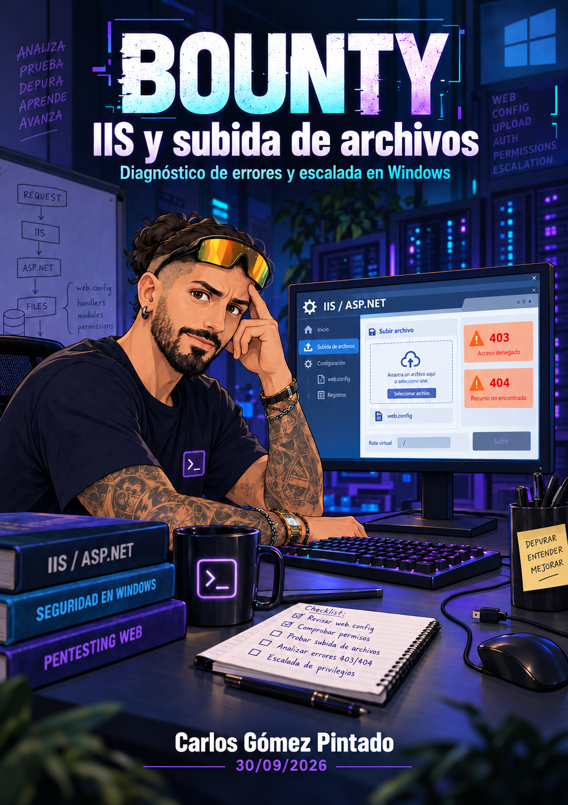

---
tags:
- Auditoría web
date: '2026-09-30'
author: Carlos Gómez Pintado
---

# Bounty

2026-09-30 · Carlos Gómez Pintado

**BOUNTY · ESQUEMA EDITABLE**

Mapa de la clase

La práctica conecta la enumeración de una web con el análisis de una subida de archivos y la revisión de privilegios en Windows. Los fallos ayudan a entender qué comprobar en cada etapa.

| **Fase** | **Ramas de conocimiento y relación** |
| --- | --- |
| 1 Planificación | Laboratorio autorizado → conectividad y VPN → objetivo de la práctica. Si la instancia falla, separar el problema de infraestructura del análisis de seguridad. |
| 2 Recogida de información | Nmap y tecnologías web → IIS / ASP.NET → directorios y archivos. Diccionarios y extensiones → Shortscan → formulario transfer.aspx. |
| 3 Análisis de vulnerabilidades | Subida de archivos → extensión, tipo, contenido y tamaño. Burp → petición real y respuesta → aceptación de .config. |
| 4 Pruebas de explotación controladas | Configuración de IIS → ejecución relatada → web shell. Intérprete y codificación → conexión inversa → identidad y privilegios. |
| Revisión de privilegios | SeImpersonatePrivilege → condiciones de JuicyPotato. Programa, modo de creación y puerto COM → resultado SYSTEM relatado. |
| Diagnóstico transversal | Observar → formular hipótesis → cambiar una variable → comparar. Distinguir error de sintaxis, transporte, permisos, aplicación e infraestructura. |

## Tres distinciones que evitan errores

Subir un archivo, acceder a él y ejecutarlo son capacidades distintas. Una respuesta HTTP correcta puede contener un rechazo de la aplicación. Obtener una conexión no demuestra que se hayan elevado los privilegios.

Contenido de clase: el recorrido y las incidencias proceden de la transcripción. Ampliación técnica: las aclaraciones identificadas con referencias [R] contrastan conceptos que se simplificaron durante la explicación.

**30 DE SEPTIEMBRE DE 2026 · CARLOS GÓMEZ PINTADO**

# Objetivos y resultado de la sesión

El objetivo de esta clase fue practicar cómo razonar ante una máquina que no responde a la secuencia habitual de herramientas. El profesor había preparado varias máquinas, pero los problemas de la primera obligaron a cambiar de escenario. La práctica principal terminó centrada en Bounty, con una aplicación sobre Windows, IIS y ASP.NET.

La enseñanza principal es que cada resultado debe orientar la siguiente comprobación. Un diccionario sin hallazgos, un archivo rechazado o una conexión que no llega no explican por sí solos la causa del problema. Hay que examinar qué se envió, qué respondió el sistema y qué condición faltaba.

## Qué se debe comprender al terminar

| **Objetivo** | **Pregunta que deberías poder responder** |
| --- | --- |
| Enumeración | ¿Por qué cambiar el diccionario, las extensiones o la técnica de búsqueda? |
| Subidas | ¿Qué diferencia hay entre aceptar un archivo y ejecutarlo en el servidor? |
| Diagnóstico | ¿Cómo distinguir un fallo real de un falso negativo provocado por la herramienta? |
| Acceso | ¿Qué cambia entre una web shell y una conexión inversa? |
| Privilegios | ¿Qué evidencia demuestra la identidad y los privilegios del proceso? |

## Resultado relatado en clase

La transcripción describe el descubrimiento del formulario, la aceptación de archivos .config y la obtención de ejecución de comandos. Después se anuncia una conexión inversa, la lectura de user.txt y una nueva sesión identificada como NT AUTHORITY\SYSTEM, seguida de la lectura de root.txt. Los valores de las flags no aparecen en el texto.

Alcance de la evidencia: estos son resultados relatados durante la clase, no una reproducción independiente del laboratorio. No se dispone de capturas, del vídeo ni de los mensajes con los payloads. Los comandos incompletos no se reconstruyen como si fueran literales.

El nombre Bounty se normaliza a partir de las menciones del host y del cierre de la sesión. La portada es una ilustración de la práctica y sus incidencias. El mapa inicial conecta las fases y permite repasar el razonamiento antes de entrar en los detalles.

**DE LA CONECTIVIDAD A UNA HIPÓTESIS ÚTIL**

# Reconocimiento y enumeración web

## Contenido de clase

El trabajo comienza con la VPN, la respuesta de la máquina y Nmap. La instancia inicial responde a algunas comprobaciones, pero el escaneo y el arranque presentan bloqueos. Se contrasta con otra máquina y se cambia de objetivo. La clase muestra así que un problema de infraestructura puede consumir tiempo sin aportar información sobre vulnerabilidades.

En el nuevo entorno se revisan la página, su código fuente, las tecnologías y las rutas. Los indicios apuntan a Windows con IIS y ASP.NET. Se comentan el TTL y Wappalyzer como pistas. El TTL se debe tratar como orientación: por sí solo no confirma el sistema operativo.

La enumeración con dirsearch se amplía al cambiar el diccionario y considerar extensiones. Un listado de palabras propone nombres; si el recurso buscado no está representado, la herramienta puede no descubrirlo. Una lista mayor exige más peticiones y tiempo. El cambio debe tener una razón, como adaptarse a la tecnología o buscar archivos además de directorios.

## La especialización de Shortscan

Tras varios intentos sin el resultado deseado se busca una herramienta específica para IIS. Shortscan aparece como alternativa y su puesta en marcha da problemas. Después de recurrir a ayuda de IA, la clase relata nuevos hallazgos, entre ellos transfer.aspx y el directorio de archivos subidos.

Ampliación técnica [R2]: Shortscan enumera nombres cortos de archivos en IIS e intenta resolver sus nombres completos. No es simplemente un diccionario más grande ni garantiza encontrar todos los recursos de cualquier servidor IIS.

## Cómo interpretar las respuestas

Un 301 invita a comprobar la redirección; un 403 indica que la solicitud no se autoriza, pero no permite deducir todos los permisos de los archivos interiores. Un 404 requiere revisar ruta, nombre y comportamiento del servidor. Los resultados deben anotarse junto con la petición concreta y las condiciones de la prueba.

Ampliación técnica [R1]: Nmap -Pn omite el descubrimiento previo de hosts y trata los objetivos como activos para el escaneo solicitado. No desactiva la resolución DNS; esa función corresponde a -n. Un mismo diccionario tampoco garantiza resultados idénticos si las herramientas usan otras extensiones, filtros o ajustes.

**ACEPTACIÓN · ALMACENAMIENTO · TRATAMIENTO**

# Qué se analiza en una subida de archivos

## Contenido de clase

El formulario de transfer.aspx permite seleccionar un archivo. Se prueban varios tipos y aparecen mensajes de archivo inválido. El profesor propone dejar de adivinar y analizar la petición con Burp. En vez de enumerar directorios, ahora se estudia una función de la aplicación: qué acepta y cómo informa del resultado.

| **Elemento** | **Qué representa** | **Qué hay que distinguir** |
| --- | --- | --- |
| Nombre y extensión | Nombre declarado en la subida. | Una extensión admitida no demuestra que el contenido sea seguro. |
| Content-Type | Tipo de medio declarado. | La declaración del cliente puede no corresponder al contenido. |
| Contenido y firma | Bytes reales del archivo. | MIME es una clasificación; una firma son bytes característicos. |
| Tamaño | Cantidad de datos transferidos. | El cuerpo HTTP puede incluir más datos que el propio archivo. |
| Destino | Lugar y nombre con que se almacena. | El nombre local no prueba la ruta final ni los permisos. |

En una petición multipart/form-data pueden convivir campos del formulario y una parte de archivo. Los separadores delimitan esas partes. El nombre, el tipo declarado y los bytes cumplen funciones diferentes: cambiar uno no significa haber cambiado los demás.

## Lo que sí y lo que no demuestra una prueba

La aceptación de un archivo demuestra una decisión del flujo de subida, pero todavía hay que estudiar su almacenamiento y tratamiento. Un mensaje de éxito tampoco revela automáticamente la URL de acceso. En clase se relacionan tres capacidades: subir, acceder y ejecutar; deben comprobarse por separado.

Ampliación técnica [R3, R4]: una subida puede conducir a ejecución cuando el servidor trata el archivo como código. El navegador no ejecuta el PHP del servidor. El tipo declarado y la firma son controles complementarios, no pruebas suficientes de inocuidad.

Durante la exploración también se examina una imagen con strings y ExifTool sin que se relate un hallazgo útil. Leer cadenas o metadatos es distinto de demostrar esteganografía. La pista se descarta para continuar con la función de subida que sí ofrece resultados.

**COMPARAR LA PETICIÓN REAL ANTES DE DESCARTAR UNA IDEA**

# Burp y los falsos negativos

## Contenido de clase

Proxy permite interceptar la subida; Repeater sirve para repetir una petición controlada y observar la respuesta; Intruder se usa para variar una posición con una lista de candidatos. La práctica aplica estas funciones a extensiones de archivo, no a un formulario de acceso.

Al principio, las pruebas parecen rechazar todas las extensiones. Se observa un código HTTP 200 y una longitud repetida, con el texto de archivo inválido. Ese 200 significa que hubo una respuesta HTTP satisfactoria, pero la aplicación está rechazando la operación solicitada.

Una subida manual de un archivo .config funciona. Esa diferencia es la pista decisiva: si el navegador acepta un caso que Intruder rechaza, conviene comparar ambos mensajes antes de concluir que el servidor bloquea el tipo de archivo. En la clase se atribuye la discrepancia a la codificación que altera la extensión enviada.

| **Comprobación** | **Resultado relatado** | **Interpretación** |
| --- | --- | --- |
| Primera tanda | Respuestas de 1336 bytes y mensaje de archivo inválido. | Referencia negativa de esa prueba, no tamaño universal. |
| Prueba manual .config | Aceptación y respuesta de 1331 bytes. | Existe una diferencia que merece examinarse. |
| Petición ajustada | Se aceptan imágenes y .config. | La configuración de la prueba estaba influyendo en el resultado. |

## Un procedimiento de diagnóstico reutilizable

Primero conserva una petición que funciona y otra que falla. Después compara el nombre exacto, la posición modificada, la codificación y el contenido. Cambia una variable y repite. Finalmente interpreta el cuerpo de la respuesta, no solo el código o su longitud. Este método evita automatizar una prueba equivocada.

Ampliación técnica [R5]: Intruder puede transformar los valores y aplicar codificación URL al final del procesamiento. Hay que comprobar el mensaje enviado. La codificación válida depende del contexto; el nombre de un archivo multipart no debe tratarse automáticamente como un valor de URL.

Inferencia técnica: en esta sesión, la prueba manual actúa como control positivo y obliga a revisar la automatización. No basta con que una herramienta termine sin errores para que sus conclusiones sean correctas.

**EL PAPEL DE LA CONFIGURACIÓN EN IIS**

# Por qué importa web.config

## Contenido de clase

La aceptación de .config lleva a investigar cómo puede influir un archivo de configuración en una aplicación IIS. Se consulta un artículo y se plantea una prueba con web.config. El punto relevante es la relación entre una subida insuficientemente restringida y una configuración que puede afectar al tratamiento de recursos.

En la demostración aparecen intentos con distintos nombres, respuestas 404 y nuevas subidas. Un alumno recuerda la diferencia entre web1.config y web.config. Más tarde se relata ejecución de comandos mediante una web shell. Estos intentos forman parte del aprendizaje: un fichero con extensión .config no tiene necesariamente el mismo papel que el nombre de configuración reconocido por IIS.

## Ampliación técnica

IIS organiza su configuración de forma jerárquica. Los archivos web.config pueden definir opciones en determinados niveles, sujetas a herencia, delegación y bloqueo de secciones. Por ello, la ubicación importa: no se puede afirmar que toda subida sustituya el archivo de la raíz del sitio. [R6]

Los handlers o manejadores relacionan solicitudes y recursos con los componentes que los procesan. Si una configuración modificable por el usuario cambia ese tratamiento, el riesgo depende de las reglas efectivas y de los permisos del entorno. Leer un archivo y procesarlo como código siguen siendo operaciones distintas. [R7]

| **Afirmación** | **Lectura precisa** |
| --- | --- |
| Se aceptó .config | Se observó aceptación de un tipo en la subida; falta analizar el tratamiento posterior. |
| Se devolvió 404 | La respuesta no demuestra por sí sola que el archivo no exista ni explica la causa. |
| Un parámetro produjo salida | Se relata una ejecución asociada a esa prueba; no significa que añadir parámetros ejecute cualquier .config. |
| El archivo desaparecía | Se plantearon limpieza o interferencias; la causa quedó sin confirmar. |

Aplicación defensiva [R3]: almacenar subidas fuera de la raíz web, generar nombres controlados y evitar que alteren configuración o se ejecuten. Combinar tipos permitidos, límites de tamaño y validación del contenido. La cuenta del servicio debe tener solo los permisos necesarios.

El código exacto del artículo y los payloads del chat no están en el material recibido. La explicación conserva el mecanismo y los resultados relatados, sin inventar sus literales.

**INTÉRPRETE · ESTADO · CODIFICACIÓN**

# De la web shell a la conexión inversa

## Contenido de clase

Tras obtener ejecución a través de la web, se intenta trabajar con una conexión inversa. Aparecen fallos por diferencias entre CMD y PowerShell, caracteres enviados en la URL, ausencia del listener y problemas de teclado. Finalmente se anuncia una conexión y se continúa con la búsqueda de user.txt.

| **Concepto** | **Qué significa** |
| --- | --- |
| Web shell | Interfaz de comandos accesible mediante solicitudes HTTP al servidor. |
| Conexión inversa | La máquina del laboratorio inicia una conexión hacia el receptor preparado para la práctica. |
| Bind shell | La máquina objetivo escucha y el cliente se conecta a ella. No equivale a una web shell. |
| Listener | Proceso que espera una conexión en una dirección y un puerto concretos. |
| Intérprete | Programa que entiende el comando. CMD y PowerShell no tienen la misma sintaxis. |

Cambiar de canal puede hacer el trabajo más cómodo, pero no cambia por sí solo los permisos. Una conexión nueva debe comprobarse: quién ejecuta, con qué contexto y si el canal se mantiene. En una web shell, cada petición puede iniciar un proceso independiente; por eso un cambio de directorio puede no conservarse entre peticiones.

## Ampliación técnica sobre codificación

La codificación URL y Base64 resuelven problemas distintos. La primera representa caracteres dentro de componentes de una URL. La segunda representa bytes como texto. Su utilidad depende de que el receptor espere y decodifique ese formato. Codificar dos veces puede introducir otro error; no asegura eludir controles. [R11]

Windows PowerShell admite -EncodedCommand para recibir un comando representado en Base64 a partir de texto UTF-16LE. No significa que PowerShell solo entienda Base64 ni que decodifique automáticamente cualquier cadena que se le entregue. La llamada desde CMD también afecta a cómo se interpretan los argumentos. [R9]

Resultado relatado: se obtiene una conexión, se identifica un prompt de PowerShell y se lee user.txt. La clase también usa -Force al listar. Esa opción permite incluir elementos ocultos o de sistema, pero no evita las restricciones de seguridad ni concede permisos nuevos. [R8]

Una explicación de diagnóstico debe distinguir lo que falló del motivo que se supone. La desaparición del archivo y algunos 404 no quedaron explicados con evidencia suficiente.

**DE LA CUENTA DEL SERVICIO AL RESULTADO SYSTEM**

# Privilegios e identidad en Windows

## Contenido de clase

Después del acceso inicial se consulta la identidad y los privilegios del usuario. La explicación se centra en SeImpersonatePrivilege y en JuicyPotato. Se relata la transferencia de archivos, la preparación de un ejecutable con msfvenom y un intento de lanzar el proceso que falla por argumentos obligatorios ausentes.

El mensaje de ayuda permite detectar la omisión. Después de corregir la invocación, se anuncia una sesión cuya identidad es NT AUTHORITY\SYSTEM y la lectura de root.txt. El resultado final está descrito oralmente; el texto no aporta las flags ni una salida íntegra de las herramientas.

## Ampliación técnica

SeImpersonatePrivilege permite que un hilo actúe en otro contexto de seguridad bajo las condiciones de la suplantación. Es una capacidad legítima que puede ser abusada; su presencia no demuestra por sí sola que cualquier técnica funcione. [R12]

JuicyPotato se basa en componentes COM y en el uso de tokens para crear procesos. La compatibilidad del sistema y las condiciones del servicio importan. No debe describirse como un fallo genérico de regiones de memoria ni como una técnica universal para todas las versiones de Windows. [R13]

| **Elemento explicado** | **Significado técnico** |
| --- | --- |
| whoami /priv | Consulta los privilegios del contexto actual; no enumera todas las cuentas del sistema. [R10] |
| Programa de JuicyPotato | Proceso que se intenta crear con el token obtenido. [R13] |
| Modo de creación | Elección entre las API de creación de procesos que admite la herramienta. [R13] |
| Puerto local de JuicyPotato | Puerto de escucha del servidor COM; no es, por definición, el del listener de la conexión inversa. [R13] |
| NT AUTHORITY\SYSTEM | Identidad LocalSystem, con amplios privilegios locales; distinta de una cuenta llamada Administrator. [R14] |

El token de Windows no debe confundirse con un ticket Kerberos. La existencia de un token o una salida de autenticación no acredita por sí sola que se haya usado Kerberos en esta prueba.

El propósito de la revisión es enlazar privilegios, condiciones y resultado. La secuencia no termina al lanzar una herramienta: termina al verificar la identidad del proceso obtenido y documentar el alcance real.

**INCIDENCIAS Y DIAGNÓSTICO**

# Los problemas de la clase y lo que enseñan

| **Problema relatado** | **Respuesta durante la clase** | **Lección para estudiar** |
| --- | --- | --- |
| Instancia y escaneo bloqueados | Se contrasta otra máquina y se cambia de escenario. | Separar conectividad e infraestructura del comportamiento de la aplicación. |
| Shortscan no se ejecuta | Se revisan instalación, ubicación y entorno; se recurre a Claude Code. | No confundir instalar con tener el ejecutable disponible. La corrección exacta no quedó registrada. |
| Todas las extensiones parecen fallar | Se compara la prueba manual con Intruder y se ajusta la codificación. | Usar un control conocido y revisar los bytes enviados. |
| web1.config y respuestas 404 | Se revisan nombre y peticiones; se repite la subida. | Los nombres especiales y la configuración efectiva importan. |
| Comandos que no se reconocen | Se distingue CMD de PowerShell y se modifica el intento. | Identificar primero el intérprete y cómo recibe los argumentos. |
| No llega la conexión | Se detecta que faltaba el listener y se retoman las pruebas. | Revisar emisor, destino y receptor; no atribuir todo al payload. |
| JuicyPotato no inicia el resultado esperado | Se lee la ayuda y se añaden los argumentos obligatorios. | El mensaje de error es evidencia, no ruido que ignorar. |
| Micrófono, ratón y teclado | Interrupciones, cambios y correcciones manuales. | Separar errores de entrada de fallos del servidor. |

## Un registro mejor que repetir a ciegas

Para cada intento conviene anotar objetivo, entrada, respuesta, hipótesis y cambio siguiente. Si se modifican a la vez nombre, contenido, codificación y ruta, resulta difícil saber qué resolvió el problema. Una repetición solo aporta información si conserva o controla las condiciones relevantes.

Pendiente de confirmar: no se demostró quién o qué eliminaba el archivo ni si todos los fallos de acceso tenían la misma causa. Tampoco quedó establecido que Hack The Box sufriera una incidencia general.

**REGISTRO DE APRENDIZAJE**

# Herramientas y uso durante la práctica

Los niveles indican cómo aparece cada herramienta en esta sesión. No representan dominio adquirido ni una recomendación para ejecutarla fuera de un laboratorio autorizado.

| **Herramienta** | **Objetivo y fase** | **Uso visto y nivel** |
| --- | --- | --- |
| OpenVPN | Conectividad · Planificación | Preparación de acceso al laboratorio. Practicada. |
| Nmap | Servicios · Recogida de información | Escaneo, opciones y mención de NSE. Practicada. |
| Wappalyzer | Tecnologías · Recogida de información | Inspección de tecnologías web. Practicada. |
| dirsearch y diccionarios | Rutas · Recogida de información | Cambio de lista y búsqueda por extensiones. Practicada. |
| Shortscan | Nombres cortos IIS · Recogida de información | Instalación problemática y hallazgos posteriores. Practicada. |
| strings y ExifTool | Imagen · Recogida de información | Cadenas y metadatos; sin pista útil relatada. Practicadas. |
| Burp Suite | Peticiones · Análisis de vulnerabilidades | Proxy, Repeater, Intruder y Decoder. Practicada. |
| Claude Code | Asistencia durante la práctica | Ayuda con instalación y trabajo sobre el laboratorio. Practicada; sin traza completa. |
| Netcat | Canal · Pruebas de explotación controladas | Listener de la conexión de laboratorio. Practicada. |
| PowerShell y CMD | Comandos · Pruebas de explotación controladas | Diferencias de intérprete y navegación. Practicados. |
| certutil y servidor HTTP | Transferencia · Pruebas de explotación controladas | Transferencia relatada y duda final sobre opciones. Practicados. |
| msfvenom | Preparación · Pruebas de explotación controladas | Generación de un ejecutable relatada. Practicada. |
| JuicyPotato | Privilegios · Pruebas de explotación controladas | Ayuda, argumentos y resultado SYSTEM relatado. Practicada. |

Gobuster, otras utilidades de enumeración, herramientas de esteganografía y SMB aparecen como alternativas o menciones. La transferencia por SMB se relata por un alumno; no se confunde con la demostración principal.

**SINTAXIS NORMALIZADA PARA COMPRENDER LA CLASE**

# Comandos de consulta y términos clave

Los siguientes comandos de consulta se corresponden con funciones mencionadas en clase. Se normaliza la escritura y se explica su alcance; las salidas concretas deben comprobarse en cada entorno. No se reconstruyen las cadenas incompletas de explotación.

whoami  
whoami /priv

Objetivo: identificar la cuenta y consultar los privilegios del contexto actual. /priv solicita la lista de privilegios. Resultado esperado: identidad o tabla con sus estados. En clase se relata SeImpersonatePrivilege y, después, SYSTEM. Riesgo: divulgar información del contexto si se comparte la salida. [R10]

Get-ChildItem -Force

Objetivo: listar elementos de la ubicación actual, incluidos ocultos o de sistema cuando proceda. -Force no evita las ACL. Resultado esperado: listado accesible al usuario. Que aparezca un archivo antes oculto no demuestra una escalada. Riesgo: exponer nombres o rutas al copiar la salida. [R8]

## Parámetros y comandos que requieren contexto

Nmap -Pn omite el descubrimiento previo; -p- expresa el rango completo de puertos del protocolo escaneado. La clase los comenta, pero no aporta una línea de escaneo fiable completa. Las transferencias con certutil y la creación del ejecutable con msfvenom también están fragmentadas: se conserva su función, no una reconstrucción atribuida al profesor. [R1, R15, R16]

| **Término** | **Definición para esta sesión** |
| --- | --- |
| IIS | Servidor web de Microsoft y su sistema de configuración. |
| ASP.NET | Tecnología de aplicaciones web observada en el entorno; ASP clásico es diferente. |
| Handler | Componente que procesa una solicitud o clase de recurso. |
| RCE | Ejecución de código en un sistema remoto. |
| Payload | Contenido preparado para producir un efecto en una prueba. |
| Token | Representación del contexto de seguridad de Windows. |
| CLSID | Identificador de una clase COM. |
| Falso negativo | Prueba que no detecta una condición existente. |

Precisión: .aspx se asocia a páginas ASP.NET; .asp a ASP clásico. La extensión .net no es una regla general para identificar páginas ASP.NET. Tampoco la ausencia de SSH obliga a que exista una vía de RCE.

**ACLARACIONES ACADÉMICAS DE LA SESIÓN**

# Entrega del proyecto y repaso

## Lo solicitado por el profesor

Antes de la práctica se aclara la entrega del proyecto: acceso al repositorio, demostración de la aplicación y una memoria explicativa. Si el repositorio es privado, el profesor debe poder consultarlo. Si la aplicación no está publicada, se contempla un vídeo o una explicación que permita entender y comprobar su funcionamiento.

La memoria debe presentar qué problema resuelve la plataforma, sus funciones, la arquitectura, las tecnologías, la infraestructura, el desarrollo y el uso. Se propone incluir capturas, despliegue, conclusiones y evolución prevista. La intención es justificar el trabajo como un entregable para un cliente.

Cada integrante debe realizar la entrega en Classroom, aunque el documento del grupo sea el mismo. La portada debe identificar a los integrantes. Describir roles puede ayudar, pero en la explicación no se exige un documento distinto por persona.

El profesor anuncia presentaciones en directo de al menos media hora, con todos o la mayoría del grupo, y comenta una nota de partida de 7 para presentaciones con contenido suficiente. También aclara que se puede alcanzar un 10 sin presentación. Son indicaciones orales de esta sesión; el plazo exacto y las condiciones finales deben cotejarse en Classroom.

## Preguntas de repaso con respuesta

| **Pregunta** | **Respuesta breve** |
| --- | --- |
| ¿Un 200 confirma la subida? | No. Hay que leer el resultado de la aplicación. |
| ¿Qué reveló la prueba manual? | Que Intruder podía estar alterando una petición válida. |
| ¿Accesible significa ejecutable? | No. Depende del tratamiento del servidor. |
| ¿Qué cambia al pasar a conexión inversa? | El canal de interacción, no automáticamente la identidad. |
| ¿-Force concede permisos? | No. Puede mostrar elementos ocultos; respeta restricciones. |
| ¿Qué demuestra la escalada relatada? | La identidad SYSTEM anunciada tras el nuevo proceso, no el simple lanzamiento de la herramienta. |

Para estudiar, explica el recorrido con tus palabras y justifica cada cambio de técnica. El profesor propone repetir Bounty con Carlos Castillo para reforzar la comprensión. La ayuda de IA puede servir para pedir pistas y explicaciones; sus afirmaciones necesitan contraste con evidencias del laboratorio.

**REFERENCIAS TÉCNICAS CONSULTADAS EL 01/10/2026**

# Fuentes y criterios de estudio

La transcripción aportada por Chema es la fuente del relato de clase. Las referencias siguientes sustentan las ampliaciones y precisiones técnicas identificadas con [R]. No prueban que una acción se realizara durante la sesión.

[[R1] Nmap · descubrimiento de hosts](https://nmap.org/book/man-host-discovery.html)

[[R2] Shortscan · documentación del autor](https://github.com/bitquark/shortscan)

[[R3] OWASP · seguridad en subidas de archivos](https://cheatsheetseries.owasp.org/cheatsheets/File_Upload_Cheat_Sheet.html)

[[R4] PortSwigger · vulnerabilidades de subida](https://portswigger.net/web-security/file-upload)

[[R5] PortSwigger · procesamiento de valores en Intruder](https://portswigger.net/burp/documentation/desktop/tools/intruder/configure-attack/processing)

[[R6] Microsoft · jerarquía de configuración IIS](https://learn.microsoft.com/en-us/iis/get-started/planning-your-iis-architecture/deep-dive-into-iis-configuration-with-iis-7-and-iis-8)

[[R7] Microsoft · handlers de IIS](https://learn.microsoft.com/en-us/iis/configuration/system.webserver/handlers/)

[[R8] Microsoft · Get-ChildItem y Force](https://learn.microsoft.com/en-us/powershell/module/microsoft.powershell.management/get-childitem?view=powershell-7.5)

[[R9] Microsoft · Windows PowerShell y EncodedCommand](https://learn.microsoft.com/en-us/powershell/module/microsoft.powershell.core/about/about_powershell_exe?view=powershell-5.1)

[[R10] Microsoft · whoami](https://learn.microsoft.com/en-us/windows-server/administration/windows-commands/whoami)

[[R11] PortSwigger · codificaciones y su contexto](https://portswigger.net/web-security/essential-skills/obfuscating-attacks-using-encodings)

[[R12] Microsoft · suplantación tras autenticación](https://learn.microsoft.com/en-us/previous-versions/windows/it-pro/windows-10/security/threat-protection/security-policy-settings/impersonate-a-client-after-authentication)

[[R13] JuicyPotato · documentación de los autores](https://github.com/ohpe/juicy-potato)

[[R14] Microsoft · cuenta LocalSystem](https://learn.microsoft.com/en-us/windows/win32/ad/the-localsystem-account)

[[R15] Microsoft · certutil](https://learn.microsoft.com/en-us/windows-server/administration/windows-commands/certutil)

[[R16] Nmap · selección de puertos](https://nmap.org/book/man-port-specification.html)

## Qué conservar al repasar

Comprueba qué parte de cada explicación es una observación, una hipótesis o una regla técnica. El historial de intentos ayuda a entender el razonamiento, pero no sustituye a la documentación de la herramienta ni a la evidencia del entorno.

Pendientes documentales: faltan los comandos completos del chat, el artículo concreto mostrado y las capturas. No se han asignado CVE ni versiones exactas que no constan. Las menciones sobre novedades de IA y restricciones de certificaciones no se usan como información vigente.

**REFERENCIAS PARA VOLVER A LA EXPLICACIÓN**

# Ideas importantes de la transcripción

| **Tema** | **Idea importante** | **Referencia** |
| --- | --- | --- |
| Entrega | Repositorio, demostración y memoria; documento común entregado por cada integrante. | 19:42–31:55 |
| Infraestructura | La primera máquina falla; se contrasta y cambia el escenario. | 36:38–57:54 |
| Enumeración | Cambiar diccionarios y considerar archivos/extensiones cuando no aparecen rutas útiles. | 58:23–01:19:12 |
| Shortscan | Búsqueda de herramienta para IIS, problemas de instalación y nuevos hallazgos. | 01:19:12–01:33:46 |
| Subida | Pruebas de tipos y explicación de controles sobre archivos. | 01:33:46–01:44:39 |
| Burp | Una prueba manual contradice a Intruder; se revisa la codificación. | 01:49:56–01:53:18 |
| Configuración | Se investiga web.config como vía relacionada con la subida. | 01:53:54–02:03:41 |
| Web shell | Intentos con nombres, errores y parámetros hasta la ejecución relatada. | 02:30:15–02:38:39 |
| Conexión | Intérprete, codificación y listener; conexión anunciada. | 02:40:24–02:54:55 |
| Usuario | Navegación y lectura de user.txt relatada. | 02:55:16–02:57:14 |
| Privilegios | Consulta, JuicyPotato, ayuda de argumentos y resultado SYSTEM. | 02:57:23–03:13:18 |
| Repaso | Transferencia y anuncio de repetir Bounty para comprender el método. | 03:14:06–03:17:33 |

Las marcas son las del texto recibido, no horas del día. El relato conserva los fallos y los resultados posteriores. Las correcciones técnicas de estos apuntes se identifican aparte y no se atribuyen como palabras del profesor.

**REGISTRO DE ESTA SESIÓN**

# Actualización de memoria del proyecto

| **Categoría** | **Información nueva** | **Certeza** | **Acción futura** |
| --- | --- | --- | --- |
| Sesión | Carlos Gómez Pintado, 30/09/2026. Práctica principal Bounty. | Alta en fecha y profesor; nombre normalizado. | Mantener vinculada a esta transcripción. |
| Enumeración | IIS/ASP.NET, diccionarios, extensiones y Shortscan. | Alta como contenido relatado. | Practicar la justificación de cada técnica. |
| Diagnóstico | La codificación de Intruder generó resultados negativos que se contrastaron manualmente. | Alta como relato; sin petición original adjunta. | Conservar un control positivo al repetir. |
| Acceso | Se relatan web shell, conexión inversa y lectura de user.txt. | Alta como relato; sin reproducción independiente. | Añadir capturas si se aportan. |
| Privilegios | JuicyPotato y resultado NT AUTHORITY\SYSTEM relatado. | Alta como relato; condiciones exactas incompletas. | Relacionar privilegio, compatibilidad y evidencia. |
| Precisiones | -Force, ejecución del servidor, intérpretes y puerto COM requieren explicación cuidadosa. | Alta para las precisiones citadas. | Repasar las referencias técnicas. |
| Incidencias | Bloqueos, instalación, codificación y periféricos dificultaron la práctica. | Alta como relato; algunas causas desconocidas. | Documentar causas verificadas al repetir. |
| Diseño | Portada ligada a Bounty y a los problemas de esta clase. | Alta; petición expresa de Chema. | Conservar imagen y versión de entrega. |

## Checklist de comprensión

Antes de dar el tema por aprendido, explica por qué se eligió Shortscan, qué mostró la comparación entre la subida manual e Intruder, por qué web.config es relevante en IIS y qué evidencia distingue el acceso inicial de la escalada. Debes poder hacerlo sin depender de una cadena de comandos memorizada.

Este registro pertenece a la sesión. Los hechos del laboratorio y sus incidencias se conservan con estos apuntes para futuras consultas expresas.
