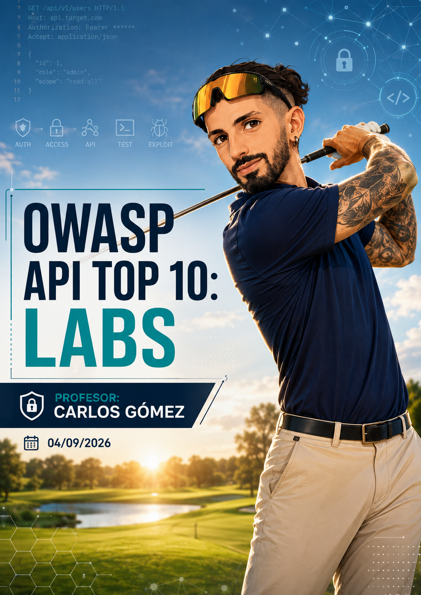

---
tags:
- Auditoría web
date: '2026-09-04'
author: Carlos Gómez
---

# OWASP API Top 10 Labs

2026-09-04 · Carlos Gómez

*Portada ilustrativa generada para los apuntes; no es una captura de clase.*

# 1. Metadatos y criterio de elaboración

| **Campo** | **Información** |
| --- | --- |
| Fecha de clase | 04/09/2026 |
| Profesor | Carlos Gómez |
| Título | OWASP API Top 10: Labs |
| Fuente principal | Transcripción completa de la sesión |
| Laboratorios | Laboratorio online de APIs (Hacker Labs, según la transcripción) y repaso de Hack The Box Starting Point: Meow |
| Objetivo general | Consolidar seguridad de APIs mediante práctica controlada y recuperar la metodología básica de auditoría de servicios. |

|  |
| --- |
| **Criterio de fidelidad**  Los datos de laboratorio, credenciales, endpoints, roles y resultados se incluyen únicamente cuando aparecen en la transcripción. No se inventan IPs, tokens JWT, flags ni salidas. Cuando una línea concreta no quedó inequívoca se marca como “Pendiente de confirmar” o como reconstrucción. |

# 2. Objetivos de la sesión

- Repasar qué es una API, qué es un endpoint y cómo viajan las peticiones HTTP entre cliente y servidor.
- Consolidar el significado práctico de GET, POST, PUT, PATCH, DELETE y OPTIONS en el contexto de una auditoría.
- Relacionar la práctica con el OWASP API Security Top 10 utilizado en clase.
- Aprender a interceptar, repetir y modificar peticiones con Burp Suite y FoxyProxy.
- Enumerar métodos y objetos de una API, detectar fallos de autorización y validar un IDOR/BOLA.
- Comprobar cómo una actualización de propiedades puede provocar una escalada de privilegios dentro de la aplicación.
- Repasar la metodología base de una máquina: ping/ICMP, TTL, Nmap, identificación de servicios, búsqueda de información y acceso controlado a Telnet.
- Entender que cada servicio expuesto exige una metodología de auditoría específica.

# 3. Resumen ejecutivo

La sesión se dividió en tres bloques útiles para el estudio. Primero se comentó una arquitectura de trabajo con agentes de IA, modelos locales y una base de conocimiento en Obsidian, junto con una demostración de clonación de voz enfocada a concienciación frente a suplantaciones. Después se retomó la teoría de APIs y se llevó a un laboratorio práctico: documentación de endpoints, autenticación mediante token, uso de OPTIONS, enumeración de objetos, IDOR/BOLA, modificación de propiedades de usuario y control de acciones administrativas. Finalmente se hizo un repaso de metodología ofensiva con Hack The Box Starting Point “Meow”: ping, TTL, Nmap, Telnet, traceroute y la idea de adaptar el pentest al servicio detectado.

|  |
| --- |
| **Idea central de Carlos Gómez**  Una API debe tratarse como una superficie web más: tiene rutas/endpoints, métodos, parámetros, cabeceras y controles de acceso. El hecho de que una acción no aparezca en el frontend no significa que el backend o la API no la expongan. |

# 4. Preámbulo: IA, agentes y concienciación

## 4.1. Arquitectura de trabajo comentada

Carlos describió una arquitectura orientada a reducir el consumo de tokens en tareas de programación: un modelo/servicio de alto nivel descompone requisitos y genera instrucciones, mientras un modelo local asume la carga de programación. También mencionó el uso de un servidor MCP, agentes/subagentes de supervisión y una bóveda de Obsidian para conservar contexto de proyecto.

- Separar toma de requisitos, diseño y programación como responsabilidades distintas.
- Usar una base de conocimiento de proyecto para mantener contexto, documentación y decisiones.
- Aplicar agentes de supervisión para comprobar que el código cumple los requisitos definidos.
- Elegir recursos según la complejidad real del proyecto: no sobredimensionar una arquitectura si no aporta valor.

|  |
| --- |
| **Información de clase, no especificación técnica**  Las comparaciones de calidad entre modelos y las estimaciones de coste/rendimiento fueron opiniones y previsiones expresadas durante la sesión. No se presentan aquí como benchmarks verificados. |

## 4.2. Clonación de voz y riesgo de suplantación

La clase probó herramientas de clonación de voz y generación de avatar a partir de audio e imagen. Aunque la parte tuvo un tono informal, Carlos la conectó con un riesgo real de seguridad: la suplantación mediante voz o vídeo sintéticos en fraudes y videollamadas empresariales.

- La clonación de voz puede utilizarse para simular a una persona conocida.
- El contexto, la verificación fuera de banda y los procedimientos internos son defensas esenciales frente a solicitudes sensibles.
- Una prueba de identidad no debe basarse únicamente en “reconocer la voz” o “ver la cara” en una videollamada.

# 5. Fundamentos de APIs repasados

## 5.1. API, endpoint y request

En la explicación de clase, una API se presenta como un conjunto de funcionalidades web expuestas mediante rutas. Cada ruta concreta es un endpoint: el punto final al que el cliente envía una request para solicitar una acción o un dato. El backend procesa esa petición y devuelve una respuesta.

**Flujo conceptual visto en clase**

|  |
| --- |
| Cliente → request HTTP → endpoint/API → lógica del backend → respuesta → cliente |

## 5.2. Páginas dinámicas y templates

Carlos volvió al ejemplo de una tienda online: la página mostrada al usuario funciona como una plantilla que se rellena dinámicamente con información obtenida mediante peticiones al backend. El frontend no necesita tener una página estática diferente para cada producto; solicita los datos y actualiza la plantilla.

|  |
| --- |
| **Conexión con la sesión del 03/09**  Esta idea enlaza directamente con la clase anterior: el navegador/cliente pide datos, la API accede a la lógica y a los datos del servidor, y la respuesta termina representándose en la interfaz. |

## 5.3. Métodos HTTP trabajados

| **Método** | **Idea** | **Uso en auditoría/lab** |
| --- | --- | --- |
| GET | Leer/obtener un recurso. | Enumerar un objeto o una colección; comprobar si cambia la respuesta al modificar un ID. |
| POST | Crear un recurso o disparar una acción. | Crear una mascota; login; acciones que escriben o procesan datos. |
| PUT | Reemplazar/actualizar un recurso completo según la implementación. | Modificar propiedades de un usuario o recurso cuando el endpoint lo acepta. |
| PATCH | Modificar parcialmente un recurso. | Cambiar campos concretos; Carlos lo usó como ejemplo de cambio de rol. |
| DELETE | Eliminar un recurso. | Borrar una mascota cuando la autorización lo permite. |
| OPTIONS | Consultar opciones/métodos disponibles para un recurso. | Enumerar métodos habilitados antes de probar acciones. |

|  |
| --- |
| **Ampliación técnica verificada**  La clase se centró en estos métodos, pero HTTP no tiene “solo cinco”. RFC 9110 define GET, HEAD, POST, PUT, DELETE, CONNECT, OPTIONS y TRACE; PATCH está estandarizado aparte. Por tanto, conviene pensar en “métodos relevantes para el endpoint”, no en una lista cerrada de cinco. |

# 6. OWASP API Security Top 10

La nomenclatura repasada en clase corresponde esencialmente a la edición 2019 del OWASP API Security Top 10. Esa edición es especialmente útil para entender el laboratorio porque separa fallos como Excessive Data Exposure y Mass Assignment.

| **ID** | **Riesgo** | **Qué significa** | **Relación con la sesión** |
| --- | --- | --- | --- |
| API1:2019 | Broken Object Level Authorization (BOLA) | IDOR: cambiar/iterar un identificador y acceder a objetos ajenos. | Confirmado en /api/pets/{id}. |
| API2:2019 | Broken User Authentication | Fallos en login, tokens o recuperación de identidad. | Se trabajó autenticación con token, sin explotar esta categoría de forma específica. |
| API3:2019 | Excessive Data Exposure | La API devuelve más datos de los necesarios. | Se observó exposición de campos/objetos durante enumeración. |
| API4:2019 | Lack of Resources & Rate Limiting | Ausencia de límites de uso o frecuencia. | Repasado teóricamente; no se confirmó abuso de rate limit en el lab. |
| API5:2019 | Broken Function Level Authorization | Un usuario alcanza funciones reservadas a roles superiores. | Relacionado con acciones administrativas y diferencias de control por método/token. |
| API6:2019 | Mass Assignment | El backend acepta propiedades que el usuario no debería modificar. | Cambio de role y VIP mediante actualización del recurso de usuario. |
| API7:2019 | Security Misconfiguration | Métodos/configuraciones innecesarias o inseguras. | OPTIONS ayudó a descubrir una superficie amplia de métodos. |
| API8:2019 | Injection | SQL/NoSQL/command injection, etc. | Mencionadas SQLi y XXE como posibilidades de API; no se ejecutaron en este lab. |
| API9:2019 | Improper Assets Management | Versiones/endpoints antiguos o inventario deficiente. | No quedó desarrollado con claridad en la transcripción. |
| API10:2019 | Insufficient Logging & Monitoring | Falta de logs/monitorización útil. | Repasado teóricamente. |

|  |
| --- |
| **Ampliación técnica: edición actual**  OWASP publicó una edición 2023. Entre otros cambios, API3:2023 “Broken Object Property Level Authorization” combina las raíces de API3:2019 (Excessive Data Exposure) y API6:2019 (Mass Assignment). Para estudiar esta clase conviene conservar el mapa 2019 y saber que existe la revisión 2023. |

# 7. Metodología de auditoría de una API

1. Identificar la aplicación y la documentación de API disponible.
2. Interceptar tráfico real del cliente con Burp Suite, usando FoxyProxy para enrutar el navegador al proxy.
3. Mandar peticiones interesantes a Repeater para modificarlas de forma controlada.
4. Enumerar endpoints y métodos; OPTIONS puede revelar qué verbos acepta un recurso.
5. Observar identificadores, nombres de campos y estructuras JSON devueltas por la API.
6. Iterar IDs únicamente dentro del laboratorio autorizado para comprobar autorización a nivel de objeto.
7. Probar cambios de método o de propiedades cuando exista evidencia de que el endpoint los acepta.
8. Comparar respuestas: código de estado, longitud, cuerpo y campos devueltos.
9. No destruir recursos innecesariamente: DELETE puede impedir seguir investigando el laboratorio.

|  |
| --- |
| **Fase de auditoría**  La enumeración de endpoints/métodos y la inspección de respuestas pertenecen al Análisis de vulnerabilidades. Cambiar roles, propiedades o borrar recursos para demostrar impacto entra en Pruebas de explotación controladas. |

# 8. Laboratorio de APIs (Hacker Labs)

## 8.1. Planificación

El laboratorio se abrió como entorno online autorizado. Carlos indicó que contenía varias flags y que el objetivo era aprender el comportamiento de una API probando sus endpoints y métodos. No se incluyó en la transcripción una URL final estable ni el nombre exacto de la máquina, por lo que no se inventan.

|  |
| --- |
| **Pendiente de confirmar**  Nombre exacto de la máquina/laboratorio de Hacker Labs y URL concreta. La transcripción solo deja claro que se trataba de un laboratorio online de APIs. |

## 8.2. Recogida de información: documentación y login

La documentación del laboratorio mostraba, entre otros, endpoints de login, mascotas y usuarios. El primer paquete interceptado fue el login.

**Endpoint interceptado en Burp Suite**

|  |
| --- |
| POST /api/login |

El login devolvía un token JWT para incluirlo en la cabecera Authorization como Bearer. La transcripción recoge dos credenciales de prueba proporcionadas por el propio laboratorio:

| **Usuario** | **Contraseña** | **Resultado observado** |
| --- | --- | --- |
| ana | ana123 | Se obtiene un token de usuario normal; Ana aparece asociada al ID 1 durante la práctica. |
| admin | admin123 | Se obtiene un token de administrador; el usuario admin aparece con ID 3. |

|  |
| --- |
| **Corrección técnica importante sobre JWT**  En clase se dijo que un JWT “va cifrado”. Técnicamente no es obligatorio: RFC 7519 permite JWT firmados/MAC (JWS) y/o cifrados (JWE). Un JWT firmado normal puede leerse en base64url; la confidencialidad de transporte suele depender de TLS. No debemos asumir que “JWT = contenido cifrado”. |

## 8.3. Enumeración de métodos con OPTIONS

Sobre el recurso de mascotas se probó OPTIONS. El laboratorio devolvió los métodos permitidos: GET, POST, PUT, DELETE y OPTIONS. Esa comprobación activó una flag mostrada en pantalla con el nombre “Options Explorer”.

**Evidencia de clase**

|  |
| --- |
| OPTIONS /api/pets → Allow/métodos observados: GET, POST, PUT, DELETE, OPTIONS |

|  |
| --- |
| **Interpretación**  OPTIONS no demuestra por sí solo que cada método sea explotable. Solo revela capacidad/aceptación anunciada. Cada verbo debe validarse con su propio control de autorización. |

## 8.4. Creación y lectura de mascotas

La interfaz permitía crear mascotas. Carlos interceptó la petición y la mandó a Repeater. El método utilizado para crear el recurso fue POST. La respuesta asignó un identificador a la mascota creada (durante la sesión aparecieron IDs 6 y 7 en intentos distintos).

**Estructura observada; el SRT no conserva todo el cuerpo literal**

|  |
| --- |
| POST /api/pets <JSON con datos de la mascota> → recurso creado + ID |

Después se consultó el detalle por identificador:

**Patrón del endpoint de detalle**

|  |
| --- |
| GET /api/pets/{id} |

## 8.5. IDOR / BOLA confirmado

Al cambiar manualmente el ID del recurso se obtuvieron mascotas que no pertenecían al usuario autenticado y que no aparecían en su frontend. Esto confirmó un fallo de autorización a nivel de objeto: el backend devolvía objetos ajenos al usuario al recibir un identificador válido.

**Iteración manual utilizada para observar diferencias**

|  |
| --- |
| GET /api/pets/1 GET /api/pets/2 GET /api/pets/3 GET /api/pets/4 GET /api/pets/5 |

|  |
| --- |
| **Vulnerabilidad confirmada: API1 / BOLA (IDOR)**  El hallazgo no consiste simplemente en “cambiar un número”. Es vulnerabilidad porque el cambio permite acceder a un objeto que el usuario no está autorizado a consultar. Si el mismo patrón fuese una paginación pública de catálogo, no sería un IDOR. |

## 8.6. Diferencias de autorización por método

La sesión mostró que un mismo recurso puede estar bien protegido para una acción y mal protegido para otra. La lectura de mascotas ajenas mediante GET no estaba correctamente restringida, mientras que DELETE exigía privilegios administrativos.

**Resultado observado**

|  |
| --- |
| DELETE /api/pets/{id} → Forbidden con token normal → Operación aceptada al usar un token de administrador |

|  |
| --- |
| **Lección**  La autorización debe evaluarse por endpoint y por método. No basta con que “/api/pets” tenga una política general si GET y DELETE terminan aplicando controles diferentes. |

## 8.7. Enumeración y modificación de usuarios

Al modificar el perfil se interceptó otra familia de endpoints relacionada con usuarios. Consultar un usuario por ID devolvía una estructura JSON con campos como id, role, username y email (según el punto de la práctica).

**Patrón observado**

|  |
| --- |
| GET /api/users/{id} |

Para evitar iterar manualmente, Carlos utilizó Burp Intruder sobre el identificador de la URL y comparó la longitud/respuesta de cada petición. La práctica permitió identificar qué IDs devolvían objetos válidos y cuáles no.

|  |
| --- |
| **Flag observada**  Durante esta enumeración apareció una flag/indicador con el texto “Data Exposed”. La transcripción no contiene el valor de ninguna flag, por lo que no se inventa ni se reproduce uno. |

## 8.8. Cambio de rol y propiedad VIP

A partir de los nombres de campos observados en respuestas anteriores, se probó a actualizar propiedades del usuario. El cambio de role a admin se confirmó en la respuesta y, posteriormente, también se modificó el campo VIP a 1.

**Estructura didáctica reconstruida a partir de la sesión; el SRT alterna verbalmente PUT/PATCH en algunos momentos**

|  |
| --- |
| PUT /api/users/1 {  "role": "admin" }  PUT /api/users/1 {  "vip": 1 } |

|  |
| --- |
| **Vulnerabilidad confirmada: asignación de propiedades no autorizadas**  El backend aceptó cambios en propiedades sensibles como role y VIP. En la clasificación 2019 esto encaja con Mass Assignment (API6); en 2023 se integra dentro de Broken Object Property Level Authorization. |

|  |
| --- |
| **Pendiente de confirmar**  El método exacto usado por el endpoint de usuario aparece transcrito de forma inconsistente como PUT/“putch”/PATCH en distintos momentos. El cambio de propiedades sí quedó confirmado; el verbo exacto debe revisarse con la captura o documentación del lab si se necesita literalidad. |

## 8.9. Token, rol y estado de autorización

Un punto pedagógico importante fue que modificar el campo role en el recurso no hizo que el token de usuario normal adquiriese automáticamente las capacidades del token de administrador. Para DELETE, el laboratorio seguía devolviendo Forbidden hasta utilizar el bearer token de la cuenta admin.

|  |
| --- |
| **Inferencia técnica**  La explicación más probable es que el token contuviese claims/estado de autorización emitidos antes del cambio de role; modificar la base de datos no reescribe un JWT ya emitido. La transcripción no muestra la decodificación del token ni el código del backend, así que esta causa no se da por confirmada. |

## 8.10. Trabajo dejado al alumno

Carlos indicó que la máquina tenía más flags y dejó varias sin resolver para que el alumnado continuase probando la documentación y los endpoints. No se incluye un walkthrough completo ni se inventan las flags restantes.

# 9. Mapa de hallazgos del laboratorio API

| **Evidencia** | **Clasificación** | **Fase** | **Impacto** | **Certeza** |
| --- | --- | --- | --- | --- |
| OPTIONS /api/pets | Métodos expuestos | Análisis de vulnerabilidades | Superficie de ataque ampliada; flag “Options Explorer”. | Confirmado |
| GET /api/pets/{id} | BOLA/IDOR | Análisis de vulnerabilidades | Lectura de mascotas ajenas al usuario autenticado. | Confirmado |
| GET /api/users/{id} | Exposición/enum. de objetos | Análisis de vulnerabilidades | Enumeración de IDs y campos JSON mediante Intruder. | Confirmado |
| Actualización de role | Mass Assignment / property-level auth | Pruebas de explotación controladas | Usuario normal pasa a role=admin en el recurso. | Confirmado |
| Actualización de VIP | Mass Assignment / property-level auth | Pruebas de explotación controladas | vip pasa a 1. | Confirmado |
| DELETE /api/pets/{id} | Broken Function Level Authorization / control por rol | Pruebas de explotación controladas | Con token normal: Forbidden; con token admin: borrado permitido. | Confirmado |

# 10. Peticiones y acciones técnicas vistas

|  |
| --- |
| **Nota**  Las líneas siguientes son patrones de petición/uso vistos o reconstruidos de forma mínima. No contienen IPs, tokens ni valores no presentes en la sesión. |

| **Elemento** | **Objetivo** | **Fase** |
| --- | --- | --- |
| POST /api/login | Autenticarse y obtener un Bearer token. | Pruebas de explotación controladas / acceso al lab |
| OPTIONS /api/pets | Enumerar métodos del recurso. | Análisis de vulnerabilidades |
| GET /api/pets | Listar mascotas visibles al usuario. | Recogida/Análisis |
| POST /api/pets | Crear una mascota. | Prueba funcional del endpoint |
| GET /api/pets/{id} | Consultar una mascota por ID; base para validar BOLA. | Análisis de vulnerabilidades |
| DELETE /api/pets/{id} | Borrar un recurso si la autorización lo permite. | Pruebas de explotación controladas |
| GET /api/users/{id} | Enumerar objetos usuario y campos JSON. | Análisis de vulnerabilidades |
| Burp → Send to Repeater | Repetir y modificar una petición manualmente. | Análisis |
| Burp Intruder sobre ID | Iterar identificadores y comparar respuestas. | Análisis |
| FoxyProxy | Enviar tráfico del navegador al proxy Burp. | Preparación/Recogida |

# 11. Repaso de metodología general: Hack The Box “Meow”

## 11.1. Planificación y recogida de información

En la recta final se reabrió una máquina Starting Point de Hack The Box llamada “Meow”, ya vista anteriormente con otro profesor, para repasar el “sota, caballo y rey” de una auditoría básica antes de aumentar el ritmo de máquinas.

- Partir de una IP objetivo dentro del laboratorio autorizado.
- Comprobar conectividad con ping.
- Recordar que un ping sin respuesta no demuestra que el host esté caído: ICMP puede estar filtrado.
- Como alternativa conceptual se mencionó “TCP ping/tcping” para comprobar disponibilidad a través de TCP.
- Usar el TTL como pista orientativa sobre el sistema operativo, no como identificación concluyente.

|  |
| --- |
| **Corrección técnica: TTL**  Los valores de TTL son heurísticos y disminuyen con los saltos de red. No existe una tabla universal que permita identificar con certeza el sistema operativo solo por TTL. En clase se usó 64 como pista de Linux y 128 como pista de Windows; trátalo como indicio que debe corroborarse. |

## 11.2. Nmap y descubrimiento de servicios

**Escaneo básico mencionado**

|  |
| --- |
| nmap <IP> |

**Reconstrucción del flag explicado para escanear todo el rango de puertos**

|  |
| --- |
| nmap -p- <IP> |

**Reconstrucción de -sV (versiones) + -sC (scripts por defecto), flags explicados en clase**

|  |
| --- |
| nmap -sV -sC <IP> |

|  |
| --- |
| **Corrección técnica verificada de Nmap**  Nmap escanea por defecto los 1.000 puertos más comunes por protocolo, no 10.000. Además, -p- cubre los puertos 1–65535. En la transcripción se mencionaron “10.000” y “65.365”; se corrigen aquí porque son datos técnicos objetivos. |

El resultado relevante de Meow fue el puerto 23/TCP con Telnet. Carlos recalcó que el puerto no es “la vulnerabilidad”: interesa identificar qué servicio y, especialmente, qué versión se está ejecutando para determinar si existe un vector real.

## 11.3. Telnet y acceso inicial

Se buscó información sobre Telnet y se recordó que el protocolo transmite datos sin cifrado a nivel de aplicación, por lo que se considera obsoleto para administración remota frente a alternativas como SSH. En el laboratorio se probó conexión directa:

**Comando visto**

|  |
| --- |
| telnet <IP> |

Al solicitar usuario se probó root, usuario que existe en sistemas Unix/Linux. En la máquina de laboratorio la autenticación permitió entrar y obtener una consola Telnet; desde ella se ejecutó ls y se observó una flag. El valor de la flag no aparece en la transcripción y no se incluye.

|  |
| --- |
| **Fase**  La detección de Telnet pertenece a Recogida de información. Probar el acceso con el usuario root y obtener una shell en la máquina del laboratorio pertenece a Pruebas de explotación controladas. |

## 11.4. traceroute y explicación del TTL 63

La máquina respondió con TTL 63. Carlos lo relacionó con un TTL inicial compatible con 64 menos un salto, y usó traceroute para mostrar que la VPN introducía un salto entre atacante y objetivo.

**Comando mencionado en clase**

|  |
| --- |
| traceroute <IP> |

|  |
| --- |
| **Interpretación**  La idea reutilizable no es memorizar “63 = Linux”, sino entender que el TTL observado ya ha sido decrementado por cada salto. traceroute ayuda a visualizar el camino y contextualizar el valor recibido. |

## 11.5. Cada servicio tiene su metodología

La conclusión de la parte de Meow fue que no se audita igual una web, un recurso SMB/Samba o un Telnet. El flujo inicial (descubrir host → puertos → servicio/versiones) es común, pero después la metodología depende del servicio concreto.

|  |
| --- |
| **Ampliación mencionada en clase: HackTricks**  Carlos presentó HackTricks como referencia práctica para consultar metodologías por servicio (por ejemplo, “Pentesting Telnet”). Debe usarse como apoyo/Ampliación, no como sustituto de la evidencia real del laboratorio ni de documentación oficial. |

# 12. Metodología reutilizable por fases de auditoría

| **Fase** | **Aplicación en esta sesión** |
| --- | --- |
| Planificación | Confirmar que el objetivo pertenece al laboratorio autorizado; entender el alcance y el objetivo de la práctica. |
| Recogida de información | Descubrir conectividad, puertos, servicios, endpoints, documentación, respuestas, IDs y campos disponibles. |
| Análisis de vulnerabilidades | Comparar métodos, iterar IDs de forma controlada, revisar autorización, propiedades editables, versiones y configuraciones. |
| Pruebas de explotación controladas | Demostrar impacto mínimo: leer un objeto ajeno, cambiar un role/VIP en el lab, realizar una acción administrativa autorizada por el entorno o conseguir la shell prevista. |

# 13. Riesgos, errores y buenas prácticas

## 13.1. Errores que conviene evitar

- Confiar en que el frontend oculta una funcionalidad y asumir que el endpoint no existe.
- Proteger GET/POST pero olvidar PUT, PATCH, DELETE u OPTIONS.
- Usar un identificador como si fuese autorización: “si conoce el ID, puede verlo”.
- Permitir que el cliente modifique propiedades sensibles como role, vip, owner o permisos.
- Asumir que un JWT está cifrado por el simple hecho de ser JWT.
- Interpretar un ping sin respuesta como “host caído” sin considerar filtrado ICMP.
- Afirmar que “un puerto es vulnerable” sin identificar servicio, versión y contexto.
- Usar DELETE sin necesidad y destruir evidencia/recursos útiles dentro del laboratorio.
- Copiar una metodología genérica sin adaptarla al servicio que realmente está expuesto.

## 13.2. Buenas prácticas reforzadas

- Aplicar autorización en backend por objeto, función, método y propiedad.
- Usar allowlists de campos editables y no vincular automáticamente todo el JSON a un modelo sensible.
- Rotar/reemitir tokens cuando cambian roles o permisos si el diseño de autorización depende de claims del token.
- Limitar métodos habilitados a los necesarios y revisar la respuesta de OPTIONS.
- Comparar respuesta, status code, longitud y contenido en cada prueba.
- Mantener la metodología por checkpoints: evidencia → interpretación → siguiente comprobación mínima.
- Separar claramente enumeración, vulnerabilidad confirmada y explotación controlada.
- Realizar todas las técnicas únicamente en CTF, laboratorio o auditoría con autorización.

# 14. Conexión con la sesión anterior

La clase del 03/09 introdujo el funcionamiento general de una API, cliente-servidor, endpoints, cabeceras, autenticación/autorización y el riesgo de que la API exponga funcionalidades no visibles en la web. La sesión del 04/09 convirtió esas ideas en peticiones reales dentro de Burp Suite y mostró tres consecuencias prácticas: BOLA/IDOR, modificación de propiedades sensibles y controles de autorización distintos según método/token.

# 15. Resumen para estudiar

- Una API es una interfaz de funciones/endpoints accesible mediante peticiones.
- OPTIONS ayuda a descubrir métodos, pero no demuestra por sí solo una vulnerabilidad.
- BOLA/IDOR aparece cuando el backend no comprueba que el usuario tenga derecho sobre el objeto identificado.
- Modificar role o vip desde el cliente es un fallo grave si esas propiedades no deberían ser editables.
- La autorización debe repetirse en cada operación sensible; GET y DELETE pueden tener controles distintos.
- JWT no significa necesariamente “cifrado”; puede estar firmado y ser legible.
- Burp Repeater sirve para manipulación manual; Intruder sirve para iterar posiciones/IDs y comparar respuestas.
- En una máquina: conectividad → puertos → servicios/versiones → metodología específica del servicio.
- Nmap por defecto revisa los 1.000 puertos más comunes; -p- recorre 1–65535.
- Telnet no cifra el tráfico de aplicación y no debe usarse como alternativa moderna a SSH.

# 16. Checklist de autoevaluación

- ☐ Puedo explicar la diferencia entre endpoint, método, parámetro, cabecera y cuerpo.
- ☐ Sé qué intención tienen GET, POST, PUT, PATCH, DELETE y OPTIONS.
- ☐ Sé explicar por qué OPTIONS es útil durante enumeración.
- ☐ Puedo distinguir autenticación de autorización.
- ☐ Puedo explicar un IDOR/BOLA sin reducirlo a “cambiar el ID”.
- ☐ Entiendo por qué la actualización de role/VIP es un fallo de autorización a nivel de propiedad.
- ☐ Sé por qué cambiar el role en base de datos no implica necesariamente que un JWT emitido cambie.
- ☐ Puedo usar Repeater conceptualmente para modificar una petición y Intruder para iterar una posición.
- ☐ Sé separar Análisis de vulnerabilidades de Pruebas de explotación controladas.
- ☐ Puedo explicar por qué ping sin respuesta no implica host caído.
- ☐ Recuerdo que TTL es solo un indicio y que traceroute ayuda a contextualizarlo.
- ☐ Sé qué aportan nmap, -p-, -sV y -sC.
- ☐ Entiendo por qué cada servicio requiere una metodología de auditoría propia.

# 17. Registro de herramientas

| **Herramienta** | **Objetivo** | **Fase** | **Uso visto** | **Nivel** | **Notas** |
| --- | --- | --- | --- | --- | --- |
| Burp Suite | Interceptar, modificar y repetir peticiones HTTP/API. | Análisis de vulnerabilidades | Proxy, Repeater e Intruder. | Recurrente | Herramienta central del lab. |
| FoxyProxy | Conmutar el proxy del navegador hacia Burp. | Recogida de información | Configuración de navegador. | Practicada | Se instaló/configuró antes del laboratorio. |
| Burp Repeater | Repetición manual de requests. | Análisis de vulnerabilidades | Send to Repeater. | Recurrente | Manipulación de método, ID, JSON y token. |
| Burp Intruder | Iterar una posición y comparar respuestas. | Análisis de vulnerabilidades | Iteración sobre IDs de usuario. | Practicada | Se observó longitud/respuestas. |
| OPTIONS HTTP | Enumerar capacidades del endpoint. | Análisis de vulnerabilidades | OPTIONS /api/pets. | Practicada | Reveló métodos permitidos. |
| Kali Linux | Entorno de auditoría. | Recogida de información | Terminal para HTB. | Recurrente | Usada en el repaso Meow. |
| ping | Comprobar ICMP y observar TTL. | Recogida de información | ping <IP>. | Recurrente | TTL como indicio, no certeza. |
| Nmap | Descubrir puertos/servicios/versiones. | Recogida de información | nmap, -p-, -sV, -sC. | Recurrente | Correcciones técnicas incluidas. |
| traceroute | Visualizar saltos hacia el objetivo. | Recogida de información | traceroute <IP>. | Introducida/repasada | Sirvió para contextualizar TTL 63. |
| Telnet client | Conectar con el servicio Telnet. | Pruebas de explotación controladas | telnet <IP>. | Practicada | Acceso al lab Meow con root. |
| HackTricks | Referencia de metodología por servicio. | Apoyo / Ampliación | Pentesting Methodology / Telnet. | Mencionada | Fuente secundaria; validar con evidencia y docs oficiales. |
| Obsidian | Base de conocimiento de proyectos/agentes. | Metodología de trabajo | Bóveda de proyecto. | Mencionada | Bloque de IA, no parte del lab API. |
| ElevenLabs | Prueba de clonación de voz. | Concienciación | Clonación de voz/avatares. | Introducida | Usada como demostración de riesgo de suplantación. |

# 18. Glosario

| **Término** | **Definición** |
| --- | --- |
| API | Application Programming Interface; interfaz que expone funcionalidades/datos mediante un contrato de comunicación. |
| Endpoint | Ruta concreta de una API donde termina una petición. |
| Request | Petición enviada por el cliente al servidor. |
| Response | Respuesta del servidor, con status, cabeceras y normalmente un cuerpo. |
| Bearer token | Credencial incluida normalmente en Authorization para presentar un token al servidor. |
| JWT | Formato compacto de claims; puede estar firmado/MAC y/o cifrado, no es sinónimo de cifrado. |
| BOLA / IDOR | Fallo de autorización a nivel de objeto: un usuario accede a un recurso ajeno manipulando su identificador. |
| BFLA | Broken Function Level Authorization: acceso a funciones que el rol no debería poder ejecutar. |
| Mass Assignment | Vinculación de propiedades del cliente a un modelo sin filtrar campos sensibles. |
| OPTIONS | Método HTTP para consultar opciones/capacidades de comunicación de un recurso. |
| Intruder | Módulo de Burp Suite para automatizar variaciones de payloads/posiciones y comparar respuestas. |
| Repeater | Módulo de Burp Suite para reenviar manualmente una petición modificada. |
| ICMP | Protocolo usado por ping para mensajes de control/diagnóstico. |
| TTL | Time To Live; contador que disminuye con cada salto. Puede dar pistas sobre el stack, pero no identifica por sí solo el SO. |
| Telnet | Protocolo de terminal remota sin cifrado de aplicación; hoy está desaconsejado para administración. |
| Seguridad por oscuridad | Ocultar un servicio (por ejemplo, en un puerto alto) sin aplicar controles de seguridad reales. |

# 19. Ampliación técnica verificada

Estas correcciones se incluyen separadas del contenido de clase para no mezclar la transcripción con documentación externa:

- OWASP API Security Top 10 2019: lista usada como base conceptual durante la sesión.
- OWASP API Security Top 10 2023: edición actual que reorganiza varias categorías de 2019.
- RFC 7519: un JWT puede usar JWS (firma/MAC) y/o JWE (cifrado).
- RFC 9110: HTTP define más métodos además de los seis trabajados en clase.
- Nmap Network Scanning – Port Specification: por defecto escanea los 1.000 puertos más comunes y -p- significa 1–65535.

| **Referencia** | **URL** |
| --- | --- |
| OWASP API Security Top 10 2019 | https://owasp.org/API-Security/editions/2019/en/0x11-t10/ |
| OWASP API Security Top 10 2023 | https://owasp.org/API-Security/editions/2023/en/0x11-t10/ |
| RFC 7519 – JSON Web Token | https://www.rfc-editor.org/rfc/rfc7519.html |
| RFC 9110 – HTTP Semantics | https://www.rfc-editor.org/rfc/rfc9110.html |
| Nmap – Port Specification and Scan Order | https://nmap.org/book/man-port-specification.html |

# 20. Actualización de memoria del proyecto

| **Categoría** | **Información nueva** | **Certeza** | **Acción futura** |
| --- | --- | --- | --- |
| Sesión | 04/09/2026 · “OWASP API Top 10: Labs” · profesor Carlos Gómez. | Alta | Conectar con 03/09 y con próximos labs de API/HTB. |
| API lab | Laboratorio online de Hacker Labs con documentación de /api/login, /api/pets y /api/users. | Alta | Confirmar nombre exacto del lab si se necesita catalogar. |
| Credenciales de lab | ana/ana123 y admin/admin123 fueron credenciales de prueba mostradas en la sesión. | Alta | No reutilizar fuera de este laboratorio. |
| Vulnerabilidad | BOLA/IDOR confirmado en lectura de mascotas por ID. | Alta | Reforzar API1 y autorización por objeto. |
| Vulnerabilidad | Modificación de role y VIP confirmada; encaja con Mass Assignment/property-level authorization. | Alta | Reforzar API6:2019 y API3:2023. |
| Autorización | DELETE exigió token admin aunque el campo role hubiese sido modificado con token normal. | Alta | Revisar claims JWT y reemisión de tokens. |
| Herramientas | Burp Repeater, Intruder, FoxyProxy y OPTIONS practicados en API lab. | Alta | Usarlos como metodología recurrente de API. |
| HTB | Repaso Starting Point “Meow”: ping, Nmap, Telnet y traceroute; acceso Telnet con root en el lab. | Alta | Conectar con starting points y metodología de servicios. |
| Corrección | Nmap: default 1.000 puertos; -p- = 1–65535. JWT no implica cifrado. | Alta | Mantener correcciones separadas de la explicación literal de clase. |
| IA | Se comentó arquitectura con modelo local, agentes, MCP/CLI y Obsidian; además se probó clonación de voz como concienciación. | Media | No tratar estimaciones de rendimiento/coste como verificadas. |
| Pendiente | Nombre/URL exactos del laboratorio API y verbo literal PUT/PATCH del endpoint de usuario. | Media | Confirmar con vídeo/captura/documentación si hace falta literalidad. |

|  |
| --- |
| **Resumen final**  La sesión convierte la teoría de APIs en metodología práctica: interceptar → documentar endpoints → enumerar métodos → observar IDs/campos → validar autorización → demostrar impacto mínimo. Después vuelve al flujo general de auditoría: conectividad → puertos → servicios/versiones → metodología específica. No memorices solo “qué clic hizo Carlos”; memoriza qué evidencia justificó cada siguiente paso. |
