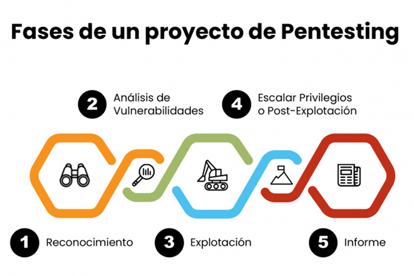

---
tags:
- Auditoría web
---

# Sesion 30 Burp WordPress

**EVOLVE ACADEMY · MÁSTER EN CIBERSEGURIDAD OFENSIVA**

**Sesión del 30 de junio de 2026**

Burp Suite a fondo · Auditoría web · WordPress

**Instructor:** Carlos Gomez (apoyo de Sergio en la introducción a Burp).

**Bloque del curso:** Parte web (la que más cuesta del máster). Continúa lo visto ayer con Castillo sobre Burp Suite y se enlaza con las máquinas RickdiculouslyEasy y Mr. Robot ya resueltas.

**Modalidad:** Teoría de Burp Suite + práctica guiada sobre una máquina de HackersLabs (WordPress). La clase fue "accidentada" por problemas con la Kali, así que parte de la práctica se hizo desde Windows con PowerShell.

| **ℹ️ Contexto de la sesión**  El servicio HTTP/HTTPS es, junto a SMB y FTP, uno de los pocos con metodología de auditoría propia. Por su extensión, la parte web se trata como una **auditoría completa dentro de la auditoría** (se repiten todas las fases: reconocimiento, enumeración, explotación…).  La máquina práctica **no se llegó a explotar por completo**: la clase terminó por problemas técnicos (Kali rota, instalación de Ruby/WPScan en Windows). Lo importante de hoy es **dominar Burp** y entender el flujo de enumeración de un WordPress. |
| --- |

# **1. Objetivos de la sesión**

- Entender **qué es Burp Suite** y definirlo correctamente como un *framework de auditoría web* (no solo "un proxy").
- Comprender el papel del **proxy** como dependencia crítica y por qué interceptar antes de que el paquete salga del navegador nos da el control.
- Configurar el **proxy y el certificado** (Foxy Proxy + certificado de la CA de Burp en Firefox).
- Conocer los módulos principales: **Proxy, Target/Scope, Intruder, Repeater, Decoder, Comparer, Sequencer**.
- Diferenciar controles de seguridad de **front** vs **back**, y el papel del **WAF**.
- Iniciar la auditoría de una web **WordPress**: enumeración con diccionarios de SecLists, fichero hosts, Wappalyzer, HackTricks y WPScan.

# **2. Conceptos clave**

## **2.1. ¿Qué es Burp Suite?**

La definición rápida y correcta es: **Burp Suite es un framework de auditoría web**. Es una recopilación de funcionalidades/herramientas dentro de un mismo programa que permiten realizar multitud de acciones sobre páginas web y, por tanto, auditarlas.

| **⚠️ Error común de definición**  Decir que "Burp es un proxy" es **incompleto**. El proxy es la **funcionalidad principal y dependencia crítica** (sin proxy no se puede operar), pero Burp es mucho más: Repeater, Intruder, Decoder, Comparer, etc. |
| --- |

## **2.2. Front vs Back: dónde tenemos el control**

Una web se compone de **front** (corre en TU ordenador, dentro del navegador) y **back** (corre en el servidor, fuera de tu alcance). El único punto donde tenemos control total es el navegador: ahí se **forja** la petición antes de enviarse por la red.

La idea central de Burp: colocar un **bloqueo (proxy)** justo después de que el front genera la petición y **antes** de que salga del ordenador hacia el back. En ese instante la petición está en **texto claro** (aún no ha entrado el cifrado TLS/SSL de HTTPS) y se puede **leer y modificar**.

| **ℹ️ Analogía de Carlos: "la abuela y el paquete"**  Tú metes unos calcetines (petición legítima) en un buzón. La página web te ve enviarlo y se queda tranquila porque cumpliste sus reglas de seguridad del front. Pero **justo antes de que llegue el cartero**, Chema (Burp) abre el paquete, cambia el contenido y lo vuelve a cerrar.  El servidor (la abuela) recibe algo muy distinto a lo enviado. Si el back no valida bien, "explota". Por eso se pone un **WAF** justo delante para protegerla. |
| --- |

Conclusión: si los controles de seguridad están **solo en el front**, son **bypasseables**. Por eso la tendencia actual es **securizar el back** y validar la **integridad del dato** en el servidor.

| FRONT (tu navegador) — generas la petición · TIENES EL CONTROL |
| --- |

**▼**

| PROXY de Burp intercepta (texto claro, antes de TLS) |
| --- |

**▼**

| Modificas la petición → se salta los controles del front |
| --- |

**▼**

| WAF (Web Application Firewall) — última defensa antes del server |
| --- |

**▼**

| BACK (servidor) — valida integridad del dato (o explota) |
| --- |

## **2.3. Sesiones, cookies e ID de sesión**

Cuando varios usuarios entran a la vez a una web, el servidor no puede servir lo mismo a todos. Asigna a cada uno un **ID de sesión** (cookie tipo SID) que identifica quién es cada cual y qué "plantilla" de la página le corresponde. De ahí la importancia de la **gestión de identidades**.

| **ℹ️ Datos sobre cookies de sesión**  Las cookies se eliminan al cerrar el navegador y **purgar la caché**. Un Ctrl+Shift+R hace un *hard reset* (borra caché → nuevo ID de sesión).  **En informática no existe la aleatoriedad pura**: siempre hay una semilla. Por eso el *Comparer* sirve para buscar patrones en cómo se generan las cookies. |
| --- |
| **🔴 Robo de sesión (laboratorio / concienciación)**  **Session hijacking** (histórico): iterar el ID de la cookie para colarse en la sesión de otro usuario. Muy usado antiguamente en e-commerce. Hoy es complejo por el uso de tokens.  **Robo de cookie de sesión actual:** si se roba la cookie de sesión válida (p. ej. mediante XSS almacenado o phishing avanzado que intercepta el 2FA en tiempo real), se puede mantener acceso durante el tiempo de vida de la cookie **sin usuario, contraseña ni 2FA**. Por eso las cookies de sesión son tan sensibles.  *Solo aplicable en laboratorios y auditorías autorizadas.* |

# **3. Desarrollo técnico: módulos de Burp Suite**

## **3.1. Proxy (corazón de Burp)**

Intercepta la petición entre front y back. Permite **pararla, leerla y modificarla**. Dentro del Proxy:

- **Intercept on/off:** activa/desactiva la retención de paquetes.
- **HTTP History:** historial de todas las peticiones (útil para consultar lo ya capturado, no solo para borrarlo).
- **Proxy Settings → Proxy listeners:** aquí se ve/define el puerto de escucha (por defecto **8080**).

## **3.2. Configuración del proxy: certificado + Foxy Proxy**

Para interceptar HTTPS sin que las webs desconfíen, hay que instalar el **certificado de la CA de Burp** (Burp actúa como entidad certificadora válida, certificado vigente hasta ~2036).

1. Con Burp abierto, ir a http://localhost:8080 (o 127.0.0.1:8080) → botón **CA Certificate** (arriba derecha) → descargar cacert.der.
2. En **Firefox** (recomendado por Carlos): about:preferences → buscar *certificados* → **Configuración avanzada → Administrar certificados → Importar** → seleccionar el cacert → aceptar.
3. Verificar en pestaña **Autoridades**: debe aparecer **PortSwigger** como CA.

Luego se configura el **proxy real** con la extensión **Foxy Proxy** (alternativa a configurar el proxy manualmente en cada web):

1. Instalar Foxy Proxy como extensión de Firefox.
2. Opciones → Proxies → añadir un proxy, nombre **Burp Suite**.
3. Host: 127.0.0.1, Puerto: **8080** (el mismo del *Proxy listener* de Burp).

| **ℹ️ Cómo encaja todo**  Burp levanta su proxy en 127.0.0.1:8080 y se pone a la escucha. **Foxy Proxy reenvía** los paquetes del navegador a Burp, y Burp es quien finalmente los lanza a Internet. Igual que una reverse shell: uno escucha, otro envía. |
| --- |

## **3.3. Target / Scope**

Cuando auditas una web te llega muchísimo ruido (Google Analytics, cookies de terceros, telemetría…). El **Target → Scope** permite añadir solo el dominio objetivo para filtrar y trabajar limpio. Poco usado, pero muy útil.

| **ℹ️ Por qué hay tanto tráfico de fondo**  Aunque estés "quieto" en una web, hay subprocesos en 2º plano (heartbeats, "sigo vivo") manteniendo sesiones: APIs del chat, conectores, comprobaciones de conectividad… Ya se vio este efecto en su día con **Wireshark**. |
| --- |

## **3.4. Intruder (fuerza bruta y fuzzing)**

Permite hacer **fuerza bruta / fuzzing** sustituyendo uno o varios parámetros marcados por las entradas de una *wordlist* (payload). Se vio por primera vez en la máquina **Mr. Robot** (login de WordPress).

| **⚠️ Buena práctica con Intruder**  Marca y fuzzea los parámetros **de uno en uno** (Add/Clear sobre la posición en verde, entre $...$). Cada parámetro controla algo distinto en el back; fuzzear varios a la vez mezcla resultados y no sabes qué provoca qué.  Y recuerda: **sin diccionario (payload) cargado, el ataque no hace nada** ("make sense"). |
| --- |

**Tipos de ataque** (desplegable del Intruder):

| **Tipo** | **Comportamiento** |
| --- | --- |
| Sniper | Un payload por cada posición, una a una (1 lista). |
| Battering ram | El mismo payload en todas las posiciones a la vez. |
| Pitchfork | Una lista por posición, en paralelo (1-1). |
| Cluster bomb | Todas las combinaciones posibles entre listas ("explota todo"). |
| **⚠️ Limitación de la versión Community (gratuita)**  En la versión gratuita el Intruder está **throttled** (limitado en velocidad). Para fuerza bruta seria sobre WordPress es mejor **WPScan**. La versión Pro (~500 €/año) levanta esa limitación. |

## **3.5. Repeater**

Permite **reenviar y repetir** una misma petición tantas veces como quieras, modificándola y viendo cómo responde el servidor. Es como hacer un curl, pero sin lanzarlo desde la sesión activa de pantalla. Ideal para "conocer" la web antes de lanzar una fuerza bruta.

## **3.6. Decoder, Comparer, Sequencer y otros**

| **Módulo** | **Para qué sirve** |
| --- | --- |
| Decoder | Codificar/decodificar (URL-encode, Base64…). Ej.: una cookie con doble Base64 + URL-encode. |
| Comparer | Comparar dos valores (p. ej. varias cookies de sesión) para buscar patrones de generación. |
| Sequencer | Encadenar/analizar secuencias de peticiones (vulnerabilidades que requieren varios paquetes). |
| Logger | Registrar y autenticar peticiones (ataques autenticados con credenciales). |
| Extensions / BApp | Plugins de terceros para detectar vulnerabilidades (mayormente útil en Pro). |
| Collaborator | Detección de interacciones fuera de banda (Pro). |

# **4. Práctica: auditoría de una web WordPress (HackersLabs "Academy")**

| **ℹ️ Sobre la máquina**  Máquina **"Academy"** descargada de **HackersLabs** (plataforma tipo Hack The Box, requiere registro gratuito). Importada en VirtualBox/VMware con la red en **NAT Network** (misma que la Kali).  Por problemas con la Kali, gran parte se hizo desde **Windows con PowerShell**. Aviso de honestidad: en la transcripción **no se llegó a completar la explotación** (instalación de Ruby/WPScan pendiente). |
| --- |

## **4.1. Recordatorio de fases de pentesting**

Repaso pedido en clase del prework:

Cuando aparece un servicio web (puerto 80), se abre una **"subauditoría"** propia y se repiten estas fases sobre la web.

## **4.2. Reconocimiento de red**

Primero localizar la IP de la máquina objetivo en la red interna:

| # En Kali — descubrir hosts de la red interna  netdiscover -r 192.168.1.0/24    # Comprobar tu propia IP y rango primero  ip a |
| --- |
| **⚠️ Incidencia real con la red (Kali en NAT)**  La Kali estaba en **NAT Network** y cogía una IP rara porque el **DHCP** de esa red no estaba habilitado. Solución: habilitar el DHCP de la NAT Network (Archivo → Herramientas → Red) y/o **apagar y encender la tarjeta de red** de la VM.  Por estos problemas se decidió tirar **desde Windows** con PowerShell, curl y diccionarios de SecLists. |

## **4.3. Enumeración web: SecLists + fuzzing de directorios**

**SecLists** es el repositorio de referencia con los mejores diccionarios (contraseñas, fuzzing, discovery, subdominios…). Se descarga como ZIP desde GitHub.

| # SecLists (repositorio de diccionarios) — clonar o descargar ZIP  git clone https://github.com/danielmiessler/SecLists    # Diccionario habitual para fuzzing de directorios:  # SecLists/Discovery/Web-Content/directory-list-2.3-medium.txt |
| --- |

El diccionario por defecto de la mayoría de herramientas (Dirsearch, Gobuster, Feroxbuster) es **directory-list-2.3-medium.txt**. Como la Kali estaba rota, en clase se usó un **script propio en PowerShell** generado con ayuda de Claude para enumerar directorios con curl y un diccionario local.

| **ℹ️ Equivalencias para fuzzear directorios**  En Linux: feroxbuster -u URL -w wordlist, gobuster dir -u URL -w wordlist o dirsearch -u URL.  En Windows/PowerShell se puede replicar la idea con un bucle sobre el diccionario lanzando peticiones con curl y mirando el código de respuesta (200 = existe). |
| --- |

**Resultado de la enumeración:** se encontró un único directorio relevante → /wordpress.

## **4.4. Identificar tecnología: Wappalyzer + fichero hosts**

La extensión **Wappalyzer** (Firefox/Chrome) revela las tecnologías de la web. Aquí la principal: **WordPress** (sobre Apache).

| **ℹ️ Recordatorio de concepto**  Igual que un servidor no es vulnerable (lo es un *servicio en una versión*), **una web no es vulnerable**: lo es **una funcionalidad o tecnología en una versión** (p. ej. un plugin). |
| --- |

La máquina usa un **dominio** (academy.thl/similar). Para que el navegador resuelva ese nombre a la IP hay que editar el fichero **hosts** (somos nuestro propio servidor DNS):

| **Sistema** | **Ruta del fichero hosts** |
| --- | --- |
| Linux | /etc/hosts |
| Windows | C:\Windows\System32\drivers\etc\hosts |
| # Línea a añadir en el fichero hosts (IP <TAB> dominio):  192.168.1.X academy.thl |
| **⚠️ Detalles del hosts en Windows**  Hay que abrir el Bloc de notas **como administrador** para poder guardar.  En el explorador, mostrar **todos los archivos** para ver hosts (no tiene extensión).  Tras añadir el dominio, la web confía más y empieza a servir imágenes/recursos correctamente.  Casi todas las máquinas tipo HTB requieren este paso de mapear DNS → IP. |

## **4.5. Enumeración de WordPress (HackTricks + rutas conocidas)**

**HackTricks** es la "Wikipedia/biblia del hacking". Para WordPress documenta los archivos y rutas típicas a comprobar:

| **Ruta** | **Qué nos dice** |
| --- | --- |
| /wordpress/index.php | Página principal (suele redirigir a la home). |
| /wordpress/license.txt | Si está, confirma WordPress y que la instalación está "recién hecha" (sin limpiar). |
| /wp-login.php | Login. Un **302 redirect** a wp-login indica panel de acceso (igual que en Mr. Robot) → posible fuerza bruta. |
| /wp-admin/ | Panel de administración. |
| /wp-content/uploads/ | Carpeta de subidas. Si hay un *uploader*, posible vector de **file upload** → subir shell. |
| **🔴 Vector de ataque en mente (laboratorio)**  Si se encuentra un punto donde **subir ficheros** (uploader) y luego se pueden **ejecutar**, el vector clásico es: subir una **web shell**, ejecutarla y obtener acceso. Requiere encontrar las dos piezas (subida + ejecución).  *Solo en la máquina de laboratorio autorizada.* |

## **4.6. WPScan (enumeración activa de WordPress)**

**WPScan** es la herramienta clave para enumerar WordPress: detecta versión, **plugins**, **temas** y **usuarios**, y permite fuerza bruta contra el login. Las vulnerabilidades de WordPress suelen venir de **plugins de terceros**, no del core.

Está escrita en **Ruby**. En Kali viene/instala fácil; en Windows requiere instalar Ruby primero (de ahí los problemas de la clase).

| # Instalación en Debian/Kali  sudo apt install -y build-essential ruby ruby-dev  gem install wpscan    # Uso básico: enumerar la web objetivo  wpscan --url http://academy.thl |
| --- |
| **ℹ️ API Token de WPScan**  WPScan ofrece un **API token gratuito** (tras registro) que enriquece los resultados con la base de datos de vulnerabilidades. Se pasa con --api-token <TOKEN>. |
| **⚠️ Estado de la práctica al cierre**  La clase terminó **instalando Ruby/WPScan en Windows** sin llegar a lanzar el escaneo completo ni a la explotación. Carlos lo dejó para la **sesión siguiente**, donde se haría la máquina entera desde Windows (vía WSL si hace falta).  **No se inventan aquí credenciales, versiones, plugins ni flags**: no aparecieron en el material. |

# **5. Herramientas utilizadas en la sesión**

| **Herramienta** | **Objetivo** | **Fase** | **Comando / uso visto** | **Nivel** | **Notas** |
| --- | --- | --- | --- | --- | --- |
| Burp Suite | Framework de auditoría web (proxy, Intruder, Repeater…) | Explotación web | Proxy 127.0.0.1:8080 + CA cert | Practicada | Tu día a día ante cualquier web |
| Foxy Proxy | Conmutar el proxy del navegador hacia Burp | Config. web | Host 127.0.0.1 : 8080 | Introducida | Extensión de Firefox/Chrome |
| Wappalyzer | Detectar tecnologías de la web | Enum. web | Extensión de navegador | Introducida | Detectó WordPress |
| netdiscover | Descubrir hosts de la red interna | Reconocimiento | netdiscover -r <rango> | Practicada | Primer paso en red local |
| SecLists | Diccionarios de fuzzing/contraseñas | Enum. web | directory-list-2.3-medium.txt | Introducida | Repo de referencia en GitHub |
| Feroxbuster / Gobuster / Dirsearch | Fuzzing de directorios web | Enum. web | -u URL -w wordlist | Practicada | Alternativas; en Windows, script propio |
| WPScan | Enumerar WordPress (plugins, users, versión) | Enum. web | wpscan --url <URL> | Introducida | Ruby; API token gratuito |
| HackTricks | Documentación de metodología | Apoyo | Rutas WP, file upload… | Recurrente | "Biblia del hacking" |
| curl | Lanzar peticiones HTTP | Enum. web | Peticiones desde PowerShell | Practicada | Sustituto puntual de Burp/Repeater |
| PowerShell | Entorno alternativo de ataque | Soporte | Scripts de enumeración | Practicada | Plan B cuando la Kali falla |

# **6. Comandos importantes**

| # Reconocimiento de red  ip a  netdiscover -r 192.168.1.0/24    # Diccionarios  git clone https://github.com/danielmiessler/SecLists    # Fichero hosts (mapear dominio -> IP)  # Linux: /etc/hosts  # Windows: C:\Windows\System32\drivers\etc\hosts  192.168.1.X academy.thl    # Rutas WordPress a comprobar  # /wordpress/license.txt /wp-login.php /wp-admin/ /wp-content/uploads/    # WPScan (Kali)  sudo apt install -y build-essential ruby ruby-dev  gem install wpscan  wpscan --url http://academy.thl --api-token <TOKEN> |
| --- |

# **7. Riesgos, errores comunes y buenas prácticas**

| **⚠️ Errores comunes**  Definir Burp solo como "un proxy": es un **framework**; el proxy es su núcleo.  Lanzar el **Intruder sin payload** (no hace nada) o fuzzear varios parámetros a la vez.  Olvidar **instalar el certificado de la CA de Burp** → las webs HTTPS fallan al interceptar.  No habilitar el **DHCP** de la NAT Network → la VM coge IP incorrecta.  Editar el hosts de Windows **sin permisos de administrador** → no deja guardar. |
| --- |
| **✅ Buenas prácticas**  Usar **Target → Scope** para filtrar ruido al auditar.  Conocer **dónde está el control** (front local) frente a lo que corre en el servidor.  Confirmar tecnología con **Wappalyzer** antes de elegir herramienta (WordPress → WPScan).  Mapear siempre **dominio → IP** en el hosts en máquinas tipo HTB.  Tener un **plan B en Windows/PowerShell** por si la Kali falla.  Trabajar **solo en laboratorios y entornos autorizados**. |

# **8. Conexión con sesiones anteriores**

- **Mr. Robot:** ya se vio el **302 redirect a `wp-login.php`** y el uso del **Intruder** para fuerza bruta sobre WordPress. Hoy se formaliza la metodología.
- **RickdiculouslyEasy / Mr. Robot:** se retoma el vector **file upload → web shell**, mencionado hoy como objetivo en wp-content/uploads.
- **Sesión OWASP/Web/Burp (29/06):** introducción a Burp; hoy se completa con la configuración real (proxy + certificado) y todos sus módulos.
- **Wireshark:** el tráfico de fondo "heartbeat" que vimos capturando paquetes explica por qué el Scope de Burp es necesario para filtrar ruido.
- **Fases de pentesting (prework):** se aplican de nuevo, esta vez como subauditoría del servicio web.
- **Fuzzing de directorios:** misma idea que Feroxbuster/Gobuster/Dirsearch de sesiones previas, ahora con SecLists y, en Windows, script propio.

# **9. Resumen final**

Burp Suite es un **framework de auditoría web** cuyo corazón es el **proxy**: interceptamos la petición en el navegador (donde tenemos el control, antes del cifrado TLS) para leerla y modificarla, saltándonos los controles de **front**. La defensa moderna securiza el **back** y añade un **WAF**.

Configuración real: instalar el **certificado de la CA de Burp** y enrutar el navegador con **Foxy Proxy** a 127.0.0.1:8080. Módulos clave: **Proxy, Target/Scope, Intruder** (fuerza bruta/fuzzing con sus 4 tipos de ataque), **Repeater** (repetir peticiones), **Decoder, Comparer, Sequencer**.

En la práctica se inició la auditoría de una web **WordPress**: enumeración de directorios con **SecLists**, identificación con **Wappalyzer**, mapeo de dominio en el fichero **hosts**, rutas típicas vía **HackTricks** y enumeración activa con **WPScan**. La explotación **queda pendiente** para la siguiente sesión por incidencias técnicas (Kali rota, WPScan en Windows).

# **10. Checklist de repaso**

- ¿Sé definir Burp como **framework de auditoría web** y explicar por qué el proxy es dependencia crítica?
- ¿Entiendo la diferencia **front vs back** y dónde tengo el control?
- ¿Sé instalar el **certificado de la CA de Burp** y configurar **Foxy Proxy** (127.0.0.1:8080)?
- ¿Distingo los 4 tipos de ataque del **Intruder** (Sniper, Battering ram, Pitchfork, Cluster bomb)?
- ¿Sé para qué sirven **Repeater, Decoder, Comparer, Sequencer**?
- ¿Entiendo el papel de un **WAF** y por qué los controles de front son bypasseables?
- ¿Sé editar el fichero **hosts** en Linux y Windows para mapear dominio → IP?
- ¿Conozco las rutas típicas de **WordPress** y el vector **file upload → web shell**?
- ¿Sé enumerar WordPress con **WPScan** (versión, plugins, usuarios)?

# **11. Actualización del registro de herramientas**

Para copiar a la base de conocimiento del proyecto. Cambios de esta sesión:

| **Herramienta** | **Nivel anterior** | **Nivel ahora** | **Motivo del cambio** |
| --- | --- | --- | --- |
| Burp Suite | Practicada | Practicada | Sesión completa de módulos y configuración real |
| Foxy Proxy | — (nueva) | Introducida | Configuración del proxy del navegador hacia Burp |
| Wappalyzer | — (nueva) | Introducida | Detección de tecnologías web |
| SecLists | — (nueva) | Introducida | Repositorio de diccionarios para fuzzing |
| WPScan | Mencionada | Introducida | Enumeración activa de WordPress (Ruby + API token) |
| HackTricks | — (referencia) | Recurrente | Metodología y rutas WordPress |
| curl | Practicada | Practicada | Usado como sustituto puntual del Repeater en PowerShell |
| netdiscover | Practicada | Practicada | Reconocimiento de red en la máquina práctica |

| **ℹ️ Pendiente para la próxima sesión**  Completar la máquina **Academy** (WordPress) **desde Windows** (posible WSL): lanzar WPScan completo, fuerza bruta del login si procede y explotación (file upload → shell).  Profundizar en Burp con más ejercicios prácticos hasta final de curso (es herramienta de uso diario). |
| --- |
