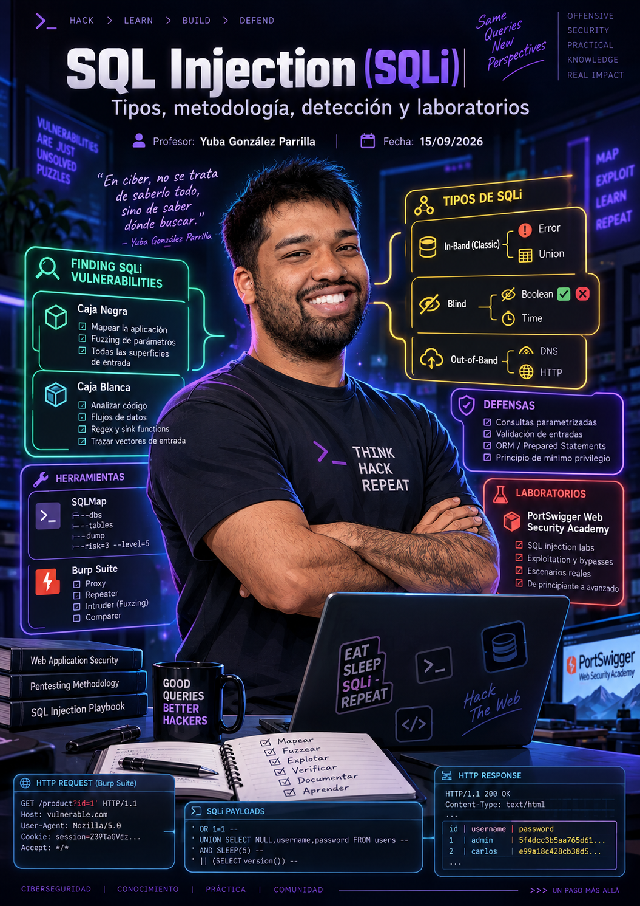
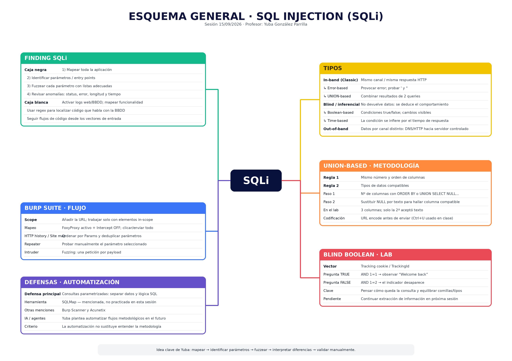

---
tags:
- Auditoría web
date: '2026-09-15'
author: Yuba González Parrilla
---

# SQL Injection

2026-09-15 · Yuba González Parrilla

**SQL Injection (SQLi): tipos, metodología, detección y laboratorios**

**Profesor:** Yuba González Parrilla **· Fecha:** 15/09/2026

|  |
| --- |
| **ℹ Fuente y alcance** Apuntes elaborados a partir de la transcripción completa y del esquema aportado para la sesión. Se han corregido errores evidentes de transcripción (nombres de herramientas y términos técnicos) sin inventar resultados, credenciales, IP, flags ni pasos ausentes. La portada es una ilustración conceptual aprobada y puede contener elementos decorativos que no equivalen a contenido impartido. |

# 1. Objetivos de la sesión

- Repasar la clasificación de SQL Injection según el canal por el que se obtiene la información.
- Construir una metodología para localizar puntos de entrada y posibles SQLi en aplicaciones web.
- Practicar el mapeo de una aplicación con Burp Suite y la identificación de parámetros.
- Entender y aplicar fuzzing sobre parámetros mediante Burp Intruder.
- Repasar Error-based y trabajar la metodología de UNION-based SQLi.
- Introducir Blind Boolean SQLi mediante respuestas condicionales.
- Relacionar las prácticas con defensas básicas, especialmente las consultas parametrizadas.

# 2. Resumen de la clase

**La sesión fue un repaso metodológico y práctico de SQLi.** Yuba organizó las inyecciones SQL en tres grandes familias —In-band, Blind/Inferential y Out-of-band— y puso el énfasis en cómo localizar vulnerabilidades antes de explotarlas: mapear toda la aplicación, identificar parámetros, fuzzearlos y analizar diferencias en las respuestas. La segunda mitad se centró en laboratorios de PortSwigger Web Security Academy, especialmente UNION-based y Blind Boolean.

|  |
| --- |
| **✓ Idea central de la sesión** La explotación no empieza por “probar payloads al azar”, sino por entender la funcionalidad, localizar los entry points, observar cómo responde la aplicación y seguir una metodología reproducible. |

# 3. Recursos recomendados en clase

| **Recurso** | **Uso mencionado en clase** | **Estado** |
| --- | --- | --- |
| PortSwigger Web Security Academy | Laboratorios gratuitos y material de refuerzo para seguridad web. | Usado en la sesión |
| The Web Application Hacker's Handbook | Antecesor conceptual de la Academy; Yuba destacó el capítulo de metodología. | Recomendado |
| BSCP / certificación de PortSwigger | Mencionada como certificación técnica exigente. | Mencionada; detalles no verificados en estos apuntes |

# 4. Clasificación de SQL Injection

**Criterio de clasificación:** cómo recibe el atacante la información o la señal de que la consulta se ha ejecutado.

| **Familia** | **Qué observa el auditor** | **Subtipos vistos** | **Resumen** |
| --- | --- | --- | --- |
| In-band (Classic) | Datos o errores en la misma respuesta HTTP | Error-based, UNION-based | “Lo veo en la respuesta”. |
| Blind / Inferential | No aparecen datos directamente; se deduce por el comportamiento | Boolean-based, Time-based | “Lo deduzco”. |
| Out-of-band | La aplicación no muestra una señal útil; la BBDD conecta a un sistema controlado | DNS/HTTP mediante Collaborator u otro servidor | “Lo recibo por otro canal”. |

## 4.1. In-band: Error-based

Técnica en la que se fuerza un error de la base de datos para obtener información que permita refinar la prueba. En clase se utilizó como ejemplo visual un error de sintaxis SQL.

**Caracteres básicos probados en clase**

|  |
| --- |
| ' " |

|  |
| --- |
| **! Interpretación** Si una comilla simple o doble provoca un error diferente y la respuesta revela información SQL, existe una señal que debe investigarse. Una respuesta distinta es evidencia para analizar, no una vulnerabilidad confirmada por sí sola. |

## 4.2. In-band: UNION-based

UNION permite combinar resultados de dos consultas en un único resultado. **Para que funcione, Yuba remarcó dos reglas:**

1. El número y el orden de columnas deben ser compatibles entre las consultas.

2. Los tipos de datos de las columnas deben ser compatibles.

## 4.3. Blind Boolean-based

Cuando no aparecen datos ni errores directamente, se formulan condiciones verdadero/falso y se observa si cambia algún elemento de la aplicación. El laboratorio utilizó una cookie de tracking y el indicador “Welcome back”.

**Condiciones booleanas empleadas como idea base**

|  |
| --- |
| AND 1=1 AND 1=2 |

|  |
| --- |
| **ℹ Clave técnica** El payload no puede analizarse aislado: hay que pensar cómo quedará insertado dentro de la consulta original y evitar dejar comillas sin cerrar o comparar tipos incompatibles. |

## 4.4. Blind Time-based

La señal no es un cambio visual, sino un retraso provocado deliberadamente en la respuesta. Si una condición hace que el servidor tarde el tiempo esperado, puede inferirse que la consulta se ejecutó. La sesión lo explicó conceptualmente; no se completó un laboratorio Time-based.

## 4.5. Out-of-band

Se utiliza cuando la respuesta HTTP, los errores, el contenido y el tiempo no permiten inferir el resultado. La idea explicada fue forzar a la base de datos a realizar una petición DNS o HTTP hacia un servidor controlado por el auditor, por ejemplo mediante Burp Collaborator.

# 5. Metodología general de auditoría web aplicada a SQLi

| **Fase de auditoría** | **Trabajo realizado en la sesión** | **Resultado buscado** |
| --- | --- | --- |
| Planificación | Definir scope del laboratorio y trabajar sobre aplicaciones autorizadas de PortSwigger. | Delimitar qué host/URL se analiza y evitar tráfico ajeno. |
| Recogida de información | Mapear toda la aplicación, recorrer enlaces/formularios y localizar parámetros. | Inventario de funcionalidades, peticiones y entry points. |
| Análisis de vulnerabilidades | Fuzzing de parámetros y comparación de status code, errores, longitud y tiempo. | Detectar respuestas anómalas que merecen validación manual. |
| Pruebas de explotación controladas | Repeater para Error-based, UNION-based y Blind Boolean en labs. | Confirmar el comportamiento en un entorno de práctica autorizado. |

## 5.1. Caja negra (Black Box)

1. Mapear completamente la aplicación.

2. Identificar parámetros y puntos de entrada.

3. Enviar listas de payloads a cada parámetro; para SQLi, la lista debe cubrir distintos tipos de SQLi.

4. Analizar diferencias y validar manualmente las respuestas interesantes.

|  |
| --- |
| **! Realidad de una auditoría corporativa** Yuba remarcó que una aplicación puede tener decenas o cientos de parámetros y que probar exhaustivamente todas las vulnerabilidades sobre todos ellos puede ser inviable por tiempo. La experiencia ayuda a priorizar, aunque la metodología ideal sea sistemática. |

## 5.2. Caja blanca (White Box)

- Activar los logs del servidor web y de la base de datos.
- Mapear la funcionalidad de la aplicación.
- Usar expresiones regulares (regex) para localizar instancias de código que interactúan con la base de datos.
- Realizar análisis de código siguiendo los flujos desde todos los vectores de entrada.

|  |
| --- |
| **ℹ Contexto de clase** Yuba indicó que la sesión se centraría principalmente en caja negra; la caja blanca se explicó de forma resumida y se relacionó con AppSec/auditoría de código. |

# 6. Parámetros y puntos de entrada

Un parámetro es un punto de entrada donde el usuario introduce información que la aplicación procesa. Puede aparecer en una URL (GET), en el body de una petición (POST), en cookies, cabeceras u otros lugares.

| **Ubicación** | **Ejemplos vistos/mencionados** | **Idea clave** |
| --- | --- | --- |
| GET | category, productId | El parámetro suele aparecer en la URL tras “?”. |
| POST | username, email, password, CSRF token | Los valores aparecen en el body de la petición. |
| Cookie | TrackingId | También puede ser un vector de entrada y fue clave en el lab Boolean. |
| Cabeceras | Host (mencionada como ejemplo) | Algunas cabeceras también pueden comportarse como parámetros de entrada. |

|  |
| --- |
| **✓ Relación parámetro ↔ vulnerabilidad** La funcionalidad donde aparece el parámetro condiciona qué vulnerabilidades tiene sentido probar. Un login, una subida de archivos o un recovery de contraseña no exponen los mismos vectores. |

# 7. Mapeo con Burp Suite

1. Abrir Burp Suite y añadir la URL objetivo en Target → Scope.

2. Mantener FoxyProxy activo para que el tráfico pase por Burp y dejar Intercept en OFF mientras se navega.

3. Recorrer todos los enlaces, botones y formularios relevantes, tanto sin autenticar como autenticado cuando corresponda.

4. Usar HTTP history y/o Site map para revisar el tráfico capturado.

5. Filtrar por elementos in-scope y ordenar por la columna Params.

6. Identificar parámetros únicos; no confundir un mismo parámetro con distintos valores como parámetros diferentes.

7. Enviar peticiones representativas a Repeater para validación manual.

|  |
| --- |
| **! Corrección de transcripción** “Burp”, “FoxyProxy”, “Repeater”, “Intruder”, “HTTP history” y “Site map” aparecen deformados varias veces en la transcripción; se han normalizado a sus nombres reales. |

# 8. Fuzzing de parámetros con Intruder

Fuzzear consiste en enviar muchos valores o payloads distintos a un punto de entrada y observar si alguna respuesta se comporta de forma diferente.

1. Seleccionar una petición y enviarla a Burp Intruder.

2. Limpiar las posiciones y marcar únicamente el parámetro que se quiere probar.

3. Cargar una lista de payloads adecuada al tipo de vulnerabilidad que se busca.

4. Lanzar el ataque y ordenar/comparar resultados.

| **Indicador** | **Qué significa una anomalía** |
| --- | --- |
| Status code | Un 500 frente a respuestas habituales 200/302 puede indicar tratamiento diferente. |
| Error | Un mensaje inesperado puede aportar una pista sobre la lógica o el backend. |
| Length | Una respuesta sensiblemente más larga/corta puede significar contenido diferente. |
| Tiempo / timeout | Un retraso anómalo puede ser relevante, especialmente en pruebas Time-based. |

|  |
| --- |
| **⚠ Importante** Una anomalía no confirma por sí sola una vulnerabilidad. El siguiente paso es reproducirla manualmente y entender por qué la aplicación respondió distinto. |

## 8.1. Calidad de la wordlist/payload list

La lista debe cubrir los tipos de prueba que realmente se quieran detectar. Si se busca Blind Boolean pero la lista no contiene condiciones booleanas, el fuzzing no podrá evidenciar ese comportamiento. Yuba comparó esta idea con la calidad de un diccionario en ataques por diccionario.

# 9. Laboratorio: Error-based SQLi

|  |
| --- |
| **✓ Objetivo de la práctica** Visualizar cómo un carácter especial puede provocar un error que devuelve información útil sobre la consulta SQL. La intención de Yuba no era completar toda la explotación del laboratorio. |

- Se mapeó el laboratorio en Burp y se identificaron parámetros de GET, POST y cookies.
- El enunciado indicaba que una tracking cookie se utilizaba en una consulta SQL.
- Al modificar el TrackingId con una comilla simple, la aplicación devolvió un error con información SQL.
- Con dos comillas el comportamiento cambió, reforzando la necesidad de probar caracteres distintos.

**Idea de la prueba vista (valor exacto de la cookie no documentado)**

|  |
| --- |
| TrackingId=<valor>' |

|  |
| --- |
| **⚠ Evidencia real de la sesión** Se observó una respuesta de error al introducir una comilla simple en el valor vulnerable. No se documentó en la transcripción el contenido completo de la consulta ni se completó la extracción de credenciales. |

# 10. Laboratorio: UNION-based SQLi

## 10.1. Paso 1 — descubrir el número de columnas

Se practicaron dos métodos: incrementar ORDER BY hasta provocar error y aumentar el número de NULL en UNION SELECT hasta obtener una respuesta válida.

**Método ORDER BY mostrado en clase**

|  |
| --- |
| ORDER BY 1 ORDER BY 2 ORDER BY 3 ORDER BY 4 |

**Método con NULL mostrado en clase**

|  |
| --- |
| UNION SELECT NULL UNION SELECT NULL,NULL UNION SELECT NULL,NULL,NULL |

|  |
| --- |
| **✓ Resultado observado en el laboratorio** Con ORDER BY, la petición falló al intentar ordenar por la columna 4, por lo que se dedujo que había 3 columnas. Con UNION SELECT, la respuesta válida se obtuvo con 3 NULL. |

## 10.2. Paso 2 — localizar una columna compatible con texto

Una vez conocido el número de columnas, se sustituyeron los NULL de uno en uno por un string. La columna que acepta texto sin provocar error es útil para devolver información textual.

|  |
| --- |
| **✓ Resultado observado** En el laboratorio practicado, la primera y la tercera posición produjeron error al introducir texto; la segunda fue compatible con texto. |

## 10.3. URL encoding

Antes de enviar determinados caracteres en la petición, Yuba utilizó URL encoding desde Burp y mencionó el atajo Ctrl+U. El objetivo es representar correctamente caracteres especiales dentro de la petición HTTP.

## 10.4. Paso posterior aplazado

Tras identificar número de columnas y una columna textual, el siguiente objetivo sería empezar a extraer información de la base de datos. Yuba mostró de forma breve un ejemplo para obtener la versión de Oracle, pero decidió posponer esta parte para no complicar el laboratorio.

**Ejemplo de Oracle mencionado y aplazado**

|  |
| --- |
| SELECT banner FROM v$version |

# 11. Laboratorio: Blind Boolean SQLi con respuesta condicional

|  |
| --- |
| **✓ Objetivo** Demostrar una SQLi ciega donde la página no devuelve datos de la BBDD ni muestra errores, pero sí cambia un elemento visible en función de que una condición sea verdadera o falsa. |

1. Mapear la aplicación y añadirla al scope de Burp.

2. Identificar las peticiones representativas y enviarlas a Repeater.

3. Localizar la tracking cookie indicada por el enunciado.

4. Añadir una condición que siempre sea verdadera y observar el indicador “Welcome back”.

5. Cambiarla por una condición falsa y comprobar que el indicador desaparece.

6. A partir de esa diferencia, construir preguntas a la base de datos.

|  |
| --- |
| **! Punto crítico explicado por Yuba** Hay que imaginar la consulta original y cómo queda al insertar el payload. Las comillas sueltas o las comparaciones de tipos incorrectos pueden romper la consulta y ocultar la SQLi. |

|  |
| --- |
| **⏳ Pendiente de confirmar / continuar** La sesión terminó cuando se iba a comenzar a preguntar por la tabla users. No se completó en esta clase la extracción carácter a carácter ni el login final. Debe retomarse en una sesión posterior. |

# 12. Automatización, herramientas e IA

Yuba comentó que este proceso es muy metódico y que la automatización mediante agentes de IA puede llegar a ejecutar flujos sistemáticos sobre grandes cantidades de parámetros. Lo presentó como una dirección de futuro, no como una solución actualmente resuelta en la clase.

| **Elemento** | **Qué se dijo** | **Clasificación** |
| --- | --- | --- |
| SQLMap | Herramienta automatizada para SQLi. | Mencionada |
| Burp Scanner | Puede detectar problemas automáticamente. | Mencionada |
| Acunetix | Herramienta de pago mencionada. | Mencionada |
| Agentes de IA | Posible automatización de flujos de mapeo/pruebas sobre parámetros. | Concepto / visión de futuro |

|  |
| --- |
| **ℹ Separación importante** En la sesión no se ejecutó SQLMap, Burp Scanner ni Acunetix. Tampoco se mostró un agente que realizara la auditoría completa. Se mencionaron como automatización o línea futura. |

# 13. Defensa principal: consultas parametrizadas

La defensa destacada fue utilizar consultas parametrizadas. La idea es separar la lógica SQL de los datos proporcionados por el usuario, de modo que la entrada se trate como dato y no como parte ejecutable de la consulta.

|  |
| --- |
| **✓ Buena práctica** El objetivo no es “filtrar algunas comillas” como defensa principal, sino impedir que el input del usuario pueda modificar la estructura de la consulta. |

# 14. Errores frecuentes y buenas prácticas

| **Error / riesgo** | **Consecuencia** | **Buena práctica** |
| --- | --- | --- |
| No mapear la aplicación | Se omiten funcionalidades y parámetros. | Recorrer la aplicación antes de empezar la explotación. |
| Confundir valores con parámetros nuevos | Trabajo duplicado. | Deduplicar por nombre, método y contexto. |
| Wordlist incompleta | Falsos negativos en fuzzing. | Incluir payloads de los tipos que realmente se quieren detectar. |
| Concluir por una sola anomalía | Falso positivo. | Reproducir manualmente y entender la causa. |
| Olvidar el contexto SQL | La consulta se rompe por comillas/tipos. | Pensar cómo se integra el payload en la consulta. |
| No considerar el DBMS | Sintaxis/comentarios incompatibles. | Identificar el gestor cuando la explotación lo requiera. |

# 15. Checklist operativo de la sesión

- Definir scope y confirmar que el entorno está autorizado.
- Mapear todas las funcionalidades accesibles.
- Identificar y deduplicar parámetros.
- Relacionar cada parámetro con su funcionalidad.
- Fuzzear con una lista adecuada y observar status, error, length y tiempo.
- Validar manualmente las anomalías con Repeater.
- Clasificar la posible SQLi: In-band, Blind o Out-of-band.
- Si es UNION-based: nº de columnas → tipos compatibles → extracción posterior.
- Si es Boolean-based: condición verdadera → condición falsa → construir preguntas.
- Documentar evidencia real y no dar por confirmada una vulnerabilidad solo por una diferencia aislada.

# 16. Registro de herramientas

| **Herramienta** | **Objetivo** | **Fase de auditoría** | **Comando/uso visto** | **Nivel** | **Notas** |
| --- | --- | --- | --- | --- | --- |
| Burp Suite | Proxy y análisis manual de tráfico web | Recogida / Análisis / Explotación | Target, Scope, Proxy, HTTP history, Site map, Repeater, Intruder | Recurrente | Herramienta central de la sesión |
| FoxyProxy | Enviar tráfico del navegador a Burp | Recogida de información | Activado mientras Intercept estaba OFF | Practicada | Usado durante el mapeo |
| Burp Repeater | Repetir/modificar peticiones | Pruebas de explotación controladas | Send sobre parámetros y cookies | Practicada | Validación manual |
| Burp Intruder | Fuzzing de parámetros | Análisis de vulnerabilidades | Posición en parámetro + lista de payloads + Start attack | Practicada | Observar status/error/length/time |
| Burp Collaborator | Canal OOB DNS/HTTP | Pruebas de explotación controladas | Concepto mostrado | Introducida | No se practicó un lab OOB |
| PortSwigger Web Security Academy | Laboratorios autorizados | Todas | Labs de SQLi | Recurrente | Base práctica de la sesión |
| SQLMap | Automatización de SQLi | Análisis / Explotación | Solo mencionado | Mencionada | No se ejecutó |
| Acunetix | Escáner web automatizado | Análisis de vulnerabilidades | Solo mencionado | Mencionada | Herramienta de pago según la clase |

# 17. Glosario

| **Término** | **Definición en el contexto de la sesión** |
| --- | --- |
| SQL Injection (SQLi) | Inyección que altera una consulta SQL mediante entrada controlada por el usuario. |
| Entry point | Punto de entrada donde el usuario controla un valor que la aplicación procesa. |
| In-band | Ataque y resultado por el mismo canal. |
| Blind / Inferential | La información se deduce de cambios de comportamiento o tiempo. |
| Out-of-band | La confirmación o los datos salen por un canal alternativo, como DNS/HTTP. |
| Fuzzing | Envío sistemático de múltiples entradas para localizar comportamientos anómalos. |
| Scope | Conjunto de objetivos incluidos en el análisis de Burp. |
| Regex | Lenguaje de patrones para buscar/validar texto; en white box puede ayudar a localizar accesos a BBDD. |
| Consulta parametrizada | Consulta que mantiene separados la lógica SQL y los datos de entrada. |
| URL encoding | Codificación de caracteres para representarlos correctamente en una URL/petición. |

# 18. Conexión con sesiones anteriores y pendientes

- La sesión retomó SQLi ya trabajada con los profesores Carlos y reforzó especialmente la metodología y la clasificación de tipos.
- El laboratorio UNION-based consolidó el flujo ya visto: determinar columnas y localizar una columna de texto.
- El laboratorio Blind Boolean quedó incompleto justo al comenzar la fase de descubrimiento/extracción sobre la tabla users.
- Quedan por profundizar Time-based, Out-of-band y la extracción posterior de información según el DBMS.

# 19. Resumen final para examen / repaso

|  |
| --- |
| **1 SQLi en una frase** La entrada controlada por el usuario llega a una consulta SQL de forma insegura y permite modificar su comportamiento. |

|  |
| --- |
| **2 Tres familias** In-band: veo la información. Blind: la deduzco. Out-of-band: la recibo por otro canal. |

|  |
| --- |
| **3 Metodología** Mapear → parámetros → fuzzing → anomalías → validación manual → explotación controlada. |

|  |
| --- |
| **4 UNION** Mismo número de columnas + tipos compatibles. Después: hallar columna textual y continuar la extracción. |

|  |
| --- |
| **5 Blind Boolean** Comparar una condición verdadera y otra falsa y observar un indicador estable de la aplicación. |

|  |
| --- |
| **6 Defensa** Consultas parametrizadas: el input se procesa como dato, no como lógica SQL. |

# 20. Actualización de memoria del proyecto

| **Categoría** | **Información nueva** | **Nivel de certeza** | **Acción futura** |
| --- | --- | --- | --- |
| Sesión | SQL Injection: tipos, metodología, detección y laboratorios — 15/09/2026 | Alta | Conectar con la siguiente sesión de SQLi |
| Profesor | Yuba González Parrilla | Alta | Mantener identidad visual propia en portadas |
| Metodología | Mapeo → parámetros → fuzzing → validación manual | Alta | Usar como checklist en prácticas web |
| Técnica | UNION: 3 columnas en el lab; 2ª compatible con texto | Alta | Continuar con extracción de información |
| Técnica | Blind Boolean mediante TrackingId y “Welcome back” | Alta | Terminar laboratorio en siguiente sesión |
| Herramientas | Burp Suite (Scope, Proxy, Repeater, Intruder, Collaborator), FoxyProxy, SQLMap, Acunetix | Alta | Actualizar nivel si se practican SQLMap/Acunetix |
| Formato de apuntes | Añadir siempre una hoja de esquema visual tipo XMind/Yuba | Alta | Aplicar desde esta sesión en adelante |
