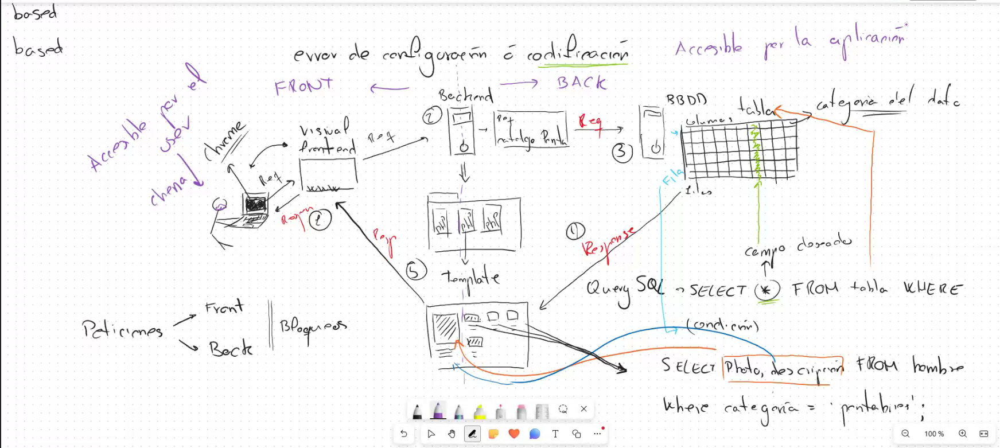
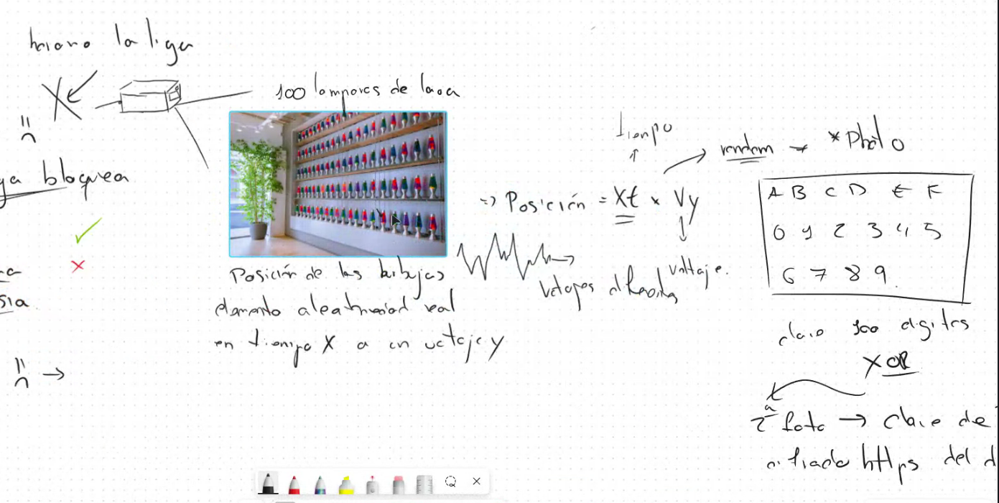
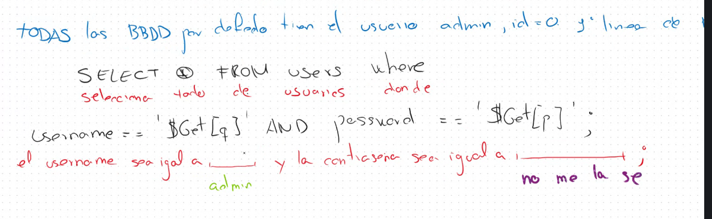
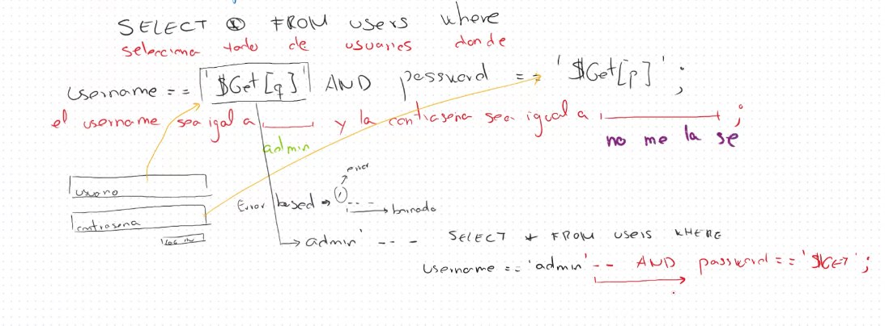
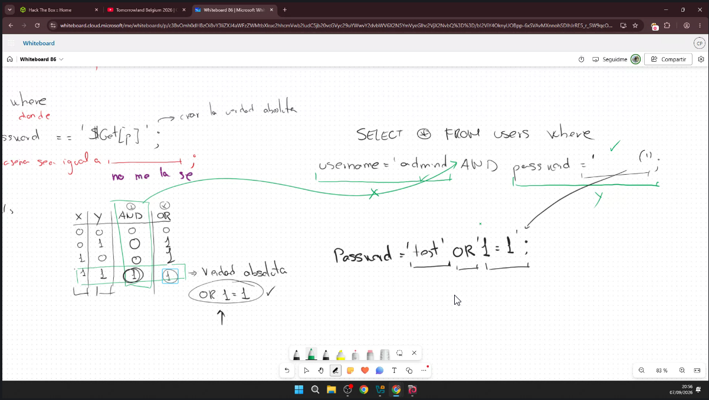
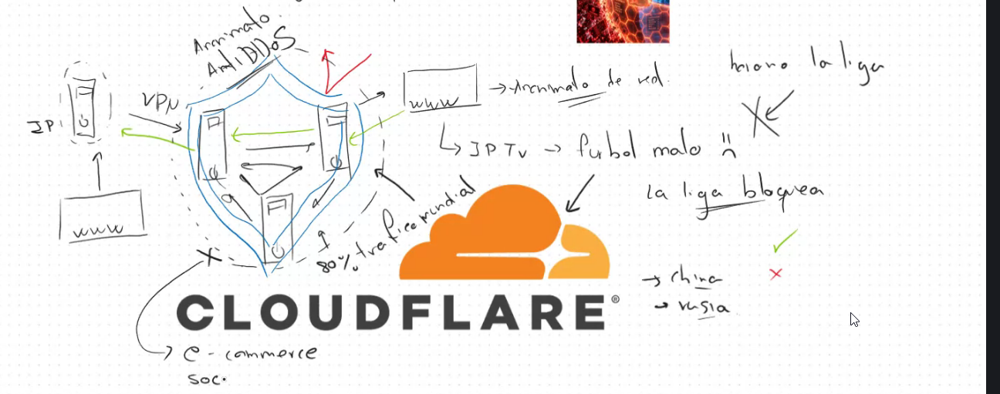
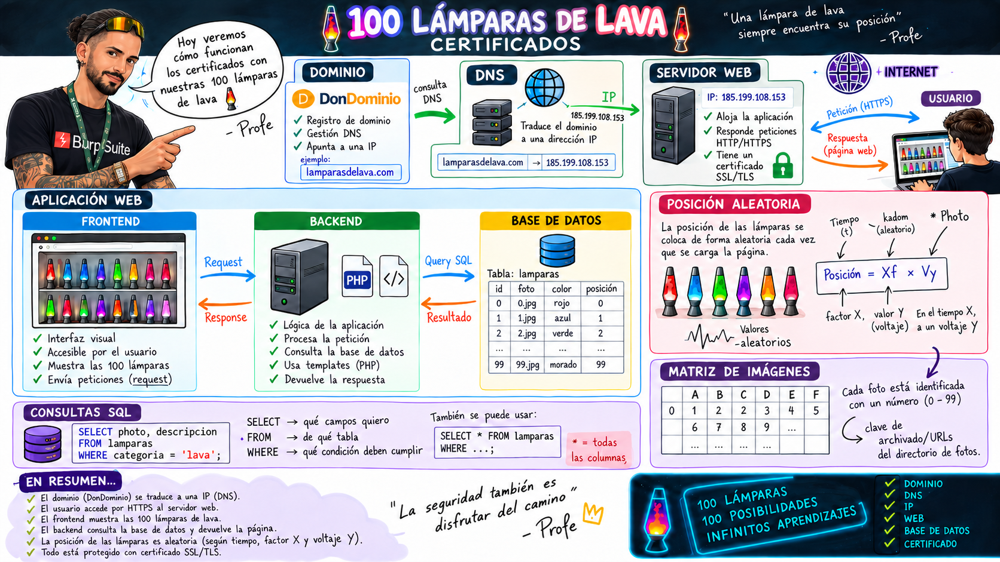

---
tags:
- Auditoría web
date: '2026-09-07'
author: Carlos Gómez
---

# SQLi y fundamentos de SQL

2026-09-07 · Carlos Gómez

SQLi y fundamentos de SQL

Arquitectura web y autenticación

Máster de Ciberseguridad Ofensiva · Evolve Academy

Profesor Carlos Gómez

Fecha de clase 07/09/2026

Apuntes de estudio de Chema

Consultas SQL, flujo de datos y análisis de inyecciones

# Guía de estudio y alcance de la sesión

La inyección SQL aparece cuando una aplicación permite que una entrada del usuario altere la estructura de una consulta. Para entenderla, primero hay que seguir el recorrido de los datos desde el navegador hasta la base de datos y distinguir qué interpreta cada componente.

La clase repasa ese recorrido, introduce la sintaxis de consulta y explica dos alteraciones de un login vulnerable: comentar la comprobación de la contraseña y añadir una condición siempre verdadera. También dedica un bloque a Cloudflare, DNS y aleatoriedad criptográfica.

## Objetivos

• Distinguir navegador, frontend, servidor web, backend y sistema gestor de bases de datos.

• Leer SELECT, FROM y WHERE en lenguaje natural y diferenciar filtrar de ordenar.

• Comprender qué hacen las comillas, los comentarios, AND y OR dentro de una consulta.

• Separar un indicio de SQLi de una vulnerabilidad confirmada y de una explotación completada.

• Entender por qué las consultas parametrizadas corrigen la causa de la inyección.

## Mapa de la grabación

| **Tramo del SRT** | **Contenido académico** |
| --- | --- |
| 00:09–00:29 | Repaso de SQLi y recorrido frontend → backend → base de datos |
| 00:30–01:04 | Controles de seguridad, Cloudflare, DNS y lámparas de lava |
| 01:05–01:10 | Tablas, atributos, consultas, UNION y JOIN |
| 01:42–02:12 | Demostración local de una web y problemas con PHP |
| 02:12–02:25 | Conexión MySQL, consultas del catálogo y errores |
| 02:26–03:03 | Comillas, comentarios y bypass teórico del login |

**Cómo leer estos apuntes.** Los tiempos remiten al SRT entregado. “Contenido de clase” identifica lo explicado o relatado durante la sesión. “Ampliación técnica” incorpora precisiones contrastadas. “Inferencia técnica” expresa una deducción condicionada. “Pendiente de confirmar” identifica evidencias que faltan.

El SRT contiene 3380 bloques y llega hasta las 03:05:07. Se han excluido conversaciones personales, bromas, pausas y repeticiones sin valor académico. Los nombres de profesor y fecha proceden de Chema. Las consultas recompuestas se identifican expresamente; no son capturas de una ejecución real.

# Arquitectura web y recorrido de los datos

Contenido de clase · 00:16–00:29 y 01:42–01:44.

El ejemplo principal es un catálogo de ropa. El usuario selecciona una categoría; el navegador envía una petición; el backend decide qué información necesita y consulta la base de datos. Con el resultado, la aplicación completa una plantilla y devuelve contenido que el navegador representa.

Figura 1. Pizarra original del flujo web. La explicación siguiente precisa sus simplificaciones.

## Un recorrido en cinco pasos

1. El usuario interactúa con el frontend, por ejemplo al pedir el catálogo de pantalones.

2. El navegador envía una request HTTP al servicio web; el backend recibe sus parámetros.

3. El backend construye o prepara la operación y usa una conexión al gestor de bases de datos.

4. El gestor procesa la consulta con los permisos de la cuenta de conexión y devuelve su resultado al backend.

5. El backend devuelve una response. El navegador representa HTML o utiliza los datos recibidos para actualizar la página.

**Ampliación técnica.** Una plantilla no necesita una consulta por cada hueco. Una sola consulta puede recuperar muchas filas y alimentar todo el catálogo. Una aplicación también puede servir contenido estático, usar caché o devolver JSON; el esquema de clase describe un caso, no todas las webs.

SQL es un lenguaje. MySQL es un sistema gestor que implementa un dialecto de ese lenguaje. Una tabla organiza registros en filas y atributos en columnas. La comparación con Excel ayuda a visualizarla, pero un gestor añade consultas, restricciones, concurrencia, permisos y otros mecanismos propios.

La aplicación se ejecuta como un proceso bajo una identidad del sistema operativo. Esa identidad y la cuenta con la que se conecta a MySQL son distintas. El navegador normalmente no recibe las credenciales de conexión ni abre directamente esa conexión.

# Controles de seguridad en el recorrido web

Contenido de clase · 00:29–00:41. Se dibujan filtros antes de la aplicación, controles en el servidor y una barrera adicional hacia la base de datos. El concepto útil es la defensa en profundidad: cada control cubre una parte del recorrido.

| **Componente** | **Función y límite** |
| --- | --- |
| WAF | Inspecciona tráfico HTTP y aplica reglas. Puede bloquear patrones de ataque, pero no corrige una consulta vulnerable. |
| Burp Proxy | Intercepta tráfico entre navegador y servidor para observarlo o modificarlo durante una prueba autorizada. |
| Control del backend | Valida entradas y aplica autenticación y autorización en el servidor. Las consultas parametrizadas separan datos y código SQL. |
| EDR | Detecta y permite responder a actividad en endpoints. No es sinónimo de firewall de red. |
| SIEM | Centraliza y correlaciona eventos. El bloqueo requiere una capacidad de respuesta o una integración; no es inherente a toda correlación. |
| Segmentación de la base de datos | Limita quién puede conectarse al servicio y reduce exposición. Un firewall de red corriente no necesariamente interpreta las consultas SQL. |

**Ampliación técnica y corrección.** Colocar Burp entre el navegador y el servidor no permite saltarse automáticamente un WAF. Una petición modificada sigue atravesando los controles presentes en su ruta. Interceptar puede eludir validaciones ejecutadas solo en el cliente; evadir un WAF concreto exige evidencia adicional. [S1, S2]

## Permitir y bloquear

La clase contrapone allowlists y denylists, denominadas allí whitelist y blacklist. Una allowlist acepta valores previstos; una denylist intenta rechazar valores considerados peligrosos. En la entrada de una aplicación, elegir valores de un conjunto cerrado resulta útil cuando el dato realmente pertenece a ese conjunto.

**Ampliación técnica.** Separar aplicación y base de datos puede mejorar aislamiento y capacidad, pero no elimina una SQLi. Su impacto depende de los privilegios efectivos. Que un mismo gestor aloje varias bases de datos no implica que una cuenta comprometida pueda leerlas todas. [S3]

La validación debe responder a la semántica del dato: formato de un identificador, categoría permitida o tamaño máximo. Prohibir indiscriminadamente comillas puede rechazar nombres legítimos y seguir dejando otras vías de inyección.

# Dominio DNS y Cloudflare

Contenido de clase · 00:40–01:04. El profesor explica el registro de un dominio, la delegación de sus nameservers y el uso de Cloudflare como intermediario. Muestra un panel con opciones de DNS, analítica, seguridad y reglas.

## Qué hace cada pieza

El registrador permite registrar y gestionar el dominio. DNS, Domain Name System, relaciona nombres con registros, entre ellos direcciones IP. Los servidores DNS autoritativos publican los registros de la zona; los resolutores consultan y almacenan respuestas en caché.

Cloudflare puede publicar el DNS y actuar como proxy inverso. Con un registro proxied, la respuesta DNS apunta a direcciones de Cloudflare y las solicitudes web pasan por su red. Con un registro DNS only, el tráfico puede ir directamente al origen. Cambiar los nameservers no equivale necesariamente a transferir el dominio de registrador. [S4, S4b]

**Ampliación técnica.** La expresión de clase “VPN para servidores” es una analogía. El servicio explicado es un proxy inverso. Ocultar la dirección de origen mediante el proxy no garantiza anonimato ni impide por sí solo el acceso directo si la IP se conoce y el origen lo permite.

Una CDN distribuye la entrega de contenidos y puede almacenarlos en caché cerca de los usuarios. Cloudflare también ofrece reglas WAF y otros controles, cuya disponibilidad depende del servicio y del plan. Las tarifas de dominios y prestaciones mencionadas oralmente son referencias de clase, no precios ni condiciones vigentes verificados.

## Bloqueos y disponibilidad

En clase se comentan bloqueos relacionados con LaLiga. La enseñanza técnica es que bloquear una IP compartida puede afectar a servicios distintos del que motiva el bloqueo. Cloudflare y LaLiga publican versiones enfrentadas sobre su alcance: Cloudflare denuncia daños a webs ajenas y LaLiga niega que el bloqueo sea indiscriminado. [S5, S6]

**Pendiente de confirmar.** El SRT no demuestra el porcentaje del 80 % del tráfico mundial atribuido a Cloudflare, ni el supuesto incidente hospitalario y sus consecuencias. Tampoco permite afirmar que el mecanismo de bloqueo consistiera en leer una cabecera HTTP concreta. No se incorporan como hechos confirmados.

## Nota sobre terminaciones de dominio

Ampliación técnica. No todas las terminaciones representan países. IANA clasifica .ai y .tv como dominios de país o territorio, asociados a Anguila y Tuvalu; .cat es un dominio patrocinado. Se omiten las cifras de ingresos y las restricciones caricaturizadas en la conversación. [S7a, S7b, S7c]

# Lámparas de lava y aleatoriedad criptográfica

Contenido de clase · 00:47–00:52. El profesor utiliza las lámparas de lava de Cloudflare para explicar que un fenómeno físico impredecible puede aportar aleatoriedad a la criptografía. El dibujo relaciona movimiento, fotografías y valores usados en el cifrado.

Figura 2. Pizarra original sobre lámparas de lava. La fórmula y el proceso de clave diaria dibujados no son una especificación verificada de LavaRand.

## Ampliación técnica verificada

Cloudflare documenta LavaRand como una fuente adicional de entropía. Las imágenes de fenómenos físicos se incorporan a mecanismos criptográficos que producen aleatoriedad para reforzar los sistemas de sus servidores. La documentación también describe otras fuentes físicas, como péndulos dobles; las lámparas no son la única fuente posible. [S8, S9]

El flujo que interesa recordar es: fenómeno físico → captura → procesamiento y mezcla de entropía → generador criptográficamente seguro → valores aleatorios. Una foto no se convierte, sin más, en una contraseña ni en un certificado.

**Corrección del esquema de clase.** No hay respaldo en las fuentes consultadas para “posición = tiempo × voltaje”, una clave universal de 100 dígitos, el XOR de dos fotografías como clave HTTPS diaria ni una rotación manual decidida por el CEO. Son explicaciones de clase que no deben memorizarse como funcionamiento real.

## Certificado y claves de sesión

Ampliación técnica. Un certificado vincula una identidad con una clave pública. Las claves de tráfico TLS se establecen durante el protocolo de conexión; no existe una única clave HTTPS diaria para todas las webs. En Cloudflare, el tramo navegador–Cloudflare y el tramo Cloudflare–origen tienen configuraciones TLS diferenciadas. Full (strict) cifra hacia el origen y valida su certificado. [S10]

El candado HTTPS acredita una conexión protegida bajo las comprobaciones del navegador; no demuestra que la aplicación carezca de SQLi ni que el contenido del sitio sea legítimo.

# Consultas SQL y selección de datos

Contenido de clase · 00:21–00:24, 00:36–00:37 y 01:05–01:08.

SELECT expresa qué columnas o expresiones se recuperan; FROM indica de qué tabla o conjunto de tablas; WHERE establece qué filas cumplen la condición. El resultado puede contener ninguna fila, una o muchas. La condición no es una fila: es el criterio aplicado a cada registro.

## Ejemplo del catálogo

Reconstrucción normalizada de la pizarra. Se conserva la tabla hombre, los campos photo y descripcion y la categoría pantalones. El acento y los nombres exactos del esquema real no están disponibles.

SELECT photo, descripcion  
FROM hombre  
WHERE categoria = 'pantalones';

| **Fragmento** | **Lectura y función** |
| --- | --- |
| SELECT photo, descripcion | Recupera las columnas de foto y descripción. |
| FROM hombre | Usa la tabla denominada hombre. |
| WHERE categoria = 'pantalones' | Conserva las filas cuyo valor de categoria coincide con ese texto. |
| Comillas simples | Delimitan un literal de texto. No forman parte del nombre de la categoría. |
| Punto y coma | Actúa como terminador en muchos clientes SQL; su necesidad depende de la interfaz que envía la consulta. |

El objetivo del ejemplo es recuperar contenido para una plantilla. El resultado esperado sería un conjunto de fotos y descripciones de los registros coincidentes; no se aporta una salida SQL real ni se conoce cuántos registros hay. Es una consulta de lectura, aunque la confidencialidad depende de qué datos permita leer la cuenta.

## El asterisco

Contenido de clase, con sintaxis normalizada:

SELECT \* FROM users;

El asterisco representa las columnas incluidas por esa selección. No es una función: la escritura SELECT (\*) de algunas pizarras no es la forma a trasladar a MySQL. SELECT ALL y SELECT \* tampoco significan lo mismo: ALL afecta a la conservación de duplicados; \* es la selección de columnas. [S11]

**Ampliación técnica.** Un login no exige SELECT \*. Puede recuperar solo los campos necesarios. Los ejemplos de autenticación de clase usan SELECT \* para simplificar, no como requisito de diseño.

# Filtrar ordenar contar y combinar resultados

Contenido de clase · 01:06–01:10 y 02:18–02:23.

En el segundo bloque aparece la tabla productos con id, nombre, categoria, precio y stock. Se explica una lista sin WHERE y ordenada por nombre.

Reconstrucción normalizada de la consulta dictada:

SELECT id, nombre, categoria, precio, stock  
FROM productos  
ORDER BY nombre;

El objetivo es listar los productos recuperados y ordenar su presentación. La clase no aporta la salida completa. Que una interfaz muestre filtros o selectores permite proponer hipótesis sobre el backend, pero no revela por sí solo su SQL exacto.

| **Operación** | **Ampliación técnica y corrección** |
| --- | --- |
| WHERE | Filtra filas según una condición. |
| ORDER BY | Ordena el resultado; no filtra filas. ASC es ascendente y DESC descendente. Para fechas, lo más reciente primero suele requerir DESC. |
| COUNT | Cuenta filas o valores, según la expresión. No limita la consulta a un registro. |
| LIMIT | Limita cuántas filas se devuelven. Se añade aquí para distinguirlo del COUNT mencionado oralmente. |
| INNER JOIN | Combina filas que satisfacen la condición de unión. |
| LEFT JOIN | Conserva todas las filas del lado izquierdo; cuando falta correspondencia, las columnas derechas quedan en NULL. |
| RIGHT JOIN | Conserva todas las filas del lado derecho. |
| UNION | Combina los resultados compatibles de consultas. No sustituye al JOIN. |

Estas precisiones proceden del manual de MySQL. UNION elimina duplicados por defecto; UNION ALL los conserva. Los resultados combinados deben tener el mismo número de columnas y tipos compatibles. [S11, S12, S13, S14]

**Ampliación técnica.** Escribir varias tablas separadas por comas en FROM puede generar un producto cartesiano. Para relacionar registros hace falta una condición adecuada. La alusión de clase a historia y romance ilustra atributos cualificados, pero no aporta un esquema ni una unión completa que se pueda ejecutar fielmente.

ORDER BY puede usar expresiones o columnas no proyectadas en determinados contextos. Las restricciones dependen de la consulta; no debe aprenderse que siempre tenga que repetir un campo de SELECT. [S11]

# Demostración local del servidor web

Contenido de clase · 01:44–01:59. Entorno relatado: Kali Linux y navegador Mozilla Firefox. El profesor crea una carpeta de ejemplo, levanta un servidor HTTP y accede mediante localhost al puerto 8000.

## Comando principal

La transcripción fragmenta su pronunciación. La forma normalizada, verificada con la documentación de Python, es:

python3 -m http.server

| **Aspecto** | **Explicación** |
| --- | --- |
| Comando | Ejecuta el servidor HTTP de la biblioteca de Python. |
| Opciones | -m ejecuta el módulo http.server. Sin puerto explícito, utiliza 8000. |
| Objetivo | Servir el contenido del directorio de trabajo para visualizar el ejemplo local. |
| Resultado esperado | Peticiones al servidor y acceso al contenido servido mediante el navegador. |
| Resultado relatado | Listado de directorio, acceso a home, respuesta 200 y petición de favicon.ico con 404. |
| Interpretación | El proceso sirve archivos; esos eventos no demuestran ejecución de PHP ni conexión a MySQL. |
| Riesgo | Puede exponer los archivos del directorio a equipos que alcancen el servicio. No es un servidor para producción. |

La dirección de acceso local descrita en la clase es http://localhost:8000/. La ruta / representa la raíz publicada por ese servidor, no necesariamente la raíz del sistema operativo. [S15]

**Ampliación técnica.** Este proceso es el servidor de Python, no Apache. El puerto 8000 es el predeterminado de este comando. 0.0.0.0 representa escucha en todas las interfaces IPv4; 127.0.0.1 es loopback. No son equivalentes.

## Qué cambia al añadir un índice

Se crea la carpeta home y se añaden archivos, entre ellos index.html. La clase muestra que un índice puede sustituir la vista de listado. Eso no hace desaparecer el resto de los recursos: una ruta existente puede seguir respondiendo si el servidor permite su acceso.

La observación se vincula a descubrimiento de contenido web: localizar rutas es Recogida de información. No se documenta una ejecución de un fuzzer ni un comando de DirBuster en esta sesión.

# Por qué falló el catálogo PHP

Contenido de clase · 01:50–02:11. Se solicita a una IA un catálogo sencillo en PHP y después una interfaz HTML con buscador. El ejemplo almacena seis productos en un array; no se demuestra una base de datos real detrás de ese catálogo.

| **Evidencia relatada** | **Interpretación técnica** |
| --- | --- |
| home.txt muestra código en texto plano | El servidor entrega el archivo como contenido. No está ejecutando su PHP. |
| El recurso home se descarga | Su nombre y la forma de servirlo influyen en cómo lo trata el navegador. No prueba una técnica universal de extracción de PHP. |
| home.php devuelve 404 mientras existe home | Son nombres de recurso diferentes. Quitar una extensión no permite obtener arbitrariamente cualquier código fuente. |
| El HTML referencia catalogo.php y el archivo se llama home | Hay una incoherencia entre la ruta solicitada y el recurso disponible. |
| Se reconoce que el servidor no es un servidor PHP | Servir bytes mediante http.server no proporciona un intérprete PHP. |
| Tras varios ajustes siguen las dificultades | No consta una comprobación completa del catálogo y su buscador funcionando. |

**Ampliación técnica.** HTML describe estructura; CSS define presentación; JavaScript puede enviar peticiones, por ejemplo mediante fetch. PHP debe interpretarse en el servidor. El DOM es la representación del documento como objetos y nodos, no el nombre de los navegadores. [S16, S17]

## Rutas y permisos

Una ruta del sistema de archivos y una URL pertenecen a espacios distintos. Copiar una ruta como la del escritorio del servidor dentro de una petición web no garantiza que exista una URL equivalente. El servidor decide qué directorios publica y con qué reglas.

Los permisos de lectura del proceso son relevantes, pero no explican solos una descarga. También importan el directorio publicado, el enrutamiento, el tipo de contenido y si hay un intérprete configurado. No se dispone de la salida íntegra de ls -la para auditar sus permisos exactos.

**Pendiente de confirmar.** No se adjuntaron los ficheros home, home.txt, index.html ni catalogo.php. Tampoco el comando final con el que se intentó ejecutar PHP. No se reconstruye un proyecto funcional ni se presenta el fallo del catálogo como un error de inyección SQL.

Ampliación técnica. PHP dispone de un servidor integrado de desarrollo; también puede ejecutarse con servidores web configurados para ello. ASP.NET es un framework, no el equivalente directo de Apache. La elección de Linux o Windows no impone una única tecnología web. [S16]

# Conexión de la aplicación con MySQL

Contenido de clase · 02:12–02:18. El profesor pide un ejemplo de PHP para conectar con MySQL y comenta sus parámetros. El SRT permite entender sus funciones, pero no recuperar con fiabilidad el código completo.

| **Parámetro explicado** | **Función** |
| --- | --- |
| Host | Identifica dónde se encuentra el gestor. En el ejemplo se habla de una base de datos local. |
| Puerto | Se menciona 3306 para MySQL. Es una referencia de clase; no una detección de red realizada aquí. |
| Base de datos | Se usa tienda como nombre de ejemplo. Un mismo gestor puede alojar varias bases de datos. |
| Usuario y contraseña | Autentican a la aplicación frente al gestor y determinan el acceso concedido. No se proporcionan credenciales reales. |
| Charset | Especifica la codificación de caracteres de la conexión. La transcripción no conserva un valor concreto fiable. |

Una constante mantiene el valor definido durante su uso; una variable puede cambiar. Guardar datos de conexión como constantes no convierte un archivo en seguro. Su protección depende de dónde está, quién lo lee y cómo se gestiona.

## Secretos y privilegios

Contenido de clase. Se propone sacar la contraseña del código y cargarla mediante variables de entorno. El ejemplo de PATH se usa como referencia al concepto de variable de entorno.

**Ampliación técnica.** PATH indica dónde buscar ejecutables; no es el lugar donde guardar una contraseña. Las variables de entorno pueden separar secretos y código, pero también pueden filtrarse. Deben controlarse accesos, registros, copias y configuración de despliegue. La cuenta de la aplicación debería tener solo los permisos necesarios. [S3]

## Gestión de errores

Contenido de clase. Se introduce try-catch para tratar fallos de conexión o de consulta. La utilidad es gestionar el error sin perder el control del flujo de la aplicación.

Ampliación técnica. Un error de conexión, una ruta 404 y un error de sintaxis SQL son eventos distintos. Ninguno demuestra automáticamente SQLi. Mostrar consultas, rutas internas o mensajes detallados del gestor puede facilitar el análisis de una vulnerabilidad; al usuario conviene devolver un mensaje controlado y registrar el detalle en un lugar protegido.

**Inferencia técnica.** La demostración ayuda a identificar capas que comprobar en orden: URL solicitada, recurso publicado, intérprete, conexión y consulta. Sin los archivos ni los registros completos, no puede atribuirse cada fallo a una causa única.

# Inyección SQL e indicios basados en errores

Contenido de clase · 00:13–00:16 y 02:23–02:31.

El problema aparece cuando datos controlados por el usuario pasan a formar parte de la gramática SQL. Una aplicación vulnerable puede concatenar una entrada dentro de una consulta; una comilla introducida en esa entrada puede cerrar un literal antes de lo previsto.

## Nombres introducidos en clase

| **Término** | **Significado preciso para estudiar** |
| --- | --- |
| Blind SQL injection | La respuesta no muestra directamente los resultados relevantes o los detalles de los errores. Se buscan señales indirectas. |
| Error-based | Los errores permiten extraer o inferir información. Un error aislado solo puede ser un indicio. |
| Time-based | Se analiza una señal temporal provocada de forma controlada. Es una forma de SQLi ciega, no una categoría totalmente separada de blind. |

Ampliación técnica. Un cambio de respuesta puede servir como señal booleana; un cambio de tiempo exige descartar variación normal, carga o problemas de red. No se incluyen funciones de retardo ni payloads de extracción porque no se desarrollaron en esta sesión. [S18]

## La prueba de la comilla

El profesor propone introducir una comilla simple en una búsqueda y después añadir un comentario. En el SRT se identifica su codificación URL como %27. Se describe un error que desaparece al completar la entrada con un comentario; no se adjunta una captura de una petición y su respuesta real.

'  
'-- -

Son fragmentos explicados en clase, no payloads universales. Su objetivo es comprobar cómo influye una entrada en el análisis sintáctico. La primera comilla podría romper el literal; la segunda variante podría neutralizar el resto de una consulta vulnerable. El comportamiento depende de la consulta, el motor y las transformaciones aplicadas.

**Ampliación técnica.** Un aviso de “carácter no permitido” puede proceder de una validación o un WAF; no prueba que la comilla haya llegado a MySQL. Que otro intento cambie la respuesta tampoco basta para atribuirlo a SQL sin controles comparables y repetibilidad. [S19]

Fase principal de esta comprobación: Análisis de vulnerabilidades. Si se usa deliberadamente para eludir un control y se verifica ese efecto en un laboratorio autorizado, el paso corresponde a Pruebas de explotación controladas.

# Login vulnerable y uso de comentarios

Contenido de clase · 02:32–02:45. El ejemplo supone que existe un usuario admin y que la consulta concatena los valores recibidos. Son premisas didácticas, no descubrimientos realizados en una máquina.

Consulta normalizada del esquema de clase. USUARIO y CONTRASEÑA son marcadores explicativos:

SELECT \* FROM users  
WHERE username = 'USUARIO'  
AND password = 'CONTRASEÑA';

Ampliación técnica. En MySQL la comparación se escribe =. El == dibujado y dictado no es la sintaxis a copiar. $\_GET['q'] es una expresión PHP para leer un parámetro de la URL, no una instrucción SQL. El esquema mezcla ambos lenguajes para representar el origen de los datos.

## Entrada explicada en el campo de usuario

admin'-- -

Reconstrucción de su efecto si se concatena en una consulta de una sola línea:

SELECT \* FROM users WHERE username = 'admin'-- -' AND password = 'CONTRASEÑA';

La comilla cierra el literal admin. Los dos guiones seguidos de un espacio inician un comentario MySQL; el guion adicional queda dentro del comentario. El resto de esa línea deja de formar parte del SQL ejecutable. La condición efectiva pasa a ser username = 'admin'. [S20]

**Pruebas de explotación controladas.** Objetivo: anular la comparación de contraseña en el supuesto vulnerable. Resultado esperado: recuperar el registro de admin si existe y si la aplicación considera suficiente esa consulta para autenticar. No se documenta aquí una sesión administrativa real obtenida con este payload.

**Ampliación técnica.** Un comentario SQL afecta al texto SQL hasta el fin de línea; no borra un try-catch de PHP ni la validación que se haya ejecutado antes. Si AND aparece en otra línea, el mismo comentario puede no neutralizarlo.

MySQL no crea una tabla users de cada aplicación con admin e id=0. La cuenta administrativa inicial del gestor y los usuarios de la aplicación son objetos distintos. El ID tampoco representa una posición física garantizada. [S21]

# Tablas de verdad y prioridad de operadores

Contenido de clase · 02:51–02:57. La clase utiliza X para la comprobación del usuario e Y para la de la contraseña. En un login simplificado, ambas deben cumplirse para aceptar el registro.

| **X** | **Y** | **X AND Y** | **X OR Y** |
| --- | --- | --- | --- |
| 0 | 0 | 0 | 0 |
| 0 | 1 | 0 | 1 |
| 1 | 0 | 0 | 1 |
| 1 | 1 | 1 | 1 |

AND exige que ambas condiciones sean verdaderas. OR exige que lo sea al menos una. La expresión 1=1 es verdadera: esa es la “verdad absoluta” utilizada en la explicación oral. La tabla corrige los valores intercambiados durante el dictado, cuya confusión se reconoce después en clase.

**Ampliación técnica.** Esta tabla cubre verdadero y falso. SQL también tiene el estado desconocido asociado a NULL. Para seguir el ejemplo de clase basta con el caso binario, pero no debe extrapolarse la tabla a todas las expresiones SQL.

## El matiz que cambia el resultado

En MySQL, AND tiene prioridad sobre OR. Sin paréntesis, la condición:

X AND Y OR verdadero

se agrupa así:

(X AND Y) OR verdadero

No equivale a exigir un usuario concreto y hacer verdadero únicamente el bloque de contraseña. La segunda interpretación requeriría esta agrupación:

X AND (Y OR verdadero)

**Ampliación técnica y corrección.** La explicación de la pizarra trata el OR como si siempre quedara agrupado con la contraseña. Sin esos paréntesis, una tautología final puede hacer verdadera la condición para todas las filas. No garantiza que la aplicación seleccione admin ni que acepte varias filas. [S22]

La consecuencia depende también del código posterior: puede tomar la primera fila, exigir una sola coincidencia o aplicar otras comprobaciones. Esas decisiones no se deducen del formulario y no se aportan en el material.

# Cómo se equilibran las comillas

Contenido de clase · 02:55–03:03. Se intenta introducir test y una condición verdadera aprovechando la comilla final que añade la aplicación. La pizarra y el dictado no conservan una secuencia inequívoca y correcta de todas las comillas.

**Ampliación técnica con reconstrucción explícita.** El siguiente ejemplo normaliza la intención de clase para una consulta que encierra la contraseña entre comillas simples. No se atribuye como transcripción literal ni como ejecución observada.

Entrada en el campo de contraseña:

test' OR '1'='1

Consulta resultante bajo la concatenación vulnerable supuesta:

SELECT \* FROM users  
WHERE username = 'admin'  
AND password = 'test' OR '1'='1';

## Lectura carácter a carácter

1. La aplicación aporta la comilla que abre el valor de password.

2. test es el texto inicial introducido. La comilla que sigue a test cierra ese literal.

3. OR queda fuera del literal y pasa a ser un operador SQL.

4. '1' es el primer operando de la comparación. El signo = queda fuera de sus comillas.

5. La última parte de la entrada abre el segundo '1. La aplicación aporta la comilla de cierre que falta.

El resultado contiene la comparación '1'='1', que es verdadera. Por la prioridad descrita en la página anterior, el WHERE sin paréntesis puede ser verdadero para todas las filas. La entrada tiene cuatro comillas propias; la aplicación añade las dos exteriores del parámetro.

**Ampliación técnica.** Escribir '1=1' como un único literal no expresa una comparación entre dos operandos. Tampoco es correcto afirmar que '1' y 1 nunca pueden compararse como iguales: MySQL admite conversiones implícitas según el contexto. La interpretación debe comprobarse en el motor utilizado. [S23]

## El punto y coma

El navegador no completa sintaxis SQL. Cuando se envía una sola sentencia mediante una API, puede no hacer falta un terminador textual; en un cliente interactivo suele usarse para delimitarla. Un punto y coma situado después de -- y antes del salto de línea forma parte del comentario. No se añade a ciegas como requisito de toda inyección. [S20]

Objetivo y riesgo del ejemplo: estudiar la alteración de autenticación dentro de Pruebas de explotación controladas. No consta la respuesta de una aplicación real a esta reconstrucción.

# Prevención y desarrollo seguro

Contenido de clase · 02:13–02:16 y 02:46–02:51. Se discuten filtros de caracteres y el riesgo de que un generador de código deje pasar una comilla. La enseñanza útil es que una protección incompleta no sustituye a un diseño que separe instrucciones y datos.

## Ampliación técnica

La defensa principal es una consulta parametrizada: el programa define su estructura y suministra los valores por separado. Así, las comillas de una entrada se tratan como datos del parámetro y no se convierten en operadores o delimitadores SQL. OWASP prioriza esta técnica frente al escape manual generalizado. [S3]

En PHP, PDO::prepare permite preparar consultas con marcadores. Los parámetros representan valores completos; no sirven para sustituir sin más nombres de tablas, columnas o palabras como ASC y DESC. Para elecciones estructurales, la aplicación necesita un conjunto controlado de alternativas. [S24]

## Autenticación

El login con comparación directa de password representa el ejemplo vulnerable de clase. Un diseño con contraseñas protegidas recupera el registro necesario y verifica el hash mediante una función adecuada. En PHP, password\_verify compara la contraseña aportada con un hash compatible; no se necesita conocer ni recuperar la contraseña original. [S25]

La aplicación determina después la sesión y los permisos. Un SELECT no devuelve necesariamente una cookie de sesión guardada en la misma fila, ni obliga a recuperar todas las columnas del usuario.

## Controles que complementan la parametrización

• Validar tipo, longitud y valores permitidos según el dato esperado.

• Mantener los secretos fuera del contenido público y de los repositorios distribuidos.

• Restringir los privilegios de la cuenta de conexión y el acceso de red al gestor.

• Gestionar errores sin exponer consultas, credenciales ni rutas internas al usuario.

• Usar el WAF como una capa adicional y revisar las alertas junto a los registros de aplicación.

## Uso de IA durante la sesión

El profesor relata una infraestructura gestionada mediante un agente, API y un servidor MCP; después solicita generación y revisión de PHP y HTML. Son usos descritos, no una arquitectura que se haya inspeccionado en estos apuntes.

**Ampliación técnica.** El modelo genera propuestas; la aplicación agente utiliza herramientas; las API y los servidores ejecutan las operaciones. Conviene limitar permisos, proteger secretos, revisar cambios y conservar versiones recuperables. La demostración del catálogo muestra por qué una respuesta de IA debe contrastarse con ejecución y registros.

# Metodología de auditoría aplicada a la sesión

La sesión aporta fundamentos y ejemplos teóricos para las cuatro fases del proyecto. No contiene una cadena completa de compromiso ni nombres de máquinas resueltas.

| **Fase de auditoría** | **Aplicación al contenido y evidencia necesaria** |
| --- | --- |
| Planificación | Definir el laboratorio autorizado, alcance y objetivo. Identificar qué acciones están permitidas y cómo recuperar el entorno. Los laboratorios anunciados no se identifican en el SRT. |
| Recogida de información | Entender rutas, formularios, parámetros y respuestas normales. En la demo se relatan listado de directorio y archivos del catálogo. No consta un barrido de rutas con herramienta. |
| Análisis de vulnerabilidades | Formular una hipótesis sobre la consulta; comparar respuestas ante cambios controlados. Distinguir sintaxis SQL, validación, WAF y errores de aplicación. |
| Pruebas de explotación controladas | Comprobar, con el mínimo impacto necesario, si una entrada modifica la consulta y elude un control. Los ejemplos de admin y OR se explican en pizarra, sin prueba real completa documentada. |

## Secuencia de trabajo para la siguiente práctica

1. Registrar el comportamiento normal antes de introducir cambios.

2. Identificar un parámetro concreto y plantear qué parte de una consulta podría alimentar.

3. Cambiar una sola cosa por intento y conservar petición y respuesta.

4. Contrastar la hipótesis con intentos de control; repetir si hay variación de red o de aplicación.

5. Si la evidencia permite una prueba de explotación, verificar la identidad y permisos realmente obtenidos.

6. Documentar el impacto demostrado y proponer la corrección en la capa responsable.

**Límite de la evidencia.** Un HTTP 200 no acredita un login válido. Un 404 no acredita SQLi. Un cambio de tiempo no acredita ejecución de un retardo SQL. Una fila recuperada no acredita permisos de administrador. Cada conclusión necesita una observación correspondiente.

## Conexión con sesiones anteriores

El profesor y los alumnos recuerdan explicaciones previas de SQLi, una práctica con Dani, el uso de Burp y un servidor HTTP local. Se registran como referencias orales, sin asignarles fecha, máquina ni resultados no aportados. No se han usado otros apuntes para completar datos de esta clase.

Se anuncian siete laboratorios de diferentes inyecciones, tres máquinas de Hack The Box y una futura sesión de automatización con sqlmap. Son contenidos previstos; no deben marcarse como realizados el 07/09/2026.

# Registro de comandos y herramientas

Las normalizaciones de comandos se basan en lo dictado. La transcripción no sustituye a un historial de terminal y no permite reproducir todos los nombres de carpeta ni todos los comandos introducidos.

| **Comando o uso** | **Objetivo y opciones** | **Evidencia y riesgo** |
| --- | --- | --- |
| ls | Listar entradas del directorio actual. | Se dicta varias veces en la demo. Lectura; no se conserva la salida completa. |
| ls -la | Mostrar detalles y entradas ocultas; -l activa formato largo y -a incluye ocultos. | Se emplea para hablar de archivos y permisos. Puede revelar nombres sensibles si se comparte la salida. |
| cd Desktop | Cambiar al directorio Desktop relativo al actual. | Se dicta en Kali. No se presenta como ruta válida en cualquier equipo. |
| cat index.html | Leer el archivo HTML y localizar referencias al recurso PHP. | Reconstrucción de la lectura relatada; el SRT confunde en un punto cat con car. No se aporta el archivo. |
| python3 -m http.server | Publicar el directorio mediante HTTP; -m ejecuta el módulo. | Comando normalizado de la demo. Véanse explicación, resultados relatados y riesgo en su sección. |

No se inventan las órdenes de creación de carpetas, edición o arranque PHP cuando su forma exacta no queda clara. Las consultas y fragmentos SQLi están documentados con su objetivo y sus supuestos en las secciones anteriores.

## Registro de herramientas de la clase

| **Herramienta** | **Objetivo** | **Fase de auditoría** | **Comando o uso visto** | **Nivel** | **Notas** |
| --- | --- | --- | --- | --- | --- |
| Kali Linux | Entorno de la demo | Planificación | Apertura del entorno | Practicada | No se identifica versión. |
| Python http.server | Servir archivos | Planificación | Arranque local | Practicada | No ejecuta PHP. |
| Firefox | Observar la web | Recogida de información | localhost:8000 | Practicada | Navegador, no DOM. |
| Burp Suite | Inspeccionar peticiones | Análisis de vulnerabilidades | Proxy explicado | Introducida | Sin captura de uso en esta sesión. |
| MySQL | Gestionar datos | Análisis de vulnerabilidades | Conexión y SQL explicados | Introducida | No hay consola SQL real aportada. |
| Cloudflare | DNS y controles web | Planificación | Panel comentado | Introducida | No consta una regla guardada. |
| sqlmap | Automatizar pruebas SQLi | Pruebas de explotación controladas | Anunciado para después | Mencionada | Sin comando ni ejecución. |

# Registro complementario y glosario

El nivel describe la evidencia de esta sesión, no el dominio de Chema sobre la herramienta.

| **Herramienta o tecnología** | **Objetivo** | **Fase de auditoría** | **Comando o uso visto** | **Nivel** | **Notas** |
| --- | --- | --- | --- | --- | --- |
| PHP y HTML | Ejemplo de catálogo | Planificación | Archivos generados y revisados | Practicada | Demostración incompleta. |
| DirBuster y fuzzers | Descubrir recursos web | Recogida de información | Mención de rutas ocultas | Mencionada | No se verifica herramienta exacta para “fuzzes”. |
| DonDominio | Registrar dominio | Planificación | Explicación del registro | Introducida | Sin compra realizada. |
| Claude y Claude Code | Ayudar con código e infraestructura | Planificación | Generación de archivos relatada | Introducida | No se confirma la interfaz ni el modelo de cada intervención. |
| API y MCP | Conectar herramientas y servicios | Planificación | Relato de automatización | Mencionada | Sin configuración inspeccionada. |
| Hack The Box | Práctica autorizada | Planificación | Máquinas anunciadas | Mencionada | Ninguna identificada o resuelta. |
| SonarQube | Análisis de código | Análisis de vulnerabilidades | Alusión a desarrollo seguro | Mencionada | Sin análisis ejecutado. |

## Glosario de consulta

| **Término** | **Significado** |
| --- | --- |
| Request y response | Petición del cliente y respuesta del servidor. |
| Frontend y backend | Parte de la aplicación del lado cliente y lógica ejecutada del lado servidor. |
| Template | Plantilla que se completa con datos para producir contenido. |
| API | Interfaz que ofrece operaciones a otros componentes o aplicaciones. |
| Query | Consulta u operación dirigida al gestor de datos. |
| Literal | Valor escrito directamente en una expresión, como un texto entre comillas. |
| Payload | Entrada preparada para provocar un comportamiento concreto durante una prueba. |
| Tautología | Condición que es siempre verdadera, como 1=1. |
| Entropía y CSPRNG | Imprevisibilidad aportada a un sistema y generador pseudoaleatorio apto para usos criptográficos. |
| Proxy inverso | Intermediario que recibe solicitudes destinadas a servicios de origen. |
| TLS | Protocolo que protege la comunicación; HTTPS utiliza HTTP sobre TLS. |

# Repaso y comprobación de comprensión

## Lo que debe quedar claro

El navegador pide recursos; el backend decide las operaciones; el gestor interpreta SQL. Una inyección permite que una entrada cambie la consulta porque no se ha mantenido la separación entre datos y código. Ni el uso de HTTPS, ni un proxy, ni la separación de servidores corrigen por sí solos esa mezcla.

## Preguntas de repaso

| **Pregunta** | **Respuesta breve** |
| --- | --- |
| ¿SQL es una base de datos? | Es un lenguaje. MySQL es un gestor de bases de datos. |
| ¿Qué distingue WHERE de ORDER BY? | WHERE selecciona filas; ORDER BY ordena el resultado. |
| ¿Por qué una comilla puede causar un error? | Puede cerrar un literal y dejar una estructura SQL inválida si la entrada se concatena. |
| ¿Qué comenta -- en MySQL? | El resto de la línea, si se cumple el requisito de espacio o carácter de control tras el segundo guion. |
| ¿Un comentario SQL elimina un catch de PHP? | No. Son lenguajes y etapas de interpretación diferentes. |
| ¿X AND Y OR verdadero exige que X sea verdad? | Sin paréntesis, no: AND se agrupa antes y el OR final hace verdadera la expresión. |
| ¿Usar admin garantiza un administrador? | No. Su existencia, el rol, el ID y la selección de filas dependen de la aplicación. |
| ¿Qué corrige la causa de SQLi? | Separar estructura y valores mediante parametrización adecuada. |

## Checklist para estudiar antes del laboratorio

• Puedo dibujar el recorrido de una petición y explicar quién consulta la base de datos.

• Puedo leer las consultas del catálogo sin confundir columnas, tablas y condiciones.

• Puedo distinguir el texto introducido en el formulario de la consulta completa que lo incorpora.

• Puedo señalar qué comillas aporta la aplicación y cuáles aporta la entrada del ejemplo.

• Puedo evaluar AND y OR, aplicando su prioridad y los paréntesis reales.

• Puedo explicar por qué el fallo del catálogo PHP no demuestra una inyección SQL.

• Puedo justificar cada conclusión con una petición, una respuesta o una revisión de código.

## Pendientes para la siguiente sesión

Identificar los laboratorios y máquinas concretos; conservar peticiones y respuestas de las pruebas; obtener los archivos de la demo si se desea reproducirla; practicar las variantes de SQLi anunciadas y registrar la ejecución de sqlmap cuando realmente se produzca.

# Láminas originales de autenticación

Estas capturas conservan el contexto visual de la pizarra. Su sintaxis es esquemática: para estudiar se deben usar las precisiones sobre =, comentarios, comillas y prioridad de operadores incluidas en el desarrollo.

Figura 3. Consulta de autenticación y variables del formulario. La afirmación sobre admin e id=0 se corrige en los apuntes.

Figura 4. Explicación del comentario aplicado a la comprobación de contraseña.

Figura 5. Tabla de verdad y ejemplo de OR. El entrecomillado se reconstruye y la agrupación lógica se precisa en el texto.

# Láminas de apoyo sobre arquitectura y protección

Figura 6. Pizarra de Cloudflare. VPN, anonimato y 80 % son anotaciones originales que no se adoptan como descripciones verificadas.

Figura 7. Infografía aportada durante la conversación y comentada en clase. Reúne el catálogo y las lámparas de lava, que son ejemplos distintos.

**Lectura de la infografía.** La matriz de imágenes y las posiciones aleatorias de un catálogo no describen el sistema de generación de entropía de Cloudflare. El dominio y la IP visibles pertenecen al ejemplo gráfico: no son un objetivo autorizado ni una infraestructura comprobada. La ilustración tampoco acredita una implementación real de certificados.

Se ha utilizado la imagen elegida por Chema en la portada. Las capturas repetidas del esquema de arquitectura y los dos encuadres de Cloudflare se han consolidado para evitar duplicación del contenido.

# Fuentes para las ampliaciones técnicas

Fuente principal de clase: SQLi - Fundamentos de SQL Evolve.srt y las imágenes entregadas por Chema. Las referencias S1–S25 se usan para precisar conceptos; no acreditan resultados del laboratorio. Consulta documental realizada el 08/09/2026, distinta de la fecha de clase.

**S1** [PortSwigger · Burp Proxy](https://portswigger.net/burp/documentation/desktop/tools/proxy)

**S2** [Cloudflare · Web Application Firewall](https://developers.cloudflare.com/waf/)

**S3** [OWASP · SQL Injection Prevention Cheat Sheet](https://cheatsheetseries.owasp.org/cheatsheets/SQL_Injection_Prevention_Cheat_Sheet.html)

**S4** [Cloudflare · Proxy status y DNS setups](https://developers.cloudflare.com/dns/proxy-status/)

**S4b** [Cloudflare · Tipos de configuración DNS](https://developers.cloudflare.com/dns/zone-setups/)

**S5** [Cloudflare · Informe de transparencia y bloqueo de IP compartidas](https://blog.cloudflare.com/h1-2025-transparency-report/)

**S6** [LaLiga · Comunicado sobre bloqueos de IP](https://www.laliga.com/en-GB/news/official-statement-in-relation-to-the-blocking-of-ips-during-the-recent-ea-sports-laliga-matchdays-linked-to-illegal-cloudflare-practices)

**S7a** [IANA · Delegación del dominio .ai](https://www.iana.org/domains/root/db/ai.html)

**S7b** [IANA · Delegación del dominio .tv](https://www.iana.org/domains/root/db/tv.html)

**S7c** [IANA · Delegación del dominio .cat](https://www.iana.org/domains/root/db/cat.html)

**S8** [Cloudflare · Randomness 101 LavaRand in Production](https://blog.cloudflare.com/randomness-101-lavarand-in-production/)

**S9** [Cloudflare · Harnessing chaos in Cloudflare offices](https://blog.cloudflare.com/harnessing-office-chaos/)

**S10** [Cloudflare · Modo TLS Full strict](https://developers.cloudflare.com/ssl/origin-configuration/ssl-modes/full-strict/)

**S11** [MySQL 8.4 · SELECT Statement](https://dev.mysql.com/doc/refman/8.4/en/select.html)

**S12** [MySQL 8.4 · Aggregate Function Descriptions](https://dev.mysql.com/doc/refman/8.4/en/aggregate-functions.html)

# Fuentes sobre SQL y ejecución web

**S13** [MySQL 8.4 · JOIN Clause](https://dev.mysql.com/doc/refman/8.4/en/join.html)

**S14** [MySQL 8.4 · UNION Clause](https://dev.mysql.com/doc/refman/8.4/en/union.html)

**S15** [Python · http.server](https://docs.python.org/3/library/http.server.html)

**S16** [PHP · Built in web server](https://www.php.net/manual/en/features.commandline.webserver.php)

**S17** [MDN · Document Object Model](https://developer.mozilla.org/en-US/docs/Web/API/Document_Object_Model)

**S18** [PortSwigger · Blind SQL injection y errores condicionales](https://portswigger.net/web-security/sql-injection/blind)

**S19** [PortSwigger · SQL injection](https://portswigger.net/web-security/sql-injection)

**S20** [MySQL 8.4 · Comments](https://dev.mysql.com/doc/refman/8.4/en/comments.html)

**S21** [MySQL 8.4 · Securing the Initial MySQL Account](https://dev.mysql.com/doc/refman/8.4/en/default-privileges.html)

**S22** [MySQL 8.4 · Operator Precedence](https://dev.mysql.com/doc/refman/8.4/en/operator-precedence.html)

**S23** [MySQL 8.4 · Type Conversion in Expression Evaluation](https://dev.mysql.com/doc/refman/8.4/en/type-conversion.html)

**S24** [PHP · PDO prepare](https://www.php.net/manual/en/pdo.prepare.php)

**S25** [PHP · password\_verify](https://www.php.net/manual/en/function.password-verify.php)

## Criterio para reutilizar estos ejemplos

El manual MySQL 8.4 se utiliza para verificar la sintaxis y las precisiones indicadas. Esto no significa que la demo usara esa versión: la versión de MySQL no se identifica en el material. Los comandos del servidor Python se normalizan a partir de su documentación, sin atribuir una versión de Python a la máquina de clase.

Las páginas de Cloudflare y LaLiga sobre bloqueos son declaraciones de las partes. Se emplean para distinguir lo documentado de las afirmaciones orales, no para dar por probadas cifras o incidentes concretos ausentes de la evidencia.

# Actualización de memoria del proyecto

Registro nuevo de esta sesión. “Alta” puede indicar certeza de que un tema se explicó; no convierte en cierta una afirmación técnica corregida dentro de los apuntes.

| **Categoría** | **Información nueva** | **Nivel de certeza** | **Acción futura** |
| --- | --- | --- | --- |
| Sesión | SQLi y fundamentos de SQL. Carlos Gómez. 07/09/2026. Metadatos facilitados por Chema. | Alta | Enlazar las prácticas posteriores con esta base teórica. |
| Material | SRT completo y capturas de arquitectura, Cloudflare, aleatoriedad y autenticación. Portada elegida por Chema. | Alta | Conservar las referencias visuales con sus correcciones. |
| Entorno | Demostración relatada en Kali y Firefox con servidor HTTP local en 8000. | Alta | Confirmar versiones solo si son relevantes para reproducirla. |
| Laboratorio | Se anuncia trabajo futuro con siete laboratorios y tres máquinas HTB; no se identifican ni se resuelven en el material. | Alta | Pedir o registrar nombres al recibir la práctica. |
| Web y SQL | Flujo cliente–backend–gestor; SELECT, FROM, WHERE, ORDER BY y conexión MySQL. | Alta | Practicar consultas sobre un esquema conocido. |
| SQLi | Comillas, comentario -- y tautología con OR explicados en pizarra. No consta un login real comprometido. | Alta | Conservar evidencia de cada prueba futura. |
| Correcciones | admin/id=0 no es universal; AND precede a OR; JOIN difiere de UNION; Python HTTP no ejecuta PHP. | Alta | Aplicar estas precisiones en los siguientes apuntes. |
| Cloudflare | Proxy inverso, DNS y WAF; LavaRand como entropía adicional, sin clave HTTPS diaria universal. | Alta | Evitar reutilizar literalmente la infografía como especificación. |
| Herramientas | sqlmap, DirBuster y SonarQube mencionados; sin ejecución acreditada. | Alta | Actualizar su nivel cuando se practiquen. |
| IA | Relato de gestión por API/MCP y generación de PHP/HTML; interfaz y modelo exactos no acreditados. | Media | Distinguir modelo, agente, herramienta y servicio. |
| Pendientes | Faltan archivos originales del catálogo, arranque PHP final y pruebas HTTP/SQL completas. | Alta | Incorporarlos si Chema los aporta. |
